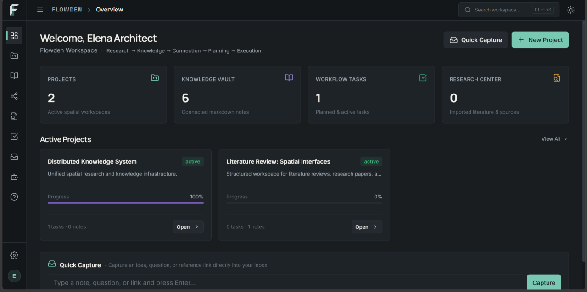
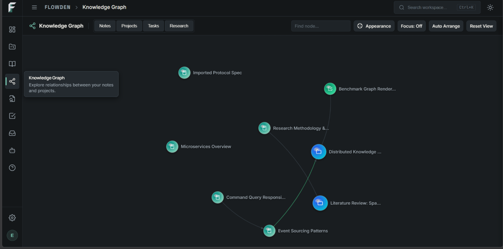
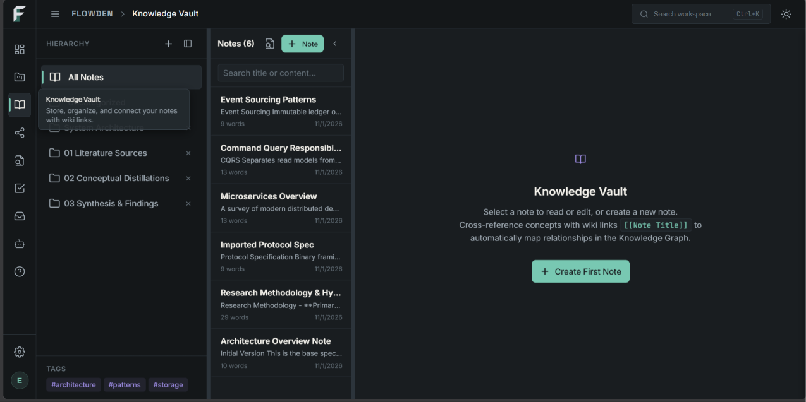
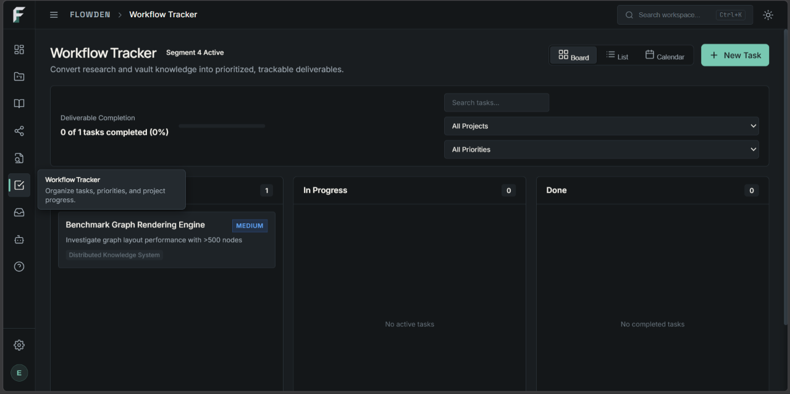
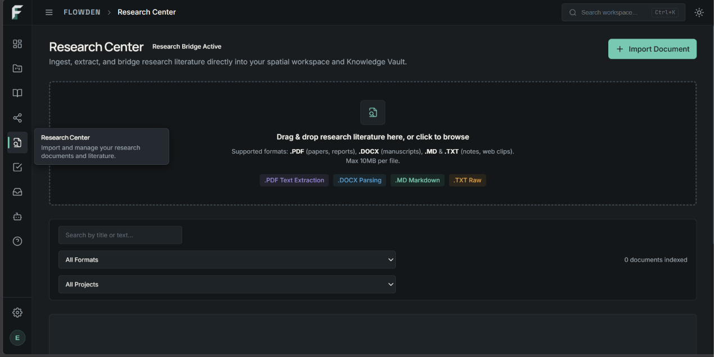
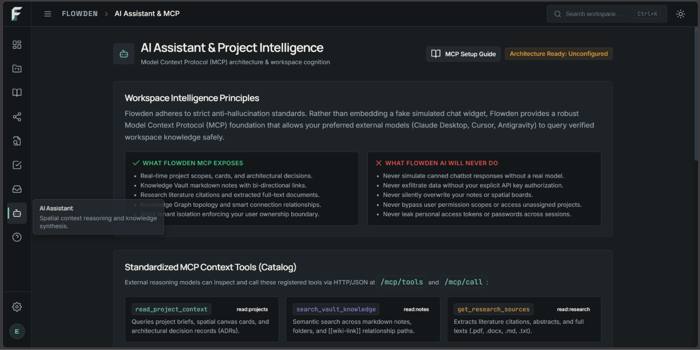

<div align="center">


### A Modern Spatial Productivity Workspace

**Turn scattered information into connected knowledge, and connected knowledge into meaningful action.**

[](https://nodejs.org/)
[](https://www.mysql.com/)
[](https://expressjs.com/)
[](https://modelcontextprotocol.io/)
[](LICENSE)

---

</div>

## Table of Contents

1. [Overview & Purpose](#1-overview--purpose)
2. [Key Features & Core Capabilities](#2-key-features--core-capabilities)
3. [Interface Showcase & Visual Gallery](#3-interface-showcase--visual-gallery)
4. [Technology Stack](#4-technology-stack)
5. [System Architecture](#5-system-architecture)
6. [How Flowden Works](#6-how-flowden-works)
7. [Repository Directory Structure](#7-repository-directory-structure)
8. [Prerequisites](#8-prerequisites)
9. [Installation & Setup](#9-installation--setup)
10. [Environment Configuration](#10-environment-configuration)
11. [Database Setup & Automated Migrations](#11-database-setup--automated-migrations)
12. [Running the Application](#12-running-the-application)
13. [Testing & Verification Suites](#13-testing--verification-suites)
14. [Model Context Protocol (MCP) Integration](#14-model-context-protocol-mcp-integration)
15. [REST API Reference](#15-rest-api-reference)
16. [Security, Privacy & Data Isolation](#16-security-privacy--data-isolation)
17. [Project Status & Limitations](#17-project-status--limitations)
18. [Future Roadmap](#18-future-roadmap)
19. [Author & Credits](#19-author--credits)

---

## 1. Overview & Purpose

**Flowden** is a modern spatial productivity and knowledge management workspace designed to bridge the fundamental disconnect between **research**, **structured documentation**, **visual planning**, and **task execution**.

### The Problem
Knowledge workers and technical researchers currently face high cognitive fragmentation:
- **Scattered Literature & Sources**: Research documents, papers, and web citations live in separate PDF viewers and bookmark folders.
- **Linear Note-Taking Constraints**: Standard hierarchical folder or document trees fail to show cross-domain conceptual connections.
- **Execution Silos**: Task boards and project roadmaps exist in disconnected tools, severed from the source research notes that justify why tasks exist.

### The Flowden Value Chain
Flowden organizes cognitive work as an unbroken end-to-end continuum:

$$\text{Research} \longrightarrow \text{Knowledge} \longrightarrow \text{Connection} \longrightarrow \text{Planning} \longrightarrow \text{Execution}$$

- **More Spatial than Notion**: Visual canvas-based spatial boards allow cards, groups, and conceptual items to be arranged with infinite 2D freedom.
- **More Structured than Milanote**: Integrated relational knowledge vault with nested categories, bi-directional WikiLinks, and backlink indexes.
- **More Visual than Obsidian**: Dynamic project dashboards, interactive knowledge graphs, and spatial card projections.
- **AI-Native via MCP**: Native Model Context Protocol (MCP) stdio and HTTP bridges enable external AI models (such as Claude Desktop) to inspect, query, and assist within strict project boundaries.

---

## 2. Key Features & Core Capabilities

### 🗂️ Knowledge Vault
- **Markdown-Centric Editing**: Full Markdown editing with live preview, syntax highlighting, and typography hierarchy.
- **Hierarchical Categories & Tags**: Nested multi-level folders with real-time tag indexing and filtering.
- **Bi-directional WikiLinks & Backlinks**: Automatically resolves internal `[[Note Title]]` or `[[fkf:id|Title]]` links and surfaces incoming references.
- **Version History & Rollback**: Automatic point-in-time snapshots created upon edits with one-click content restoration.

### 📐 Spatial Workspace Boards
- **Infinite 2D Visual Canvas**: High-performance pan, zoom, and coordinate transform system for visual thinking.
- **Modular Spatial Cards**: Note cards, idea cards, and reference cards with customizable dimensions and titles.
- **Semantic Grouping & Layouts**: Visual card groups with automated collision detection and spacious non-overlapping arrangement.
- **Decoupled Link Systems**: Explicit separation between visual board wire connections and underlying database semantic links (`entity_links`).

### 🕸️ Interactive Knowledge Graph
- **Topical Clustering**: Automatic circular clustering grouped by Folder categories with topological spacing.
- **Visual Anchor Prominence**: Centralized Project node acting as a visual anchor with radius scaling.
- **Citation Edge Synthesis**: Dynamic calculation and rendering of `cites` edges between research sources and referencing notes.
- **Readable Two-Line Typography**: Automatic text wrapping to prevent label clipping and reduce edge crossing.

### 📚 Research Center & Citation Library
- **Multi-Format Ingestion**: Ingests, parses, and indexes PDF, DOCX, Markdown (`.md`), and Plain Text documents.
- **Excerpt & Quotation Management**: Extract verbatim source quotes and track direct page/chapter references.
- **Inline Citation Syntax**: Interoperable citation anchors (`[src-1]`, `[src-2]`) linked to authoritative document entries.

### 📋 Workflow Tracker
- **Stage Progression**: Multi-status workflow tracking across `Backlog`, `Todo`, `In Progress`, `Review`, and `Done`.
- **Priorities & Deadlines**: Priority categorization (`Low`, `Medium`, `High`, `Urgent`) with automated `completed_at` timestamping.
- **Architectural Decision Records (ADR)**: Dedicated decision logs capturing problem statements, rationale, and consequences for each project.

### ⚡ Quick Capture Engine
- Rapid floating scratchpad to capture fleeting thoughts, code snippets, or links without breaking context.
- One-click processing engine to promote captured thoughts into formal Knowledge Vault notes or actionable Workflow tasks.

### 📦 Knowledge Exchange (FKF 2.0 & Markdown Import)
- **Universal Markdown Ingestion**: Import multi-note research papers formatted in Markdown (`.md`) with automated detection of notes, hierarchical folders, sources, citations, and WikiLinks.
- **Deterministic 3-Stage Pipeline**: Strict `Inspect` $\rightarrow$ `Preview` $\rightarrow$ `Commit` execution model inside transactional boundaries.
- **Spatial Board Projection**: Automatically creates spatial boards and neatly arranges imported note cards by category with zero overlap.
- **Informative Diagnostics**: Actionable HTTP 422 validation codes (`EMPTY_DOCUMENT`, `EMPTY_NOTE_CONTENT`, `BINARY_CONTENT_NOT_ALLOWED`, `INVALID_MARKDOWN_FORMAT`).
- **Backward Compatibility**: Fully supports Flowden Knowledge Format v1.0.0 ZIP archives (`.flowden.zip`).

---

## 3. Interface Showcase & Visual Gallery

| Flowden Dashboard | Knowledge Graph |
|:---:|:---:|
|  |  |
| *Unified Project Overview with activity metrics and quick actions.* | *Spacious topical knowledge graph with folder clustering.* |

| Spatial Workspace & Vault | Workflow Tracker |
|:---:|:---:|
|  |  |
| *Bi-directional Markdown editor with category tree and backlinks.* | *Multi-stage task management with priorities and deadlines.* |

| Research Center | AI Assistant & MCP Integration |
|:---:|:---:|
|  |  |
| *Document library with excerpt extraction and citation linking.* | *MCP server configuration, API tokens, and AI safety controls.* |

---

## 4. Technology Stack

Flowden is engineered with a clean, low-overhead architecture that avoids heavyweight frontend frameworks, ensuring near-instant load times, responsive UI updates, and straightforward deployment.

### Frontend
- **Runtime**: Native Browser Vanilla ES6+ JavaScript.
- **Architecture**: Single Page Application (SPA) driven by an asynchronous hash router (`window.location.hash`).
- **Styling**: Vanilla CSS3 with CSS custom properties (`variables.css`), responsive Flexbox/Grid layouts, and modular styling (`components.css`, `layout.css`).
- **Visual Rendering**: HTML5 Canvas and SVG for graph visualizations and spatial connections.
- **Icons**: Lucide-inspired SVG icon system (`public/js/utils/icons.js`).

### Backend
- **Server Runtime**: Node.js (CommonJS, Node v18+ / v20+ / v22 LTS tested).
- **HTTP Framework**: Express.js 5 (`express@^5.3.0`).
- **Security & Middleware**:
  - `helmet@^8.3.0` for strict HTTP security headers (CSP, frameguards, XSS protection).
  - `cors@^2.8.6` for cross-origin access control.
  - `cookie-parser@^1.4.7` for secure authentication cookies.
  - `bcryptjs@^3.0.3` for 12-round salted password hashing.
  - `jsonwebtoken@^9.0.3` for stateless session tokens with version invalidation.
  - `multer@^2.5.0` for safe streaming multipart file uploads.
- **Document Parsing**: `pdf-parse@^2.4.5` (PDF extraction) and `mammoth@^1.13.0` (DOCX extraction).

### Database
- **Engine**: MySQL 8.0+ / 8.4 Community Server (`InnoDB` engine, `utf8mb4_unicode_ci`).
- **Driver**: `mysql2/promise@^3.24.6` with automated connection pooling.
- **Migration Engine**: Transaction-safe authoritative runner (`server/migrations/runner.js`) supporting sequential JavaScript and SQL migration files.

### Protocols & Integrations
- **Model Context Protocol**: Official `@modelcontextprotocol/sdk@^1.32.2` implementing standard stdio and HTTP JSON-RPC 2.0 transports.

---

## 5. System Architecture

```text
┌───────────────────────────────────────────────────────────────────────────┐
│                           CLIENT BROWSER (SPA)                            │
│                                                                           │
│   ┌───────────────┐     ┌───────────────────┐     ┌───────────────────┐   │
│   │ Hash Router   │     │ State & UI Layers │     │ Canvas / SVG      │   │
│   │ (#/dashboard) │ ──> │ (Vault, Board,    │ ──> │ (Spatial Board &  │   │
│   │ (#/vault, etc)│     │  Workflow, Graph) │     │  Knowledge Graph) │   │
│   └───────────────┘     └───────────────────┘     └───────────────────┘   │
│                                   │                                       │
│                                   ▼                                       │
│                       ┌───────────────────────┐                           │
│                       │ Fetch API Client      │                           │
│                       │ (JSON Payload & Auth) │                           │
│                       └───────────────────────┘                           │
└───────────────────────────────────┬───────────────────────────────────────┘
                                    │ HTTP / REST (/api/v1/*)
                                    ▼
┌───────────────────────────────────────────────────────────────────────────┐
│                       EXPRESS.JS BACKEND (PORT 3000)                      │
│                                                                           │
│   ┌───────────────────────────────────────────────────────────────────┐   │
│   │ Middleware: Helmet, CORS, CookieParser, RateLimiter, AuthGuard    │   │
│   └──────────────────────────────────┬────────────────────────────────┘   │
│                                      ▼                                    │
│   ┌───────────────────────────────────────────────────────────────────┐   │
│   │ API Routes:                                                       │   │
│   │ /auth        /projects    /boards     /notes      /research       │   │
│   │ /tasks       /graph       /exchange   /mcp        /admin          │   │
│   └──────┬───────────────────────────┬──────────────────────┬─────────┘   │
│          │                           │                      │             │
│          ▼                           ▼                      ▼             │
│   ┌─────────────┐             ┌─────────────┐        ┌────────────────┐   │
│   │ Knowledge   │             │ Migration   │        │ MCP Stdio      │   │
│   │ Exchange    │             │ Runner      │        │ Bridge Server  │   │
│   │ (FKF & MD)  │             │ (Sequential)│        │ (@mcp/sdk)     │   │
│   └──────┬──────┘             └──────┬──────┘        └───────┬────────┘   │
└──────────┼───────────────────────────┼───────────────────────┼────────────┘
           │                           │                       │
           ▼                           ▼                       ▼
┌───────────────────────────────────────────────────────────────────────────┐
│                       MYSQL 8.0+ / 8.4 DATABASE                           │
│                                                                           │
│   ┌──────────────┐    ┌──────────────┐    ┌──────────────┐                │
│   │ users        │    │ projects     │    │ project_mem. │                │
│   ├──────────────┤    ├──────────────┤    ├──────────────┤                │
│   │ notes        │    │ note_folders │    │ note_links   │                │
│   ├──────────────┤    ├──────────────┤    ├──────────────┤                │
│   │ boards       │    │ board_groups │    │ board_items  │                │
│   ├──────────────┤    ├──────────────┤    ├──────────────┤                │
│   │ research_doc │    │ research_exc │    │ entity_links │                │
│   ├──────────────┤    ├──────────────┤    ├──────────────┤                │
│   │ tasks        │    │ decision_log │    │ sec_events   │                │
│   └──────────────┘    └──────────────┘    └──────────────┘                │
└───────────────────────────────────────────────────────────────────────────┘
                                ▲
                                │ stdio JSON-RPC
┌───────────────────────────────┴───────────────────────────────────────────┐
│                         AI AGENTS (CLAUDE DESKTOP)                        │
└───────────────────────────────────────────────────────────────────────────┘
```

---

## 6. How Flowden Works

Flowden coordinates research and delivery through five deliberate stages:

```
[ 1. Ingest ] ──> [ 2. Synthesize ] ──> [ 3. Connect ] ──> [ 4. Structure ] ──> [ 5. Assist ]
   Capture            Knowledge            Knowledge           Spatial &           MCP & AI
  Research              Vault                Graph             Workflow            Exchange
```

1. **Ingest**: Literature and references are imported into the **Research Center** (or jotted down in **Quick Capture**). The parser extracts plain text, citations, and metadata.
2. **Synthesize**: Findings are transformed into structured notes in the **Knowledge Vault**, organized by folders and tagged with keywords. Quotes are linked back to original documents using `[src-n]` citations.
3. **Connect**: Notes cite other notes using `[[WikiLinks]]`. Flowden analyzes references to construct an interconnected bi-directional network.
4. **Structure**: In the **Spatial Workspace**, notes are projected onto 2D boards alongside idea cards and task lists, organizing abstract thinking into spatial clusters.
5. **Assist & Exchange**: External AI assistants interact with your workspace via **MCP**, reading context and generating new notes, while the **Knowledge Exchange** imports external research packages with zero data loss.

---

## 7. Repository Directory Structure

```text
flowden/
├── docs/                                # Technical specifications & architecture audits
│   ├── assets/screenshots/              # Authentic user interface screenshot gallery
│   ├── architecture/                    # FKF 2.0 technical blueprints
│   ├── design/                          # Design system & theme specifications
│   ├── knowledge-exchange/              # Canonical schemas & example Markdown packages
│   │   ├── examples/                    # solar-system-research.md & flowden.zip fixtures
│   │   ├── flowden-knowledge-format-v2.schema.json
│   │   └── FLOWDEN_RESEARCH_SPEC.md     # Official Markdown exchange specification
│   └── reports/                         # Phase verification reports & validation logs
├── public/                              # Frontend static single-page application (SPA)
│   ├── app.html                         # Primary workspace application shell
│   ├── index.html                       # Public product introduction & landing page
│   ├── privacy.html                     # Privacy policy
│   ├── terms.html                       # Terms and conditions
│   ├── assets/branding/                 # SVG & PNG brand marks, lockups, and favicons
│   ├── css/                             # Base styles, variables, component CSS, and layouts
│   └── js/                              # Frontend application logic
│       ├── app.js                       # SPA initialization, router, and navigation
│       ├── components/                  # Vault editor, exchange modal, link handlers
│       ├── pages/                       # Page controllers (vault, board, graph, etc.)
│       └── utils/                       # SVG icon library and API client helpers
├── server/                              # Node.js Express backend application
│   ├── index.js                         # Application entrypoint & HTTP server lifecycle
│   ├── config/                          # Database connection pool & environment setup
│   ├── mcp/                             # Model Context Protocol implementation
│   │   ├── index.js                     # Dual-transport MCP server (stdio & HTTP bridge)
│   │   ├── middleware/                  # MCP bearer authentication & project guards
│   │   └── tools/                       # MCP tool definitions (search, read, tasks, etc.)
│   ├── middleware/                      # Auth guards, security logger, upload handlers
│   ├── migrations/                      # Authoritative SQL/JS database migrations
│   │   └── runner.js                    # Sequential migration runner & schema locks
│   ├── models/                          # Database entity query models (User, Note, etc.)
│   ├── routes/                          # Express REST API endpoints
│   ├── services/                        # Business logic (Exchange, Search, Security)
│   └── utils/                           # Markdown parser & FKF canonical validators
├── tests/                               # Comprehensive automated test suites
│   ├── foundation.test.js               # Segment 2: Auth, health, RBAC
│   ├── workspace.test.js                # Segment 3: Boards, notes, backlinks, ADRs
│   ├── segment4.test.js                 # Segment 4: Tasks, versions, research, export
│   ├── launch_assets.test.js            # Launch requirements, favicon, legal pages
│   ├── markdown_import.test.js          # Markdown import & solar system regression tests
│   ├── markdown_spatial_board.test.js   # Spatial board auto-creation & card layout tests
│   ├── graph_layout.test.js             # Knowledge graph spacing & clustering tests
│   ├── test_mcp_bridge.js               # MCP stdio bridge & tool invocation tests
│   └── phase3a_assistant_ui.test.js     # Assistant UI & resource download tests
├── .env.example                         # Safe configuration template with instructions
├── .gitignore                           # Excludes secrets, node_modules, and local stores
├── package.json                         # Project dependencies, scripts, and metadata
└── package-lock.json                    # Deterministic dependency lockfile
```

---

## 8. Prerequisites

Ensure your host environment meets the following requirements before installation:

| Requirement | Supported Version | Notes |
|:---|:---|:---|
| **Node.js** | `>= 18.0.0` (LTS v20+ / v22 recommended) | Active LTS version required |
| **npm** | `>= 9.0.0` | Included with Node.js |
| **MySQL Server** | `8.0+` or `8.4 LTS` | InnoDB engine enabled |
| **Operating System** | Windows 10/11, macOS, Linux | Cross-platform Node.js execution |

---

## 9. Installation & Setup

### 1. Clone the Repository
```bash
git clone https://github.com/DYoures/flowden.git
cd flowden
```

### 2. Check out the Target Branch
```bash
git checkout feat/fkf-2.0-implementation
```

### 3. Install Node.js Dependencies
```bash
npm install
```
*(Alternatively, run `npm ci` for a clean install matching `package-lock.json`.)*

---

## 10. Environment Configuration

Flowden keeps all sensitive credentials and environmental bindings strictly separated from source control.

### Create Your Local `.env` File
Copy `.env.example` to create your local `.env`:

```bash
# On Windows (PowerShell):
Copy-Item .env.example .env

# On macOS / Linux:
cp .env.example .env
```

### Configure Settings in `.env`

```env
# Server Configuration
PORT=3000
NODE_ENV=development

# MySQL Database Configuration
DB_HOST=127.0.0.1
DB_PORT=3306
DB_USER=root
DB_PASSWORD=your_local_mysql_password
DB_NAME=flowden

# Authentication
# In production: generate a 32-byte secret (e.g. `openssl rand -hex 32`)
JWT_SECRET=your_custom_jwt_secret_key_minimum_32_characters
JWT_EXPIRES_IN=7d

# File Upload Constraints
UPLOAD_DIR=./uploads
MAX_FILE_SIZE=10485760
```

> **Security Notice**: Never commit `.env` or expose real database passwords to version control. The `.gitignore` file is strictly configured to omit `.env` and `.env.*`.

---

## 11. Database Setup & Automated Migrations

Flowden handles its database lifecycle automatically:

1. **Ensure MySQL is Running**:
   - On Windows: Start the MySQL service via `net start MySQL84` or through Windows Services (`services.msc`).
   - On Linux/macOS: `sudo systemctl start mysql` or `brew services start mysql`.

2. **Automatic Schema Creation**:
   - You do **not** need to manually execute SQL dump files.
   - When the backend starts, it connects to MySQL, executes `CREATE DATABASE IF NOT EXISTS \`${DB_NAME}\``, and runs all outstanding migrations sequentially through [server/migrations/runner.js](file:///C:/Users/Sod/.gemini/antigravity/scratch/flowden/server/migrations/runner.js).

---

## 12. Running the Application

### Start Development Server
```bash
npm run dev
```

### Start Production Server
```bash
npm start
```

Upon successful startup, the server output will display:
```text
==================================================
  FLOWDEN: Modern Spatial Productivity Workspace
  Server listening on http://127.0.0.1:3000
  Environment: development
==================================================
```

### Accessing Flowden in Your Browser
- **Main Workspace Application**: [http://127.0.0.1:3000/app.html](http://127.0.0.1:3000/app.html)
- **Public Product Landing Page**: [http://127.0.0.1:3000/index.html](http://127.0.0.1:3000/index.html)
- **Interactive Knowledge Graph**: [http://127.0.0.1:3000/app.html#/graph](http://127.0.0.1:3000/app.html#/graph)

---

## 13. Testing & Verification Suites

Flowden includes a comprehensive suite of **162 automated tests** covering foundational auth, spatial boards, research extraction, and knowledge graph math.

### Run All Standard Test Suites
```bash
npm test
```
*Executes Foundation (Segment 2), Workspace (Segment 3), Integration (Segment 4), and Launch Asset checks sequentially.*

### Run Specialized Test Suites
```bash
# Markdown Import Pipeline & Solar System Regression (56 tests)
node tests/markdown_import.test.js

# Spatial Board Auto-Creation & Zero Collision Tests (28 tests)
node tests/markdown_spatial_board.test.js

# Knowledge Graph Spacing & Topical Clustering Tests (16 tests)
node tests/graph_layout.test.js

# Model Context Protocol (MCP) Stdio Bridge Tests (9 tests)
node tests/test_mcp_bridge.js

# Phase 3A Assistant UI & Resource Downloads (20 tests)
node tests/phase3a_assistant_ui.test.js
```

---

## 14. Model Context Protocol (MCP) Integration

Flowden natively supports the [Model Context Protocol (MCP)](https://modelcontextprotocol.io/) to connect external AI agents (like Claude Desktop) directly to your project knowledge vault within strict, user-controlled boundaries.

### Available MCP Tools

| Tool Name | Parameters | Description |
|:---|:---|:---|
| `read_project_context` | `projectId` | Returns high-level project summary, members, and activity metrics. |
| `search_vault_knowledge` | `query`, `projectId?`, `limit?` | Searches markdown notes by text, tag, or folder with relevance ranking. |
| `get_workflow_tasks` | `projectId`, `status?` | Queries project workflow tasks filtered by completion status. |
| `get_research_sources` | `projectId` | Retrieves research documents, authors, URLs, and recorded excerpts. |
| `get_knowledge_connections` | `nodeId`, `entityType` | Returns bi-directional relationship graph edges for an entity. |
| `create_vault_note` | `projectId`, `title`, `content`, `tags?` | Creates a new note in the project vault with automatic link parsing. |

### Connecting Claude Desktop to Flowden via Stdio

Add the Flowden MCP server entry to your Claude Desktop configuration file:
- **Windows**: `%APPDATA%\Claude\claude_desktop_config.json`
- **macOS**: `~/Library/Application Support/Claude/claude_desktop_config.json`

```json
{
  "mcpServers": {
    "flowden": {
      "command": "node",
      "args": [
        "C:\\Users\\Sod\\.gemini\\antigravity\\scratch\\flowden\\server\\mcp\\index.js"
      ],
      "env": {
        "FLOWDEN_API_URL": "http://127.0.0.1:3000/mcp",
        "FLOWDEN_API_KEY": "fld_mcp_your_personal_access_token_here"
      }
    }
  }
}
```

---

## 15. REST API Reference

The Flowden HTTP server exposes standard RESTful endpoints under `/api/v1/`:

### Authentication & User Management
- `POST /api/v1/auth/register` — Create a new account with email, password, and display name.
- `POST /api/v1/auth/login` — Authenticate and receive a JWT session token and httpOnly cookie.
- `GET /api/v1/auth/me` — Retrieve the currently authenticated user's profile and roles.

### Projects & Workspace Boards
- `GET /api/v1/projects` — List accessible workspace projects.
- `POST /api/v1/projects` — Create a new project workspace.
- `GET /api/v1/boards/project/:projectId` — Fetch the spatial board associated with a project.
- `PUT /api/v1/boards/:boardId/viewport` — Persist canvas pan $(x, y)$ coordinates and zoom level.
- `POST /api/v1/boards/:boardId/cards` — Create a modular card on the spatial board.
- `PATCH /api/v1/boards/:boardId/cards/batch` — Bulk update spatial card positions after drag operations.

### Knowledge Vault & Notes
- `GET /api/v1/notes` — List notes with folder and tag filters.
- `POST /api/v1/notes` — Create a Markdown note with automatic link parsing.
- `GET /api/v1/notes/:id` — Retrieve note content, metadata, and incoming backlinks.
- `PUT /api/v1/notes/:id` — Update note body and trigger automatic snapshot versioning.
- `GET /api/v1/notes/:id/versions` — View historical snapshots of a note.
- `POST /api/v1/notes/:id/versions/:versionId/restore` — Rollback note content to an earlier snapshot.

### Knowledge Exchange Engine
- `POST /api/v1/exchange/inspect` — Multipart upload of `.md` or `.flowden.zip` package for validation and preview summary generation.
- `POST /api/v1/exchange/commit` — Atomically commit inspected package into a target project.
- `GET /api/v1/exchange/resources/:resourceKey` — Download canonical research specifications, schemas, or reference packages.

### Knowledge Graph
- `GET /api/v1/graph` — Retrieve enriched node and edge structures with topical folder groupings and citation linkages.

---

## 16. Security, Privacy & Data Isolation

- **Local Data Ownership**: All notes, research files, and workflow records are stored in your private MySQL instance and local filesystem uploads directory. Flowden does not transmit your personal notes to third-party tracking services.
- **Strict Role-Based Access Control (RBAC)**: Enforces discrete permissions (`owner`, `editor`, `viewer`, `admin`) across projects and notes.
- **SQL Injection Prevention**: All database interactions use parameterized queries via `mysql2/promise`.
- **Stateless Session Tokens with Revocation**: JWT sessions include a `token_version` claim. Changing a password or invalidating sessions immediately increments the token version, revoking existing tokens.
- **Safe File Ingestion**: Uploaded research documents are validated for MIME type, file extension, and maximum size limits. Upload file paths are hashed to prevent directory traversal exploits.

---

## 17. Project Status & Limitations

- **Current Stage**: Active Development / Feature Complete on `feat/fkf-2.0-implementation`.
- **Platform Focus**: Desktop and tablet browsers (optimized for Chrome, Edge, Safari, Firefox).
- **Single-User Workspace Focus**: Designed primarily for individual knowledge workers, students, and engineers managing project repositories locally. Multi-user concurrent live cursor editing is planned for a future release.

---

## 18. Future Roadmap

- [ ] **Collaborative Multi-User Canvas**: Live multi-cursor spatial board collaboration utilizing Conflict-Free Replicated Data Types (CRDTs).
- [ ] **Local Vector Semantic Search**: Optional local embeddings (via ONNX / Transformers.js) for semantic concept similarity search across notes and literature.
- [ ] **End-to-End Encrypted Backups**: Client-side encrypted export bundles for zero-knowledge cloud backups.
- [ ] **Obsidian & Logseq Vault Importers**: Direct folder synchronization with existing local Markdown vaults.

---

## 19. Author & Credits

Flowden is designed and developed by **Hafiez Shadry (Sod)** — Software Engineering student and creative developer.

- **Developer**: [Hafiez Shadry (Sod)](https://github.com/DYoures)
- **Portfolio**: [Sod Creative Developer Portfolio](https://github.com/DYoures/Sod_Portofolio)
- **Repository**: [https://github.com/DYoures/flowden](https://github.com/DYoures/flowden)
- **License**: Released under the [ISC License](LICENSE).

<div align="center">
<sub>Crafted with precision for knowledge workers, researchers, and creators.</sub>
</div>
