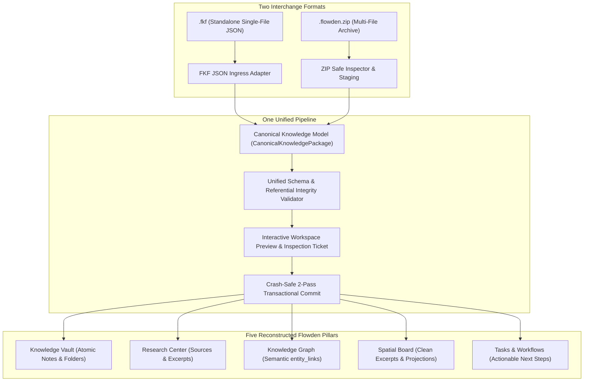
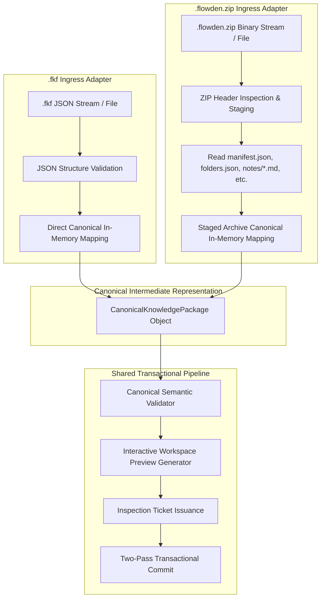
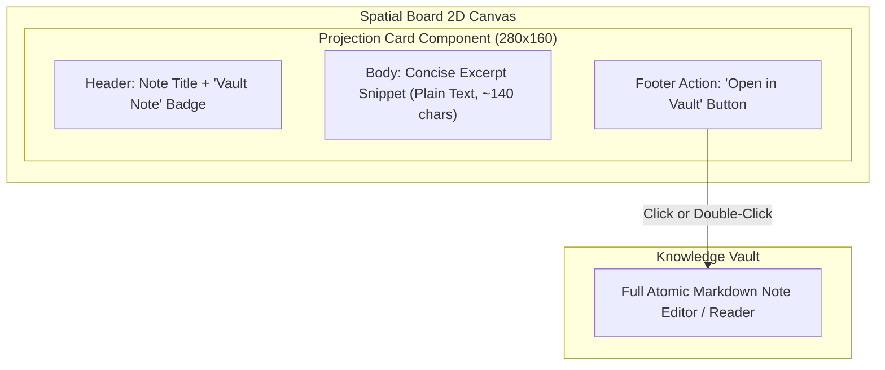
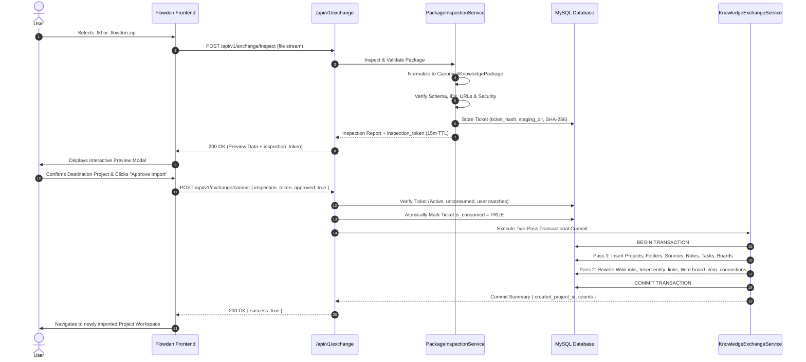

# Flowden FKF 2.0 — Canonical Architecture Design and Technical Specification

- **Document Identifier:** `FLOWDEN-FKF-2.0-CANONICAL-SPEC`
- **Document Path:** `docs/architecture/fkf-2.0/FKF-2.0-ARCHITECTURE-DRAFT.md`
- **Target Specification Version:** `FKF 2.0.0`
- **Date:** November 9, 2026
- **Status:** Architectural Design Draft (Phase 1A — Design Only)
- **Author:** Antigravity Advanced Agentic Architecture Pair
- **Accepted Evidence References:**
  - `docs/reports/flowden-fix-video-evidence-analysis.md` (Video analysis of `rev/fix.mp4`)
  - `docs/knowledge-exchange/FLOWDEN_RESEARCH_SPEC.md` (FKF 1.0 specification)
  - `docs/knowledge-exchange/flowden-package.schema.json` (FKF 1.0 JSON Schema)
  - `docs/knowledge-exchange/PHASE-1-ARCHITECTURAL-DECISIONS.md` (ADR-001 through ADR-010)
  - `server/services/packageInspectionService.js` (Existing package inspection service)
  - `server/services/knowledgeExchangeService.js` (Existing transactional commit pipeline)
  - `server/routes/exchange.js` (Existing inspection and commit HTTP routes)
  - `server/routes/research.js` (Research Center document ingestion and bridging)
  - `public/js/pages/board.js` (Spatial Board projection cards and wire connections)
  - `public/js/pages/vault.js` (Knowledge Vault note listing, editor, and renderer)
  - `server/routes/graph.js` (Knowledge Graph query and relationship visualization)

---

## Epistemic Classification Legend

Every architectural assertion, technical contract, and design decision in this document is explicitly classified into one of four epistemic categories:

1. `[CONFIRMED EXISTING BEHAVIOR]` — Fact verified directly against the live MySQL schema, migration files (`001_initial_schema.sql` through `006_knowledge_import_jobs.js`), backend models/services, or frontend components.
2. `[PROPOSED FKF 2.0 SPECIFICATION]` — Formal specification contract, data structure, schema grammar, or interchange requirement for FKF 2.0.
3. `[PROPOSED FUTURE IMPLEMENTATION]` — Planned backend, frontend, or pipeline engineering implementation scheduled for Phases 1B through 6 (not yet implemented in code).
4. `[UNRESOLVED DESIGN DECISION]` — Explicit trade-off, edge case, or open engineering decision highlighted for team alignment before code execution.

---

## Executive Summary: The Second-Brain Crisis & FKF 2.0

Flowden was designed to be an interconnected second-brain workspace combining five tightly integrated pillars:
1. **Research Center:** Ingesting and extracting literature (PDF, DOCX, MD, TXT).
2. **Knowledge Vault:** Atomic Markdown note writing, hierarchical folders, and bidirectional WikiLinks.
3. **Knowledge Graph:** Multi-dimensional semantic ontology connecting notes, sources, excerpts, and tasks.
4. **Spatial Board:** 2D visual canvas for arranging entity projections, visual groups, and directional wires.
5. **Knowledge Exchange (FKF):** Open interchange standard enabling external AI systems (such as NotebookLM, Claude, and ChatGPT) to inject structured research packages directly into the workspace.

As documented in `docs/reports/flowden-fix-video-evidence-analysis.md`, the actual user experience suffered from severe disconnects:
- Literature ingestion failed on text extraction (`pdfParse is not a function`), saving raw error strings into documents and notes.
- Bridging research to Vault dumped entire unformatted text blobs into single monolithic notes with collapsed headings.
- Projecting Vault notes onto the Spatial Board dumped thousands of words of raw Markdown syntax (`#`, `>`) into tiny cards, destroying canvas readability.
- The Knowledge Graph and board pickers were flooded with dozens of orphan `Untitled Note` records.
- Most fundamentally, FKF 1.0 was strictly a multi-file ZIP archive (`.flowden.zip`). Web-based AI assistants like Google NotebookLM produce clean textual synthesis (Markdown or JSON) and cannot easily output multi-file binary ZIP archives.

**FKF 2.0 solves this architectural divide.** It introduces a **single canonical intermediate knowledge model (`CanonicalKnowledgePackage`)** that natively accepts BOTH:
1. **Standalone `.fkf`:** A single, self-contained JSON text document containing notes, sources, excerpts, relationships, board layout, and tasks.
2. **Full `.flowden.zip`:** A multi-file archive containing discrete Markdown files, media assets (diagrams, images, PDFs), and metadata files.

Both formats flow through **ONE unified parser, ONE validation gate, ONE preview generator, and ONE crash-safe transactional commit pipeline**. Neither format is a second-class citizen.



---

## 1. Verified Codebase Audit & Architectural Gap Analysis

### 1.1 Existing FKF v1 Implementation Review (`[CONFIRMED EXISTING BEHAVIOR]`)

The existing Knowledge Exchange implementation was inspected across:
- `docs/knowledge-exchange/flowden-package.schema.json`
- `server/services/packageInspectionService.js` (1,080 lines)
- `server/services/knowledgeExchangeService.js` (1,293 lines)
- `server/routes/exchange.js` (557 lines)
- `server/migrations/006_knowledge_import_jobs.js` (92 lines)

#### Strengths of the Existing Backend:
1. **Crash-Safe State Machine:** `knowledge_import_jobs` tracks explicit states (`validating`, `failed_validation`, `staged`, `committing_files`, `committing_db`, `committed`, `rollback_pending`, `rolled_back`).
2. **Server-Side Ticket Binding:** `POST /api/v1/exchange/inspect` computes the archive SHA-256, verifies zip headers, extracts to staging, and returns an opaque, single-use `inspection_token` stored in `knowledge_exchange_tickets`. `POST /api/v1/exchange/commit` strictly verifies this ticket before mutating MySQL.
3. **Write-Ahead Journaling:** A disk journal (`temp/fkp_journals/<operation_id>.journal.json`) records promoted file paths before copying, enabling safe orphan-file cleanup if the Node.js process crashes mid-flight.
4. **Two-Pass Commit Architecture:** Pass 1 creates entities (`projects`, `note_folders`, `research_documents`, `research_excerpts`, `notes`, `tasks`, `boards`, `board_groups`, `board_items`), recording database IDs in `packageIdMap`. Pass 2 rewrites WikiLinks, maps semantic `entity_links`, and wires `board_item_connections`.

#### Fatal Gaps in FKF v1:
1. **Archive-Only Ingress:** `packageInspectionService.js` (line 206) and `exchange.js` (lines 107-143) strictly require a `.flowden.zip` uploaded as `multipart/form-data`. Standalone text, JSON, or `.fkf` inputs cannot be inspected or imported.
2. **Forced Multi-File Decomposition:** FKF 1.0 mandates 5 separate core files (`manifest.json`, `project/overview.md`, `folders.json`, `sources/index.json`, `relationships/links.json`) plus `notes/*.md` and `sources/*.md`. An AI generating research in a web browser without terminal access cannot produce this layout.
3. **Rigid Extraction Dependency:** The inspection pipeline is hard-coded to `inspectZipCentralDirectory()` and `extractValidatedZipToStaging()`.
4. **Missing Markdown Embedding:** There was no schema definition allowing Markdown note bodies to be included directly inside a single manifest or JSON file.

### 1.2 Root Cause Analysis of Video Evidence Defects (`[CONFIRMED EXISTING BEHAVIOR]`)

The second-by-second inspection of `rev/fix.mp4` identified four user-facing breakdowns:

#### Defect 1: PDF Text Extraction Crash (`VID-01`, `VID-02`)
- **Code Reference:** `server/routes/research.js` lines 56–62.
- **Root Cause:** `package.json` installs `"pdf-parse": "^2.4.5"`. In `pdf-parse` v2, the CommonJS export is `{ PDFParse: class ... }`, not a callable function. Calling `pdfParse(dataBuffer)` throws `TypeError: pdfParse is not a function`.
- **Failure Cascade:** Line 61 catches this exception and returns the string `"[PDF Text Extraction Unavailable: pdfParse is not a function]"`. This error string was persisted to `research_documents.summary` and `research_documents.content_text`. Clicking "Bridge to Vault Note" copied this error string directly into a new Vault Note.

#### Defect 2: Monolithic Research Note Bridging (`VID-03`, `VID-04`)
- **Code Reference:** `public/js/pages/research.js` lines 375–379.
- **Root Cause:** Bridging creates a single note with `title: "Research: " + doc.title` and writes the entire document summary and metadata into one note body. It does not decompose the literature into distinct concept notes, does not preserve excerpts, does not create semantic relationships, and does not generate board projections.

#### Defect 3: Spatial Board Raw Markdown Document Dump (`VID-06`)
- **Code Reference:** `public/js/pages/board.js` lines 1838–1848 and lines 938–942.
- **Root Cause:** When the user projects a Vault Note onto the Spatial Board via "Add Existing Vault Note", line 1842 passes `content: chosen.content || ''`, copying the entire multi-thousand-word raw Markdown document into `board_items.content`. Line 940 then renders `item.content` directly inside `<div class="card-body">` with only `SmartLinkHandler.renderMarkdownLinks()`. The card displays raw `#` headers, blockquotes, and unformatted syntax in an 11px font, forcing the user to drag the card across the entire canvas to read it.

#### Defect 4: Untitled Note Spawns & Knowledge Graph Contamination (`VID-04`, `VID-05`, `VID-07`)
- **Code References:**
  - `public/js/pages/vault.js` line 2771: Clicking "+ New Note" fires `POST /api/v1/notes` with `{ title: 'Untitled Note', content: '' }`. Unedited drafts remain forever in MySQL.
  - `public/js/pages/board.js` line 1793: Calls `GET /notes` without `project_id`, populating the projection dropdown with dozens of empty `"Untitled Note"`, `"SS"`, and `"s"` drafts.
  - `server/routes/graph.js` lines 46–52: Queries `SELECT id, title, project_id, folder_id FROM notes WHERE user_id = ?` without `deleted_at IS NULL` and without filtering empty untitled drafts.
  - `server/routes/graph.js` line 80: Queries `SELECT source_note_id, target_note_id FROM note_links` globally across all users without scoping to `user_id` or `project_id`.

---

## 2. The Unified Canonical Import Model

### 2.1 The Core Architectural Invariant (`[PROPOSED FKF 2.0 SPECIFICATION]`)

> **Invariant FKF-2.0-CORE-01:**  
> Flowden MUST maintain exactly **ONE internal representation** of an imported knowledge package.  
> Whether the package arrives as a standalone `.fkf` JSON document or a `.flowden.zip` multi-file archive, the ingress layer MUST parse and normalize the input into an in-memory `CanonicalKnowledgePackage` object.  
> Validation, schema checking, user preview, ID mapping, and transactional database commit MUST operate exclusively against this canonical representation. Under no circumstances may separate import logic exist for `.fkf` and `.flowden.zip`.



### 2.2 Ingress Format Comparison

| Feature | Standalone `.fkf` | Full `.flowden.zip` |
| :--- | :--- | :--- |
| **File Type** | Single UTF-8 text file (`.fkf` / `.json`) | Compressed binary archive (`.flowden.zip`) |
| **MIME Type** | `application/vnd.flowden.fkf+json` or `application/json` | `application/zip` |
| **Best Used For** | AI chat outputs (NotebookLM, Claude, ChatGPT), API transmission, lightweight sharing | Rich multimedia research, large PDF/image assets, multi-document archives |
| **Markdown Storage** | Embedded directly in `notes[].content_markdown` string | Stored in discrete files (`notes/<slug>.md`) |
| **Asset Storage** | Inline data URI (small SVG/PNG) or external verified URL | Stored as discrete binary files in `assets/` |
| **Staging Required** | None (direct JSON parse into memory) | Staged to `temp/fkp_stage_<operation_id>/` |
| **Security Gates** | JSON size limit, AST depth limit, URL sanitization | ZIP bomb check, path traversal, magic bytes, URL check |
| **Internal Model** | `CanonicalKnowledgePackage` | `CanonicalKnowledgePackage` |

### 2.3 `CanonicalKnowledgePackage` TypeScript / JSDoc Interface (`[PROPOSED FKF 2.0 SPECIFICATION]`)

Every ingress adapter MUST parse its input into this canonical in-memory structure:

```typescript
interface CanonicalKnowledgePackage {
  format: 'flowden-knowledge-package';
  fkf_version: '2.0.0';
  min_compatible_fkf_version: '1.0.0';
  package_id: string; // ^[a-z][a-z0-9_-]{2,63}$
  
  generator: {
    system_name: string;
    model_identifier: string;
    generated_at: string; // ISO 8601
    spec_version: string;
    research_prompt_summary?: string;
    contains_synthetic_sources: boolean;
  };

  project: {
    id: string; // ^proj-[a-z0-9_-]{2,58}$
    title: string;
    summary: string;
    overview_markdown: string; // Normalized markdown content
    color?: string; // Hex #rrggbb
    icon?: string;
    tags?: string[];
  };

  folders: Array<{
    id: string; // ^fld-[a-z0-9_-]{2,59}$
    name: string;
    parent_id: string | null;
    sort_order?: number;
  }>;

  notes: Array<{
    id: string; // ^note-[a-z0-9_-]{2,58}$
    title: string;
    folder_id: string | null;
    content_markdown: string; // Clean body without YAML frontmatter
    is_pinned?: boolean;
    verification_status?: 'verified' | 'partially_verified' | 'unverified_external' | 'synthetic_demonstration';
    disambiguation_hint?: string;
    tags?: string[];
    created_at?: string;
    updated_at?: string;
  }>;

  sources: Array<{
    id: string; // ^src-[a-z0-9_-]{2,59}$
    title: string;
    source_type: 'journal_article' | 'technical_report' | 'book_or_chapter' | 'web_documentation' | 'dataset' | 'standard_or_specification' | 'primary_interview_or_field_note' | 'synthetic_demonstration';
    authors: string[];
    publication_date: string | null; // YYYY-MM-DD
    accessed_date: string | null;
    source_url: string | null;
    verification_status: 'verified' | 'partially_verified' | 'unverified_external' | 'synthetic_demonstration';
    is_synthetic_example: boolean;
    summary: string;
    content_markdown: string; // Detailed notes/synthesis
    tags?: string[];
    excerpts: Array<{
      id: string; // ^exc-[a-z0-9_-]{2,59}$
      quoted_text: string;
      annotation?: string;
      location_anchor: string;
      color?: string;
    }>;
  }>;

  relationships: Array<{
    id: string; // ^rel-[a-z0-9_-]{2,59}$
    source_id: string; // Valid entity package_id
    target_id: string; // Valid entity package_id
    link_type: 'references' | 'embeds' | 'cites' | 'derived_from' | 'supports' | 'contradicts' | 'inspired_by' | 'depends_on' | 'blocks' | 'relates_to';
    context_snippet?: string;
    confidence?: number;
  }>;

  assets: Array<{
    id: string; // ^ast-[a-z0-9_-]{2,59}$
    filename: string;
    mime_type: string;
    size_bytes: number;
    sha256: string;
    title?: string;
    source_type: 'embedded_base64' | 'staged_file' | 'external_url';
    buffer?: Buffer; // Populated for base64 or staged files
    staged_path?: string; // Path in temp staging if from zip
    external_url?: string;
  }>;

  optional_modules: {
    tasks?: {
      enabled: boolean;
      tasks: Array<{
        id: string; // ^tsk-[a-z0-9_-]{2,59}$
        title: string;
        description?: string;
        status: 'planned' | 'in_progress' | 'done';
        priority: 'low' | 'medium' | 'high' | 'urgent';
        due_date: string | null; // YYYY-MM-DD
        sort_order?: number;
        related_entity_ids?: string[];
      }>;
    };
    spatial_board?: {
      enabled: boolean;
      board: {
        id: string; // ^brd-[a-z0-9_-]{2,59}$
        title: string;
        description?: string;
        groups: Array<{
          id: string; // ^grp-[a-z0-9_-]{2,59}$
          title: string;
          color?: string;
          position_x: number;
          position_y: number;
          width: number;
          height: number;
        }>;
        items: Array<{
          id: string; // ^bitm-[a-z0-9_-]{2,58}$
          group_id?: string | null;
          item_type: 'note' | 'idea' | 'image' | 'link' | 'research_ref' | 'task' | 'document';
          reference_type?: 'note' | 'task' | 'research' | 'excerpt' | 'project' | 'board' | 'decision';
          reference_package_id?: string | null; // Points to note-*, tsk-*, src-*, exc-*
          title: string;
          excerpt_snippet?: string; // Clean 140-char excerpt, NOT raw document markdown
          position_x: number;
          position_y: number;
          width: number;
          height: number;
          color?: string;
        }>;
        connections: Array<{
          id: string; // ^bcon-[a-z0-9_-]{2,58}$
          source_item_id: string; // Points to bitm-*
          target_item_id: string; // Points to bitm-*
          connection_type: 'flow' | 'dependency' | 'association' | 'default';
          label?: string;
        }>;
      };
    };
  };
}
```

---

## 3. Formal FKF 2.0 Format Specifications

### 3.1 Standalone `.fkf` File Specification (`[PROPOSED FKF 2.0 SPECIFICATION]`)

A standalone `.fkf` file is a valid UTF-8 JSON document conforming to the FKF 2.0 JSON Schema.

#### File Conventions:
- **File Extension:** `.fkf` (or `.json`)
- **MIME Type:** `application/vnd.flowden.fkf+json`, `application/json`
- **Encoding:** UTF-8 strictly without BOM
- **Maximum File Size:** 15 MB for standalone JSON (to prevent browser freezing during text rendering)
- **Inline Markdown:** Note and Source markdown text are provided directly as JSON strings inside `content_markdown`.
- **Inline Assets:** Media assets under 500 KB may be embedded as base64 data URIs (`data:image/png;base64,...`). Larger assets must reference external HTTPS URLs.

#### Complete `.fkf` Structure Example:
```json
{
  "$schema": "https://flowden.app/schemas/flowden-package-v2.0.0.schema.json",
  "format": "flowden-knowledge-package",
  "fkf_version": "2.0.0",
  "min_compatible_fkf_version": "1.0.0",
  "package_id": "pkg-ocean-chemistry-2026",
  "generator": {
    "system_name": "Google NotebookLM",
    "model_identifier": "gemini-1.5-pro",
    "generated_at": "2026-11-09T04:00:00Z",
    "spec_version": "2.0.0",
    "research_prompt_summary": "Comprehensive synthesis of abyssal ocean acidification and carbonate dissolution rates.",
    "contains_synthetic_sources": false
  },
  "project": {
    "id": "proj-ocean-acidification",
    "title": "Abyssal Ocean Acidification & Benthic Flux",
    "summary": "Deep-sea carbonate chemistry analysis and benthic dissolution rate modeling.",
    "overview_markdown": "# Abyssal Ocean Acidification\n\nExecutive synthesis of deep-sea benthic flux models across three oceanic basins...\n\nSee [[fkf:note-saturation-horizons|Carbonate Saturation Horizons]] for details.",
    "color": "#0ea5e9",
    "icon": "droplet",
    "tags": ["oceanography", "carbon-cycle", "climate-science"]
  },
  "folders": [
    { "id": "fld-empirical-data", "name": "01 Empirical Data", "parent_id": null, "sort_order": 1 },
    { "id": "fld-models", "name": "02 Biogeochemical Models", "parent_id": null, "sort_order": 2 }
  ],
  "notes": [
    {
      "id": "note-saturation-horizons",
      "title": "Carbonate Saturation Horizons",
      "folder_id": "fld-empirical-data",
      "verification_status": "verified",
      "disambiguation_hint": "Atlantic Basin",
      "tags": ["aragonite", "saturation-depth"],
      "content_markdown": "### Carbonate Saturation Horizons\n\nRecent profiling reveals significant shoaling of the aragonite saturation horizon in the North Atlantic.\n\nAccording to [[fkf:src-noaa-benthic-2025]], saturation depth has decreased by 180 meters.\n\nKey mechanisms:\n- Increased dissolved inorganic carbon\n- Temperature-dependent solubility shifts\n\nRelated synthesis: [[fkf:note-dissolution-kinetics|Dissolution Kinetics]]."
    },
    {
      "id": "note-dissolution-kinetics",
      "title": "Dissolution Kinetics & Flux Models",
      "folder_id": "fld-models",
      "verification_status": "verified",
      "disambiguation_hint": "Empirical Rate Equations",
      "tags": ["kinetics", "flux"],
      "content_markdown": "### Dissolution Kinetics & Flux Models\n\nBenthic carbonate dissolution follows non-linear kinetic regimes under undersaturated conditions.\n\nEmpirical rate constants derived from [[fkf:src-noaa-benthic-2025]] demonstrate accelerated calcium loss at high pressures."
    }
  ],
  "sources": [
    {
      "id": "src-noaa-benthic-2025",
      "title": "North Atlantic Abyssal Benthic Flux Survey 2025",
      "source_type": "technical_report",
      "authors": ["NOAA Ocean Acidification Program", "Woods Hole Oceanographic Institution"],
      "publication_date": "2025-08-14",
      "accessed_date": "2026-11-08",
      "source_url": "https://oceanacidification.noaa.gov/reports/2025-benthic-survey.pdf",
      "verification_status": "verified",
      "is_synthetic_example": false,
      "summary": "Hydrographic survey measuring deep-water pH, total alkalinity, and carbonate mineral dissolution.",
      "content_markdown": "# North Atlantic Abyssal Survey\n\nDetailed observational notes and calibration metrics...",
      "tags": ["noaa", "benthic-flux"],
      "excerpts": [
        {
          "id": "exc-aragonite-shoaling",
          "quoted_text": "The aragonite saturation horizon was observed at an average depth of 2,150 m, representing a shoaling of approximately 180 m relative to the 2005 baseline.",
          "annotation": "Critical benchmark for benthic ecosystem vulnerability.",
          "location_anchor": "Section 3.2, p. 19",
          "color": "#fef08a"
        }
      ]
    }
  ],
  "relationships": [
    {
      "id": "rel-note-cites-src",
      "source_id": "note-saturation-horizons",
      "target_id": "src-noaa-benthic-2025",
      "link_type": "cites",
      "context_snippet": "saturation depth has decreased by 180 meters"
    },
    {
      "id": "rel-notes-reference",
      "source_id": "note-saturation-horizons",
      "target_id": "note-dissolution-kinetics",
      "link_type": "references",
      "context_snippet": "Related synthesis: Dissolution Kinetics"
    }
  ],
  "assets": [],
  "optional_modules": {
    "tasks": {
      "enabled": true,
      "tasks": [
        {
          "id": "tsk-verify-calcite-flux",
          "title": "Cross-reference calcite dissolution rates with Pacific basin data",
          "description": "Compare Atlantic benthic rate curves with recent Pacific transect publications.",
          "status": "planned",
          "priority": "high",
          "due_date": null,
          "sort_order": 1,
          "related_entity_ids": ["note-dissolution-kinetics", "src-noaa-benthic-2025"]
        }
      ]
    },
    "spatial_board": {
      "enabled": true,
      "board": {
        "id": "brd-ocean-chemistry",
        "title": "Ocean Acidification Conceptual Flow",
        "description": "Spatial synthesis of saturation horizons and dissolution pathways.",
        "groups": [
          {
            "id": "grp-empirical",
            "title": "Empirical Observations",
            "color": "#0ea5e9",
            "position_x": 40,
            "position_y": 60,
            "width": 320,
            "height": 400
          },
          {
            "id": "grp-kinetics",
            "title": "Theoretical Models",
            "color": "#6366f1",
            "position_x": 420,
            "position_y": 60,
            "width": 320,
            "height": 400
          }
        ],
        "items": [
          {
            "id": "bitm-card-saturation",
            "group_id": "grp-empirical",
            "item_type": "note",
            "reference_type": "note",
            "reference_package_id": "note-saturation-horizons",
            "title": "Carbonate Saturation Horizons",
            "excerpt_snippet": "Recent profiling reveals shoaling of aragonite saturation depth by 180m in North Atlantic...",
            "position_x": 60,
            "position_y": 120,
            "width": 280,
            "height": 160,
            "color": "#0284c7"
          },
          {
            "id": "bitm-card-kinetics",
            "group_id": "grp-kinetics",
            "item_type": "note",
            "reference_type": "note",
            "reference_package_id": "note-dissolution-kinetics",
            "title": "Dissolution Kinetics & Flux Models",
            "excerpt_snippet": "Benthic carbonate dissolution follows non-linear kinetic regimes under undersaturated conditions...",
            "position_x": 440,
            "position_y": 120,
            "width": 280,
            "height": 160,
            "color": "#4f46e5"
          }
        ],
        "connections": [
          {
            "id": "bcon-flow-1",
            "source_item_id": "bitm-card-saturation",
            "target_item_id": "bitm-card-kinetics",
            "connection_type": "flow",
            "label": "informs rate models"
          }
        ]
      }
    }
  }
}
```

### 3.2 Full `.flowden.zip` Archive Specification (`[PROPOSED FKF 2.0 SPECIFICATION]`)

The `.flowden.zip` archive format is retained and extended in FKF 2.0. It allows large research dossiers, companion PDFs, high-resolution media, and individual Markdown files to be bundled cleanly.

#### Directory Layout:
```text
my-research.flowden.zip
├── manifest.json                   [REQUIRED] Package metadata, entity index, format version
├── project/
│   └── overview.md                 [REQUIRED] Markdown overview (imported as pinned Note)
├── folders.json                    [REQUIRED] Hierarchical folder tree
├── notes/
│   ├── note-saturation.md          [REQUIRED] Note Markdown file (with optional YAML frontmatter)
│   └── note-kinetics.md
├── sources/
│   ├── index.json                  [REQUIRED] Research Sources & Excerpts registry
│   └── src-noaa-benthic-2025.md    [REQUIRED for each source] Detailed source markdown
├── relationships/
│   └── links.json                  [REQUIRED] Semantic knowledge graph edges
├── assets/
│   ├── abyssal-transect-chart.png  [OPTIONAL] Media assets declared in manifest
│   └── benthic-flux-diagram.svg
├── optional/
│   ├── tasks.json                  [OPTIONAL] Actionable research tasks
│   └── spatial-board.json          [OPTIONAL] 2D Spatial Board layout & projections
└── exports/
    └── summary-report.pdf          [OPTIONAL] Companion human-readable PDF
```

#### `.flowden.zip` Ingress Rules:
1. Every file in `notes/*.md` and `sources/*.md` is parsed by the ZIP Ingress Adapter into the `notes[]` and `sources[]` arrays of `CanonicalKnowledgePackage`.
2. YAML frontmatter in `notes/*.md` is extracted: metadata fields (`id`, `title`, `folder_id`, `tags`) are synchronized with `manifest.json`, and the frontmatter header is stripped so only the clean Markdown body is preserved.
3. Assets in `assets/*` are validated for size and magic-byte signature before being added to `CanonicalKnowledgePackage.assets[]`.

### 3.3 Stable Package-Local Identifier Grammar (`[PROPOSED FKF 2.0 SPECIFICATION]`)

To ensure deterministic referencing across notes, sources, excerpts, board cards, and wires, every entity MUST have an immutable package-local ID matching regex:
`^[a-z][a-z0-9_-]{2,63}$`

Strict type prefix conventions:
- Project: `proj-<slug>` (e.g., `proj-ocean-acidification`)
- Folder: `fld-<slug>` (e.g., `fld-empirical-data`)
- Note: `note-<slug>` (e.g., `note-saturation-horizons`)
- Source: `src-<slug>` (e.g., `src-noaa-benthic-2025`)
- Excerpt: `exc-<slug>` (e.g., `exc-aragonite-shoaling`)
- Asset: `ast-<slug>` (e.g., `ast-abyssal-transect`)
- Task: `tsk-<slug>` (e.g., `tsk-verify-calcite-flux`)
- Spatial Board: `brd-<slug>` (e.g., `brd-ocean-chemistry`)
- Board Group: `grp-<slug>` (e.g., `grp-empirical`)
- Board Item: `bitm-<slug>` (e.g., `bitm-card-saturation`)
- Board Connection (Wire): `bcon-<slug>` (e.g., `bcon-flow-1`)
- Relationship: `rel-<slug>` (e.g., `rel-note-cites-src`)

### 3.4 Markdown WikiLink Syntax Grammar (`[PROPOSED FKF 2.0 SPECIFICATION]`)

Inside Markdown bodies (`notes[].content_markdown`, `project.overview_markdown`, `sources[].content_markdown`), references to other package entities MUST use the FKF token syntax:
- `[[fkf:<package_id>|<Display Label>]]` (Standard, with custom display text)
- `[[fkf:<package_id>]]` (Bare token, uses entity's default title)

#### Resolution Behavior during Pass 2 Import:
1. The token `[[fkf:note-saturation-horizons|Carbonate Saturation Horizons]]` is detected.
2. The importer resolves `note-saturation-horizons` in `packageIdMap` to database ID `42` and title `"Carbonate Saturation Horizons"`.
3. The importer inserts a row into `note_links (source_note_id = <thisNoteId>, target_note_id = 42)`.
4. The importer inserts a row into `entity_links (source_type = 'note', source_id = <thisNoteId>, target_type = 'note', target_id = 42, link_type = 'references', origin = 'inline_link')`.
5. The importer rewrites the token in `notes.content` to `[[note:42|Carbonate Saturation Horizons]]` (or `[[Carbonate Saturation Horizons]]`), allowing Flowden's `VaultEditor` to render and navigate the link natively.

---

## 4. Canonical Entity Mapping to Flowden Database Schema

### 4.1 Exhaustive Entity Mapping Table (`[CONFIRMED EXISTING BEHAVIOR]` & `[PROPOSED FKF 2.0 SPECIFICATION]`)

The following table defines the exact, authoritative mapping from FKF 2.0 entities to Flowden MySQL tables and columns.

| FKF 2.0 Declaration | Target MySQL Table | Key Columns Populated | Secondary Registration / Junctions |
| :--- | :--- | :--- | :--- |
| **`project`** | `projects` | `user_id`, `title`, `description`, `color`, `icon`, `status = 'active'` | 1. `project_members (project_id, user_id, role = 'owner')`<br>2. `entities (uuid, entity_type = 'project', entity_id, owner_user_id, primary_project_id, title, search_text)` |
| **`project.overview_markdown`** | `notes` (Pinned Overview) | `user_id`, `project_id`, `folder_id = NULL`, `title = "<Project Title> — Project Overview"`, `content`, `is_pinned = 1`, `word_count` | 1. `entities (entity_type = 'note')`<br>2. `project_entities (access_role = 'contributor')`<br>3. `note_versions (version_number = 1)` |
| **`folders[]`** | `note_folders` | `user_id`, `parent_folder_id`, `name`, `sort_order` | Topologically sorted from root to leaves; `parent_id` resolved via `packageIdMap`. |
| **`notes[]`** | `notes` | `user_id`, `project_id`, `folder_id`, `title`, `content = <normalized body>`, `is_pinned`, `word_count` | 1. `entities (entity_type = 'note')`<br>2. `project_entities (access_role = 'contributor')`<br>3. `note_versions (version_number = 1, content_markdown)`<br>4. `note_tags` & `note_tag_map`<br>5. `note_links` (via WikiLink sync) |
| **`sources[]`** | `research_documents` | `user_id`, `project_id`, `title`, `original_filename`, `file_name`, `file_path`, `file_type = 'md'`, `file_size`, `content_text = <provenance header + body>`, `summary`, `source_url`, `tags_json` | 1. `entities (entity_type = 'research')`<br>2. `project_entities (access_role = 'contributor')` |
| **`sources[].excerpts[]`** | `research_excerpts` | `research_id`, `user_id`, `project_id`, `quoted_text`, `annotation`, `location_anchor`, `color` | 1. `entities (entity_type = 'excerpt')`<br>2. `project_entities (access_role = 'contributor')` |
| **`relationships[]`** | `entity_links` | `user_id`, `source_type`, `source_id`, `target_type`, `target_id`, `link_type`, `origin`, `context_snippet`, `is_confirmed = 1` | If both source and target are notes, additionally insert into `note_links (source_note_id, target_note_id)`. |
| **`optional_modules.tasks.tasks[]`** | `tasks` | `user_id`, `project_id`, `title`, `description`, `status`, `priority`, `due_date`, `sort_order` | 1. `entities (entity_type = 'task')`<br>2. `project_entities (access_role = 'contributor')`<br>3. `entity_links` for any `related_entity_ids` |
| **`optional_modules.spatial_board.board`** | `boards` | `project_id`, `user_id`, `title`, `description`, `zoom_level = 1.0`, `viewport_x = 0`, `viewport_y = 0`, `grid_size = 20` | `packageIdMap.set(board.id, { entityType: 'board', dbId })` |
| **`board.groups[]`** | `board_groups` | `board_id`, `title`, `color`, `position_x`, `position_y`, `width`, `height` | `packageIdMap.set(group.id, { entityType: 'board_group', dbId })` |
| **`board.items[]`** | `board_items` | `board_id`, `user_id`, `item_type`, `reference_type`, `reference_id`, `group_id`, `title`, `content = <excerpt_snippet>`, `position_x`, `position_y`, `width`, `height`, `color`, `z_index = 1` | `packageIdMap.set(item.id, { entityType: 'board_item', dbId })` |
| **`board.connections[]`** | `board_item_connections` | `board_id`, `source_item_id`, `target_item_id`, `connection_type`, `label` | Visual canvas diagram wires only. **Never inserted into `entity_links`**. |
| **`assets[]`** | `file_uploads` | `user_id`, `project_id`, `entity_type = 'note'`, `entity_id`, `filename`, `original_name`, `file_path = '/uploads/vault/fkp_...'`, `mime_type`, `file_size`, `sha256_hash` | Promoted to disk `/uploads/vault/` with crash-safe journal tracking. |

### 4.2 Storage Invariants (`[CONFIRMED EXISTING BEHAVIOR]`)

1. **`notes.content` is the Sole Canonical Markdown Column:**
   - The live database schema (`schema-target.sql` line 114) defines `notes.content LONGTEXT`. There is NO `notes.content_markdown` column.
   - `note_versions.content_markdown` is used exclusively for historical snapshot revisions.
   - Flowden must NEVER introduce a dual-column split brain.
2. **Raw YAML Frontmatter is Never Stored in MySQL:**
   - Frontmatter (`--- ... ---`) must be parsed and stripped before saving to `notes.content`.
   - Storing raw frontmatter in `notes.content` corrupts the visual blocks rendered by `VaultEditor` (`public/js/components/vaultEditor.js`).
3. **Primary Project ID Invariant:**
   - `entities.primary_project_id` must match the owning project.
   - `project_entities` maps cross-project shared access.
   - `project_members` governs user permissions.

---

## 5. Spatial Board Projection vs. Vault Markdown Decoupling

### 5.1 The Root Cause of Board Degradation (`[CONFIRMED EXISTING BEHAVIOR]`)

In `rev/fix.mp4` (VID-06), when the user projected a note onto the board:
1. `public/js/pages/board.js` line 1842 assigned the entire note content (`chosen.content`) to `board_items.content`.
2. The card was rendered with raw Markdown characters (`#`, `>`, `*`) crammed into a 260x170 pixel container.
3. The user had to resize the card to cover the full screen to read it.

This completely violates the spatial canvas paradigm. A board card is an **index card / projection token**, not a full word processor window.

### 5.2 The FKF 2.0 Projection Card Contract (`[PROPOSED FKF 2.0 SPECIFICATION]`)

Every board item that projects an existing knowledge entity MUST obey the following presentation contract:



#### Contract Rules:
1. **`reference_type` and `reference_id` are Authoritative:**
   - When `reference_type = 'note'`, `reference_id` points to the canonical `notes.id`.
2. **`content` Holds a Clean Excerpt Only:**
   - `board_items.content` MUST contain a short, readable plain-text excerpt (maximum 160–200 characters), stripped of raw Markdown heading `#` markers, blockquote `>` symbols, and image tags.
   - If the note has an explicit summary, the summary is used. Otherwise, the first paragraph is stripped of markdown syntax.
3. **Action Button & Navigation:**
   - The card UI displays an explicit icon/button: `Open in Vault` (`#/vault?noteId=<id>`).
   - Clicking this action or double-clicking the card navigates directly to the full document in the Knowledge Vault reader.
4. **Visual Badge:**
   - The card displays a distinct `Vault Note` badge (Champagne Gold accent `#C5A15B` in Light Theme), differentiating projections from freeform spatial sticky notes or ideas.

### 5.3 Semantic Relationships (`entity_links`) vs. Visual Wires (`board_item_connections`) (`[PROPOSED FKF 2.0 SPECIFICATION]`)

A critical architectural distinction in Flowden is the strict separation between **Semantic Ontology** and **Visual Diagramming**:

| Dimension | Semantic Relationships (`entity_links`) | Visual Canvas Connections (`board_item_connections`) |
| :--- | :--- | :--- |
| **Purpose** | Meaning-bearing knowledge graph edges connecting concepts | 2D visual layout flow, wire diagramming, mind-mapping |
| **Storage Table** | `entity_links` (and `note_links` for notes) | `board_item_connections` |
| **FKF 2.0 Entity** | `relationships[].id` (`rel-*`) | `optional_modules.spatial_board.board.connections[]` (`bcon-*`) |
| **Scope** | Workspace-wide / Project-wide Knowledge Graph | Scoped strictly to one specific 2D Spatial Board |
| **Link Types** | 10 canonical ontology types (`references`, `cites`, `supports`, `contradicts`, `derived_from`, `depends_on`, `blocks`, `embeds`, `inspired_by`, `relates_to`) | 4 visual wire styles (`flow`, `dependency`, `association`, `default`) |
| **Endpoints** | Canonical entities: `note`, `research`, `task`, `excerpt`, `project` | Visual canvas items: `board_items.id` (`bitm-*`) |
| **Cross-Contamination Rule** | **MUST NEVER** be created automatically from board visual wires | **MUST NEVER** be created automatically from `entity_links` |

> **Architectural Guardrail:** A user drawing an arrow between two cards on a Spatial Board is creating a visual presentation flow (`board_item_connections`). This does NOT mean Note A logically "contradicts" or "cites" Note B in the Knowledge Graph. Flowden keeps the Knowledge Graph semantically pure.

---

## 6. Knowledge Vault Reading, Formatting & Hygiene Experience

### 6.1 Clean Markdown Rendering Architecture (`[PROPOSED FUTURE IMPLEMENTATION]`)

In `rev/fix.mp4` (VID-04), research notes displayed squashed text where headings like `### Main Question` were rendered inline with the preceding text without linebreaks.

The target Knowledge Vault reading architecture requires:
1. **Standardized Heading Margins & Blocks:**
   - Ensure the markdown parser (`marked.js` or block renderer) strictly enforces block separation: headings (`h1`, `h2`, `h3`) must always clear preceding floats and have dedicated top/bottom margins (`margin-top: 1.5rem; margin-bottom: 0.5rem; display: block;`).
2. **Two Distinct Modes:**
   - **Edit Mode:** Clean monospace/sans editor with live frontmatter badge display (frontmatter is edited via structured fields, not raw YAML text).
   - **Read Mode:** Obsidian-quality reading typography with readable line-length (`max-width: 720px`), proper quote styling, interactive WikiLink pills, and embedded excerpt cards.

### 6.2 Eliminating `Untitled Note` Pollution (`[PROPOSED FUTURE IMPLEMENTATION]`)

The inspection revealed that `notes` table was littered with empty orphan records spawned whenever a user clicked "+ New Note".

#### Three-Point Hygiene Solution:
1. **Deferred Draft Persistence:**
   - When "+ New Note" is clicked in the UI, do NOT immediately execute `POST /api/v1/notes`. Maintain the new note in client-side memory until the user types their first keystroke or title.
2. **Database Query Filtering:**
   - Update `server/routes/graph.js` and `server/routes/notes.js`:
     ```sql
     WHERE user_id = ? 
       AND deleted_at IS NULL 
       AND NOT (title = 'Untitled Note' AND (content IS NULL OR TRIM(content) = ''))
     ```
3. **Board Picker Sanitization:**
   - `public/js/pages/board.js` line 1793: Scope note query to active `project_id`, sort by `updated_at DESC`, and omit empty untitled drafts.

---

## 7. Idempotency, Transactional Safety, Security & Conflict Resolution

### 7.1 Two-Phase Ticketed Import Workflow (`[CONFIRMED EXISTING BEHAVIOR]`)

Flowden implements a zero-trust, two-phase import contract:



### 7.2 Idempotency Mechanics (`[CONFIRMED EXISTING BEHAVIOR]`)

- Every import job supports an `idempotency_key` header or parameter computed as:
  `SHA-256(userId + ":" + packageSha256 + ":" + targetProjectId + ":" + conflictResolution)`
- If an import request arrives with an existing `idempotency_key`:
  - If state is `committed`: The server immediately returns the previously created project summary without re-inserting records (`idempotent_replay: true`).
  - If state is `validating` or `committing_db`: The server returns `409 Conflict` (`IMPORT_IN_PROGRESS`).
  - If the same key is supplied with a different package hash: The server returns `409 Conflict` (`IDEMPOTENCY_KEY_REUSED_DIFFERENT_HASH`).

### 7.3 Crash-Safe Write-Ahead Journaling (`[CONFIRMED EXISTING BEHAVIOR]`)

- Stored in `temp/fkp_journals/<operation_id>.journal.json` and tracked in `knowledge_import_jobs`.
- Any files promoted to `uploads/vault/` are recorded in `journalData.promoted_files` BEFORE the disk write.
- If the Node.js server crashes mid-import:
  - On restart, `cleanupStaleStagingDirs()` scans for jobs with expired locks (`state = 'rollback_pending'` or `expires_at < NOW()`).
  - Staged temporary directories are deleted.
  - Any orphan files recorded in `promoted_files` are safely unlinked from `uploads/vault/`.

### 7.4 Zero-Trust Security Gates (`[CONFIRMED EXISTING BEHAVIOR]`)

1. **ZIP Bomb Defense:** Maximum 500 entries, maximum 250 MB total uncompressed, maximum 50 MB per single file, maximum 100:1 compression ratio.
2. **ZIP Slip & Path Traversal:** Immediate rejection of any path containing `..`, leading `/` or `\`, or null bytes.
3. **Symlink Rejection:** Rejection of POSIX symlink attributes (`0120000`).
4. **Binary File Magic-Byte Validation:** All media attachments verified via `SecurityService.validateUploadedFile()`. Executables (`.exe`, `.dll`, `.sh`, `.bat`, `.ps1`, `.js`) unconditionally rejected.
5. **SSRF & URL Sanitization:** All source URLs verified via `SecurityService.validateExternalUrl()` (blocking private RFC1918 IPs, loopbacks, `file:`, `data:`, `javascript:`).
6. **XSS & Injection Protection:** Markdown bodies stripped of `<script>`, `<iframe>`, `<object>`, and `on*=` handlers.
7. **AI Context Wrapping:** Untrusted package content sent to LLM assistants wrapped with `SecurityService.wrapUntrustedWorkspaceData()`.

### 7.5 Conflict Resolution Policies (`[PROPOSED FKF 2.0 SPECIFICATION]`)

When importing into an existing project or when entity titles collide:
- **`disambiguate` (Default):** Append deterministic suffix (e.g., `"Carbonate Saturation Horizons (Imported 2026-11-09)"`). Preserves all existing user notes.
- **`overwrite_version`:** If a note with the exact title exists in the target folder, create a new snapshot in `note_versions` and update `notes.content`. Never deletes historical revisions.
- **`skip`:** Retain existing note; link relationships to the existing note record.

---

## 8. Practical NotebookLM / AI Research Prompt Template & Generation Guide

### 8.1 Why NotebookLM Needs Explicit Structural Guidance

Google NotebookLM is exceptional at synthesizing deep insights across multiple user-provided PDFs, audio transcripts, and notes. However, by default, NotebookLM outputs continuous, monolithic prose. 

To bridge NotebookLM into Flowden's second brain, the user needs a **ready-to-use Master System Prompt** that instructs NotebookLM to output a 100% compliant standalone `.fkf` JSON document.

### 8.2 The Master Prompt Template (`[PROPOSED FKF 2.0 SPECIFICATION]`)

Users can copy and paste the following prompt directly into NotebookLM, Claude, or ChatGPT to generate an importable Flowden Knowledge Package:

````markdown
# SYSTEM PROMPT: FLOWDEN KNOWLEDGE FORMAT (FKF 2.0) GENERATOR

You are an expert research architect. Your task is to analyze all provided source materials and synthesize them into a structured, interconnected **Flowden Knowledge Package (FKF 2.0)**.

DO NOT output a single monolithic wall of text.
DO NOT use vague summaries.
You MUST output a single, raw, valid JSON code block conforming strictly to the FKF 2.0 specification below.

## STRUCTURAL REQUIREMENTS:
1. Decompose findings into 3 to 10 atomic, well-scoped Notes (notes[]).
2. Organize Notes into 2 to 4 logical Folders (folders[]).
3. Document every source paper, report, or URL in sources[] with exact author, publication date, and verbatim excerpts.
4. Establish explicit semantic relationships in relationships[] using the 10 canonical link types:
   ["references", "embeds", "cites", "derived_from", "supports", "contradicts", "inspired_by", "depends_on", "blocks", "relates_to"].
5. In notes[].content_markdown, use inline WikiLinks in the format: [[fkf:<note-id>|Display Title]].
6. Create an optional Spatial Board (optional_modules.spatial_board) grouping cards visually and linking them with diagram wires (connections[]).
7. Create actionable follow-up tasks in optional_modules.tasks with due_date: null.

## STRICT ID RULES:
Every entity MUST have a stable, lowercase, prefix-typed ID matching `^[a-z][a-z0-9_-]{2,63}$`:
- Project: "proj-<slug>"
- Folders: "fld-<slug>"
- Notes: "note-<slug>"
- Sources: "src-<slug>"
- Excerpts: "exc-<slug>"
- Tasks: "tsk-<slug>"
- Board: "brd-<slug>"
- Groups: "grp-<slug>"
- Board Items: "bitm-<slug>"
- Board Wires: "bcon-<slug>"
- Relationships: "rel-<slug>"

## ANTI-HALLUCINATION CONTRACT:
- NEVER invent citations, authors, dates, or quotes.
- If an author or date is unknown, use null.
- If creating a demonstration package, set "contains_synthetic_sources": true and "verification_status": "synthetic_demonstration".

## TARGET JSON STRUCTURE:
```json
{
  "$schema": "https://flowden.app/schemas/flowden-package-v2.0.0.schema.json",
  "format": "flowden-knowledge-package",
  "fkf_version": "2.0.0",
  "min_compatible_fkf_version": "1.0.0",
  "package_id": "pkg-<topic-slug>",
  "generator": {
    "system_name": "NotebookLM / Claude Research",
    "model_identifier": "research-synthesis-v2",
    "generated_at": "<ISO-TIMESTAMP>",
    "spec_version": "2.0.0",
    "research_prompt_summary": "<One-sentence summary of research objective>",
    "contains_synthetic_sources": false
  },
  "project": {
    "id": "proj-<topic-slug>",
    "title": "<Concise Project Title>",
    "summary": "<Executive summary of project>",
    "overview_markdown": "# <Project Title>\n\nComprehensive overview synthesizing findings...",
    "color": "#6366f1",
    "icon": "book-open",
    "tags": ["<tag1>", "<tag2>"]
  },
  "folders": [
    { "id": "fld-foundations", "name": "01 Foundations", "parent_id": null, "sort_order": 1 },
    { "id": "fld-evidence", "name": "02 Empirical Evidence", "parent_id": null, "sort_order": 2 }
  ],
  "notes": [
    {
      "id": "note-<concept-1>",
      "title": "<Descriptive Concept Title>",
      "folder_id": "fld-foundations",
      "verification_status": "verified",
      "disambiguation_hint": "<Context>",
      "tags": ["<tag>"],
      "content_markdown": "### <Concept Title>\n\nDetailed technical analysis with proper paragraph breaks...\n\nCross reference: [[fkf:note-<concept-2>|Related Concept]]."
    }
  ],
  "sources": [
    {
      "id": "src-<source-1>",
      "title": "<Exact Title of Source Document/Paper>",
      "source_type": "technical_report",
      "authors": ["<Author Name>"],
      "publication_date": "<YYYY-MM-DD or null>",
      "accessed_date": "<YYYY-MM-DD or null>",
      "source_url": "<URL or null>",
      "verification_status": "verified",
      "is_synthetic_example": false,
      "summary": "<Summary of source>",
      "content_markdown": "# <Source Title>\n\nKey notes from this source...",
      "tags": ["<tag>"],
      "excerpts": [
        {
          "id": "exc-<slug>",
          "quoted_text": "<Verbatim excerpt from the document>",
          "annotation": "<Why this excerpt matters>",
          "location_anchor": "Page <X>, Section <Y>",
          "color": "#fef08a"
        }
      ]
    }
  ],
  "relationships": [
    {
      "id": "rel-<slug>",
      "source_id": "note-<concept-1>",
      "target_id": "src-<source-1>",
      "link_type": "cites",
      "context_snippet": "<Short quote or context>"
    }
  ],
  "assets": [],
  "optional_modules": {
    "tasks": {
      "enabled": true,
      "tasks": [
        {
          "id": "tsk-<slug>",
          "title": "<Actionable research verification step>",
          "description": "<Details>",
          "status": "planned",
          "priority": "medium",
          "due_date": null,
          "sort_order": 1,
          "related_entity_ids": ["note-<concept-1>"]
        }
      ]
    },
    "spatial_board": {
      "enabled": true,
      "board": {
        "id": "brd-<slug>",
        "title": "<Spatial Synthesis Canvas>",
        "description": "Visual diagram of concepts and flow.",
        "groups": [
          {
            "id": "grp-core",
            "title": "Core Mechanisms",
            "color": "#6366f1",
            "position_x": 40,
            "position_y": 60,
            "width": 320,
            "height": 400
          }
        ],
        "items": [
          {
            "id": "bitm-card-1",
            "group_id": "grp-core",
            "item_type": "note",
            "reference_type": "note",
            "reference_package_id": "note-<concept-1>",
            "title": "<Concept Title>",
            "excerpt_snippet": "<Clean plain-text summary under 140 chars>",
            "position_x": 60,
            "position_y": 120,
            "width": 280,
            "height": 160,
            "color": "#4f46e5"
          }
        ],
        "connections": []
      }
    }
  }
}
```

Now, analyze the attached documents and generate the complete FKF 2.0 JSON package. Output ONLY the raw JSON.
````

---

## 9. Backward Compatibility & Migration Strategy

### 9.1 Compatibility with FKF 1.0 `.flowden.zip` Packages (`[CONFIRMED EXISTING BEHAVIOR]` & `[PROPOSED FKF 2.0 SPECIFICATION]`)

1. **Version Gate:**
   - Any package declaring `fkf_version: "1.0.0"` continues to be fully supported.
   - The ZIP Ingress Adapter checks `fkf_version`. If `"1.0.0"` is detected, it reads `manifest.json`, `folders.json`, `notes/*.md`, `sources/index.json`, `relationships/links.json`, and optional modules, mapping them directly into `CanonicalKnowledgePackage`.
2. **Schema Dual-Version Resolution:**
   - The updated schema validator supports both `$id: "...flowden-package-v1.0.0.schema.json"` and `$id: "...flowden-package-v2.0.0.schema.json"`.

### 9.2 Database Cleansing & Migration Plan (`[PROPOSED FUTURE IMPLEMENTATION]`)

To resolve database contamination observed in `fix.mp4`:
1. **Migration Script (`007_clean_orphan_untitled_notes.js`):**
   - Soft-delete all notes where `title = 'Untitled Note'` and `content IS NULL OR TRIM(content) = ''` and `deleted_at IS NULL`.
   - Clean corresponding orphan records from `entities`, `entity_links`, and `note_links`.
2. **Fixing Existing Contaminated Research Documents:**
   - Detect `research_documents` where `summary LIKE '%pdfParse is not a function%'` or `content_text LIKE '%pdfParse is not a function%'`.
   - Flag these documents as `extraction_status = 'failed'` so users can re-trigger parsing once the PDF extractor is repaired in Phase 3.

---

## 10. Phased Implementation Roadmap & Unresolved Questions

### 10.1 Phased Implementation Roadmap


#### Detailed Phase Deliverables:
- **Phase 1B (Schema & Test Fixtures):**
  - Author `docs/knowledge-exchange/flowden-package-v2.schema.json`.
  - Create valid standalone `.fkf` reference fixture (`examples/ocean-acidification.fkf`).
  - Create valid `.flowden.zip` reference fixture matching FKF 2.0.
- **Phase 2 (Unified Parser & Backend Ingress):**
  - Implement `server/utils/fkfCanonicalParser.js`: parses both `.fkf` JSON and staged `.flowden.zip` into `CanonicalKnowledgePackage`.
  - Update `server/routes/exchange.js` to accept raw JSON payloads (`POST /api/v1/exchange/inspect-json`) in addition to multipart file uploads.
  - Update `KnowledgeExchangeService.js` to execute the two-pass transactional commit directly from `CanonicalKnowledgePackage`.
- **Phase 3 (Document Extraction Reliability):**
  - Fix `server/routes/research.js` PDF extraction: instantiate `new PDFParse()` from `pdf-parse` v2 or wrap safely with fallback.
  - Add extraction unit tests for PDF, DOCX, MD, and TXT.
  - Ensure failed extractions fail gracefully with clear UI warnings rather than polluting document content.
- **Phase 4 (Knowledge Vault Experience & Draft Hygiene):**
  - Implement deferred persistence for "+ New Note" in `vault.js` to prevent empty untitled notes.
  - Update Markdown rendering typography in Read Mode: enforce clear block spacing for `###` headings and blockquotes.
  - Re-design "Bridge to Vault Note" modal to allow modular concept extraction.
- **Phase 5 (Spatial Board Projection & Graph Scoping):**
  - Update `public/js/pages/board.js` projection creation: write plain-text excerpt/summary into `board_items.content` (max 160 chars), add `Vault Note` badge, and implement direct "Open in Vault" action.
  - Update `server/routes/graph.js`: filter `deleted_at IS NULL`, filter empty untitled drafts, and scope `note_links` and `entity_links` to authenticated user and active project.
- **Phase 6 (Real-World Integration Verification):**
  - Execute end-to-end user journeys: NotebookLM prompt -> `.fkf` generation -> Flowden import -> Vault verification -> Spatial Board arrangement -> Knowledge Graph visual check.
  - Verify zero-regression against existing test suites.

### 10.2 Explicit Unresolved Design Decisions (`[UNRESOLVED DESIGN DECISION]`)

The following design decisions are highlighted for stakeholder review prior to Phase 1B/Phase 2 coding:

1. **`[UNRESOLVED DESIGN DECISION 01]` — Standalone `.fkf` Ingress Endpoint:**
   - *Option A:* Overload `POST /api/v1/exchange/inspect` so that if `Content-Type: application/json` or `application/vnd.flowden.fkf+json` is received, it parses the JSON body; if `multipart/form-data` is received, it processes the uploaded file.
   - *Option B:* Create a dedicated endpoint `POST /api/v1/exchange/inspect-json` alongside `POST /api/v1/exchange/inspect`.
   - *Recommendation:* Option A is cleaner for API consumers, but Option B provides unambiguous routing, simpler middleware configuration, and clearer rate-limiting isolation.

2. **`[UNRESOLVED DESIGN DECISION 02]` — Handling Large Media Assets in Standalone `.fkf`:**
   - *Option A:* Allow base64 data URIs up to 2 MB embedded directly in `.fkf` JSON.
   - *Option B:* Disallow base64 entirely in `.fkf`; require external HTTPS URLs for images/media, and require `.flowden.zip` for binary files.
   - *Recommendation:* Hybrid approach: allow small inline base64 images (under 500 KB each, up to 2 MB total per `.fkf`) for diagrams/charts, but reject oversized binary payloads with `PAYLOAD_TOO_LARGE_USE_ZIP`.

3. **`[UNRESOLVED DESIGN DECISION 03]` — Project Overview Note vs. Project Description:**
   - In FKF 1.0, `project/overview.md` was imported as a pinned root Note titled `"<Project Title> — Project Overview"`.
   - Should this overview note be editable in Vault like any other note, or should it be a special system-protected document?
   - *Recommendation:* Standard editable pinned note with `is_pinned = 1`. Users frequently need to refine executive summaries as research progresses.

4. **`[UNRESOLVED DESIGN DECISION 04]` — Re-extracting Existing Broken PDFs:**
   - Should Flowden automatically run a background migration to re-extract text for existing `research_documents` whose `summary` contains the error string `pdfParse is not a function` once the parser is fixed?
   - *Recommendation:* Yes, provide an explicit "Re-extract literature text" button in the Research Center UI, allowing users to safely reprocess affected documents without corrupting any user-edited notes.

---

## 11. Architectural Conclusion & Sign-Off

This document formalizes the canonical architecture for **Flowden FKF 2.0**. By unifying standalone `.fkf` and full `.flowden.zip` into a single intermediate knowledge model, Flowden directly bridges modern AI research engines (like NotebookLM) into an interconnected second-brain workspace without data degradation, squashed formatting, or canvas clutter.

Execution is held strictly at **Design Only** for Phase 1A. No application source code or database schemas have been altered. Proceed to Phase 1B upon review.

