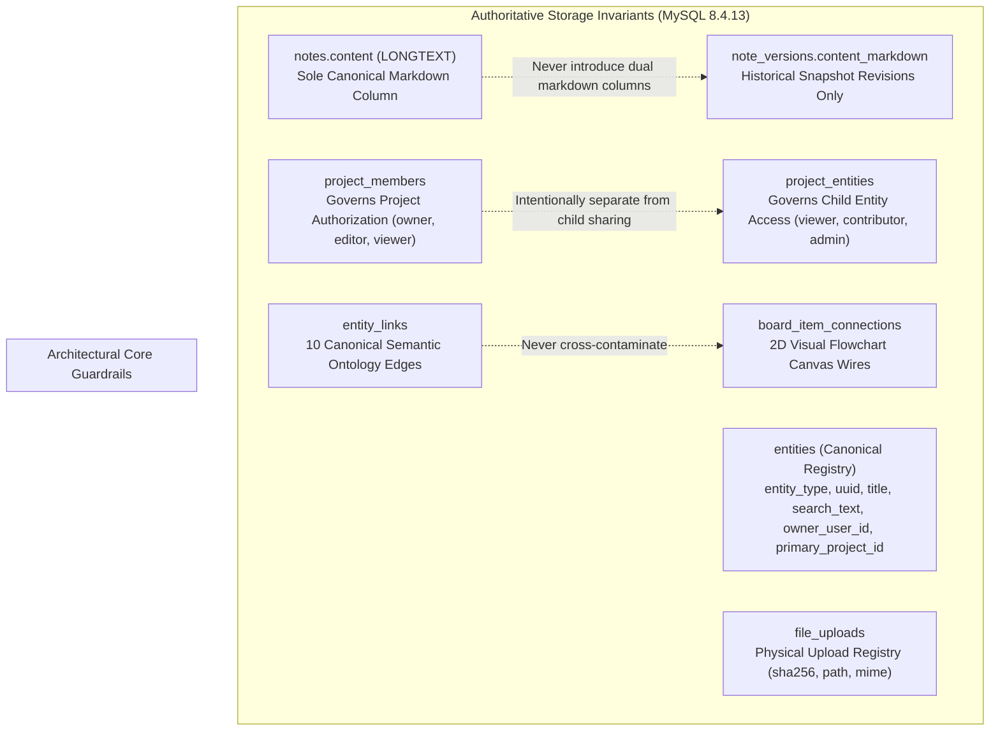
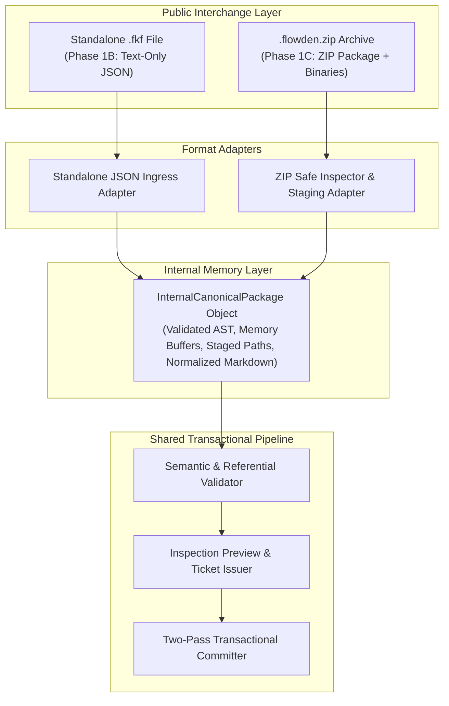
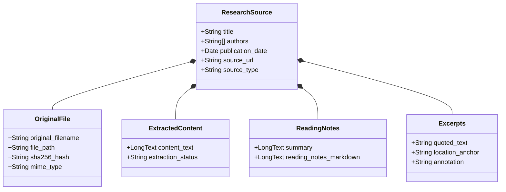
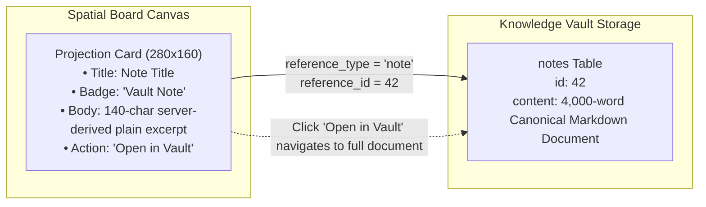
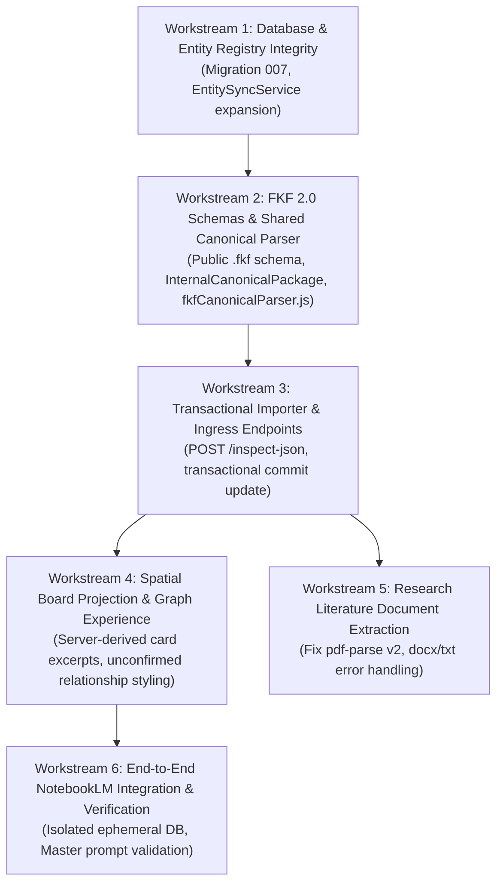

# Flowden FKF 2.0 — Final Architecture Reconciliation Specification

- **Document Identifier:** `FLOWDEN-FKF-2.0-RECONCILED-SPEC`
- **Document Path:** `docs/architecture/fkf-2.0/FKF-2.0-ARCHITECTURE-REVISED.md`
- **Target Specification Version:** `FKF 2.0.0`
- **Revision Phase:** Phase 1A.1 Final Consistency Correction
- **Date:** November 9, 2026
- **Status:** Architecture Contract & Technical Design Specification (Reconciled & Consistent)
- **Author:** Antigravity Advanced Agentic Architecture Pair
- **Authoritative Foundation Documents:**
  - `docs/architecture/fkf-2.0/FKF-2.0-ARCHITECTURE-DRAFT.md` (Initial Phase 1A Draft)
  - `docs/reports/fkf2-phase0-rebaseline.md` (Live Environment & Schema Rebaseline Report)
  - `docs/reports/fkf2-phase0b-critical-gap-verification.md` (Critical Gaps & Entity Audit Report)
  - Independent Claude Architecture Review Directives (16-Point Analysis)

---

## Epistemic Classification Legend

Every architectural assertion, technical contract, and design decision in this document is explicitly classified into one of six epistemic categories:

1. `[CONFIRMED]` — Fact directly verified against the live MySQL 8.4.13 database (`flowden_test`), migration files (001–006), backend models/services, or frontend components.
2. `[CODE-PATH CONFIRMED]` — Structural behavior or defect established through static source-code and data-flow inspection, without executing live database mutations.
3. `[DONE-UNVERIFIED]` — Implemented in source code or covered by automated test suites, but pending end-to-end verification in an isolated production-grade environment.
4. `[PROPOSED]` — Formal specification contract, data structure, schema grammar, or interchange requirement designed for FKF 2.0.
5. `[UNRESOLVED]` — Explicit trade-off, edge case, provenance ambiguity, or open engineering decision requiring deliberate alignment.
6. `[BLOCKED]` — Task or verification that requires an isolated database or currently missing infrastructure.

---

## 1. Executive Verdict

Flowden is designed as an integrated second brain uniting literature ingestion (Research Center), atomic knowledge drafting (Knowledge Vault), spatial canvas modeling (Spatial Board), and multi-typed semantic graph exploration (Knowledge Graph).

The empirical audits conducted in Phase 0 and Phase 0B revealed that while Flowden possesses robust underlying foundations—including write-ahead import journaling, zero-trust search access predicates, and a unified entity registry—the application suffered from three core architectural disconnects:

1. **The Ingress Divide:** FKF v1 was strictly a multi-file binary ZIP archive (`.flowden.zip`). Web-based AI assistants like **Google NotebookLM** output structured text/JSON and cannot naturally construct multi-file ZIP archives in web chat interfaces.
2. **The Entity Registration Divide:** Normal application CRUD for Projects (`Project.create`), Research Documents (`research.js`), and Boards (`Project.create` / `Board.js`) omitted registration in the central `entities` table. Only 14 out of 228 Projects (6.1%) and 32 out of 56 Research Documents (57.1%) in the live database exist in `entities`—and all were created exclusively by the FKF v1 importer during test runs (`[CONFIRMED]`). Because `SearchService.universalSearch` queries `entities` exclusively, Universal Search misses normal CRUD projects in MySQL (`[CODE-PATH CONFIRMED]`).
3. **The Presentation Divide:** Spatial Board projection cards dumped thousands of words of raw Markdown syntax (`#`, `>`, tables) into tiny 260×170px canvas cards instead of showing readable excerpts that link to the Knowledge Vault.

**FKF 2.0 resolves this entire divide through a phased, consistent architecture:**
- **Phased Ingress Rollout:** Phase 1B delivers the strictly typed public JSON interchange schema (**Standalone `.fkf`**) for text-only knowledge exchange with NotebookLM, Claude, and ChatGPT. Phase 1C delivers the full package format (**`.flowden.zip`**) for multi-document dossiers and binary media assets (`[PROPOSED]`).
- **Unified Internal Model:** Both formats normalize into **one internal canonical runtime model (`InternalCanonicalPackage`)**, utilizing a single validation, preview, and transactional commit pipeline.
- **Server-Derived Board Excerpts:** Board projection cards are lightweight visual projection tokens. Flowden derives clean plain-text excerpts directly from canonical Vault notes on the server, eliminating card content duplication and stale package excerpts.
- **Strict Entity & Security Lifecycle:** Explicit lifecycle contracts separate Project authorization (`project_members`), child entity sharing (`project_entities`), and global discovery (`entities`), while keeping imported AI links unconfirmed (`is_confirmed = 0`).

---

## 2. Verified Current Flowden Architecture

Flowden's live architecture was empirically audited in Phase 0 and Phase 0B against **MySQL Community Server v8.4.13** on `127.0.0.1:3306`, database `flowden_test` (`[CONFIRMED]`):



### Verified Core Invariants:

1. **`notes.content` is the Sole Canonical Markdown Column (`[CONFIRMED]`):**
   - Live MySQL column inspection confirms `notes.content LONGTEXT NULL`. There is NO `notes.content_markdown` column on `notes`.
   - `note_versions.content_markdown` is used exclusively for historical snapshot revisions.
   - Flowden strictly forbids dual-writing markdown columns on `notes`.
2. **`entities` is the Central Universal Registry (`[CONFIRMED]`):**
   - Live counts: `entities` (346 rows), `entity_links` (1,554 rows), `project_entities` (856 rows), `project_members` (173 rows).
   - `entities.primary_project_id` is the authoritative project anchor for global search and discovery.
3. **Three-Tier Access & Registration Governance (`[CONFIRMED]`):**
   - **Tier 1 — Project Authorization:** Governed exclusively by `project_members` (`role: 'owner' | 'editor' | 'viewer'`). If a user lacks membership in `project_members` for a project, access is rejected.
   - **Tier 2 — Child Entity Sharing:** Governed by `project_entities` (`entity_type: 'note' | 'task' | 'research' | 'excerpt' | 'board' | 'decision'`, `access_role: 'viewer' | 'contributor' | 'admin'`). `project` is **intentionally omitted** because projects are root containers, not child entities. `capture` is omitted because quick captures are strictly private.
   - **Tier 3 — Universal Registry Membership:** Governed by `entities` for system-wide indexing (e.g. Universal Search). Registering a child entity in `project_entities` or `entities` does **not** grant user access; project authorization via `project_members` remains mandatory.
4. **Semantic Links vs Visual Board Wires Invariant (`[CONFIRMED]`):**
   - `entity_links` stores semantic knowledge relationships (`references`, `embeds`, `cites`, `derived_from`, `supports`, `contradicts`, `inspired_by`, `depends_on`, `blocks`, `relates_to`).
   - `board_item_connections` stores 2D canvas flowchart wires (`flow`, `dependency`, `association`, `default`).
   - Visual wires MUST NEVER create semantic links, and semantic links MUST NEVER spawn visual board wires automatically.
5. **Live Verified Enum Invariants (`[CONFIRMED]` in MySQL 8.4):**
   - `entity_links.origin`: `enum('inline_link','embed','board_promoted','citation','task_sync','capture_convert','manual','ai_suggested')` (8 values).
   - `entity_links.link_type`: `enum('references','embeds','cites','derived_from','supports','contradicts','inspired_by','depends_on','blocks','relates_to')` (10 values).
   - `project_entities.entity_type`: `enum('note','task','research','excerpt','board','decision')` (6 values).
   - `project_entities.access_role`: `enum('viewer','contributor','admin')` (default: `'contributor'`).
   - `research_documents.file_type`: `enum('md','pdf','docx','txt')` (4 values).

---

## 3. Confirmed Entity Registration Matrix

The live database audit across 19 critical tables established the following empirical coverage counts (`[CONFIRMED]`):

| Entity Type | Main Table Rows | Matched in `entities` | Coverage % | CRUD Creation Invariant | Target Access Governance |
| :--- | :---: | :---: | :---: | :--- | :--- |
| **`project`** | 228 | 14 | 6.1% | `Project.create()` inserts into `projects`, `boards`, `project_members`. **Omits `entities`**. (All 14 matched rows were created by FKF v1 importer test runs). | Governed by `project_members`. **Must NOT be inserted into `project_entities`**. |
| **`note`** | 435 | 170 | 39.1% | `Note.create()` inserts into `notes`, calls `syncTags()`, `syncWikiLinks()`, and `EntitySyncService.syncNoteEntity()`. | Governed by `project_entities` + personal private notes. |
| **`task`** | 190 | 58 | 30.5% | `POST /api/v1/tasks` inserts into `tasks`, calls `EntitySyncService.syncTaskEntity()`. | Governed by `project_entities`. |
| **`research`** | 56 | 32 | 57.1% | `POST /api/v1/research/upload` inserts into `research_documents` & `file_uploads`. **Omits `entities`**. (All 32 matched rows created by FKF v1 importer). | Governed by `project_members.project_id = research_documents.project_id`. |
| **`excerpt`** | 48 | 48 | 100.0% | No normal CRUD route. Exclusively created via FKF v1 import, which inserts into `entities` and `project_entities`. | Inherited from parent research document & project. |
| **`board`** | 214 | 0 | 0.0% | Created in `Project.create()` or `Board.createItem()`. **Omits `entities` in both CRUD and FKF v1 import**. | Governed by owning `project_id` and `project_members`. |
| **`decision`** | 11 | 0 | 0.0% | `POST /api/v1/decision-logs` inserts into `decision_logs`. **Omits `entities`**. | Scoped by `project_id` and `user_id`. |
| **`capture`** | 17 | 0 | 0.0% | `POST /api/v1/quick-captures` inserts into `quick_captures`. **Omits `entities`**. | Strictly personal to `owner_user_id`. Never shared; excluded from `project_entities`. |

*Note on Coverage Provenance (`[UNRESOLVED]`):* The 265 unmatched rows in `notes` and 132 unmatched rows in `tasks` reflect historical test fixture runs, pre-migration states, or legacy un-synchronized code paths. Rather than asserting without full audit logs that all are legacy fixtures, their exact provenance is classified as `[UNRESOLVED]`. All existing rows and primary keys are strictly preserved.

---

## 4. Corrected Canonical Import Model

The architecture decouples the **Public Serialized JSON Interchange Schema** from the **Internal Runtime Canonical Model**:



### 4.1 Internal Runtime Object (`InternalCanonicalPackage`) (`[PROPOSED]`)

This internal runtime representation holds parsed memory structures, temporary staging references, and pre-computed hash digests:

```typescript
interface InternalCanonicalPackage {
  format: 'flowden-knowledge-package';
  fkf_version: '2.0.0'; // Public specification contract version
  min_reader_version: '2.0.0'; // Minimum Flowden reader engine required
  package_id: string; // ^[a-z][a-z0-9_-]{2,63}$
  source_format: 'standalone_fkf' | 'flowden_zip';
  staging_dir?: string; // Staging directory path if extracted from zip

  generator: {
    system_name: string;
    model_identifier: string;
    generated_at: string;
    spec_version: string;
    research_prompt_summary?: string;
    contains_synthetic_sources: boolean;
  };

  project: {
    id: string;
    title: string;
    summary: string;
    overview_markdown: string; // Normalized markdown body
    color?: string;
    icon?: string;
    tags?: string[];
  };

  folders: Array<{
    id: string;
    name: string;
    parent_id: string | null;
    sort_order?: number;
  }>;

  notes: Array<{
    id: string;
    title: string;
    folder_id: string | null;
    content_markdown: string; // Normalized markdown body (frontmatter stripped)
    is_pinned?: boolean;
    producer_verification_status?: 'verified' | 'partially_verified' | 'unverified_external' | 'synthetic_demonstration';
    disambiguation_hint?: string;
    tags?: string[];
  }>;

  sources: Array<{
    id: string;
    title: string;
    source_type: 'journal_article' | 'technical_report' | 'book_or_chapter' | 'web_documentation' | 'dataset' | 'standard_or_specification' | 'primary_interview_or_field_note' | 'synthetic_demonstration';
    authors: string[];
    publication_date: string | null;
    accessed_date: string | null;
    source_url: string | null;
    producer_verification_status: 'verified' | 'partially_verified' | 'unverified_external' | 'synthetic_demonstration';
    is_synthetic_example: boolean;
    summary: string;
    reading_notes_markdown: string; // Distinct from original physical document content
    tags?: string[];
    excerpts: Array<{
      id: string;
      quoted_text: string;
      annotation?: string;
      location_anchor: string;
      color?: string;
    }>;
  }>;

  relationships: Array<{
    id: string;
    source_id: string;
    target_id: string;
    link_type: 'references' | 'embeds' | 'cites' | 'derived_from' | 'supports' | 'contradicts' | 'inspired_by' | 'depends_on' | 'blocks' | 'relates_to';
    context_snippet?: string;
    producer_confidence?: number;
    is_confirmed: boolean; // ALWAYS initialized to FALSE (0) for imported packages
  }>;

  // Asset Model: Phase 1B is text-only (assets empty). Phase 1C enables assets in .flowden.zip.
  assets: Array<{
    id: string;
    filename: string;
    mime_type: string; // Restricted to image/png, image/jpeg, image/webp, application/pdf
    size_bytes: number;
    sha256: string;
    title?: string;
    source_type: 'staged_file'; // No arbitrary external URL fetching; no embedded base64 in initial release
    staged_path?: string; // Staged filesystem path for zip assets
    referenced_by_entities: Array<{ entity_type: 'note' | 'source' | 'project'; package_id: string }>;
  }>;

  optional_modules: {
    tasks?: {
      enabled: boolean;
      tasks: Array<{
        id: string;
        title: string;
        description?: string;
        status: 'planned' | 'in_progress' | 'done';
        priority: 'low' | 'medium' | 'high' | 'urgent';
        due_date: string | null;
        sort_order?: number;
        related_entity_ids?: string[];
      }>;
    };
    spatial_board?: {
      enabled: boolean;
      board: {
        id: string;
        title: string;
        description?: string;
        groups: Array<{
          id: string;
          title: string;
          color?: string;
          position_x: number;
          position_y: number;
          width: number;
          height: number;
        }>;
        items: Array<{
          id: string;
          group_id?: string | null;
          item_type: 'note' | 'idea' | 'image' | 'link' | 'research_ref' | 'task' | 'document';
          reference_type?: 'note' | 'task' | 'research' | 'excerpt' | 'project' | 'board' | 'decision';
          reference_package_id?: string | null;
          title: string;
          excerpt_snippet?: string; // Optional client/package hint only; server always derives authoritative excerpt
          position_x: number;
          position_y: number;
          width: number;
          height: number;
          color?: string;
        }>;
        connections: Array<{
          id: string;
          source_item_id: string;
          target_item_id: string;
          connection_type: 'flow' | 'dependency' | 'association' | 'default';
          label?: string;
        }>;
      };
    };
  };
}
```

---

## 5. Public `.fkf` Contract

The public `.fkf` format is a single, self-contained UTF-8 JSON document (`application/vnd.flowden.fkf+json` or `application/json`) (`[PROPOSED]`).

### Contract Invariants:

1. **Release Phasing Scope:**
   - **Phase 1B (Initial FKF 2.0 Release):** Strictly text-only. Contains Markdown notes, sources metadata, unconfirmed relationships, tasks, and spatial board layouts. Contains **zero binary assets** and **zero base64 media blocks**.
   - **Phase 1C:** Binary assets and document attachments supported via `.flowden.zip`.
2. **Payload Size Limit:** Maximum 15 MB uncompressed JSON.
3. **No Database Mass-Assignment:** The public schema rejects properties named `database_id`, `dbId`, `user_id`, `created_at`, or `updated_at`. Flowden assigns all primary keys, timestamps, and user bindings.
4. **Embedded Markdown:** Markdown bodies are supplied directly as JSON strings inside `content_markdown` and `overview_markdown`.
5. **No Arbitrary External Asset Fetching:** The importer performs **zero server-side HTTP fetches** of external asset URLs during package processing, completely eliminating SSRF, egress bandwidth abuse, and remote timeout vulnerabilities.
6. **SVG Rejection in Initial Asset Release:** SVG is vector XML capable of embedding `<script>` tags, inline event handlers, and external entity declarations (XXE). SVG is strictly rejected in the initial asset-enabled release until hardened rasterization or an XML sanitizer is integrated.
7. **Explicit Versioning Contract:**
   - `fkf_version`: Format specification version (e.g. `"2.0.0"`).
   - `min_reader_version`: Minimum Flowden reader engine version required to parse the package (e.g. `"2.0.0"`).
8. **Board Projections Excerpt Contract:** Packages must never embed full markdown documents into board card bodies. For note projection items, Flowden derives the preview excerpt directly from the canonical note content.

---

## 6. `.flowden.zip` Contract

The `.flowden.zip` format bundles discrete Markdown files, raw source literature, and binary media assets into a standard ZIP archive (Phase 1C `[PROPOSED]`):

### Standard Directory Hierarchy:
```text
archive-root/
├── manifest.json                   [REQUIRED] Public package descriptor conforming to FKF 2.0
├── project/
│   └── overview.md                 [REQUIRED] Markdown Project Overview
├── folders.json                    [REQUIRED] Hierarchical folder tree
├── notes/
│   ├── note-concept-01.md          [REQUIRED] Discrete Markdown Note files
│   └── note-concept-02.md
├── sources/
│   ├── index.json                  [REQUIRED] Sources & Excerpts metadata index
│   ├── source-01-notes.md          [OPTIONAL] Detailed AI reading notes for source-01
│   └── source-01-original.pdf      [OPTIONAL] Original raw document file
├── relationships/
│   └── links.json                  [REQUIRED] Semantic knowledge graph edges
├── assets/
│   ├── architecture-diagram.png    [OPTIONAL] Declared image assets (PNG, JPEG, WebP)
│   └── microclimate-chart.webp
└── optional/
    ├── tasks.json                  [OPTIONAL] Actionable research tasks
    └── spatial-board.json          [OPTIONAL] 2D canvas layout, projection cards & wires
```

### Zip Ingress Extraction Guards (`[CONFIRMED]` in v1):
- Maximum 500 entries.
- Maximum 250 MB total uncompressed bytes; maximum 50 MB single-file uncompressed bytes.
- Maximum 100:1 compression ratio (ZIP bomb rejection).
- Path Traversal Guard: Immediate rejection of entries with `..`, leading `/` or `\`, or drive letters (`SECURITY_PATH_TRAVERSAL`).
- Symlink Rejection: Rejection of POSIX symlink attributes (`SECURITY_SYMLINK_REJECTED`).
- Media Signature Check: Files in `assets/` must pass magic-byte inspection (PNG, JPEG, WebP, PDF). Executables and unverified SVGs are rejected.

---

## 7. Project and Entity Destination Mapping

Flowden supports two distinct destination semantics (`[PROPOSED]`):

### Mode A: Create New Project (Default)
1. **Project Provisioning:** Creates a new row in `projects` with `user_id = req.user.id`.
2. **Owner Membership:** Inserts `project_members (project_id, user_id, role = 'owner')`.
3. **Universal Registry:** Inserts `entities (uuid = UUID(), entity_type = 'project', entity_id = projectId, owner_user_id = userId, primary_project_id = projectId, title, search_text)`.
4. **Child Entity Scoping:** All folders, notes, sources, excerpts, tasks, and boards are created with `primary_project_id = projectId`.
5. **Project Overview Note:** Imported as a pinned root Note (`notes.is_pinned = 1`) titled `"<Project Title> — Project Overview"`.

### Mode B: Merge into Existing Project
1. **Authorization Gate:** Caller MUST possess `role IN ('owner', 'editor')` in `project_members` for the target project (`[CONFIRMED]`). Callers with `viewer` role are rejected with `403 Forbidden` (`PROJECT_MUTATION_DENIED`).
2. **Preserve Target Project Metadata:** The target project's title, description, color, and icon in `projects` are **never overwritten**.
3. **Project Overview Handling:** Imported as a standard (unpinned) Note titled `"<Package Project Title> — Overview (Imported <Date>)"` inside the target project.
4. **Collision Conflict Policies:**
   - **`disambiguate` (Default):** If an incoming note shares a title with an existing active note in the project, append a deterministic timestamp suffix (e.g., `"Thermal Bounds (Imported 2026-11-09)"`). Existing user notes are NEVER overwritten.
   - **`skip`:** Keep the existing note; link incoming relationships to the existing note record.
   - **`link_to_existing`:** Do not create a new note record; re-point incoming WikiLinks and semantic relationships to the existing note.
   - **Deferred Policy — `version_snapshot` (`[PROPOSED - DEFERRED TO POST-PHASE 1B]`):** Overwriting a note by creating a revision snapshot in `note_versions` is deferred from the initial release to eliminate destructive overwrite risks. When introduced, it strictly requires:
     1. Explicit per-note user approval in the inspection preview UI.
     2. A side-by-side before/after diff preview.
     3. Verified user permission (`role IN ('owner', 'editor')`) on the specific target Note.
     4. Optimistic concurrency check verifying that `notes.updated_at` and `version_number` match the inspection ticket state.

---

## 8. Relationship and WikiLink Semantics

### 8.1 Imported Relationships Start Unconfirmed (`[PROPOSED]`)
In FKF v1, imported relationships were inserted with `is_confirmed = 1`. In FKF 2.0:
- Every relationship generated by an external AI assistant is inserted into `entity_links` with **`is_confirmed = 0` (FALSE)** and `origin = 'ai_suggested'` (or `'citation'`).
- Both `origin = 'ai_suggested'` and `origin = 'citation'` are **confirmed live enum values** in MySQL 8.4 (`[CONFIRMED]`).
- The Knowledge Graph UI displays unconfirmed relationships with dashed lines and distinctive styling.
- Users can review and confirm relationships with one click in the Knowledge Graph or Vault Backlinks inspector.

### 8.2 Deduplication of WikiLinks and Declared Relationships (`[PROPOSED]`)
AI packages frequently both declare a semantic link in `relationships[]` (e.g., Note A `cites` Source B) AND embed an inline WikiLink `[[fkf:src-01|Source Title]]` in Note A's markdown body:
1. Pass 2 scans inline WikiLinks and generates link tuples: `(sourceId, targetId, linkType)`.
2. Explicit relationships from `relationships[]` are unioned with inline WikiLink tuples.
3. If an explicit typed relationship exists (e.g., `cites`), it takes precedence over the generic `references` verb generated by the inline WikiLink.
4. Insertions into `entity_links` execute with duplicate protection:
   ```sql
   INSERT INTO entity_links (
     user_id, source_type, source_id, target_type, target_id,
     link_type, origin, context_snippet, is_confirmed, created_at, updated_at
   ) VALUES (?, ?, ?, ?, ?, ?, ?, ?, 0, NOW(), NOW())
   ON DUPLICATE KEY UPDATE 
     context_snippet = COALESCE(VALUES(context_snippet), entity_links.context_snippet),
     updated_at = NOW();
   ```

---

## 9. Asset and Source Provenance Architecture

### 9.1 Five Distinct Facets of Research Literature (`[PROPOSED]`)

To eliminate data corruption (such as injecting PDF extraction errors into notes), FKF 2.0 strictly separates five distinct facets:



1. **Bibliographic Source Metadata:** External literature identity (`research_documents.title`, `source_url`, authors, publication date, source type).
2. **Original Physical Source File:** Raw document binary (PDF/DOCX) stored on disk in `/uploads/research/` and registered in `file_uploads` with SHA-256 hash.
3. **Extracted Content:** Verbatim plain text extracted from the document (`research_documents.content_text`). If extraction fails, the column remains `NULL` or empty; error strings are NEVER stored in content columns.
4. **AI Reading Notes / Synthesis:** AI or researcher analytical commentary (`research_documents.summary`). May also be imported as a dedicated Vault Note linked via `entity_links` (`link_type = 'cites' | 'derived_from'`). A generated Markdown summary is NEVER represented as an original PDF file.
5. **Verbatim Excerpts:** Quoted literature passages linked to exact page/section anchors (`research_excerpts.quoted_text`, `location_anchor`, `annotation`).

### 9.2 Schema Limitation on Source-Only Records (`[CONFIRMED]` in live schema)
In the live MySQL schema, `research_documents` requires non-null file columns:
- `original_filename varchar(300) NOT NULL`
- `file_path varchar(500) NOT NULL`
- `file_type enum('md','pdf','docx','txt') NOT NULL`
- `file_size int unsigned NOT NULL`

**Explicit Schema Limitation:** The current database cannot store a purely bibliographic source record (without an uploaded file or extracted text) as a standalone row in `research_documents` without synthesizing a placeholder file (e.g. `file_type = 'md'`) or expanding the schema. In Phase 1B, source literature without physical binaries is represented via reading-notes Markdown documents (`file_type = 'md'`) or captured as external reference citations in `entity_links`.

### 9.3 Asset Ownership and Attachment Binding (`[PROPOSED]`)
- **Phased Asset Scope:**
  - **Phase 1B:** Text-only `.fkf`. No binary assets.
  - **Phase 1C:** Binary assets bundled in `.flowden.zip`.
- **Attachment Ownership:**
  - `file_uploads` rows require `(user_id, project_id, entity_type, entity_id)` (`[CONFIRMED]`).
  - When an asset is referenced by multiple notes, its canonical row in `file_uploads` binds to the primary referencing Note (or Project Overview Note).
  - Multiple entity attachments are represented through the existing `notes.attachments_json` column (`[CONFIRMED]` in live schema col 12) without creating duplicate physical files or altering the `file_uploads` schema:
    ```json
    [
      { "upload_id": 42, "filename": "microclimate.png", "mime_type": "image/png", "size_bytes": 104857 }
    ]
    ```
- Markdown image paths `../assets/<filename>` are rewritten to authenticated URLs `/uploads/vault/<promotedFilename>`.

---

## 10. Board Projection Lifecycle

### 10.1 Projection Tokens vs Duplicate Documents (`[PROPOSED]`)

A board card projecting a Vault note is a **visual projection token**, NOT a duplicate copy of the Markdown document:



### 10.2 Server-Derived Excerpt Contract (`[PROPOSED]`):
1. **Canonical Reference:** `board_items.item_type = 'note'`, `board_items.reference_type = 'note'`, `board_items.reference_id = <notes.id>` (`[CONFIRMED]` in schema).
2. **Server-Derived Content:** The server derives a clean plain-text excerpt directly from canonical note content (`notes.content`), stripping all Markdown syntax (`#`, `>`, lists, tables, bold, code blocks) and truncating to 140–160 characters.
3. **Derived Data Only:** `board_items.content` is strictly a derived/cached preview snippet, NEVER an independent source of truth. External package `excerpt_snippet` values are treated as hints only and verified/regenerated against the canonical note body.
4. **Prohibition on Long Markdown:** Full multi-thousand-word Markdown bodies are NEVER imported or saved into `board_items.content`.
5. **Freeform Cards Supported:** Freeform cards (`reference_type IS NULL` or `item_type = 'idea'`) remain supported and store their own card text directly in `board_items.content`.
6. **Card UI Presentation:**
   - Card displays a distinct `Vault Note` badge (`#C5A15B` in Light Theme).
   - Card footer displays `"Open in Vault"` action (`#/vault?noteId=<id>`).
   - Clicking navigates directly to the full document in the Knowledge Vault editor/reader.

### 10.3 Authoritative Board Lifecycle across All Creation Paths:

All Board creation and mutation paths must preserve the same canonical entity invariants:

1. **Default Board Created with New Project (`Project.create()`):**
   - Inserts row into `boards (project_id, user_id, title, description)`.
   - Invokes `EntitySyncService.syncBoardEntity(conn, boardId, userId)` to insert into `entities (entity_type = 'board', entity_id = boardId, owner_user_id = userId, primary_project_id = projectId, title, search_text)`.
   - Inserts into `project_entities (project_id = projectId, entity_type = 'board', entity_id = boardId, access_role = 'contributor', added_by = userId)`.
2. **Additional Board Created through Normal CRUD (`Board.createItem()` / Route):**
   - Inserts row into `boards`.
   - Invokes `EntitySyncService.syncBoardEntity(dbOrConn, boardId, userId)` to register in `entities`.
   - Inserts into `project_entities (project_id, entity_type = 'board', entity_id = boardId, access_role = 'contributor')`.
3. **Board Imported through FKF (`KnowledgeExchangeService`):**
   - Inserts row into `boards`.
   - Registers in `entities` via `syncBoardEntity()`.
   - Registers in `project_entities` with `access_role = 'contributor'`.
4. **Board Mutation, Archival, Deletion, and Restoration:**
   - **Update:** Changing board title or description triggers `syncBoardEntity()` to update `entities.title` and `entities.search_text`.
   - **Soft-Delete / Archive:** Sets `deleted_at = NOW()` on `boards`, cascades soft-delete to `entities.deleted_at`, and marks inactive in `project_entities`.
   - **Restore:** Reverses soft-delete on `boards` and `entities`.

---

## 11. Database Mapping and Authorization Rules

### 11.1 Authoritative Mapping from Package to Database (`[PROPOSED]`)

| Package Declaration | Target MySQL Table | Key Columns Populated | Secondary Registration / Junctions |
| :--- | :--- | :--- | :--- |
| **`project`** | `projects` | `user_id = req.user.id`, `title`, `description = summary`, `color`, `icon`, `status = 'active'` | 1. `project_members (project_id, user_id, role = 'owner')`<br>2. `entities (uuid, entity_type = 'project', entity_id, owner_user_id, primary_project_id, title, search_text)`<br>*(Projects are root containers; NEVER inserted into `project_entities`)* |
| **`project.overview_markdown`** | `notes` (Pinned Overview) | `user_id`, `project_id`, `folder_id = NULL`, `title = "<Project Title> — Project Overview"`, `content`, `is_pinned = 1`, `word_count` | 1. `entities (entity_type = 'note')`<br>2. `project_entities (access_role = 'contributor')`<br>3. `note_versions (version_number = 1)` |
| **`folders[]`** | `note_folders` | `user_id`, `parent_folder_id`, `name`, `sort_order` | Topologically sorted roots-to-leaves; `parent_id` resolved via `packageIdMap`. |
| **`notes[]`** | `notes` | `user_id`, `project_id`, `folder_id`, `title`, `content = <normalized body>`, `is_pinned`, `word_count` | 1. `entities (entity_type = 'note')`<br>2. `project_entities (access_role = 'contributor')`<br>3. `note_versions (version_number = 1)`<br>4. `note_tags` & `note_tag_map`<br>5. `note_links` (via durable WikiLink sync) |
| **`sources[]`** | `research_documents` | `user_id`, `project_id`, `title`, `original_filename`, `file_name`, `file_path`, `file_type = 'md'`, `file_size`, `content_text`, `summary`, `source_url`, `tags_json` | 1. `entities (entity_type = 'research')`<br>2. `project_entities (access_role = 'contributor')` |
| **`sources[].excerpts[]`** | `research_excerpts` | `research_id`, `user_id`, `project_id`, `quoted_text`, `annotation`, `location_anchor`, `color` | 1. `entities (entity_type = 'excerpt')`<br>2. `project_entities (access_role = 'contributor')` |
| **`relationships[]`** | `entity_links` | `user_id`, `source_type`, `source_id`, `target_type`, `target_id`, `link_type`, `origin = 'ai_suggested'`, `context_snippet`, `is_confirmed = 0` | If both source and target are notes, additionally insert into `note_links (source_note_id, target_note_id)`. |
| **`optional_modules.tasks.tasks[]`** | `tasks` | `user_id`, `project_id`, `title`, `description`, `status = 'planned'`, `priority = 'medium'`, `due_date = NULL`, `sort_order` | 1. `entities (entity_type = 'task')`<br>2. `project_entities (access_role = 'contributor')`<br>3. `entity_links` for any `related_entity_ids` |
| **`optional_modules.spatial_board.board`** | `boards` | `project_id`, `user_id`, `title`, `description`, `zoom_level = 1.0`, `viewport_x = 0`, `viewport_y = 0`, `grid_size = 20` | 1. `entities (entity_type = 'board')`<br>2. `project_entities (access_role = 'contributor')` |
| **`board.groups[]`** | `board_groups` | `board_id`, `title`, `color`, `position_x`, `position_y`, `width`, `height` | `packageIdMap.set(group.id, { entityType: 'board_group', dbId })` |
| **`board.items[]`** | `board_items` | `board_id`, `user_id`, `item_type`, `reference_type`, `reference_id`, `group_id`, `title`, `content = <server-derived plain excerpt>`, `position_x`, `position_y`, `width`, `height`, `color`, `z_index = 1` | `packageIdMap.set(item.id, { entityType: 'board_item', dbId })` |
| **`board.connections[]`** | `board_item_connections` | `board_id`, `source_item_id`, `target_item_id`, `connection_type`, `label` | Visual canvas diagram wires only. **Never inserted into `entity_links`**. |
| **`assets[]` (Phase 1C)** | `file_uploads` | `user_id`, `project_id`, `entity_type = 'note'`, `entity_id`, `filename`, `original_name`, `file_path`, `mime_type`, `file_size`, `sha256_hash` | Bound to primary referencing entity. Multi-entity references mapped via `notes.attachments_json`. |

---

## 12. Import Transaction, Idempotency, and Recovery

### 12.1 Coordinated Two-Phase Recovery vs Cross-Resource Atomicity (`[PROPOSED]`)
Filesystem writes and database transactions cannot achieve single-primitive ACID atomicity. Flowden coordinates them through write-ahead journaling:
- **Phase 1: File Promotion & Write-Ahead Journaling:**
  Files are copied from staging to permanent storage `/uploads/vault/fkp_<operationId>_<uuid>.<ext>` during `committing_files` stage. Before any disk write, the intended path is written to disk journal `temp/fkp_journals/<operationId>.journal.json` (`[CONFIRMED]`).
- **Phase 2: Database Transaction (`committing_db`):**
  A single MySQL connection (`conn`) opens a transaction (`conn.beginTransaction()`). All rows across all entity tables, permissions, and job state updates are inserted using that connection (`[CONFIRMED]`).
- **Rollback Coordination:**
  If the MySQL transaction fails or the Node process crashes before `conn.commit()`:
  1. MySQL transaction automatically rolls back all database rows.
  2. The recovery handler unlinks all promoted files matching `fkp_${operationId}_` recorded in the journal (`[CONFIRMED]`).
  3. This guarantees zero orphaned files and zero partial database state.

### 12.2 Dual-Key Idempotency Contract (`[PROPOSED]`)
1. **Client Idempotency Key (`idempotency_key`):**
   - An optional client-supplied UUID header (`Idempotency-Key`) or payload parameter.
   - Matches the verified database column `knowledge_import_jobs.idempotency_key` (`[CONFIRMED]`).
   - Governed by the database unique constraint: `uq_user_idempotency (user_id, idempotency_key)`.
2. **Server Request Fingerprint (`request_fingerprint`):**
   - A deterministic server-computed hash:
     ```text
     request_fingerprint = SHA-256(
       userId + ":" + 
       packageSha256 + ":" + 
       targetProjectId + ":" + 
       importMode + ":" + 
       selectedModulesJson + ":" + 
       conflictPolicy + ":" + 
       specVersion
     )
     ```
   - Serves as a runtime validation token to guarantee that retried requests share identical parameters and options. (Note: Stored in runtime job metadata; not an independent MySQL column in current schema).
3. **Job State Retry Invariants (`[CONFIRMED]` in `knowledge_import_jobs`):**
   - If an existing job matches `(user_id, idempotency_key)`:
     - State `committed`: Return `200 OK` with cached `summary_json` and `idempotent_replay: true`.
     - State `validating`, `staged`, `committing_files`, or `committing_db`: Return `409 Conflict` (`IMPORT_IN_PROGRESS`).
     - If package hash or fingerprint differs: Return `409 Conflict` (`IDEMPOTENCY_KEY_REUSED_DIFFERENT_HASH`).
     - State `failed_validation` or `rolled_back`: Allow clean re-submission.

---

## 13. FKF v1 Compatibility

Flowden maintains backward compatibility with FKF v1 packages (`[PROPOSED]`):

### The `fkfV1ZipAdapter` Component:
- When a `.flowden.zip` package is uploaded declaring `fkf_version: "1.0.0"`, the adapter:
  1. Inspects zip headers via `zipSafeInspector.js`.
  2. Reads `manifest.json`, `project/overview.md`, `folders.json`, `sources/index.json`, `relationships/links.json`, `optional/*.json`.
  3. Parses YAML frontmatter from `notes/*.md` and strips headers.
  4. Maps all fields into the internal canonical `InternalCanonicalPackage` runtime model.
  5. Hands off to the shared validator and transactional committer.
- Existing v1 fixture packages (such as `docs/knowledge-exchange/examples/flowden-reference-package.flowden.zip`) continue to import cleanly with zero modifications.

---

## 14. Security and Validation

1. **Anti-XSS Markdown Sanitization (`[PROPOSED]`):**
   Markdown renderer in Knowledge Vault and preview modals must enforce HTML sanitization:
   - Strip `<script>`, `<iframe>`, `<object>`, `<embed>`, `<form>`, `<input>`.
   - Strip inline event handlers (`onload=`, `onerror=`, `onclick=`).
   - Disallow `javascript:`, `data:`, and `vbscript:` URI protocols in markdown links and images.
2. **SSRF URL Protection (`[CONFIRMED]` in `SecurityService.js:562`):**
   All external URLs in `sources[].source_url` are checked against `validateExternalUrl()`. Blocks loopback (`127.0.0.1`), RFC1918 private IPs (`10.0.0.0/8`, `172.16.0.0/12`, `192.168.0.0/16`), AWS metadata (`169.254.169.254`), and IPv6 loopback (`::1`).
3. **Binary File Magic-Byte Inspection (`[CONFIRMED]` in `SecurityService.js:370`):**
   All media assets in `assets/` must pass file-signature inspection. Disguised executables (PE/MZ, ELF, Mach-O, shell scripts) and arbitrary SVGs are unconditionally rejected.
4. **AI Boundary Wrapping (`[CONFIRMED]` in `SecurityService.js:687`):**
   When imported notes are sent to Flowden AI Assistant or MCP tools, they are framed with `wrapUntrustedWorkspaceData()` to prevent prompt injection attacks.

---

## 15. Revised Implementation Roadmap

The implementation is structured into **seven decoupled workstreams**, separating database schema integrity from FKF interchange and frontend reliability:



### Workstream Breakdown:

- **Workstream 1: Database & Entity Registry Integrity:**
  - **Migration 007 Dynamic DDL Reconciliation (`[PROPOSED]`):**
    - Audit of `SecurityService.ensureSecurityTables()` identified 9 dynamic DDL operations.
    - Reconciliation against existing migrations:
      - `notes.deleted_at` is owned by Migration 001 (`[CONFIRMED]`).
      - `research_documents.file_name` and `tags_json` are owned by Migration 003 (`[CONFIRMED]`).
      - `project_members` is owned by Migration 005 (`[CONFIRMED]`).
    - Scope of `server/migrations/007_formalize_security_and_uploads.js`:
      Must ONLY formalize the 5 genuinely un-migrated dynamic DDL objects:
      1. `file_uploads` table
      2. `security_reports` table
      3. `security_audit_logs` table
      4. `notes.attachments_json` column
      5. `users.token_version` column (previously omitted from roadmap)
    - Convergence: Uses idempotent `CREATE TABLE IF NOT EXISTS` and `SHOW COLUMNS` guards so existing databases and fresh installations converge without collision.
    - Note: `schema-target.sql` is a historical snapshot from Migration 004, not an authoritative schema.
  - **EntitySyncService Expansion (`[PROPOSED]`):**
    - Implement `syncProjectEntity(dbOrConn, projectId, userId)`, `syncResearchEntity(dbOrConn, researchId, userId)`, and `syncBoardEntity(dbOrConn, boardId, userId)`.
    - Accept `dbOrConn` so registrations can execute atomically within ongoing transactions without uncoordinated connections.
    - Call `syncProjectEntity()` and `syncBoardEntity()` in `Project.create()`, and `syncResearchEntity()` in `research.js`.
- **Workstream 2: FKF 2.0 Schemas & Shared Canonical Parser:**
  - Author public JSON schema: `docs/knowledge-exchange/flowden-package-v2.schema.json` (Phase 1B text-only contract).
  - Implement `server/utils/fkfCanonicalParser.js` supporting both standalone `.fkf` JSON and staged `.flowden.zip`.
  - Implement `fkfV1ZipAdapter.js` for v1 backward compatibility.
- **Workstream 3: Transactional Importer & Ingress Endpoints:**
  - Add dedicated endpoint `POST /api/v1/exchange/inspect-json` for direct text/JSON ingress.
  - Update `KnowledgeExchangeService.js` to execute two-pass transactional commit directly from `InternalCanonicalPackage`.
  - Register `board` in `entities` and `project_entities` during package import.
- **Workstream 4: Spatial Board Projection & Graph Experience:**
  - Update `public/js/pages/board.js` and server routes: render server-derived plain-text excerpt (max 140–160 chars), render `Vault Note` badge, and implement `"Open in Vault"` action.
  - Update `server/routes/graph.js`: filter `deleted_at IS NULL`, filter empty untitled drafts, and render unconfirmed AI relationships with distinct styling.
- **Workstream 5: Research Literature Document Extraction:**
  - Update `server/routes/research.js` line 56 to instantiate `new PDFParse()` per `pdf-parse` v2 CommonJS export shape (`[CODE-PATH CONFIRMED]`).
  - Ensure failed extractions fail gracefully with clear UI warnings rather than polluting document content.
- **Workstream 6: End-to-End NotebookLM Integration & Verification:**
  - Configure isolated ephemeral test database setup (`flowden_ephemeral_test`).
  - Verify complete journey: NotebookLM prompt -> `.fkf` output -> Flowden import -> Vault notes -> Board projections -> Graph visualization.

---

## 16. Acceptance Tests

The following acceptance test criteria must be verified in isolated test suites:

1. **Standalone `.fkf` Ingress Acceptance:**
   - Uploading a valid `.fkf` JSON document to `POST /api/v1/exchange/inspect-json` returns HTTP 200 with `valid: true`, inspection token, and accurate preview entity counts.
2. **Two-Pass Atomic Transaction Commit:**
   - Committing the ticket creates Projects, Folders, Notes, Sources, Excerpts, Tasks, and Boards in a single transaction.
   - Forcing a database constraint failure mid-commit rolls back 100% of inserted database rows and unlinks all promoted files from disk.
3. **Board Projection Excerpt Verification:**
   - Projecting a 3,000-word Vault note onto the Spatial Board generates a card displaying:
     - Server-derived plain-text excerpt under 160 characters.
     - Zero raw Markdown characters (`#`, `>`, `*`).
     - Distinct `Vault Note` badge.
     - Functional `"Open in Vault"` link navigating to the full document.
4. **Knowledge Graph Unconfirmed Link Display:**
   - Imported AI relationships appear in `entity_links` with `is_confirmed = 0`.
   - Knowledge Graph renders imported links with dashed or differentiated styling.
5. **Universal Search Project Resolution on Real MySQL:**
   - In an isolated test database on MySQL 8.4, creating a project via `Project.create()` registers the project in `entities`.
   - `SearchService.universalSearch` discovers the project by title and description, resolving the Test 9 defect.
6. **FKF v1 Backward Compatibility:**
   - Uploading `docs/knowledge-exchange/examples/flowden-reference-package.flowden.zip` (v1.0.0) inspects, validates, and commits successfully without errors.

---

## 17. Remaining Unresolved Decisions

The following architectural trade-offs are documented for deliberate team alignment:

1. **`[UNRESOLVED DECISION 01]` — Dedicated Ingress Endpoint vs Content-Type Overload:**
   - *Option A:* Overload `POST /api/v1/exchange/inspect` to branch on `Content-Type: application/json` vs `multipart/form-data`.
   - *Option B:* Create a dedicated endpoint `POST /api/v1/exchange/inspect-json` alongside file upload.
   - *Architecture Recommendation:* **Option B**. Provides explicit routing, distinct rate limiting, and eliminates multer multipart middleware overhead on JSON text payloads.
2. **`[UNRESOLVED DECISION 02]` — Project Overview Note Mutability:**
   - In FKF 1.0, `project/overview.md` was imported as a pinned root Note titled `"<Project Title> — Project Overview"`.
   - Should this overview note be editable in Vault like any other note, or should it be a special read-only system document?
   - *Architecture Recommendation:* **Standard editable pinned note**. Researchers regularly refine project summaries as investigations develop.
3. **`[UNRESOLVED DECISION 03]` — Literature Re-extraction for Existing Contaminated PDFs:**
   - Should Flowden automatically run a background migration to re-extract text for existing `research_documents` whose `summary` contains `pdfParse is not a function`?
   - *Architecture Recommendation:* Provide an explicit `"Re-extract Literature"` button in the Research Center UI rather than an automatic migration, giving users full control over when to reprocess documents.
4. **`[UNRESOLVED DECISION 04]` — Pure Bibliographic Source Schema Evolution:**
   - Live `research_documents` requires physical file columns (`file_type`, `file_name`, `file_path`, `file_size`).
   - Should Migration 008 loosen these columns to `NULL` to support pure citation literature records without physical files?
   - *Architecture Recommendation:* Maintain current non-null invariants in Phase 1B/1C using synthetic reading-notes documents (`file_type = 'md'`); evaluate schema loosening in a subsequent phase.

---

## 18. Exact Source Evidence and Epistemic Classification

| Claim / Fact | Live Source File & Line Range | Epistemic Status |
| :--- | :--- | :--- |
| MySQL 8.4.13 Active Engine | `SELECT VERSION()` -> `8.4.13`, `SELECT DATABASE()` -> `flowden_test` | `[CONFIRMED]` |
| `notes.content` Sole Markdown Column | `schema-target.sql:114`, live `INFORMATION_SCHEMA.COLUMNS` | `[CONFIRMED]` |
| `notes.attachments_json` Live Column | Live `notes` table col 12, added in [`server/services/securityService.js:156`](file:///C:/Users/Sod/.gemini/antigravity/scratch/flowden/server/services/securityService.js#L156) | `[CONFIRMED]` |
| `users.token_version` Live Column | Live `users` col 10, added in [`server/services/securityService.js:132`](file:///C:/Users/Sod/.gemini/antigravity/scratch/flowden/server/services/securityService.js#L132) | `[CONFIRMED]` |
| 14 of 228 Projects in `entities` | Live query: `SELECT count(*) FROM entities WHERE entity_type = 'project'` | `[CONFIRMED]` |
| All 14 Projects from FKF Importer | Live query: `SELECT title, created_at FROM entities WHERE entity_type = 'project'` | `[CONFIRMED]` |
| 0 of 214 Boards in `entities` | Live query: `SELECT count(*) FROM entities WHERE entity_type = 'board'` | `[CONFIRMED]` |
| `project` Omitted from `project_entities` | Live schema `INFORMATION_SCHEMA.COLUMNS` on `project_entities.entity_type` | `[CONFIRMED]` |
| `entity_links.origin` Live Enum (8 values) | Live schema: `inline_link`, `embed`, `board_promoted`, `citation`, `task_sync`, `capture_convert`, `manual`, `ai_suggested` | `[CONFIRMED]` |
| `entity_links.link_type` Live Enum (10 values) | Live schema: `references`, `embeds`, `cites`, `derived_from`, `supports`, `contradicts`, `inspired_by`, `depends_on`, `blocks`, `relates_to` | `[CONFIRMED]` |
| `Project.create()` Omits `entities` | [`server/models/Project.js:55-73`](file:///C:/Users/Sod/.gemini/antigravity/scratch/flowden/server/models/Project.js#L55-L73) | `[CODE-PATH CONFIRMED]` |
| Search Test 9 Code-Path Defect | [`server/routes/search.js:24`](file:///C:/Users/Sod/.gemini/antigravity/scratch/flowden/server/routes/search.js#L24), [`server/services/searchService.js:55`](file:///C:/Users/Sod/.gemini/antigravity/scratch/flowden/server/services/searchService.js#L55) | `[CODE-PATH CONFIRMED]` |
| PDF Extraction Crash (`pdfParse`) | [`server/routes/research.js:56-62`](file:///C:/Users/Sod/.gemini/antigravity/scratch/flowden/server/routes/research.js#L56-L62), `package.json` line 30 (`"pdf-parse": "^2.4.5"`) | `[CODE-PATH CONFIRMED]` |
| Importer Single Transaction | [`server/services/knowledgeExchangeService.js:500-1133`](file:///C:/Users/Sod/.gemini/antigravity/scratch/flowden/server/services/knowledgeExchangeService.js#L500-L1133) | `[CONFIRMED]` |
| Rollback Promoted File Unlinking | [`server/services/knowledgeExchangeService.js:1183, 1215-1235`](file:///C:/Users/Sod/.gemini/antigravity/scratch/flowden/server/services/knowledgeExchangeService.js#L1183) | `[CONFIRMED]` |
| Write-Ahead Journal File | `temp/fkp_journals/<operation_id>.journal.json` | `[CONFIRMED]` |
| Dynamic DDL at Server Boot | [`server/index.js:203`](file:///C:/Users/Sod/.gemini/antigravity/scratch/flowden/server/index.js#L203), [`server/services/securityService.js:74-171`](file:///C:/Users/Sod/.gemini/antigravity/scratch/flowden/server/services/securityService.js#L74-L171) | `[CONFIRMED]` |

---

## 19. Architecture Readiness Assessment

This document reconciles all established findings from the Phase 0 rebaseline, Phase 0B critical gap verification, the original FKF 2.0 draft, and the 16-point independent architecture review.

- **Preservation of Established Foundations:** Architectural alignment is maintained across established tables (`entities`, `entity_links`, `project_members`, `notes.content`, zero-trust search predicates).
- **Decoupling of Schema and Runtime:** Cleanly separated between `PublicFkfDocument` and `InternalCanonicalPackage`.
- **Data Safety:** Zero automated destructive overwrites; `version_snapshot` deferred from initial release in favor of `disambiguate`, `skip`, and `link_to_existing`.
- **Epistemic Integrity:** All claims strictly separated into verified database facts (`[CONFIRMED]`), static code-path deductions (`[CODE-PATH CONFIRMED]`), proposed contracts (`[PROPOSED]`), and open decisions (`[UNRESOLVED]`).

---

## 20. Revision Record (Phase 1A.1 Final Consistency Correction)

### 1. Contradictions Resolved:
1. **Board Projection Excerpts:** Resolved package-supplied vs server-derived conflict. Defined contract: `reference_type = 'note'` identifies canonical Vault note; Flowden server/importer derives clean plain-text excerpt (max 140–160 chars) directly from canonical note content; `board_items.content` is strictly derived preview data, never an independent source of truth; full markdown bodies are forbidden in projection cards; freeform cards remain supported.
2. **Asset Architecture & Phased Rollout:** Reconciled asset scope into Phase 1B (text-only `.fkf`, no binary assets, no base64) and Phase 1C (`.flowden.zip` with binary media). Forbidden arbitrary external URL fetching during import (eliminating SSRF). Rejected SVG in initial asset release due to embedded script/XSS risks. Solved multi-entity attachments via `notes.attachments_json` without duplicating files or violating `file_uploads` schema.
3. **Board Authorization vs `project_entities` Registration:** Clarified the three-tier governance: Project access is governed by `project_members`; child entity membership is governed by `project_entities`; global search is governed by `entities`. Confirmed Projects are root containers and NEVER inserted into `project_entities`. Defined complete Board lifecycle across all paths (Project default board, normal CRUD, FKF import, update, archive/soft-delete, restore).
4. **Migration 007 Completeness:** Reconciled dynamic DDL from `SecurityService.ensureSecurityTables()` against Migrations 001–006. Identified that `notes.deleted_at` (001), `research_documents.file_name` & `tags_json` (003), and `project_members` (005) are already owned by existing migrations. Scoped Migration 007 exclusively to the 5 un-migrated objects: `file_uploads`, `security_reports`, `security_audit_logs`, `notes.attachments_json`, and `users.token_version` (which was previously omitted). Clarified that `schema-target.sql` is a historical snapshot from Migration 004.
5. **Research Source Facets vs Reading Notes:** Separated five distinct facets: bibliographic metadata, original physical file, extracted plain text, AI reading notes / synthesis, and verbatim excerpts. Disclosed live MySQL schema limitation requiring non-null file columns for `research_documents`. Forbidden storing AI summaries as original PDF files.
6. **Entity Registration Lifecycle & Invariants:** Added `syncBoardEntity()` across all board creation paths (including `Project.create()`). Defined transaction-safe registration using `dbOrConn`. Reclassified unmatched Note/Task records as `[UNRESOLVED]` provenance rather than sweeping "legacy fixtures". Confirmed `capture` is private to `owner_user_id` and omitted from `project_entities`.
7. **Identity, Versioning, and Idempotency:** Established explicit public version contract (`fkf_version` and `min_reader_version`). Distinguished client idempotency key (`idempotency_key`, confirmed MySQL column) from server request fingerprint (`request_fingerprint`, server-computed SHA-256 hash across all parameters). Aligned retry semantics with `knowledge_import_jobs` states.
8. **Conflict Resolution Safeguards:** Specified safeguards for `version_snapshot` (explicit approval, diff preview, permission check, optimistic concurrency check). Deferred in-place `version_snapshot` overwrite from initial Phase 1B release in favor of non-destructive policies (`disambiguate`, `skip`, `link_to_existing`).
9. **Database Enum & Mapping Validation:** Audited and confirmed exact live MySQL 8.4 enum values for `entity_links.origin` (8 values, including `ai_suggested` and `citation`), `entity_links.link_type` (10 values), `project_entities.entity_type` (6 values), and `research_documents.file_type` (4 values). Distinguished confirmed enums from proposed extensions.
10. **Epistemic Precision & Humility:** Corrected sweeping statements (e.g. "100% of established foundations preserved"). Replaced them with exact distinctions between live schema queries (`[CONFIRMED]`), static code-path analysis (`[CODE-PATH CONFIRMED]`), proposed contracts (`[PROPOSED]`), and open provenance questions (`[UNRESOLVED]`).

### 2. Decisions Still UNRESOLVED:
- `[UNRESOLVED DECISION 01]`: Ingress routing: Dedicated endpoint `POST /api/v1/exchange/inspect-json` (recommended) vs multipart/json routing overload on `POST /inspect`.
- `[UNRESOLVED DECISION 02]`: Mutability of imported Project Overview note: standard editable note (recommended) vs read-only system note.
- `[UNRESOLVED DECISION 03]`: Contaminated PDF extraction remediation: on-demand UI re-extraction button (recommended) vs automated background migration.
- `[UNRESOLVED DECISION 04]`: Pure bibliographic literature storage: evaluate loosening non-null file columns in `research_documents` in Migration 008 vs continuing synthetic reading-notes documents.
- `[UNRESOLVED PROVENANCE]`: Exact creation origins of the 265 unmatched rows in `notes` and 132 unmatched rows in `tasks` (historical test runs vs legacy un-synchronized code paths).

### 3. Database Assumptions Requiring Verification in Isolated Environment:
- Runtime behavior of Migration 007 idempotent DDL execution on fresh vs existing databases.
- Concurrency behavior of `EntitySyncService.syncProjectEntity` and `syncBoardEntity` during simultaneous project creation requests.
- Foreign key cascading behavior on `entity_links` and `project_entities` when a project or note is permanently purged.

### 4. Human Approval Readiness:
**FKF 2.0 Architecture is READY FOR FINAL HUMAN APPROVAL.**
All 10 consistency items have been systematically reconciled. Foundational schema invariants, security controls, phased rollout boundaries, and data safety guarantees are fully articulated. No code or database changes have been made during this design phase. Implementation may proceed to Phase 1B upon user approval.
