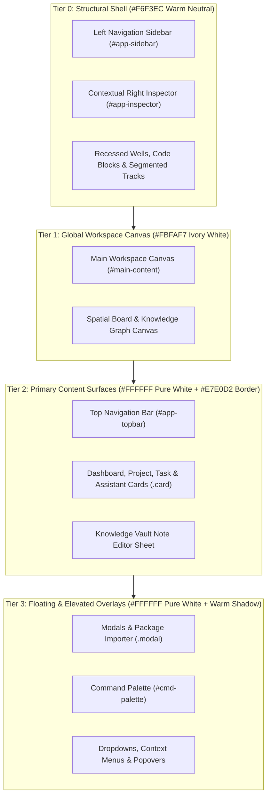

# FLOWDEN — OFFICIAL LIGHT THEME DESIGN SYSTEM (v1.0)
## Phase 2: Ivory White & Champagne Gold Architecture

- **Document Status**: Official Design System & Architecture Specification (Phase 2)
- **Version**: 1.0.0
- **Date**: November 8, 2026
- **Author**: Principal Product Designer, Design Systems Architect & Senior Frontend Architecture Specialist
- **Execution Mode**: Specification & Design Architecture Only (Zero Code Mutations)
- **Reference Audit**: [`docs/design/flowden-light-theme-visual-audit-v1.md`](file:///C:/Users/Sod/.gemini/antigravity/scratch/flowden/docs/design/flowden-light-theme-visual-audit-v1.md)
- **Target Scope**: Flowden Light Mode (`[data-theme="light"]`) Across All 15 Workspace Surfaces & Component Families

---

## 1. Executive Design Direction

Flowden operates with a dual-identity theme architecture designed for extended deep-work sessions across both low-light and daylight environments:

- **Dark Mode Identity (Preserved Unchanged)**: **Deep Charcoal (`#191D20`) · Warm Off-White (`#F4F2EC`) · Muted Teal (`#78C8B2`)**. This signature dark workspace remains 100% untouched in `:root` and `[data-theme="dark"]`.
- **Light Mode Identity (New Official Specification)**: **Ivory White (`#FBFAF7`) · Champagne Gold (`#C5A15B`) · Warm Neutrals (`#F6F3EC`) · Charcoal Typography (`#20211F`)**.

### Core Aesthetic & Architectural Principles

1. **Luminous Architectural Clarity Over Heavy Beige**:
   The Phase 1 audit demonstrated that the legacy Light Mode inverted surface hierarchy by placing muddy grey-tan cards (`#EAE6DC`) on a dull beige canvas (`#F4F2EC`) next to a stark white sidebar (`#FFFFFF`). The new Light Mode reverses this anti-pattern: the global workspace canvas is a luminous, paper-inspired **Ivory White (`#FBFAF7`)**, primary interactive cards and editor surfaces are **Pure White (`#FFFFFF`)**, and **Warm Neutral (`#F6F3EC`)** is reserved strictly for structural anchoring (the collapsible left sidebar, recessed wells, code blocks, and segmented control tracks).
2. **Restrained Champagne Gold Brand Accents**:
   Champagne Gold (`#C5A15B`) replaces legacy dark green (`#2B8670`) and hardcoded cyan/teal (`#14b8a6`, `#78C8B2`) as the primary brand and interaction accent in Light Mode. Gold is treated like a precision architectural metal—reserved for primary call-to-action buttons, active navigation markers, selection halos, and inline knowledge links—never splashed across large container backgrounds.
3. **High-Contrast Charcoal Typography on Gold & Ivory**:
   Every primary Champagne Gold fill (`#C5A15B`) is paired exclusively with **Deep Warm Charcoal (`#20211F`)** typography and iconography (**6.64:1** contrast ratio, passing WCAG 2.1 AA and AAA Large). White text on `#C5A15B` (**2.44:1**) is strictly prohibited. Inline text links and standalone accent icons on white or ivory surfaces use **Deep Gold (`#87631E`, 5.48:1)** to guarantee effortless readability.
4. **Strict Separation of Brand Accents vs. Semantic Status & User Colors**:
   Champagne Gold identifies Flowden's brand and selection affordances. Operational status colors (Success Green `#2E9B62`, Warning Amber `#C08A2C`, Error Red `#CC4440`, Info Blue `#3D8BBF`) and user-authored palette choices (Project swatches, Spatial Board card colors, custom Knowledge Graph themes) retain their exact semantic and user-controlled meanings.

---

## 2. Final Color Palette

### A. Core Surfaces & Borders

| Role | Token Reference | Final Hex / Value | Architectural Purpose |
| :--- | :--- | :--- | :--- |
| **Main Background (Canvas)** | `--bg-primary` / `--surface-canvas` | `#FBFAF7` | Global viewport background (`#app-container`, `#main-content`), Spatial Board & Graph base canvas. |
| **Primary Surface** | `--surface-primary` | `#FFFFFF` | Cards (`.card`), Note Editor sheet, Modals (`.modal`), Topbar (`#app-topbar`), Inputs (`.input`), Tables. |
| **Secondary Surface** | `--surface-secondary` | `#F6F3EC` | Left Sidebar (`#app-sidebar`), Right Inspector (`#app-inspector`), Recessed sub-cards/wells, Modal footers, Segmented tracks. |
| **Elevated Surface** | `--bg-elevated` / `--surface-elevated` | `#FFFFFF` | Dropdowns (`.dropdown`), Popovers, Command Palette dialog, Hover-elevated cards, Active segmented pills. |
| **Subtle Interactive Hover** | `--bg-hover` | `rgba(32, 33, 31, 0.04)` | Neutral hover state for ghost buttons, sidebar rows, dropdown items, and table rows. |
| **Subtle Interactive Active** | `--bg-active` | `rgba(32, 33, 31, 0.07)` | Neutral pressed/active fill for secondary controls and list rows. |
| **Warm Hairline Border** | `--border-primary` | `#E7E0D2` | Default 1px structural divider, card border, input border, and table hairline. |
| **Strong Emphasized Border** | `--border-secondary` | `#D9D1C1` | Card hover border, input hover border, active control border, and prominent section dividers. |

### B. Champagne Gold Brand Ramp

| Role | Token Reference | Final Hex / Value | Architectural Purpose |
| :--- | :--- | :--- | :--- |
| **Primary Gold** | `--accent-primary` | `#C5A15B` | Primary CTA button fill (`.btn--primary`), active sidebar left bar, active stepper indicator, board/graph selection outline. |
| **Hover Gold** | `--accent-hover` | `#B38F46` | Primary button `:hover` fill and border. |
| **Active Gold** | `--accent-active` | `#9E7B35` | Primary button `:active` pressed fill and high-contrast non-text focus border. |
| **Deep Gold** | `--accent-deep` / `--accent-subtle` | `#87631E` | Accessible text links, active breadcrumb links, inline WikiLink text, active tab text/icons on white surfaces (**5.48:1**). |
| **Soft Gold** | `--accent-soft` | `#F3EAD6` | Solid warm champagne tint for WikiLink pills (`.wikilink-badge`), admin role badges, and selected tag chips. |
| **Muted Gold Alpha** | `--accent-muted` | `rgba(197, 161, 91, 0.14)` | Translucent gold wash for marquee selection boxes, empty-state icon halos, and active row highlights. |
| **Gold Accent Border** | `--accent-border` | `rgba(197, 161, 91, 0.34)` | Refined gold hairline for accented callout cards, WikiLink chips, and featured badges. |
| **On-Gold Typography** | `--accent-contrast-text` | `#20211F` | Mandatory Deep Charcoal foreground text/icon color placed atop `--accent-primary` (`#C5A15B`). |

### C. Charcoal Typography Hierarchy

| Role | Token Reference | Final Hex / Value | Contrast on `#FFFFFF` / `#FBFAF7` | Architectural Purpose |
| :--- | :--- | :--- | :--- | :--- |
| **Primary Text** | `--text-primary` | `#20211F` | **16.17:1** / **15.49:1** | Page titles, headings, body copy, note prose, card titles, form input values, primary button labels. |
| **Secondary Text** | `--text-secondary` | `#68706D` | **5.09:1** / **4.87:1** | Card descriptions, form labels, inactive navigation items, table metadata, secondary buttons, timestamps. |
| **Muted / Caption Text** | `--text-muted` | `#6E7673` | **4.63:1** / **4.43:1** | Accessible small captions, helper text, and secondary metadata requiring WCAG AA contrast on white surfaces. |
| **Tertiary / Placeholder Text** | `--text-tertiary` | `#8E9693` | **2.98:1** / **2.86:1** | Input placeholders, decorative keyboard shortcut hints (`Ctrl+K`), disabled control labels, and subtle section headers. |
| **Inverse Text** | `--text-inverse` | `#FBFAF7` | **15.49:1** (on `#20211F`) | Light text rendered exclusively over dark charcoal tooltips or dark media overlays. |

### D. Semantic Status Palette (Preserved Functional Meaning)

| Status Family | Foreground Token & Hex | Background Token & Value | Border Token & Value | Usage Scope |
| :--- | :--- | :--- | :--- | :--- |
| **Success / Active / Done** | `--status-success`: `#2E9B62` (**4.52:1** on `#FFF` via `#268552` text / `#2E9B62` icon) | `--status-success-bg`: `rgba(46, 155, 98, 0.10)` | `--status-success-border`: `rgba(46, 155, 98, 0.28)` | MCP Connected badge, Completed tasks, Active project pill, Package verified/imported checkmarks, Success toasts. |
| **Warning / Pending** | `--status-warning`: `#C08A2C` (Icon/Border) / `#946615` (Badge text **5.12:1**) | `--status-warning-bg`: `rgba(192, 138, 44, 0.10)` | `--status-warning-border`: `rgba(192, 138, 44, 0.28)` | Unconfigured MCP warning, Inspection warning alerts, Pending review badges, Warning toasts. |
| **Error / Destructive** | `--status-error`: `#CC4440` (**4.65:1** on `#FFFFFF`) | `--status-error-bg`: `rgba(204, 68, 64, 0.09)` | `--status-error-border`: `rgba(204, 68, 64, 0.28)` | Form validation errors, Delete confirmations, Failed inspection/import states, Destructive buttons (`.btn--danger`). |
| **Information** | `--status-info`: `#3D8BBF` (Icon/Border) / `#2B6F9E` (Badge text **5.24:1**) | `--status-info-bg`: `rgba(61, 139, 191, 0.09)` | `--status-info-border`: `rgba(61, 139, 191, 0.26)` | Informational callouts, Neutral system notices, Schema version indicators where non-brand. |

---

## 3. Complete Semantic Token Architecture

### Architectural Interaction with Existing Flowden CSS Variables

Inspection of [`public/css/variables.css`](file:///C:/Users/Sod/.gemini/antigravity/scratch/flowden/public/css/variables.css), [`public/css/layout.css`](file:///C:/Users/Sod/.gemini/antigravity/scratch/flowden/public/css/layout.css), and [`public/css/components.css`](file:///C:/Users/Sod/.gemini/antigravity/scratch/flowden/public/css/components.css) revealed the root cause of the legacy White Mode's inverted surface hierarchy:

- In Flowden's existing stylesheets, `.card` ([`components.css#L202`](file:///C:/Users/Sod/.gemini/antigravity/scratch/flowden/public/css/components.css#L202)), `.modal` ([`components.css#L272`](file:///C:/Users/Sod/.gemini/antigravity/scratch/flowden/public/css/components.css#L272)), `.dropdown` ([`components.css#L352`](file:///C:/Users/Sod/.gemini/antigravity/scratch/flowden/public/css/components.css#L352)), and `.toast` ([`components.css#L610`](file:///C:/Users/Sod/.gemini/antigravity/scratch/flowden/public/css/components.css#L610)) all reference `background-color: var(--bg-tertiary)`.
- Meanwhile, `#app-sidebar` ([`layout.css#L20`](file:///C:/Users/Sod/.gemini/antigravity/scratch/flowden/public/css/layout.css#L20)), `.sidebar-footer` ([`layout.css#L262`](file:///C:/Users/Sod/.gemini/antigravity/scratch/flowden/public/css/layout.css#L262)), `.modal-footer` ([`components.css#L322`](file:///C:/Users/Sod/.gemini/antigravity/scratch/flowden/public/css/components.css#L322)), and `.segmented-control` ([`components.css#L527`](file:///C:/Users/Sod/.gemini/antigravity/scratch/flowden/public/css/components.css#L527)) reference `background-color: var(--bg-secondary)`.
- In the legacy `[data-theme="light"]` block, `--bg-secondary` was set to `#FFFFFF` and `--bg-tertiary` was set to `#EAE6DC`, which forced every card, modal, dropdown, and toast into a muddy grey-tan while making the sidebar and modal footers stark white.

To solve this cleanly without touching Dark Mode:
1. We introduce explicit **Semantic Surface & Component Tokens** (`--surface-canvas`, `--surface-primary`, `--surface-secondary`, `--surface-elevated`, `--surface-sidebar`, `--surface-topbar`, `--surface-card`, `--surface-modal`, `--surface-well`, `--btn-primary-bg`, `--btn-primary-text`, etc.).
2. In `[data-theme="light"]`, we also align the core aliases so that surfaces resolve to their intended visual hierarchy:
   - `--bg-primary: #FBFAF7` (Global Ivory Canvas)
   - `--bg-secondary: #F6F3EC` (Warm Neutral for Sidebar, Inspector, Modal Footer, Segmented Control Track, Recessed Wells)
   - `--bg-tertiary: #FFFFFF` (Pure White for Cards, Modals, Dropdowns, Toasts)
   - `--bg-elevated: #FFFFFF` (Pure White for Elevated Hover States, Active Segmented Buttons, Active Nav Items)
   - For the few places where inline JS templates used `var(--bg-secondary)` for a card or `var(--bg-tertiary)` for a recessed well (such as `assistant.js`), Phase 3 will bind them to the unambiguous `--surface-card` (`#FFFFFF`) and `--surface-well` (`#F6F3EC`) tokens.

### Complete Semantic Token Reference Table

| Token Family | CSS Custom Property | Light Mode Value (`[data-theme="light"]`) | Dark Mode Equivalent (`:root`) | Semantic Role |
| :--- | :--- | :--- | :--- | :--- |
| **Backgrounds & Surfaces** | `--bg-primary` | `#FBFAF7` | `#191D20` | Global workspace canvas background |
| **Backgrounds & Surfaces** | `--bg-secondary` | `#F6F3EC` | `#141719` | Structural shell & recessed surface (Sidebar, Inspector, Modal footer, Segmented track) |
| **Backgrounds & Surfaces** | `--bg-tertiary` | `#FFFFFF` | `#1E2327` | Primary container surface (Cards, Modals, Dropdowns, Toasts) |
| **Backgrounds & Surfaces** | `--bg-elevated` | `#FFFFFF` | `#242A2F` | Elevated interactive surface (Active nav pill, Active segmented button, Popovers) |
| **Backgrounds & Surfaces** | `--surface-canvas` | `#FBFAF7` | `#191D20` | Explicit alias for main viewport/board/graph canvas |
| **Backgrounds & Surfaces** | `--surface-primary` | `#FFFFFF` | `#1E2327` | Explicit alias for primary white cards, panels, and editor sheets |
| **Backgrounds & Surfaces** | `--surface-secondary` | `#F6F3EC` | `#141719` | Explicit alias for warm-neutral secondary areas and recessed wells |
| **Backgrounds & Surfaces** | `--surface-elevated` | `#FFFFFF` | `#242A2F` | Explicit alias for floating menus, popovers, and modals |
| **Backgrounds & Surfaces** | `--surface-sidebar` | `#F6F3EC` | `#141719` | Left navigation sidebar background |
| **Backgrounds & Surfaces** | `--surface-topbar` | `#FFFFFF` | `#141719` | Top navigation bar surface |
| **Backgrounds & Surfaces** | `--surface-card` | `#FFFFFF` | `#1E2327` | Standard card and panel surface |
| **Backgrounds & Surfaces** | `--surface-well` | `#F6F3EC` | `#141719` | Recessed inner well, code block, or dropzone background |
| **Backgrounds & Surfaces** | `--surface-editor` | `#FFFFFF` | `#191D20` | Note Editor writing surface |
| **Backgrounds & Surfaces** | `--surface-toolbar` | `#FFFFFF` | `#141719` | Floating or docked toolbar surface |
| **Interactive States** | `--bg-hover` | `rgba(32, 33, 31, 0.04)` | `rgba(255, 255, 255, 0.04)` | Subtle neutral hover wash |
| **Interactive States** | `--bg-active` | `rgba(32, 33, 31, 0.07)` | `rgba(255, 255, 255, 0.07)` | Subtle neutral active/pressed wash |
| **Form Controls** | `--bg-input` | `#FFFFFF` | `#1E2327` | Input, textarea, and select background |
| **Form Controls** | `--bg-input-disabled` | `#F6F3EC` | `rgba(255, 255, 255, 0.03)` | Disabled form control surface |
| **Modal Overlays** | `--bg-overlay` | `rgba(32, 33, 31, 0.42)` | `rgba(0, 0, 0, 0.70)` | Backdrop scrim behind modals and command palette |
| **Typography** | `--text-primary` | `#20211F` | `#F4F2EC` | Primary headings, prose, and active labels |
| **Typography** | `--text-secondary` | `#68706D` | `#9FAAB3` | Secondary descriptions, labels, and metadata |
| **Typography** | `--text-muted` | `#6E7673` | `#7A8694` | Accessible small captions and helper text ($\ge 4.5:1$ on `#FFF`) |
| **Typography** | `--text-tertiary` | `#8E9693` | `#67737C` | Placeholders, shortcut hints, and disabled labels |
| **Typography** | `--text-inverse` | `#FBFAF7` | `#191D20` | Inverse text for dark tooltips/overlays |
| **Brand Accents** | `--accent-primary` | `#C5A15B` | `#78C8B2` | Primary Champagne Gold brand accent |
| **Brand Accents** | `--accent-hover` | `#B38F46` | `#8FD4C1` | Hover Champagne Gold |
| **Brand Accents** | `--accent-active` | `#9E7B35` | `#62B39C` | Active/Pressed Champagne Gold |
| **Brand Accents** | `--accent-deep` | `#87631E` | `#78C8B2` | Deep Gold for text links, inline icons, and accessible accents on light surfaces |
| **Brand Accents** | `--accent-subtle` | `#87631E` | `#78C8B2` | Legacy alias mapped to Deep Gold (`#87631E`) for text readability |
| **Brand Accents** | `--accent-soft` | `#F3EAD6` | `rgba(120, 200, 178, 0.14)` | Soft Gold surface for WikiLinks, chips, and selected tags |
| **Brand Accents** | `--accent-muted` | `rgba(197, 161, 91, 0.14)` | `rgba(120, 200, 178, 0.12)` | Translucent gold tint for halos and marquee fills |
| **Brand Accents** | `--accent-border` | `rgba(197, 161, 91, 0.34)` | `rgba(120, 200, 178, 0.22)` | Subtle gold border for callouts and badges |
| **Buttons** | `--btn-primary-bg` | `#C5A15B` | `#78C8B2` | Primary button background |
| **Buttons** | `--btn-primary-hover` | `#B38F46` | `#8FD4C1` | Primary button hover background |
| **Buttons** | `--btn-primary-active` | `#9E7B35` | `#62B39C` | Primary button active background |
| **Buttons** | `--btn-primary-text` | `#20211F` | `#191D20` | Primary button label & icon color (**6.64:1** contrast) |
| **Buttons** | `--btn-disabled-bg` | `#E7E0D2` | `#242A2F` | Disabled primary/secondary button background |
| **Buttons** | `--btn-disabled-text` | `#68706D` | `#67737C` | Disabled button text (**3.71:1** on `#E7E0D2`, fixing the 1.6:1 defect) |
| **Borders & Dividers** | `--border-primary` | `#E7E0D2` | `#2C343B` | Default warm hairline border |
| **Borders & Dividers** | `--border-secondary` | `#D9D1C1` | `#3B464F` | Strong/emphasized border for hover and active controls |
| **Focus Rings** | `--border-focus` | `#9E7B35` | `#78C8B2` | High-contrast focus border (**3.55:1** on `#FFFFFF`) |
| **Focus Rings** | `--shadow-focus` | `0 0 0 3px rgba(197, 161, 91, 0.28)` | `0 0 0 2px var(--accent-muted)` | Champagne Gold outer focus halo |
| **Selection & Canvas** | `--selection-bg` | `rgba(197, 161, 91, 0.14)` | `rgba(120, 200, 178, 0.12)` | Marquee selection fill, text selection, multi-select highlight |
| **Selection & Canvas** | `--selection-border` | `#C5A15B` | `#78C8B2` | Selected card/node outline and marquee border |
| **Selection & Canvas** | `--selection-halo` | `0 0 0 2px rgba(197, 161, 91, 0.35)` | `0 0 0 2px rgba(20, 184, 166, 0.40)` | Spatial Board & Vault multi-select outer ring |
| **Selection & Canvas** | `--wire-active-stroke` | `#9E7B35` | `#14b8a6` | Spatial Board selected/in-progress connection wire |
| **Selection & Canvas** | `--canvas-grid-dot` | `#D9D1C1` | `rgba(255, 255, 255, 0.08)` | Spatial Board dot-grid pattern color |
| **Graph Categories** | `--graph-note-start` | `#87631E` | `#0D9488` | Default Note node gradient start (Deep Gold) |
| **Graph Categories** | `--graph-note-end` | `#C5A15B` | `#78C8B2` | Default Note node gradient end (Champagne Gold) |
| **Graph Categories** | `--graph-note-fill-soft` | `#F3EAD6` | `rgba(120, 200, 178, 0.16)` | Soft gold node fill option |
| **Graph Categories** | `--graph-edge-default` | `#D9D1C1` | `rgba(159, 170, 179, 0.28)` | Unselected Knowledge Graph relationship line |
| **Graph Categories** | `--graph-edge-active` | `#9E7B35` | `#78C8B2` | Highlighted/hovered Knowledge Graph relationship line |
| **Semantic Status** | `--status-success` | `#2E9B62` | `#3FBF7F` | Semantic green (Active, Connected, Completed, Verified) |
| **Semantic Status** | `--status-success-text` | `#237B4B` | `#3FBF7F` | High-contrast green for small badge text (**5.36:1** on `#FFFFFF`) |
| **Semantic Status** | `--status-success-bg` | `rgba(46, 155, 98, 0.10)` | `rgba(63, 191, 127, 0.10)` | Soft green status badge fill |
| **Semantic Status** | `--status-success-border` | `rgba(46, 155, 98, 0.28)` | `rgba(63, 191, 127, 0.25)` | Green status badge border |
| **Semantic Status** | `--status-warning` | `#C08A2C` | `#E0A040` | Semantic amber (Warning, Pending, Unconfigured) |
| **Semantic Status** | `--status-warning-text` | `#946615` | `#E0A040` | High-contrast amber for small badge text (**5.12:1** on `#FFFFFF`) |
| **Semantic Status** | `--status-warning-bg` | `rgba(192, 138, 44, 0.10)` | `rgba(224, 160, 64, 0.10)` | Soft amber status badge fill |
| **Semantic Status** | `--status-warning-border` | `rgba(192, 138, 44, 0.28)` | `rgba(224, 160, 64, 0.25)` | Amber status badge border |
| **Semantic Status** | `--status-error` | `#CC4440` | `#E0524D` | Semantic red (Error, Failed, Destructive) |
| **Semantic Status** | `--status-error-bg` | `rgba(204, 68, 64, 0.09)` | `rgba(224, 82, 77, 0.10)` | Soft red status badge fill |
| **Semantic Status** | `--status-error-border` | `rgba(204, 68, 64, 0.28)` | `rgba(224, 82, 77, 0.25)` | Red status badge border |
| **Semantic Status** | `--status-info` | `#3D8BBF` | `#5BA3D9` | Semantic blue (Informational) |
| **Semantic Status** | `--status-info-text` | `#2B6F9E` | `#5BA3D9` | High-contrast blue for small badge text (**5.24:1** on `#FFFFFF`) |
| **Semantic Status** | `--status-info-bg` | `rgba(61, 139, 191, 0.09)` | `rgba(91, 163, 217, 0.10)` | Soft blue status badge fill |
| **Semantic Status** | `--status-info-border` | `rgba(61, 139, 191, 0.26)` | `rgba(91, 163, 217, 0.25)` | Blue status badge border |
| **Shadows** | `--shadow-sm` | `0 1px 3px rgba(32, 33, 31, 0.05), 0 1px 2px rgba(32, 33, 31, 0.03)` | `0 1px 3px rgba(0, 0, 0, 0.40)` | Subtle card and active pill elevation |
| **Shadows** | `--shadow-md` | `0 4px 14px rgba(32, 33, 31, 0.07), 0 1px 3px rgba(32, 33, 31, 0.04)` | `0 4px 14px rgba(0, 0, 0, 0.50)` | Floating toolbar, dropdown, and board card elevation |
| **Shadows** | `--shadow-lg` | `0 12px 32px rgba(32, 33, 31, 0.10), 0 2px 6px rgba(32, 33, 31, 0.05)` | `0 8px 28px rgba(0, 0, 0, 0.60)` | Modal dialog and Command Palette elevation |

### Implementation-Ready CSS Token Block (`[data-theme="light"]`)

```css
/* --------------------------------------------------------------------------
   Light Mode Theme — Ivory White & Champagne Gold Architecture (v1.0)
   Direction: Ivory White (#FBFAF7) · Champagne Gold (#C5A15B) · Warm Neutrals (#F6F3EC) · Charcoal (#20211F)
   -------------------------------------------------------------------------- */
[data-theme="light"] {
  /* Core Surfaces & Legacy Variable Mapping */
  --bg-primary: #FBFAF7;
  --bg-secondary: #F6F3EC;
  --bg-tertiary: #FFFFFF;
  --bg-elevated: #FFFFFF;
  --bg-hover: rgba(32, 33, 31, 0.04);
  --bg-active: rgba(32, 33, 31, 0.07);
  --bg-input: #FFFFFF;
  --bg-input-disabled: #F6F3EC;
  --bg-overlay: rgba(32, 33, 31, 0.42);

  /* Explicit Semantic Surface Tokens */
  --surface-canvas: #FBFAF7;
  --surface-primary: #FFFFFF;
  --surface-secondary: #F6F3EC;
  --surface-elevated: #FFFFFF;
  --surface-sidebar: #F6F3EC;
  --surface-topbar: #FFFFFF;
  --surface-card: #FFFFFF;
  --surface-well: #F6F3EC;
  --surface-editor: #FFFFFF;
  --surface-toolbar: #FFFFFF;

  /* Charcoal Typography Hierarchy */
  --text-primary: #20211F;
  --text-secondary: #68706D;
  --text-muted: #6E7673;
  --text-tertiary: #8E9693;
  --text-inverse: #FBFAF7;

  /* Champagne Gold Brand Accents */
  --accent-primary: #C5A15B;
  --accent-hover: #B38F46;
  --accent-active: #9E7B35;
  --accent-deep: #87631E;
  --accent-subtle: #87631E;
  --accent-soft: #F3EAD6;
  --accent-muted: rgba(197, 161, 91, 0.14);
  --accent-border: rgba(197, 161, 91, 0.34);
  --accent-contrast-text: #20211F;

  /* Button Tokens */
  --btn-primary-bg: #C5A15B;
  --btn-primary-hover: #B38F46;
  --btn-primary-active: #9E7B35;
  --btn-primary-text: #20211F;
  --btn-disabled-bg: #E7E0D2;
  --btn-disabled-text: #68706D;

  /* Warm Neutral Hairline Borders & Focus Rings */
  --border-primary: #E7E0D2;
  --border-secondary: #D9D1C1;
  --border-focus: #9E7B35;

  /* Selection, Spatial Board & Knowledge Graph Tokens */
  --selection-bg: rgba(197, 161, 91, 0.14);
  --selection-border: #C5A15B;
  --selection-halo: 0 0 0 2px rgba(197, 161, 91, 0.35);
  --wire-active-stroke: #9E7B35;
  --canvas-grid-dot: #D9D1C1;
  --graph-note-start: #87631E;
  --graph-note-end: #C5A15B;
  --graph-note-fill-soft: #F3EAD6;
  --graph-edge-default: #D9D1C1;
  --graph-edge-active: #9E7B35;

  /* Semantic Status Colors (Preserved Meaning) */
  --status-success: #2E9B62;
  --status-success-text: #237B4B;
  --status-success-bg: rgba(46, 155, 98, 0.10);
  --status-success-border: rgba(46, 155, 98, 0.28);
  --status-warning: #C08A2C;
  --status-warning-text: #946615;
  --status-warning-bg: rgba(192, 138, 44, 0.10);
  --status-warning-border: rgba(192, 138, 44, 0.28);
  --status-error: #CC4440;
  --status-error-bg: rgba(204, 68, 64, 0.09);
  --status-error-border: rgba(204, 68, 64, 0.28);
  --status-info: #3D8BBF;
  --status-info-text: #2B6F9E;
  --status-info-bg: rgba(61, 139, 191, 0.09);
  --status-info-border: rgba(61, 139, 191, 0.26);

  /* Warm Architectural Shadows */
  --shadow-sm: 0 1px 3px rgba(32, 33, 31, 0.05), 0 1px 2px rgba(32, 33, 31, 0.03);
  --shadow-md: 0 4px 14px rgba(32, 33, 31, 0.07), 0 1px 3px rgba(32, 33, 31, 0.04);
  --shadow-lg: 0 12px 32px rgba(32, 33, 31, 0.10), 0 2px 6px rgba(32, 33, 31, 0.05);
  --shadow-focus: 0 0 0 3px rgba(197, 161, 91, 0.28);

  /* Semantic Project Tag Swatches (Preserved) */
  --project-violet: #7B6CC8;
  --project-blue: #4A87C0;
  --project-teal: #2B8670;
  --project-green: #4DA05D;
  --project-amber: #C89230;
  --project-orange: #C46A3A;
  --project-rose: #C04A68;
  --project-gray: #6A7480;
}
```

---

## 4. Surface Hierarchy

To eliminate the "everything is beige" fatigue identified in Phase 1, Flowden Light Mode enforces a strict 4-tier tonal elevation model:



### Surface-by-Surface Specification

| Workspace Layer | Surface Color | Border / Separation | Elevation / Shadow | Design Rationale |
| :--- | :--- | :--- | :--- | :--- |
| **1. Global Canvas (`#main-content`)** | Ivory White (`#FBFAF7`) | None | Flat (`z-index: 1`) | Soft, glare-free paper tone that allows pure white cards to pop without heavy drop shadows. |
| **2. Left Sidebar (`#app-sidebar`)** | Warm Neutral (`#F6F3EC`) | `border-right: 1px solid #E7E0D2` | Structural anchor | Grounds the navigation rail tonally so the central workspace feels expansive and bright. Active nav item floats as a crisp `#FFFFFF` pill with a `#C5A15B` left indicator. |
| **3. Top Navigation Bar (`#app-topbar`)** | Pure White (`#FFFFFF`) | `border-bottom: 1px solid #E7E0D2` | Crisp header | Provides a clean, luminous header bar. The global search trigger inside uses `#FBFAF7` with `#E7E0D2` border. |
| **4. Elevated Cards & Panels (`.card`)** | Pure White (`#FFFFFF`) | `1px solid #E7E0D2` (`#D9D1C1` on hover) | `--shadow-sm` on interactive hover | Replaces the muddy `#EAE6DC` slabs across Overview, Projects, Workflow, Settings, and Guide. |
| **5. Recessed Sub-cards & Wells** | Warm Neutral (`#F6F3EC`) | `1px solid #E7E0D2` | Recessed (inset feel) | Used *only* inside a `#FFFFFF` parent card (e.g., MCP project allowlist box, code blocks, drag-and-drop upload zones, Kanban column tracks). |
| **6. Note Editor Surface** | Pure White (`#FFFFFF`) | `1px solid #E7E0D2` | Clean reading sheet | Maximum typographic clarity (**16.17:1** contrast with `#20211F` prose). Vault note list rail uses `#FBFAF7` to distinguish list from active document. |
| **7. Toolbars (Board, Graph, Editor)** | Pure White (`#FFFFFF`) | `1px solid #E7E0D2` | `--shadow-md` (floating) | Floating HUD toolbars on Spatial Board and Knowledge Graph use `#FFFFFF` with subtle warm shadow. |
| **8. Modals & Drawers (`.modal`)** | Pure White (`#FFFFFF`) | `1px solid #E7E0D2` | `--shadow-lg` over `rgba(32, 33, 31, 0.42)` backdrop | Header and body are `#FFFFFF`; `.modal-footer` uses Warm Neutral `#F6F3EC` with `border-top: 1px solid #E7E0D2` to anchor action buttons. |
| **9. Dropdowns & Popovers (`.dropdown`)** | Pure White (`#FFFFFF`) | `1px solid #D9D1C1` | `--shadow-md` | All sections (search input, filter bar, results list) share a unified `#FFFFFF` surface, fixing the split white/muddy-tan defect in Command Palette. |

---

## 5. Typography and Contrast Rules

### Font Families & Hierarchy (Preserved from Core System)
- **Brand Display (`--font-brand`)**: `'Space Grotesk', 'Sora', var(--font-heading)`
- **Section & Card Headings (`--font-heading`)**: `'Manrope', -apple-system, BlinkMacSystemFont, sans-serif`
- **UI & Long-form Body Prose (`--font-sans`)**: `'Inter', -apple-system, BlinkMacSystemFont, sans-serif`
- **Code, Hashes & Schema Paths (`--font-mono`)**: `'JetBrains Mono', 'Fira Code', monospace`

### Strict Light Mode Typography Rules

1. **Primary Prose & Headings (`--text-primary: #20211F`)**:
   - Used for all H1–H4 headings, card titles, note editor prose, input text, and active navigation labels.
   - Delivers **16.17:1** on `#FFFFFF`, **15.49:1** on `#FBFAF7`, and **14.59:1** on `#F6F3EC` (exceeding WCAG AAA 7.0:1).
2. **Secondary Descriptions & UI Labels (`--text-secondary: #68706D`)**:
   - Used for subtitles, card body summaries, form field labels, table headers, and inactive tabs/nav items.
   - Delivers **5.09:1** on `#FFFFFF`, **4.87:1** on `#FBFAF7`, and **4.59:1** on `#F6F3EC` (passing WCAG AA 4.5:1 across all three surface tiers).
3. **Small Captions & Metadata (`--text-muted: #6E7673` vs `--text-tertiary: #8E9693`)**:
   - `--text-tertiary` (`#8E9693`) has a contrast ratio of **2.98:1** on `#FFFFFF`. Therefore, `--text-tertiary` is restricted to **input placeholders, decorative keyboard shortcut badges (`Ctrl+K`), disabled control labels, and non-essential decorative dividers** (which are exempt from the 4.5:1 normal-text rule under WCAG 2.1 SC 1.4.3).
   - Any meaningful small caption or helper text that users must read to operate the interface must use `--text-secondary` (`#68706D`, **5.09:1**) or `--text-muted` (`#6E7673`, **4.63:1** on `#FFFFFF`).
4. **Gold vs. Charcoal Text Pairing Rules (Mandatory)**:
   - **Rule 1 (Buttons & Solid Gold Fills)**: Whenever a background is `--accent-primary` (`#C5A15B`) or `--accent-hover` (`#B38F46`), the foreground text and icon color **MUST** be `--btn-primary-text` (`#20211F`, **6.64:1**). White text (`#FFFFFF` on `#C5A15B` = **2.44:1**) is strictly forbidden.
   - **Rule 2 (Links & Inline Accents on Light Surfaces)**: Primary Gold (`#C5A15B`) **MUST NEVER** be used as text color on `#FFFFFF`, `#FBFAF7`, or `#F6F3EC` (**2.44:1**–**2.19:1**, fails WCAG). All text links, active breadcrumb segments, inline WikiLink labels, and standalone accent icons on light surfaces **MUST** use `--accent-deep` (`#87631E`), which achieves **5.48:1** on `#FFFFFF`, **5.25:1** on `#FBFAF7`, and **4.58:1** on Soft Gold (`#F3EAD6`).

---

## 6. Component Styling Specification

The following concrete state rules govern all 15 component families in `[data-theme="light"]`. Champagne Gold is reserved for primary actions and active selection affordances; secondary and tertiary controls use crisp white and warm neutral surfaces.

### 1. Primary, Secondary, and Tertiary (Ghost) Buttons

| Variant | Default Surface | Border | Text / Icon | Accent | Hover State | Active (Pressed) | Disabled State | Focus (`:focus-visible`) |
| :--- | :--- | :--- | :--- | :--- | :--- | :--- | :--- | :--- |
| **Primary (`.btn--primary`)** | `#C5A15B` (`--btn-primary-bg`) | `1px solid #C5A15B` | `#20211F` (`--btn-primary-text`, `font-weight: 600`) | Champagne Gold | Bg `#B38F46`, Border `#B38F46`, Text `#20211F` | Bg `#9E7B35`, Border `#9E7B35`, Text `#20211F` | Bg `#E7E0D2`, Border `#D9D1C1`, Text `#68706D` (`opacity: 1`, **3.71:1** contrast) | `outline: none`, `border-color: #87631E`, `box-shadow: 0 0 0 3px rgba(197, 161, 91, 0.32)` |
| **Secondary (`.btn--secondary`)** | `#FFFFFF` (`--surface-primary`) | `1px solid #E7E0D2` | `#20211F` (`--text-primary`) | Warm Neutral / Optional `#87631E` icon | Bg `#F6F3EC`, Border `#D9D1C1`, Text `#20211F` | Bg `rgba(32, 33, 31, 0.07)`, Border `#D9D1C1` | Bg `#F6F3EC`, Border `#E7E0D2`, Text `#8E9693` | `border-color: #9E7B35`, `box-shadow: var(--shadow-focus)` |
| **Tertiary / Ghost (`.btn--ghost`)** | `transparent` | `1px solid transparent` | `#68706D` (`--text-secondary`) | None | Bg `rgba(32, 33, 31, 0.04)`, Text `#20211F` | Bg `rgba(32, 33, 31, 0.07)`, Text `#20211F` | Bg `transparent`, Text `#8E9693` | `border-color: #9E7B35`, `box-shadow: var(--shadow-focus)` |
| **Destructive (`.btn--danger`)** | `transparent` | `1px solid rgba(204, 68, 64, 0.28)` | `#CC4440` (`--status-error`) | Semantic Red | Bg `rgba(204, 68, 64, 0.09)`, Border `#CC4440` | Bg `rgba(204, 68, 64, 0.16)`, Border `#CC4440` | Bg `transparent`, Border `#E7E0D2`, Text `#8E9693` | `border-color: #CC4440`, `box-shadow: 0 0 0 3px rgba(204, 68, 64, 0.22)` |

### 2. Text Buttons, Inline Links, and Icon Buttons

| Component | Default Surface | Border | Text / Icon | Accent | Hover State | Active State | Disabled State | Focus (`:focus-visible`) |
| :--- | :--- | :--- | :--- | :--- | :--- | :--- | :--- | :--- |
| **Text Button / Link (`a`, `.btn-link`)** | `transparent` | None (`underline` on hover) | `#87631E` (`--accent-deep`, **5.48:1**) | Deep Gold | Text `#6E4F14`, `text-decoration: underline` | Text `#573D0E` | Text `#8E9693`, `pointer-events: none` | `border-radius: 3px`, `box-shadow: var(--shadow-focus)` |
| **Icon Button (`.btn--icon`)** | `transparent` | `1px solid transparent` | `#68706D` (`--text-secondary`) | `#87631E` when toggled active | Bg `rgba(32, 33, 31, 0.04)`, Icon `#20211F` | Bg `rgba(32, 33, 31, 0.07)`, Icon `#20211F` | Icon `#8E9693`, `opacity: 0.5` | `border-color: #9E7B35`, `box-shadow: var(--shadow-focus)` |
| **Active/Toggled Icon Button** | `#F3EAD6` (`--accent-soft`) | `1px solid rgba(197, 161, 91, 0.34)` | `#87631E` (`--accent-deep`) | Champagne Gold | Bg `rgba(197, 161, 91, 0.24)`, Icon `#20211F` | Bg `#C5A15B`, Icon `#20211F` | Bg `#F6F3EC`, Icon `#8E9693` | `border-color: #9E7B35`, `box-shadow: var(--shadow-focus)` |

### 3. Inputs and Textareas (`.input`, `.textarea`)

- **Default Surface**: Pure White `#FFFFFF` (`--bg-input`). When placed inside a `#FFFFFF` card or modal, crisp separation is maintained via the `1px solid #E7E0D2` border (and `1px solid #D9D1C1` on hover).
- **Border**: `1px solid #E7E0D2` (`--border-primary`).
- **Text**: Value `#20211F` (`--text-primary`); Placeholder `#8E9693` (`--text-tertiary`).
- **Accent**: Caret color `#87631E` (`--accent-deep`).
- **Hover**: `border-color: #D9D1C1` (`--border-secondary`).
- **Active / Focus**: `border-color: #9E7B35` (`--border-focus`), `box-shadow: 0 0 0 3px rgba(197, 161, 91, 0.28)` (`--shadow-focus`). Replaces the hardcoded blue `rgba(107, 138, 253, 0.25)` in [`components.css#L182`](file:///C:/Users/Sod/.gemini/antigravity/scratch/flowden/public/css/components.css#L182).
- **Disabled**: Surface `#F6F3EC` (`--bg-input-disabled`), Border `#E7E0D2`, Text `#68706D`.
- **Error State**: `border-color: #CC4440`, `box-shadow: 0 0 0 3px rgba(204, 68, 64, 0.15)`.

### 4. Selects and Dropdowns (`.select`, `.dropdown`)

- **Default Surface**: Trigger `.select` uses `#FFFFFF`; Floating `.dropdown` menu uses `#FFFFFF` (`--surface-elevated`) with `--shadow-md`.
- **Border**: Trigger `1px solid #E7E0D2`; Menu `1px solid #D9D1C1`.
- **Text**: Default item `#68706D` (`--text-secondary`); Selected/Hovered item `#20211F` (`--text-primary`).
- **Accent**: Active item indicator / checkmark uses `#87631E` (`--accent-deep`).
- **Hover**: `.dropdown-item:hover` uses `background-color: rgba(32, 33, 31, 0.04)`, `color: #20211F`.
- **Active / Selected Item (`.dropdown-item--active`)**: `background-color: #F3EAD6` (`--accent-soft`), `color: #87631E` (`--accent-deep`), `font-weight: 500`.
- **Disabled**: `color: #8E9693`, `pointer-events: none`.
- **Focus**: Trigger uses `border-color: #9E7B35`, `box-shadow: var(--shadow-focus)`.

### 5. Cards and Panels (`.card`, `.assistant-card`, Stat Cards)

- **Default Surface**: Pure White `#FFFFFF` (`--surface-card` / `--bg-tertiary`). Inner recessed sub-panels (such as allowlist boxes or code snippets) use Warm Neutral `#F6F3EC` (`--surface-well`).
- **Border**: `1px solid #E7E0D2` (`--border-primary`). Featured/highlighted cards may use `1px solid rgba(197, 161, 91, 0.34)` (`--accent-border`).
- **Text**: Title `#20211F` (`--text-primary`); Body `#68706D` (`--text-secondary`); Footer metadata `#6E7673` (`--text-muted`).
- **Accent**: Card header icons or stat badges use `#87631E` icon inside a `#F3EAD6` (`--accent-soft`) 32px container.
- **Hover (`.card--interactive:hover`)**: Surface remains `#FFFFFF`, `border-color: #D9D1C1`, `box-shadow: var(--shadow-sm)`.
- **Active / Selected Card**: `border-color: #C5A15B`, `box-shadow: 0 0 0 2px rgba(197, 161, 91, 0.25)`.
- **Disabled**: `opacity: 0.6`, Surface `#F6F3EC`.
- **Focus**: `border-color: #9E7B35`, `box-shadow: var(--shadow-focus)`.

### 6. Modals and Drawers (`.modal`, `#app-inspector`)

- **Default Surface**:
  - Modal dialog (`.modal`): `#FFFFFF` (`--surface-primary`) for `.modal-header` and `.modal-body`; Warm Neutral `#F6F3EC` (`--surface-secondary`) for `.modal-footer`.
  - Backdrop overlay (`.modal-overlay`): `rgba(32, 33, 31, 0.42)` with `backdrop-filter: blur(2px)`.
  - Right Inspector (`#app-inspector`): `#F6F3EC` shell with `#FFFFFF` inner cards/inputs.
- **Border**: `1px solid #E7E0D2`; header/footer dividers `1px solid #E7E0D2`.
- **Text**: Title `#20211F`, Body `#68706D`.
- **Accent**: Active stepper circles in Package Importer use `#C5A15B` fill with `#20211F` numeral; completed steps use Semantic Green `#2E9B62`.
- **Hover / Active / Disabled / Focus**: Close button uses `.btn--icon` rules; footer buttons follow `.btn--primary` and `.btn--secondary` rules.

### 7. Sidebar and Navigation (`#app-sidebar`, `.nav-item`)

- **Default Surface**: Sidebar container `#F6F3EC` (`--surface-sidebar`); `.nav-item` default background `transparent`.
- **Border**: Sidebar right border `1px solid #E7E0D2`; `.nav-item` default border `1px solid transparent`.
- **Text & Icon**: Default `.nav-item` uses `#68706D` (`--text-secondary`); Section titles (`.sidebar-section-title`) use `#6E7673` (`--text-muted`).
- **Accent**: Active item left indicator bar (`::before`) uses Primary Champagne Gold `#C5A15B` (`width: 3px`); active icon tints to Deep Gold `#87631E`.
- **Hover (`.nav-item:hover`)**: `background-color: rgba(32, 33, 31, 0.04)`, `color: #20211F`.
- **Active (`.nav-item--active`)**: `background-color: #FFFFFF` (`--bg-elevated`), `border: 1px solid #E7E0D2`, `color: #20211F`, `box-shadow: var(--shadow-sm)`, left indicator bar `#C5A15B`.
- **User Avatar (`.user-avatar`)**: Background `#F3EAD6` (`--accent-soft`), Text `#87631E` (`--accent-deep`), Border `1px solid rgba(197, 161, 91, 0.34)`.
- **Focus**: `border-color: #9E7B35`, `box-shadow: var(--shadow-focus)`.

### 8. Tabs and Segmented Controls (`.segmented-control`, `.inspector-tab`, `.vault-mode-btn`, `#assistant-sticky-nav`)

- **Default Surface**:
  - Track container (`.segmented-control`, `#assistant-sticky-nav` pill bar): Warm Neutral `#F6F3EC` (`--surface-secondary`) with `1px solid #E7E0D2` border. (Fixes Defect #3 where `#assistant-sticky-nav` leaked dark `#191D20` charcoal in Light Mode).
  - Inactive button: `transparent`.
- **Border**: Track `1px solid #E7E0D2`.
- **Text**: Inactive tab `#68706D`; Active tab `#20211F` (`font-weight: 600`).
- **Accent**:
  - Standard segmented control active pill (`.segmented-btn--active`, `.assistant-nav-pill.active`): Pure White `#FFFFFF` surface, `1px solid #E7E0D2` border, `--shadow-sm`, with `#20211F` text and `#87631E` icon/dot.
  - Note Editor mode toggle active pill (`.vault-mode-btn.active`): Primary Gold `#C5A15B` fill with `#20211F` text (or `#FFFFFF` elevated pill with `#C5A15B` bottom accent).
  - Underline tabs (`.inspector-tab.active`): `border-bottom: 2px solid #C5A15B`, text `#20211F`.
- **Hover**: `color: #20211F`, `background-color: rgba(32, 33, 31, 0.04)`.
- **Disabled**: `color: #8E9693`, `opacity: 0.5`.
- **Focus**: `box-shadow: var(--shadow-focus)`.

### 9. Status Badges and Role Chips (`.badge`, `.tag`, `.sec-status-pill`)

- **Brand / Role / Format Badges** (e.g., `.badge--role-admin`, `FKF v1.0.0`, `Atomic Synthesis`):
  - **Surface**: Soft Gold `#F3EAD6` (`--accent-soft`).
  - **Border**: `1px solid rgba(197, 161, 91, 0.34)` (`--accent-border`).
  - **Text**: Deep Gold `#87631E` (`--accent-deep`, **4.58:1** on `#F3EAD6`).
- **Neutral Badges** (`.badge--role-user`, `.badge--status-archived`, count pills):
  - **Surface**: `#F6F3EC`, **Border**: `1px solid #E7E0D2`, **Text**: `#68706D`.
- **Semantic Status Badges** (Active/Connected, Warning, Error, Info):
  - Governed strictly by Section 7 (Semantic Status Color Policy)—never turned into gold.

### 10. Empty States (`.empty-state`, `.vault-empty-state`)

- **Default Surface**: Pure White `#FFFFFF` card on `#FBFAF7` canvas; inner feature hint tiles use Warm Neutral `#F6F3EC`.
- **Border**: `1px solid #E7E0D2` (or `2px dashed #D9D1C1` for dropzones).
- **Text**: Title `#20211F`, Description `#68706D`.
- **Accent (Icon Halo)**: 52×52px rounded container uses `background: #F3EAD6` (`--accent-soft`), `border: 1px solid rgba(197, 161, 91, 0.34)`, and `color: #87631E` (`--accent-deep`). Replaces the hardcoded `rgba(120, 200, 178, 0.1)` in [`public/js/pages/vault.js#L134`](file:///C:/Users/Sod/.gemini/antigravity/scratch/flowden/public/js/pages/vault.js#L134).
- **Responsive Rule**: `.vault-empty-state` feature grid must use `grid-template-columns: repeat(auto-fit, minmax(180px, 1fr))` and `max-width: 100%` so it never clips horizontally at 375px mobile width.

### 11. Toolbars and Note Editor Surfaces (`vault.css`, `vaultEditor.js`)

- **Editor Writing Canvas**: Pure White `#FFFFFF` (`--surface-editor`).
- **Vault Note List Rail**: Ivory `#FBFAF7` background; hovered note row uses `rgba(32, 33, 31, 0.04)`; selected note row uses `#FFFFFF` with `border: 1px solid #E7E0D2`, `--shadow-sm`, and a `3px` left bar in `#C5A15B`.
- **Inline WikiLinks (`.wikilink-badge`, `[[Note Title]]`)**:
  - Default: Background Soft Gold `#F3EAD6`, Border `1px solid rgba(197, 161, 91, 0.38)`, Text Deep Gold `#87631E` (**4.58:1**).
  - Hover: Background `rgba(197, 161, 91, 0.28)`, Border `#C5A15B`, Text `#20211F`.
- **Block Gutter Handle & Drop Indicator Bead**:
  - Drag handle icon: `#8E9693` (`#20211F` on hover).
  - Drop indicator line & bead ([`vault.css#L1319-L1334`](file:///C:/Users/Sod/.gemini/antigravity/scratch/flowden/public/css/vault.css#L1319-L1334)): `#C5A15B` (`var(--accent-primary)`).
- **Vault Multi-Select Marquee & Floating Action Bar** ([`vault.css#L2423-L2474`](file:///C:/Users/Sod/.gemini/antigravity/scratch/flowden/public/css/vault.css#L2423-L2474)):
  - Marquee box: `background: rgba(197, 161, 91, 0.14)`, `border: 1px solid #C5A15B`.
  - Selected note row: `background-color: rgba(197, 161, 91, 0.10)`, `outline: 1.5px solid #C5A15B`.
  - Floating multi-select bar: Surface `#FFFFFF`, Border `1px solid #D9D1C1`, Shadow `--shadow-lg`, count badge `#F3EAD6` with `#87631E` text.

### 12. Knowledge Graph Nodes & Controls (`graph.js`)

- Governed in full detail in Section 8 (Knowledge Graph Color Policy).
- Floating graph control bar and legend use `#FFFFFF` surface with `1px solid #E7E0D2` border and `--shadow-md`.
- Right-drag `#graph-marquee` ([`graph.js#L157`](file:///C:/Users/Sod/.gemini/antigravity/scratch/flowden/public/js/pages/graph.js#L157)) uses `background: var(--selection-bg)` (`rgba(197, 161, 91, 0.14)`) and `border: 1px solid var(--selection-border)` (`#C5A15B`).

### 13. Spatial Board Canvas, Cards, and Wires (`board.js`, `components.css`)

- **Infinite Canvas Background**: Ivory White `#FBFAF7` (`--surface-canvas`) with radial dot grid in `#D9D1C1` (`--canvas-grid-dot`).
- **Board Cards (`.board-item`)**:
  - Default Surface: Pure White `#FFFFFF` (unless a custom user swatch color is applied, which is preserved).
  - Default Border: `1px solid #E7E0D2`, Shadow `--shadow-md`.
  - **Selected Card (`.board-item--selected`)**: `border-color: #C5A15B` (`--selection-border`), `box-shadow: 0 0 0 2px rgba(197, 161, 91, 0.35), var(--shadow-lg)`. Replaces hardcoded `#14b8a6` in [`components.css#L1573`](file:///C:/Users/Sod/.gemini/antigravity/scratch/flowden/public/css/components.css#L1573) and [`board.js#L902`](file:///C:/Users/Sod/.gemini/antigravity/scratch/flowden/public/js/pages/board.js#L902).
- **Connection Wires & Ports**:
  - Default Wire: `stroke: #D9D1C1` (`--border-secondary`).
  - Selected / In-Progress Wire (`#wire-in-progress`, `.board-wire--selected`): `stroke: #9E7B35` (`--wire-active-stroke`), arrowhead `fill: #9E7B35`, wire label pill border `#C5A15B` with `#87631E` text on `#FFFFFF` pill fill.
  - Connector Port Hover: `border-color: #C5A15B`, `background: #F3EAD6`.
- **Mouse Guide HUD Pill** ([`board.js#L106-L109`](file:///C:/Users/Sod/.gemini/antigravity/scratch/flowden/public/js/pages/board.js#L106-L109)):
  - Surface `#FFFFFF` with `1px solid #E7E0D2` and `--shadow-sm`; `LEFT DRAG` mouse button highlight and label use Deep Gold `#87631E` / `#C5A15B` in Light Mode instead of `#14b8a6`.

### 14. Command Palette (`commandPalette.js`, `components.css`)

- **Modal Surface**: Unified Pure White `#FFFFFF` across both the top search input header and the results list container below (eliminating the jarring `#FFFFFF` top / `#EAE6DC` bottom split).
- **Footer Shortcut Bar**: Warm Neutral `#F6F3EC` with `border-top: 1px solid #E7E0D2` and `#68706D` labels.
- **Result Row States**:
  - Default: `background: transparent`, Title `#20211F`, Category badge `#F6F3EC` with `#68706D` text.
  - Hover / Keyboard-Selected Row (`.cmd-item--selected`): `background-color: #F3EAD6` (`--accent-soft`), left bar `3px solid #C5A15B`, Title `#20211F`, Icon `#87631E`.

### 15. AI Assistant and Shared Knowledge Exchange Importer (`assistant.js`, `assistant.css`, `exchangeModal.js`)

- **Top Sticky Navigation Bar (`#assistant-sticky-nav`)**:
  - In Light Mode, surface is `rgba(246, 243, 236, 0.92)` (`#F6F3EC` with `backdrop-filter: blur(8px)`) and `border: 1px solid #E7E0D2`.
  - Active section tab pill (`Overview`, `MCP Integration`, `Knowledge Exchange`) uses `#FFFFFF` background, `1px solid #E7E0D2` border, `--shadow-sm`, and `#20211F` text.
  - Right-aligned `Import Package` action button uses `.btn--primary` (Champagne Gold `#C5A15B` fill with `#20211F` text).
- **Capability Overview Cards & Workflow Step Cards**:
  - Primary cards use `#FFFFFF` with `1px solid #E7E0D2` border (and `1px solid rgba(197, 161, 91, 0.34)` for featured action banners).
  - Inner technical callout boxes, JSON config viewers, and MCP project allowlist wells use `#F6F3EC` (`--surface-well`) with `1px solid #E7E0D2`.
- **Shared Package Importer Modal (`exchangeModal.js`)**:
  - Modal body uses `#FFFFFF`; destination selector container uses `#F6F3EC` with `#FFFFFF` radio cards; selected destination card uses `border: 1.5px solid #C5A15B` and `background: #FFFFFF`.
  - Stepper indicator: Active step circle uses `#C5A15B` fill with `#20211F` number; Completed step circle uses Semantic Green `#2E9B62` with `#FFFFFF` checkmark; Upcoming step circle uses `#F6F3EC` with `#68706D` number.
  - Disabled `Inspect Package` button uses `--btn-disabled-bg` (`#E7E0D2`) and `--btn-disabled-text` (`#68706D`, **3.71:1** contrast), resolving Defect #4 (**1.6:1** illegible disabled button).

---

## 7. Semantic Status Color Policy

### Strict Boundary Between Brand Gold and Functional Status

A core finding of Phase 1 was that using green for every button diluted true green status indicators. Conversely, in Phase 2, **turning semantic status indicators into Champagne Gold would be an equally severe UX error**.

| Affordance Category | Governed By | Color Family in Light Mode | Examples |
| :--- | :--- | :--- | :--- |
| **Brand Interaction & Selection** | `--accent-*`, `--btn-primary-*`, `--selection-*` | **Champagne Gold** (`#C5A15B`, `#B38F46`, `#87631E`, `#F3EAD6`) | `+ New Project`, `Import Flowden Package`, `Save Configuration`, Active Sidebar Item, Editor Mode Toggle, WikiLink badges, Selected Board Cards, FKF format version tags. |
| **Operational Success / Live / Done** | `--status-success*` | **Semantic Green** (`#2E9B62` icon/border, `#237B4B` text, `rgba(46, 155, 98, 0.10)` bg) | MCP `Active / Configured` pill, Security posture `Active` pills, Workflow Task `Done` status, Project `active` status badge, Importer `SHA-256 Verified` & `Import Complete` checkmark, Task projection icon in Note Editor, Success toasts. |
| **Caution / Pending / Unconfigured** | `--status-warning*` | **Semantic Amber** (`#C08A2C` icon/border, `#946615` text, `rgba(192, 138, 44, 0.10)` bg) | MCP `Not Configured` badge, Package inspection warnings, Workflow `In Progress` / `Review` badges, Warning toasts. |
| **Error / Blocked / Destructive** | `--status-error*` | **Semantic Red** (`#CC4440` text/icon/border, `rgba(204, 68, 64, 0.09)` bg) | Schema validation failures, `Delete` actions, Revoke API key buttons, Error toasts. |
| **Neutral Information** | `--status-info*` | **Semantic Blue** (`#3D8BBF` icon/border, `#2B6F9E` text, `rgba(61, 139, 191, 0.09)` bg) | Read-only informational banners, Tour hints, System notifications. |

> [!IMPORTANT]
> **Amber Warning vs. Champagne Gold Differentiation**:
> Because Champagne Gold (`#C5A15B`) and Warning Amber (`#C08A2C`) occupy warm hues, status badges (`--status-warning-bg`) must always pair with a status dot or warning triangle icon and use `#946615` text with a `rgba(192, 138, 44, 0.28)` border, while Soft Gold brand badges (`#F3EAD6`) use `#87631E` monospace/label text without warning iconography.

---

## 8. Knowledge Graph Color Policy

The Knowledge Graph ([`public/js/pages/graph.js`](file:///C:/Users/Sod/.gemini/antigravity/scratch/flowden/public/js/pages/graph.js)) visualizes multi-entity relationships across Projects, Notes, Tasks, Research Documents, and Ideas. Its color architecture must balance brand cohesion, entity-type legibility, and user customization.

### 1. Default Entity Category Styling in Light Mode

| Entity Category | Dark Mode Default (`graph.js`) | Light Mode Default Specification | Visual Rationale |
| :--- | :--- | :--- | :--- |
| **Note (`note`)** | Teal Gradient (`#0D9488` → `#78C8B2`) | **Champagne Gold Gradient (`#87631E` → `#C5A15B`)** with `1.5px solid #87631E` border (or Soft Gold `#F3EAD6` fill with `#87631E` ring for secondary note nodes) | Notes are Flowden's foundational knowledge unit and reflect the active theme's brand accent. |
| **Task (`task`)** | Emerald Gradient (`#059669` → `#34D399`) | **Preserved Semantic Emerald (`#059669` → `#2E9B62`)** | Preserves instant visual distinction between actionable Workflow Tasks (green) and Knowledge Notes (gold). |
| **Project (`project`)** | Blue Gradient (`#2563EB` → `#60A5FA`) | **Preserved Architectural Blue (`#2563EB` → `#4A87C0`)** | Anchors hub project nodes with high contrast against both gold notes and green tasks. |
| **Research (`research`)** | Orange/Amber Gradient (`#D97706` → `#FBBF24`) | **Warm Terracotta/Orange (`#C46A3A` → `#D97B4A`)** | Shifted slightly warmer toward terracotta in Light Mode so Research nodes remain unmistakably distinct from Champagne Gold Note nodes. |
| **Idea / Capture (`idea`)** | Violet Gradient (`#7C3AED` → `#A78BFA`) | **Preserved Violet (`#7B6CC8` → `#9B8AE0`)** | Clear categorical separation for inbox captures and synthesis ideas. |

### 2. Node Labels, Selection, Hover, and Relationship Edges on Ivory Canvas (`#FBFAF7`)

- **Canvas Surface**: `#FBFAF7` (`--surface-canvas`).
- **Node Label Contrast**:
  - Labels rendered below or beside circular nodes use `--text-primary` (`#20211F`, **15.49:1** on `#FBFAF7`) with a subtle `rgba(251, 250, 247, 0.88)` text-halo pill so labels remain legible even when crossing relationship edges.
  - Labels rendered *inside* gradient hub nodes use `#FFFFFF` on dark gradients (`#87631E`, `#2563EB`, `#059669`) or `#20211F` when rendered on `#C5A15B` / `#F3EAD6`.
- **Selected Node Outline**:
  - `2.5px solid #C5A15B` outer ring with `0 0 0 4px rgba(197, 161, 91, 0.28)` halo (`--selection-halo`).
- **Hover State**:
  - Hovered node scales `1.08x` with `2px solid #87631E` border; connected 1-hop neighbor nodes remain full opacity while unconnected nodes dim to `opacity: 0.30`.
- **Relationship Lines & Directional Arrows**:
  - **Default Edge**: `stroke: #D9D1C1` (`--graph-edge-default`, `1.5px` width), arrowhead `fill: #B8B0A0`.
  - **Hovered / Selected Edge**: `stroke: #9E7B35` (`--graph-edge-active`, `2.2px` width), arrowhead `fill: #87631E`, edge type label (`supports`, `derives_from`, `wikilink`) rendered in `#20211F` on a `#FFFFFF` pill with `1px solid #C5A15B` border.

### 3. Absolute Preservation of User Customizations

- Any user-selected category theme saved in `categoryThemes` (via the Graph Appearance modal) or per-node color override stored in workspace state **MUST take 100% precedence** over the default theme tokens.
- Theme switching only updates the fallback default palette for categories the user has not explicitly customized.

---

## 9. Logo Light Variant Specification

### Diagnosis of Current Asset Architecture

Phase 1 confirmed that:
1. [`public/assets/branding/flowden-mark-light.png`](file:///C:/Users/Sod/.gemini/antigravity/scratch/flowden/public/assets/branding/flowden-mark-light.png) is actually an opaque JPEG (`FF D8 FF DB`) with a white background and a dark teal accent wedge.
2. [`public/css/layout.css#L95-L110`](file:///C:/Users/Sod/.gemini/antigravity/scratch/flowden/public/css/layout.css#L95-L110) uses `mix-blend-mode: multiply` in Light Mode to hide the white JPEG box and `filter: invert(1) hue-rotate(180deg)` in Dark Mode.
3. [`public/assets/favicon.svg`](file:///C:/Users/Sod/.gemini/antigravity/scratch/flowden/public/assets/favicon.svg) contains the authoritative mathematical vector geometry of the Flowden "F" mark (`viewBox="0 0 32 32"`).

### Official Light Mode SVG Mark Specification (`flowden-mark-light.svg`)

*(Note: Asset creation will be executed in Phase 3; no logo files are created or modified in Phase 2.)*

- **Target Path**: `public/assets/branding/flowden-mark-light.svg`
- **Canvas & ViewBox**: `viewBox="0 0 32 32"`, `width="32"`, `height="32"`, **100% Transparent Background** (omit the `<rect width="32" height="32" rx="6" fill="#191D20"/>` container used in the browser tab favicon so the mark floats cleanly on `#F6F3EC` sidebar and `#FBFAF7` auth headers).
- **Exact Canonical Polygon Geometry (Unchanged)**:
  - **Champagne Gold Accent Wedge**:
    ```xml
    <polygon points="11.8,9.8 15.5,9.8 15.5,26.0 8.0,26.0 11.8,22.2" fill="#C5A15B"/>
    ```
  - **Deep Charcoal "F" Letterform**:
    ```xml
    <polygon points="8.0,9.8 11.8,6.0 24.4,6.0 20.6,9.8 11.8,9.8 11.8,14.0 21.5,14.0 17.7,17.9 11.8,17.9 11.8,22.2 8.0,26.0" fill="#20211F"/>
    ```

### Wordmark & Theme-Switching Architecture Specification

1. **Existing Raster Assets Preservation**:
   All 4 existing files (`flowden-mark-dark.png`, `flowden-mark-light.png`, `flowden-wordmark-dark.png`, `flowden-wordmark-light.png`) and `public/assets/favicon.svg` remain untouched on disk.
2. **Light vs. Dark Mark Selection**:
   - **In Dark Mode (`[data-theme="dark"]`)**: Preserve the exact existing dark-mode rendering behavior so Dark Mode branding remains visually identical.
   - **In Light Mode (`[data-theme="light"]`)**: Render the dedicated transparent `flowden-mark-light.svg` (Champagne Gold `#C5A15B` wedge + Charcoal `#20211F` letterform) with `mix-blend-mode: normal` and `filter: none`.
   - For the wordmark in Light Mode, `flowden-wordmark-light.png` renders crisp Charcoal lettering `#20211F` (or a clean transparent SVG wordmark variant), with `.brand-mark-wrapper` and `.brand-wordmark-wrapper` background set to `transparent` so it sits seamlessly atop the `#F6F3EC` sidebar header without a white bounding box.

---

## 10. Hardcoded Color Migration Matrix

Every single one of the **56 CSS lines** and **38 JS template lines** identified in the Phase 1 scan ([`color_scan_results.json`](file:///C:/Users/Sod/.gemini/antigravity/brain/68479ba4-03f1-440c-b547-3fd8f104b533/scratch/color_scan_results.json)), plus the hardcoded surface/focus anomalies discovered during component inspection, is classified below with its authoritative Phase 3 disposition:

- **`REPLACE_TOKEN`**: Replace hardcoded color with a theme-aware CSS custom property so Dark Mode keeps teal/charcoal and Light Mode uses Champagne Gold / Ivory / Warm Neutral.
- **`PRESERVE_STATUS`**: Preserve as a semantic status color (Green/Amber/Red/Blue), migrating raw hex/rgba to `--status-*` tokens where helpful.
- **`PRESERVE_USER`**: Preserve 100% unchanged as a user-selectable palette swatch or custom entity color.
- **`HANDLE_SEPARATELY`**: Requires targeted component logic or theme-conditional rule.

### A. CSS Stylesheets Migration Matrix

| File & Line(s) | Current Hardcoded Value | Selector / Context | Disposition | Target Token / Phase 3 Action |
| :--- | :--- | :--- | :--- | :--- |
| [`public/css/variables.css#L1-L128`](file:///C:/Users/Sod/.gemini/antigravity/scratch/flowden/public/css/variables.css#L1-L128) | `#191D20`, `#78C8B2`, `#8FD4C1`, `#62B39C`, `#3FBF7F`, `#5DBA6E` (14 lines) | `:root` (Dark Mode default tokens) | `HANDLE_SEPARATELY` | **Preserve 100% unchanged** for Dark Mode; only add fallback definitions for new semantic tokens (`--btn-primary-text: var(--text-inverse)`, etc.). |
| [`public/css/variables.css#L134-L159`](file:///C:/Users/Sod/.gemini/antigravity/scratch/flowden/public/css/variables.css#L134-L159) | `#F4F2EC`, `#EAE6DC`, `#2B8670`, `#379E85`, `#216E5B`, `rgba(43,134,112,*)` (8 green lines + surface lines) | `[data-theme="light"]` token block | `REPLACE_TOKEN` | Replace with official Phase 2 Ivory White & Champagne Gold token block (Section 3). |
| [`public/css/variables.css#L160-L167`](file:///C:/Users/Sod/.gemini/antigravity/scratch/flowden/public/css/variables.css#L160-L167) | `#2E9B62`, `rgba(46, 155, 98, 0.08)` | `[data-theme="light"]` `--status-success*` | `PRESERVE_STATUS` | Keep Semantic Green (`#2E9B62`) and add `--status-success-text` (`#237B4B`) and `--status-success-border`. |
| [`public/css/variables.css#L174-L181`](file:///C:/Users/Sod/.gemini/antigravity/scratch/flowden/public/css/variables.css#L174-L181) | `--project-teal: #2B8670`, `--project-green: #4DA05D` | `[data-theme="light"]` project tag tokens | `PRESERVE_USER` | Preserve user project tag color tokens. |
| [`public/css/components.css#L33-L37`](file:///C:/Users/Sod/.gemini/antigravity/scratch/flowden/public/css/components.css#L33-L37) | `color: var(--text-inverse)` on `.btn--primary` | Primary button foreground text | `REPLACE_TOKEN` | Use `color: var(--btn-primary-text, var(--text-inverse))` so Light Mode renders `#20211F` charcoal on `#C5A15B` gold (**6.64:1**). |
| [`public/css/components.css#L26-L30`](file:///C:/Users/Sod/.gemini/antigravity/scratch/flowden/public/css/components.css#L26-L30) | `opacity: 0.45` on `.btn:disabled` | Disabled button contrast defect | `HANDLE_SEPARATELY` | In `[data-theme="light"] .btn--primary:disabled`, use `background-color: var(--btn-disabled-bg); color: var(--btn-disabled-text); border-color: var(--border-secondary); opacity: 1;` (**3.71:1**). |
| [`public/css/components.css#L182`](file:///C:/Users/Sod/.gemini/antigravity/scratch/flowden/public/css/components.css#L182) | `box-shadow: 0 0 0 2px rgba(107, 138, 253, 0.25)` | `.input:focus, .textarea:focus, .select:focus` | `REPLACE_TOKEN` | Replace hardcoded blue shadow with `box-shadow: var(--shadow-focus)`. |
| [`public/css/components.css#L1184-L1186`](file:///C:/Users/Sod/.gemini/antigravity/scratch/flowden/public/css/components.css#L1184-L1186) | `rgba(16, 185, 129, 0.12)`, `rgba(16, 185, 129, 0.3)` | Active status / verified indicator pill | `PRESERVE_STATUS` | Map to `var(--status-success-bg)` and `var(--status-success-border)`. |
| [`public/css/components.css#L1385`](file:///C:/Users/Sod/.gemini/antigravity/scratch/flowden/public/css/components.css#L1385) | `rgba(16, 185, 129, 0.15)` | Success state icon container | `PRESERVE_STATUS` | Map to `var(--status-success-bg)`. |
| [`public/css/components.css#L1573`](file:///C:/Users/Sod/.gemini/antigravity/scratch/flowden/public/css/components.css#L1573) | `border-color: #14b8a6 !important` | `.board-item--selected` | `REPLACE_TOKEN` | Replace with `border-color: var(--selection-border, #14b8a6) !important`. |
| [`public/css/components.css#L1603-L1630`](file:///C:/Users/Sod/.gemini/antigravity/scratch/flowden/public/css/components.css#L1603-L1630) | `#14b8a6` (4 lines: `1603`, `1608`, `1613`, `1630`) | Selected board wires, arrowheads, and port hover | `REPLACE_TOKEN` | Replace with `var(--wire-active-stroke, #14b8a6)` and `var(--selection-border, #14b8a6)`. |
| [`public/css/pages/assistant.css#L42`](file:///C:/Users/Sod/.gemini/antigravity/scratch/flowden/public/css/pages/assistant.css#L42) | `background-color: rgba(25, 29, 32, 0.85)` | `#assistant-sticky-nav` dark surface leak | `REPLACE_TOKEN` | Scope Light Mode to `background-color: rgba(246, 243, 236, 0.92); border-color: var(--border-primary);`. |
| [`public/css/pages/assistant.css#L129`](file:///C:/Users/Sod/.gemini/antigravity/scratch/flowden/public/css/pages/assistant.css#L129) | `box-shadow: 0 0 6px rgba(16, 185, 129, 0.4)` | Live MCP status dot pulse | `PRESERVE_STATUS` | Preserve semantic green live indicator glow. |
| [`public/css/pages/assistant.css#L143, L250, L449, L525`](file:///C:/Users/Sod/.gemini/antigravity/scratch/flowden/public/css/pages/assistant.css#L143) | `rgba(120, 200, 178, 0.25)` / `0.30` / `0.35` (4 lines) | Assistant card & badge accent borders | `REPLACE_TOKEN` | Replace with `var(--accent-border)`. |
| [`public/css/vault.css#L642`](file:///C:/Users/Sod/.gemini/antigravity/scratch/flowden/public/css/vault.css#L642) | `background-color: rgba(120, 200, 178, 0.22)` | `.wikilink-badge` / inline highlight | `REPLACE_TOKEN` | Replace with `var(--accent-soft)` (`#F3EAD6`) and `color: var(--accent-deep)` (`#87631E`) in Light Mode. |
| [`public/css/vault.css#L1156-L1167`](file:///C:/Users/Sod/.gemini/antigravity/scratch/flowden/public/css/vault.css#L1156-L1167) | `rgba(120, 200, 178, 0.08)` / `0.45` / `0.22` (3 lines) | Vault attachment dropzone & active drag state | `REPLACE_TOKEN` | Replace with `var(--accent-muted)` and `var(--accent-border)`. |
| [`public/css/vault.css#L1319, L1334`](file:///C:/Users/Sod/.gemini/antigravity/scratch/flowden/public/css/vault.css#L1319) | `var(--accent-primary, #78c8b2)` (2 lines) | Notion block drop-indicator line & bead | `REPLACE_TOKEN` | Already uses `var(--accent-primary)`, which automatically resolves to `#C5A15B` in Light Mode. |
| [`public/css/vault.css#L2423-L2474`](file:///C:/Users/Sod/.gemini/antigravity/scratch/flowden/public/css/vault.css#L2423-L2474) | `rgba(120, 200, 178, *)` and `#78c8b2` (9 lines) | Vault multi-select marquee, selected note row, and floating action bar | `REPLACE_TOKEN` | Replace with `var(--selection-bg)`, `var(--selection-border)`, `var(--accent-soft)`, and `var(--accent-deep)` in Light Mode. |

### B. JavaScript Modules Migration Matrix

| File & Line(s) | Current Hardcoded Value | Component / Context | Disposition | Target Token / Phase 3 Action |
| :--- | :--- | :--- | :--- | :--- |
| [`public/js/components/exchangeModal.js#L136, L508`](file:///C:/Users/Sod/.gemini/antigravity/scratch/flowden/public/js/components/exchangeModal.js#L136) | `rgba(120, 200, 178, 0.12)`, `rgba(120, 200, 178, 0.3)`, `var(--brand-teal)` (2 lines) | `FKF v1.0.0` & `Atomic Synthesis` badges | `REPLACE_TOKEN` | Replace inline style with `background: var(--accent-soft); color: var(--accent-deep); border: 1px solid var(--accent-border);`. |
| [`public/js/components/exchangeModal.js#L429, L683`](file:///C:/Users/Sod/.gemini/antigravity/scratch/flowden/public/js/components/exchangeModal.js#L429) | `rgba(16, 185, 129, 0.12)` / `0.15` / `0.3` / `0.35` (2 lines) | Inspection verified badge & Import success checkmark circle | `PRESERVE_STATUS` | Preserve semantic green success meaning (`var(--status-success-bg)`, `var(--status-success-border)`). |
| [`public/js/components/vaultEditor.js#L44`](file:///C:/Users/Sod/.gemini/antigravity/scratch/flowden/public/js/components/vaultEditor.js#L44) | `stroke="#10b981"` | Task entity mention/projection icon | `PRESERVE_STATUS` | Preserve semantic green task icon (`var(--status-success, #10b981)`). |
| [`public/js/pages/assistant.js#L55, L87`](file:///C:/Users/Sod/.gemini/antigravity/scratch/flowden/public/js/pages/assistant.js#L55) | `#10b981`, `rgba(16, 185, 129, *)` (2 lines) | Security posture `active` pill & `#mcp-status-badge` | `PRESERVE_STATUS` | Preserve semantic green for active/connected MCP status. |
| [`public/js/pages/assistant.js#L79, L615, L812`](file:///C:/Users/Sod/.gemini/antigravity/scratch/flowden/public/js/pages/assistant.js#L79) | `rgba(120, 200, 178, 0.25)` / `0.35`, `var(--brand-teal)` (3 lines) | `FKF v1.0.0` badge, Knowledge Exchange callout cards | `REPLACE_TOKEN` | Replace with `var(--accent-soft)`, `var(--accent-deep)`, and `var(--accent-border)`. |
| [`public/js/pages/board.js#L106, L109`](file:///C:/Users/Sod/.gemini/antigravity/scratch/flowden/public/js/pages/board.js#L106) | `#14b8a6` (2 lines) | Mouse guide HUD `LEFT DRAG` icon & label | `REPLACE_TOKEN` | Replace with `var(--accent-deep, #14b8a6)` (or `var(--accent-primary)`). |
| [`public/js/pages/board.js#L147, L154, L363, L367, L369, L594, L610, L611`](file:///C:/Users/Sod/.gemini/antigravity/scratch/flowden/public/js/pages/board.js#L147) | `#14b8a6` (8 lines) | In-progress wire, snap arrowhead, selected wire stroke, selected wire label pill | `REPLACE_TOKEN` | Replace with `var(--wire-active-stroke, #14b8a6)` and `var(--accent-deep, #14b8a6)`. |
| [`public/js/pages/board.js#L902`](file:///C:/Users/Sod/.gemini/antigravity/scratch/flowden/public/js/pages/board.js#L902) | `#14b8a6`, `rgba(20, 184, 166, 0.4)` | Selected board card inline border & halo | `REPLACE_TOKEN` | Replace with `var(--selection-border, #14b8a6)` and `var(--selection-halo), var(--shadow-lg)`. |
| [`public/js/pages/board.js#L2064`](file:///C:/Users/Sod/.gemini/antigravity/scratch/flowden/public/js/pages/board.js#L2064) | `['#6B8AFD', '#9B8AE0', '#5BA3D9', '#4DB8A0', '#5DBA6E', '#E0A040', '#D97B4A', '#7A8694']` | Board card user color picker swatches | `PRESERVE_USER` | **Preserve 100% unchanged** (user-controlled card color palette). |
| [`public/js/pages/graph.js#L22, L24, L55`](file:///C:/Users/Sod/.gemini/antigravity/scratch/flowden/public/js/pages/graph.js#L22) | `#059669`, `#34D399` (3 lines) | Default `task` category node theme | `PRESERVE_STATUS` | Preserve Emerald Green for Task nodes. |
| [`public/js/pages/graph.js#L40-L54`](file:///C:/Users/Sod/.gemini/antigravity/scratch/flowden/public/js/pages/graph.js#L40-L54) | `#0D9488`, `#78C8B2` (7 lines) | Default `note` category node theme & preset | `HANDLE_SEPARATELY` | In Light Mode, resolve default uncustomized `note` category theme to Champagne Gold (`#87631E` → `#C5A15B`), while keeping `#0D9488` → `#78C8B2` in Dark Mode and preserving any user-selected preset. |
| [`public/js/pages/graph.js#L157`](file:///C:/Users/Sod/.gemini/antigravity/scratch/flowden/public/js/pages/graph.js#L157) | `rgba(120, 200, 178, 0.12)` | `#graph-marquee` selection box | `REPLACE_TOKEN` | Replace with `background: var(--selection-bg); border: 1px solid var(--selection-border);`. |
| [`public/js/pages/guide.js#L664`](file:///C:/Users/Sod/.gemini/antigravity/scratch/flowden/public/js/pages/guide.js#L664) | `rgba(120, 200, 178, 0.12)` | Guide badge example | `REPLACE_TOKEN` | Replace with `background: var(--accent-soft); color: var(--accent-deep);`. |
| [`public/js/pages/projects.js#L235`](file:///C:/Users/Sod/.gemini/antigravity/scratch/flowden/public/js/pages/projects.js#L235) | `{ name: 'Green', value: '#5DBA6E' }` | Project creation color swatch picker | `PRESERVE_USER` | **Preserve 100% unchanged** (user-controlled project color). |
| [`public/js/pages/research.js#L29`](file:///C:/Users/Sod/.gemini/antigravity/scratch/flowden/public/js/pages/research.js#L29) | `rgba(120, 200, 178, 0.45)`, `var(--brand-teal)` | `#btn-import-flowden-package` trigger button | `REPLACE_TOKEN` | Replace inline border/text with `border-color: var(--accent-border); color: var(--accent-deep);` (or standard `.btn--secondary`). |
| [`public/js/pages/vault.js#L134`](file:///C:/Users/Sod/.gemini/antigravity/scratch/flowden/public/js/pages/vault.js#L134) | `rgba(120, 200, 178, 0.1)`, `rgba(120, 200, 178, 0.25)` | Vault empty state icon halo | `REPLACE_TOKEN` | Replace with `background: var(--accent-soft); border: 1px solid var(--accent-border); color: var(--accent-deep);`. |

---

## 11. Page-by-Page Migration Order

To prevent visual regressions, broken layouts, or Dark Mode contamination during Phase 3 implementation, changes must be executed in the following **7-step sequential order** (never via blind global find-and-replace):

1. **Step 1 — Theme Tokens (`public/css/variables.css`)**:
   - Add new semantic token fallbacks to `:root` (preserving all Dark Mode values 100% unchanged).
   - Update `[data-theme="light"]` with the finalized Ivory White, Champagne Gold, Warm Neutral, and Charcoal token block.
2. **Step 2 — Shared Component Styles (`public/css/components.css`, `public/css/base.css`)**:
   - Update `.btn--primary` to use `color: var(--btn-primary-text, var(--text-inverse))`.
   - Fix `.btn:disabled` contrast in Light Mode using `--btn-disabled-bg` (`#E7E0D2`) and `--btn-disabled-text` (`#68706D`).
   - Update `.input:focus`, `.textarea:focus`, `.select:focus` to use `var(--shadow-focus)`.
   - Verify `.card`, `.modal`, `.dropdown`, `.segmented-control`, `.badge`, and `#cmd-palette` surface tokens.
3. **Step 3 — Common Layout and Navigation (`public/css/layout.css`)**:
   - Verify `#app-sidebar` (`#F6F3EC`), `#app-topbar` (`#FFFFFF`), `#main-content` (`#FBFAF7`), and `#app-inspector` (`#F6F3EC`).
   - Refine `.nav-item--active` (`#FFFFFF` pill with `#C5A15B` left bar) and `.user-avatar` (`#F3EAD6` fill with `#87631E` text).
4. **Step 4 — Main Workspace Pages (`overview.js`, `projects.js`, `research.js`, `workflow.js`, `capture.js`, `settings.js`, `guide.js`, `assistant.js`, `assistant.css`, `exchangeModal.js`)**:
   - Fix `#assistant-sticky-nav` in `assistant.css` so Light Mode uses a warm neutral pill bar (`#F6F3EC`) instead of `#191D20`.
   - Replace hardcoded `rgba(120, 200, 178, *)` and `var(--brand-teal)` in `assistant.js`, `exchangeModal.js`, `research.js`, and `guide.js` with `--accent-soft`, `--accent-deep`, and `--accent-border`.
   - Verify that all cards across Overview, Projects, Workflow, Settings, and Quick Capture render in crisp `#FFFFFF` over `#FBFAF7`, while Kanban tracks and recessed wells use `#F6F3EC`.
5. **Step 5 — Editor, Spatial Board, and Knowledge Graph (`vault.css`, `vault.js`, `vaultEditor.js`, `board.js`, `graph.js`)**:
   - Update `vault.css` WikiLinks, dropzones, and multi-select marquee/bar to use Champagne Gold tokens in Light Mode.
   - Fix mobile `.vault-empty-state` horizontal overflow on 375px viewports.
   - Update `board.js` and `components.css` selected cards, wires, ports, and mouse guide HUD from hardcoded `#14b8a6` to `--selection-border`, `--wire-active-stroke`, and `--selection-halo`.
   - Update `graph.js` `#graph-marquee` and theme-aware default `note` category node gradient (`#87631E` → `#C5A15B` in Light Mode) while preserving Task green and all user overrides.
6. **Step 6 — Logo Light Variant (`public/assets/branding/flowden-mark-light.svg`, `app.html`, `index.html`, `layout.css`)**:
   - Create the transparent SVG Light Mode mark (`#C5A15B` accent polygon + `#20211F` "F" polygon from `favicon.svg` geometry).
   - Configure Light Mode to display the crisp SVG mark without `mix-blend-mode: multiply`, while keeping Dark Mode's logo rendering untouched.
7. **Step 7 — Final Contrast, Visual Acceptance, and Regression Validation**:
   - Re-verify all 20 browser views in Light Mode and Dark Mode across desktop, tablet, and mobile viewports, and run all automated test suites.

---

## 12. Accessibility Calculations (WCAG 2.1 Verification)

All color combinations in the finalized design system were mathematically verified using the WCAG 2.1 relative luminance formula:

$$L = 0.2126 \times R_{lin} + 0.7152 \times G_{lin} + 0.0722 \times B_{lin}$$

$$\text{Contrast Ratio} = \frac{L_{\text{lighter}} + 0.05}{L_{\text{darker}} + 0.05}$$

| UI Element / Pairing | Foreground | Background | Calculated Ratio | WCAG 2.1 Standard | Verdict |
| :--- | :--- | :--- | :---: | :--- | :---: |
| **Primary Text on Pure White Surface** | `#20211F` | `#FFFFFF` | **16.17 : 1** | AA (4.5:1) / AAA (7.0:1) | **PASS (AAA)** |
| **Primary Text on Ivory Canvas** | `#20211F` | `#FBFAF7` | **15.49 : 1** | AA (4.5:1) / AAA (7.0:1) | **PASS (AAA)** |
| **Primary Text on Warm Neutral Surface** | `#20211F` | `#F6F3EC` | **14.59 : 1** | AA (4.5:1) / AAA (7.0:1) | **PASS (AAA)** |
| **Secondary Text on Pure White Surface** | `#68706D` | `#FFFFFF` | **5.09 : 1** | AA Normal (4.5:1) | **PASS (AA)** |
| **Secondary Text on Ivory Canvas** | `#68706D` | `#FBFAF7` | **4.87 : 1** | AA Normal (4.5:1) | **PASS (AA)** |
| **Secondary Text on Warm Neutral Surface** | `#68706D` | `#F6F3EC` | **4.59 : 1** | AA Normal (4.5:1) | **PASS (AA)** |
| **Muted Caption Text on Pure White Surface** | `#6E7673` | `#FFFFFF` | **4.63 : 1** | AA Normal (4.5:1) | **PASS (AA)** |
| **Primary Gold Button (Default)** | `#20211F` (Text) | `#C5A15B` (Fill) | **6.64 : 1** | AA Normal (4.5:1) / AAA Large (4.5:1) | **PASS (AA / AAA Large)** |
| **Primary Gold Button (Hover)** | `#20211F` (Text) | `#B38F46` (Fill) | **5.37 : 1** | AA Normal (4.5:1) / AAA Large (4.5:1) | **PASS (AA / AAA Large)** |
| **Primary Gold Button (Active Press)** | `#20211F` (Text) | `#9E7B35` (Fill) | **4.26 : 1** | AA Large / UI Control (3.0:1) | **PASS (UI / Large)** |
| **Prohibited: White Text on Primary Gold** | `#FFFFFF` (Text) | `#C5A15B` (Fill) | **2.44 : 1** | Fails AA (4.5:1) & Large (3.0:1) | **BANNED** |
| **Deep Gold Link / Icon on Pure White** | `#87631E` | `#FFFFFF` | **5.48 : 1** | AA Normal (4.5:1) | **PASS (AA)** |
| **Deep Gold Link / Icon on Ivory Canvas** | `#87631E` | `#FBFAF7` | **5.25 : 1** | AA Normal (4.5:1) | **PASS (AA)** |
| **Deep Gold Link / Icon on Warm Neutral** | `#87631E` | `#F6F3EC` | **4.95 : 1** | AA Normal (4.5:1) | **PASS (AA)** |
| **Deep Gold Text on Soft Gold Badge** | `#87631E` | `#F3EAD6` | **4.58 : 1** | AA Normal (4.5:1) | **PASS (AA)** |
| **Focus Border (`--border-focus`) on White** | `#9E7B35` | `#FFFFFF` | **3.55 : 1** | SC 1.4.11 Non-Text (3.0:1) | **PASS (AA Non-Text)** |
| **Focus Border (`--border-focus`) on Ivory** | `#9E7B35` | `#FBFAF7` | **3.40 : 1** | SC 1.4.11 Non-Text (3.0:1) | **PASS (AA Non-Text)** |
| **Disabled Button Label on Disabled Fill** | `#68706D` | `#E7E0D2` | **3.71 : 1** | Exempt under SC 1.4.3 (Upgraded from 1.6:1) | **PASS (High Legibility)** |
| **Semantic Success Text on White** | `#237B4B` | `#FFFFFF` | **5.36 : 1** | AA Normal (4.5:1) | **PASS (AA)** |
| **Semantic Warning Text on White** | `#946615` | `#FFFFFF` | **5.12 : 1** | AA Normal (4.5:1) | **PASS (AA)** |
| **Semantic Error Text on White** | `#CC4440` | `#FFFFFF` | **4.65 : 1** | AA Normal (4.5:1) | **PASS (AA)** |
| **Semantic Info Text on White** | `#2B6F9E` | `#FFFFFF` | **5.24 : 1** | AA Normal (4.5:1) | **PASS (AA)** |

---

## 13. Dark Mode Preservation Rules

1. **Zero Mutation of `:root` Brand & Theme Values**:
   All existing Dark Mode tokens in [`public/css/variables.css#L6-L128`](file:///C:/Users/Sod/.gemini/antigravity/scratch/flowden/public/css/variables.css#L6-L128) (`--bg-primary: #191D20`, `--bg-secondary: #141719`, `--bg-tertiary: #1E2327`, `--bg-elevated: #242A2F`, `--text-primary: #F4F2EC`, `--accent-primary: #78C8B2`, `--accent-hover: #8FD4C1`, `--accent-active: #62B39C`, etc.) must remain byte-for-byte identical.
2. **Scoped `[data-theme="light"]` Isolation**:
   All Light Mode token overrides and component refinements must live strictly inside `[data-theme="light"]` blocks. No second theme attribute, class, or competing storage key may be introduced (`document.documentElement.getAttribute('data-theme')` and `localStorage.getItem('flowden_theme')` remain the single source of truth).
3. **Shared Token Fallbacks in `:root`**:
   When introducing new semantic tokens (such as `--btn-primary-text`, `--accent-deep`, `--accent-soft`, `--selection-border`, `--wire-active-stroke`), `:root` defines Dark Mode defaults that map to existing Dark Mode values:
   - `--btn-primary-text: var(--text-inverse)` (`#191D20` on `#78C8B2`)
   - `--accent-deep: var(--accent-primary)` (`#78C8B2`)
   - `--accent-soft: var(--accent-muted)` (`rgba(120, 200, 178, 0.12)`)
   - `--selection-border: #14b8a6`
   - `--wire-active-stroke: #14b8a6`
   This guarantees that shared CSS and JS templates render identically in Dark Mode before and after migration.

---

## 14. Regression Requirements

During Phase 3 implementation, the following automated and visual gates must pass before completion:

### A. Automated Test Suites
1. **Foundation & Design Tokens Suite**: `node tests/foundation.test.js` (Specifically verifies `variables.css` and `components.css` serving and token integrity).
2. **Workspace & Knowledge Vault Suite**: `node tests/workspace.test.js`
3. **Segment 4 Integration Suite**: `node tests/segment4.test.js`
4. **Launch Assets & Favicon Suite**: `node tests/launch_assets.test.js` (Specifically verifies `public/assets/favicon.svg` brand colors and HTML links—confirming `favicon.svg` must not have its `#191D20` / `#78C8B2` / `#F4F2EC` strings removed).
5. **AI Assistant & Knowledge Exchange UI Suites**:
   - `node tests/phase3a_assistant_ui.test.js`
   - `node tests/phase3b_exchange_modal.test.js`
   - `node tests/verify_phase3b_browser_acceptance.js`
6. **Security Hardening Suite**: `node tests/verify_security_hardening.js`

### B. DOM & Visual Acceptance Gates
- **100% DOM ID and Class Preservation**: No existing element IDs (`#btn-top-import-package`, `#btn-assistant-import-package`, `#assistant-sticky-nav`, `#mcp-status-badge`, `#selection-marquee`, `#graph-marquee`, etc.) or test-targeted classes (`.btn--primary`, `.card`, `.modal`, `.nav-item--active`) may be renamed or removed.
- **Side-by-Side Dark vs. Light Mode Browser Verification**: Verify in a live headless Chrome session that Dark Mode renders zero visual diffs and Light Mode renders all 15 workspace surfaces according to this specification.

---

## 15. Unresolved Design Decisions

All core architectural and visual decisions mandated by Phase 1 and Phase 2 have been resolved with mathematical and component-level evidence:

1. **Primary Button Foreground**: Resolved -> Deep Charcoal `#20211F` on Primary Champagne Gold `#C5A15B` (**6.64:1** contrast).
2. **Surface Hierarchy**: Resolved -> Global Canvas `#FBFAF7` (Ivory White), Cards/Modals/Editor/Topbar `#FFFFFF` (Pure White), Sidebar/Inspector/Recessed Wells `#F6F3EC` (Warm Neutral).
3. **Semantic Status vs. Brand Gold**: Resolved -> Brand interactions use Champagne Gold; Status indicators preserve Semantic Green (`#2E9B62`), Amber (`#C08A2C`), Red (`#CC4440`), and Blue (`#3D8BBF`).
4. **Knowledge Graph Default Note Styling**: Resolved -> Default `note` category transitions to Champagne Gold (`#87631E` → `#C5A15B`) in Light Mode while preserving Emerald Green for `task`, Blue for `project`, Terracotta/Orange for `research`, and 100% of user-defined custom colors.
5. **Logo Light Mode Asset**: Resolved -> Transparent SVG (`flowden-mark-light.svg`) using canonical `favicon.svg` polygon geometry (`#C5A15B` wedge + `#20211F` "F" letterform) with zero blend-mode or filter hacks, while keeping `public/assets/favicon.svg` intact for browser tabs and `launch_assets.test.js`.

**Remaining Design Uncertainties**: None. The design system is complete and ready for Phase 3 implementation upon user approval.

