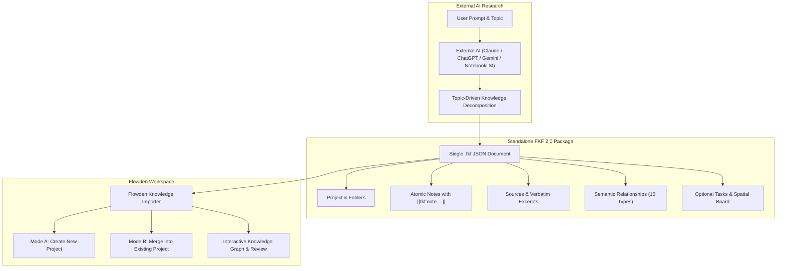

# Flowden Research Specification & Knowledge Exchange Guide (FKF 2.0)

- **Format Identifier:** `flowden-knowledge-format`
- **Specification Version:** `2.0.0`
- **File Format:** Single Standalone `.fkf` (UTF-8 JSON) or Legacy Archive `.flowden.zip`
- **Target Schema:** [flowden-knowledge-format-v2.schema.json](file:///C:/Users/Sod/.gemini/antigravity/scratch/flowden/docs/knowledge-exchange/flowden-knowledge-format-v2.schema.json)
- **Legacy Schema:** [flowden-package.schema.json](file:///C:/Users/Sod/.gemini/antigravity/scratch/flowden/docs/knowledge-exchange/flowden-package.schema.json)

---

## 1. Executive Overview

### 1.1 What Is Flowden Knowledge Exchange?
**Flowden Knowledge Exchange (FKF 2.0)** is an open, portable, machine-readable standard that enables external AI research systems—including **Claude**, **ChatGPT**, **Gemini**, **NotebookLM**, and **DeepSeek**—to transform research results, literature reviews, and domain analyses into a fully interconnected Second Brain knowledge package.

Unlike conventional AI outputs that generate a single, monolithic, flat text file or PDF, Flowden Knowledge Format decomposes research into:
1. **A Cohesive Research Project & Synthesis** (`project`)
2. **Hierarchical Knowledge Folders** (`folders`)
3. **Atomic, Focused Markdown Notes** (`notes`) with inline WikiLinks (`[[fkf:note-...|Display Title]]`)
4. **Structured Bibliographic Sources** (`sources`) with verbatim highlighted **Excerpts** (`excerpts`) and location anchors
5. **Typed Semantic Relationships** (`relationships`) establishing a navigable Knowledge Graph
6. **Optional Actionable Modules** (`optional_modules`) including Kanban Tasks and 2D Spatial Board layouts



---

## 2. Core Directives for External AI Systems

When instructed to research a subject and generate a Flowden Knowledge Package (`.fkf`), you **MUST** adhere to the following principles:

### 2.1 Dynamic, Topic-Appropriate Decomposition (No Monolithic Notes)
- **Never produce a single giant note or an empty cookie-cutter template.**
- Tailor the structural decomposition to the actual domain of inquiry:
  - **Scientific & Academic Research:** Decompose into *Theoretical Foundations*, *Methodological Framework*, *Empirical Findings / Experiments*, *Counter-Evidence & Critiques*, and *Future Directions*.
  - **Software Architecture & Technical Systems:** Decompose into *High-Level Architecture*, *Component Interfaces*, *Data Flow & Storage*, *Failure Modes & Resilience*, *Security & Threat Modeling*, and *Implementation Runbook*.
  - **Historical & Policy Analysis:** Decompose into *Historical Trajectory & Timeline*, *Primary Stakeholders & Motivations*, *Policy Interventions & Counter-Measures*, *Empirical Impact*, and *Contemporary Lessons*.
- Each Note must address a single coherent concept, mechanism, or synthesis point. Typical packages contain between **3 and 15 notes**.

### 2.2 Hierarchical Folder Organization
- Group related notes into logical folders with a clean sorting hierarchy (e.g. `01-Foundations`, `02-Architecture`, `03-Tradeoffs`).
- Folder nesting depth must not exceed **8 levels**.
- Every folder must have a unique identifier prefixed with `fld-`.

### 2.3 Bibliographic Sources & Verbatim Provenance
- Register every cited paper, document, dataset, article, or documentation source in the `sources` array.
- For each source:
  - Specify the precise `source_type` (`journal_article`, `technical_report`, `documentation`, `whitepaper`, etc.).
  - Set `verification_status` honestly (`verified`, `partially_verified`, `unverified_external`, `synthetic_demonstration`).
  - Extract **verbatim quoted excerpts** into `excerpts` with an exact `location_anchor` (e.g., `"Section 3.2, p. 14"`, `"Chapter 4, para. 3"`).
  - **Anti-Hallucination Rule:** NEVER invent authors, dates, DOIs, or URLs. If an author or date is unknown, output `null` or an empty array.

### 2.4 Semantic Relationships & Knowledge Graph
- Explicitly connect concepts in `relationships` using the 10 canonical Flowden link types:
  1. `references` — General informational citation or reference.
  2. `embeds` — Direct structural embedding or inclusion.
  3. `cites` — Bibliographic academic or legal citation.
  4. `derived_from` — Conceptual derivation, transformation, or synthesis.
  5. `supports` — Empirical evidence or theoretical proof supporting a thesis.
  6. `contradicts` — Disputed findings, counter-arguments, or conflicting evidence.
  7. `inspired_by` — Conceptual inspiration or historical lineage.
  8. `depends_on` — Technical or architectural dependency.
  9. `blocks` — Blocker or prerequisite constraint.
  10. `relates_to` — General associative link.
- **Trust Boundary:** External AI systems cannot self-certify relationships. When Flowden imports relationships, they are safely staged as unconfirmed (`origin: "ai_suggested"`, `is_confirmed: 0`) so users can inspect and confirm them in the Knowledge Graph.

### 2.5 WikiLinks Syntax
- Interlink notes in Markdown bodies using stable package WikiLinks:
  ```markdown
  [[fkf:note-system-architecture|System Architecture]]
  ```
- The target ID must match an existing `note-...` identifier in the package.

### 2.6 Strict ID Prefix Conventions
Every entity in the package MUST use lowercase alphanumeric identifiers with strict prefix conventions:
| Entity Type | Prefix Pattern | Example |
| :--- | :--- | :--- |
| **Package** | `pkg-[a-z0-9_-]{2,60}` | `pkg-distributed-consensus-2026` |
| **Project** | `proj-[a-z0-9_-]{2,60}` | `proj-raft-paxos-analysis` |
| **Folder** | `fld-[a-z0-9_-]{2,60}` | `fld-consensus-protocols` |
| **Note** | `note-[a-z0-9_-]{2,60}` | `note-raft-leader-election` |
| **Source** | `src-[a-z0-9_-]{2,60}` | `src-ongaro-raft-2014` |
| **Excerpt** | `exc-[a-z0-9_-]{2,60}` | `exc-raft-safety-invariant` |
| **Relationship** | `rel-[a-z0-9_-]{2,60}` | `rel-raft-to-paxos` |
| **Task** | `tsk-[a-z0-9_-]{2,60}` | `tsk-benchmark-election-timeout` |
| **Spatial Board** | `brd-[a-z0-9_-]{2,60}` | `brd-consensus-overview` |
| **Board Group** | `grp-[a-z0-9_-]{2,60}` | `grp-election-phase` |
| **Board Item** | `bitm-[a-z0-9_-]{2,60}` | `bitm-note-leader-election` |
| **Board Connection** | `bcon-[a-z0-9_-]{2,60}` | `bcon-election-to-replication` |

**Package-Wide Uniqueness:** Every ID across all entity types must be globally unique within the package.

### 2.7 Forbidden Database-Owned Properties
**NEVER output database internal keys or timestamps.** Flowden's persistence engine creates and manages database rows. The following properties are strictly forbidden and will cause the importer to reject the package:
- ❌ `database_id`
- ❌ `dbId`
- ❌ `user_id`
- ❌ `created_at`
- ❌ `updated_at`

---

## 3. FKF 2.0 Specification & Document Structure

An FKF 2.0 document is a single UTF-8 JSON file containing the following structure:

```json
{
  "format": "flowden-knowledge-format",
  "fkf_version": "2.0.0",
  "min_reader_version": "2.0.0",
  "package_id": "pkg-example-quantum-algorithms",
  "generator": {
    "name": "Claude 3.7 Sonnet Research Assistant",
    "version": "1.0.0",
    "model": "claude-3-7-sonnet",
    "prompt_topic": "Quantum error correction surface codes",
    "generated_at": "2026-11-09T10:00:00Z",
    "contains_synthetic_sources": false
  },
  "project": {
    "id": "proj-quantum-error-correction",
    "title": "Quantum Error Correction: Surface Codes & Fault Tolerance",
    "summary": "Deep technical analysis of topological 2D surface codes and fault-tolerant threshold theorems.",
    "overview_markdown": "# Quantum Error Correction\n\nComprehensive synthesis of surface codes...",
    "color": "#6366f1",
    "icon": "cpu",
    "tags": ["quantum", "physics", "error-correction"]
  },
  "folders": [
    {
      "id": "fld-foundations",
      "name": "01 Foundations",
      "parent_id": null,
      "sort_order": 0
    },
    {
      "id": "fld-surface-codes",
      "name": "02 Surface Codes",
      "parent_id": null,
      "sort_order": 1
    }
  ],
  "notes": [
    {
      "id": "note-stabilizer-formalism",
      "title": "The Stabilizer Formalism in Quantum Codes",
      "folder_id": "fld-foundations",
      "content_markdown": "# Stabilizer Formalism\n\nStabilizer codes use Abelian subgroups of the Pauli group [[fkf:note-toric-code|Toric and Surface Codes]] to define code spaces...",
      "tags": ["quantum-mechanics", "stabilizers"],
      "is_pinned": true
    },
    {
      "id": "note-toric-code",
      "title": "Kitaev's Toric Code & Planar Surface Codes",
      "folder_id": "fld-surface-codes",
      "content_markdown": "# Toric and Surface Codes\n\nIntroduced by Alexei Kitaev, the toric code provides topological protection against local perturbations...",
      "tags": ["surface-code", "topology"],
      "is_pinned": false
    }
  ],
  "sources": [
    {
      "id": "src-kitaev-2003",
      "title": "Fault-tolerant quantum computation by anyons",
      "source_type": "journal_article",
      "verification_status": "verified",
      "authors": ["Alexei Kitaev"],
      "publication_date": "2003-01-15",
      "source_url": "https://doi.org/10.1016/S0003-4916(02)00018-0",
      "summary": "Foundational paper introducing anyonic quantum memory and topological error correction.",
      "content_text": "We present an approach to quantum computation based on topological quantum field theories...",
      "tags": ["foundational", "anyons"],
      "excerpts": [
        {
          "id": "exc-kitaev-anyon-braiding",
          "quoted_text": "The memory consists of a physical spin lattice on a surface whose topology protects quantum states against local perturbations.",
          "annotation": "Core definition of topological code stability",
          "location_anchor": "Section 2, p. 4",
          "color": "#fef08a"
        }
      ]
    }
  ],
  "relationships": [
    {
      "id": "rel-stabilizer-to-toric",
      "source_id": "note-stabilizer-formalism",
      "target_id": "note-toric-code",
      "link_type": "supports",
      "context_snippet": "The stabilizer formalism provides the mathematical substrate for the toric code Hamiltonian."
    },
    {
      "id": "rel-source-to-toric",
      "source_id": "src-kitaev-2003",
      "target_id": "note-toric-code",
      "link_type": "cites",
      "context_snippet": "Kitaev 2003 is the primary origin of planar surface codes."
    }
  ],
  "optional_modules": {
    "tasks": {
      "tasks": [
        {
          "id": "tsk-simulate-threshold",
          "title": "Simulate error threshold using MWPM decoder",
          "description": "Run Monte Carlo simulations of Minimum-Weight Perfect Matching on rotated surface code lattice.",
          "status": "planned",
          "priority": "high",
          "due_date": null,
          "sort_order": 0,
          "related_entity_ids": ["note-toric-code"]
        }
      ]
    },
    "spatial_board": {
      "board": {
        "id": "brd-qec-overview",
        "title": "Quantum Error Correction Synthesis Board",
        "description": "2D topological layout of codes and relationships",
        "groups": [
          {
            "id": "grp-foundations",
            "title": "Foundational Formalisms",
            "color": "#3b82f6",
            "position_x": 100,
            "position_y": 100,
            "width": 400,
            "height": 500
          }
        ],
        "items": [
          {
            "id": "bitm-stabilizers",
            "item_type": "note",
            "reference_package_id": "note-stabilizer-formalism",
            "group_id": "grp-foundations",
            "title": "Stabilizer Formalism",
            "content": "Mathematical foundation",
            "position_x": 120,
            "position_y": 140,
            "width": 240,
            "height": 160,
            "color": "#ffffff"
          }
        ],
        "connections": []
      }
    }
  }
}
```

---

## 4. Complete Prompt Template for External AI Models

Copy and paste the prompt below into **Claude**, **ChatGPT**, **Gemini**, or **NotebookLM** when conducting research:

```markdown
You are an expert research synthesizer and Knowledge Architect. Your task is to conduct thorough, rigorous research on the specified topic and export the complete findings as a valid Flowden Knowledge Format (FKF 2.0) JSON document.

### Research Requirements:
1. Topic: [INSERT YOUR TOPIC HERE]
2. Target Depth: Deep technical/academic synthesis with verbatim source citations.
3. Structure: Decompose findings logically into separate, well-scoped notes within a hierarchical folder structure. Do NOT merge everything into a single note.
4. Sources: Every cited claim must reference an entry in `sources` with verbatim excerpts in `excerpts` and precise location anchors.
5. Links: Interconnect notes using inline WikiLinks `[[fkf:note-...|Display Title]]` and populate the `relationships` array using valid link types (`references`, `embeds`, `cites`, `derived_from`, `supports`, `contradicts`, `inspired_by`, `depends_on`, `blocks`, `relates_to`).
6. Identifiers: Use strict lowercase prefixed IDs (`pkg-...`, `proj-...`, `fld-...`, `note-...`, `src-...`, `exc-...`, `rel-...`, `tsk-...`, `brd-...`).
7. Forbidden Fields: Do NOT include `database_id`, `dbId`, `user_id`, `created_at`, or `updated_at`.
8. Output Format: Output ONLY raw, valid JSON conforming to Flowden Knowledge Format 2.0 (`"format": "flowden-knowledge-format"`, `"fkf_version": "2.0.0"`).
```

---

## 5. Import Modes in Flowden

When the user uploads or pastes an `.fkf` package into Flowden, they may select between two destination modes:

### Mode A: Create New Project
- Creates a fresh Flowden Project using the package metadata (`title`, `summary`, `color`, `icon`).
- Establishes a brand-new workspace containing all folders, notes, sources, excerpts, and relationships.

### Mode B: Merge into Existing Project
- Merges the incoming knowledge package directly into an existing Flowden Project.
- **Permission Check:** The authenticated user must be an **Owner** or **Editor** of the destination project. Viewers or non-members are strictly forbidden (HTTP 403).
- **Metadata Protection:** The existing project's title, summary, color, icon, and overview are preserved unchanged.
- Folders, notes, and sources are seamlessly appended, preserving cross-project referential integrity.
