# Flowden Research Specification & Knowledge Exchange Standard (FKF v1.0.0)

- **Format Identifier:** `flowden-knowledge-package`
- **Specification Version:** `1.0.0`
- **Target Schema:** [flowden-package.schema.json](file:///C:/Users/Sod/.gemini/antigravity/scratch/flowden/docs/knowledge-exchange/flowden-package.schema.json)
- **Architectural Decisions:** [PHASE-1-ARCHITECTURAL-DECISIONS.md](file:///C:/Users/Sod/.gemini/antigravity/scratch/flowden/docs/knowledge-exchange/PHASE-1-ARCHITECTURAL-DECISIONS.md)
- **Reference Package:** [flowden-reference-package.flowden.zip](file:///C:/Users/Sod/.gemini/antigravity/scratch/flowden/docs/knowledge-exchange/examples/flowden-reference-package.flowden.zip)

---

## 1. Introduction (Section 7.1)

### 1.1 What Is Flowden Knowledge Exchange?
**Flowden Knowledge Exchange** is an open, portable, machine-readable standard that allows external AI research assistants—such as **Claude**, **ChatGPT**, **NotebookLM**, and **Gemini**—to package deep research into a structured, interconnected **Flowden Knowledge Package (`.flowden.zip`)** conforming to the **Flowden Knowledge Format (`FKF v1.0.0`)**.

### 1.2 What Is a Flowden Knowledge Package?
Instead of exporting a flat wall of text, a **Flowden Knowledge Package** is a structured archive containing:
- **1 Project & Rich Overview** (`manifest.json` + `project/overview.md`)
- **Hierarchical Note Folders** (`folders.json`)
- **Modular Markdown Notes** (`notes/*.md`) with stable package-local IDs and inline WikiLinks
- **Research Sources & Verbatim Excerpts** (`sources/index.json` + `sources/*.md`) with strict citation provenance
- **Typed Semantic Relationships** (`relationships/links.json`) connecting Notes, Sources, Excerpts, and Tasks
- **Verified Media Assets** (`assets/*`) such as architecture diagrams or data charts
- **Optional Workflow Modules** (`optional/tasks.json`, `optional/spatial-board.json`, and `exports/research-report.pdf`)

### 1.3 Why Structured Research Beats a Single PDF or Markdown File
When an AI assistant dumps a 4,000-word report into a single PDF or monolithic Markdown document:
- Individual concepts cannot be linked, tagged, or reorganized independently.
- Source excerpts and bibliographic metadata are flattened into prose rather than tracked as reusable research entities.
- Knowledge Graph connections (`supports`, `contradicts`, `cites`, `derived_from`) are lost.
- Visual Spatial Boards and actionable follow-up Tasks must be rebuilt manually by the user.

By producing a `.flowden.zip` package, the external AI delivers an immediately navigable **connected knowledge system**.

### 1.4 What Flowden Will Do with the Package
> [!IMPORTANT]
> **Implementation Status Notice:** Phase 1 formalizes the **Flowden Knowledge Format (`FKF v1.0.0`)** specification, JSON Schema, and reference package. The automated backend/frontend `.flowden.zip` importer is a **planned capability scheduled for Phase 2 and subsequent integration phases**—it is not yet active in the live Flowden UI.

Once the Phase 2+ importer is deployed, Flowden will:
1. Safely inspect and validate the `.flowden.zip` archive against [flowden-package.schema.json](file:///C:/Users/Sod/.gemini/antigravity/scratch/flowden/docs/knowledge-exchange/flowden-package.schema.json) and Flowden's security rules.
2. Present an interactive **Import Preview & Validation Report** showing the Project, Folders, Notes, Sources, Relationships, Assets, and optional modules.
3. Let the user choose whether to create a new Project or merge into an existing Project, and choose which optional modules (`tasks`, `spatial_board`) to include.
4. Resolve package-local IDs into canonical Flowden database records (`projects`, `note_folders`, `notes`, `research_documents`, `research_excerpts`, `entity_links`, `note_links`, `tasks`, `boards`) inside a crash-safe transactional pipeline.

---

## 2. How the Workflow Works (Section 7.2)

```mermaid
flowchart LR
  A["1. Download FLOWDEN_RESEARCH_SPEC.md"] --> B["2. Provide Spec + Topic to External AI"]
  B --> C["3. AI Conducts Research & Verifies Sources"]
  C --> D["4. AI Organizes Folders, Notes, Sources & Links"]
  D --> E["5. AI Generates .flowden.zip (or Structured Files)"]
  E --> F["6. User Uploads .flowden.zip in Flowden (Planned Phase 2+)"]
  F --> G["7. Flowden Validates Schema, Links & Security"]
  G --> H["8. User Previews & Approves Transactional Import"]
```



1. **Download the Flowden Research Spec:** The user downloads `FLOWDEN_RESEARCH_SPEC.md` (and optionally `flowden-package.schema.json`).
2. **Give the Specification to an External AI:** The user attaches `FLOWDEN_RESEARCH_SPEC.md` to their prompt in Claude, ChatGPT, NotebookLM, or another AI tool.
3. **Provide the Research Topic & Requirements:** The user specifies their research question, scope, provided source documents, and whether optional Tasks or a Spatial Board are desired.
4. **AI Conducts Research:** The AI gathers evidence, extracts verbatim excerpts, and records exact provenance (authors, dates, URLs, verification status).
5. **AI Organizes Findings:** The AI decomposes the synthesis into logical Folders, atomic Markdown Notes, structured Sources, and explicit semantic Relationships using stable package-local IDs.
6. **AI Generates the `.flowden.zip` Package:** The AI builds the archive matching the exact FKF directory layout (or outputs the files for local zipping if the AI client lacks code execution).
7. **User Imports via Flowden (Planned Phase 2+):** The user selects the `.flowden.zip` file in Flowden's **AI Assistant — Knowledge Exchange** panel or **Research Center**.
8. **Validation, Preview & User Approval:** Flowden validates the archive, displays a complete preview and conflict resolution summary, and imports the workspace only after explicit user approval.

---

## 3. Instructions for External AI Systems (Section 7.3)

If you are an AI system reading this specification to generate a Flowden Knowledge Package for a user, you **MUST** obey the following operational directives:

1. **Understand the Research Objective First:** Identify the core research questions, boundaries, and target audience before creating entities.
2. **Decompose into Atomic, Well-Scoped Notes:** Do not dump the entire report into one Note. Create separate Notes for distinct concepts, mechanisms, comparisons, case studies, or methodological critiques (typically 3 to 15 Notes per package).
3. **Create a Logical Folder Hierarchy:** Group Notes into meaningful folders (`folders.json`) such as `01-Foundations`, `02-Empirical-Evidence`, `03-Synthesis-and-Tradeoffs`. Do not exceed a folder nesting depth of 8.
4. **Identify Reliable Sources & Preserve Provenance:** Record every source in `sources/index.json` with a companion `sources/<slug>.md` document and structured `excerpts[]`.
5. **Connect Related Notes and Sources Explicitly:** Populate `relationships/links.json` using package-local IDs and use inline package WikiLinks (`[[fkf:<note-id>|Display Title]]`) inside Note Markdown.
6. **Always Use Stable Package-Local IDs:** Every entity MUST have a unique, lowercase, prefix-typed ID (`proj-*`, `fld-*`, `note-*`, `src-*`, `exc-*`, `ast-*`, `tsk-*`, `brd-*`, `grp-*`, `bitm-*`, `rel-*`, `bcon-*`).
7. **Eliminate Redundancy:** Each Note must have a distinct purpose. Cross-reference related concepts with `[[fkf:<note-id>|Display Title]]` instead of repeating paragraphs across Notes.
8. **Separate Verified Facts from Uncertainty:** Mark uncertain claims explicitly in prose and set `"verification_status"` accurately (`"verified"`, `"partially_verified"`, `"unverified_external"`, or `"synthetic_demonstration"`).
9. **STRICT ANTI-HALLUCINATION RULE:**
   - **NEVER** invent facts, statistics, quotes, authors, publication dates, DOIs, or URLs.
   - If a source's publication date, author, or URL is unknown, set `"publication_date": null`, `"authors": []`, or `"source_url": null`.
   - If generating a synthetic/example package for testing, set `"is_synthetic_example": true` and `"verification_status": "synthetic_demonstration"`.
10. **Avoid Unnecessary Optional Modules & Never Invent Deadlines:**
    - Only populate `optional/tasks.json` or `optional/spatial-board.json` when actionable next steps or visual synthesis add genuine value.
    - **NEVER invent task deadlines:** Always set `"due_date": null` on every task in `optional/tasks.json` unless the user explicitly supplied a calendar date in their prompt.

---

## 4. Research Quality and Source Integrity (Section 7.4)

### 4.1 Required Source Metadata (`sources/index.json`)
Every entry in `sources/index.json` must record:
- `id`: Stable package-local ID (`^src-[a-z0-9_-]{2,59}$`, e.g., `src-urban-albedo-2025`).
- `title`: Exact title of the paper, report, dataset, or documentation page.
- `source_type`: One of:
  - `"journal_article"`
  - `"technical_report"`
  - `"book_or_chapter"`
  - `"web_documentation"`
  - `"dataset"`
  - `"standard_or_specification"`
  - `"primary_interview_or_field_note"`
  - `"synthetic_demonstration"`
- `authors`: Array of author or organization strings (`string[]`). Use `[]` if unknown—never guess names.
- `publication_date`: `YYYY-MM-DD` string when verified, or `null` when unknown.
- `accessed_date`: `YYYY-MM-DD` string when accessed online, or `null`.
- `source_url`: Full `https://` or `http://` URL when verified, or `null`. Never fabricate URLs.
- `verification_status`:
  - `"verified"` — Directly verified from user-provided documents or retrieved primary sources.
  - `"partially_verified"` — Primary claim verified, some secondary metadata unavailable.
  - `"unverified_external"` — Referenced from secondary literature or model training knowledge without live primary document verification; must be flagged for human verification.
  - `"synthetic_demonstration"` — Explicitly synthetic fixture data created only to demonstrate package structure.
- `is_synthetic_example`: Boolean (`true` only for demonstration fixtures; `false` for real research).
- `summary`: Concise objective summary of what the source contains.
- `content_file`: Relative path `sources/<slug>.md` containing the detailed source notes and context.
- `excerpts`: Array of structured excerpts (`exc-*`), each containing:
  - `id`: `^exc-[a-z0-9_-]{2,59}$`
  - `quoted_text`: Exact quote or data point from the source.
  - `annotation`: AI or researcher commentary explaining how the excerpt applies to the project.
  - `location_anchor`: Section, page, or table identifier (e.g., `"Section 4.1, p. 12"`).

### 4.2 Separating Source Content from AI Interpretation
Inside both `sources/<slug>.md` and `notes/<slug>.md`:
- Keep verbatim source excerpts inside blockquotes (`> "..."`) or inside `sources/index.json -> excerpts[].quoted_text`.
- Place AI synthesis, comparisons, and hypotheses in clearly labeled analytical sections (`## Synthesis & Interpretation`, `## Open Uncertainties`).
- Link every analytical claim in a Note back to its supporting `src-*` or `exc-*` record in `relationships/links.json` using `link_type: "cites"`, `"supports"`, `"contradicts"`, or `"derived_from"`.

---

## 5. Knowledge Organization Rules (Section 7.5)

### 5.1 Architectural Distinction: Identifiers, Titles, Folders, Semantic Links, and Visual Wires
External AI generators and developers must strictly distinguish five concepts:

| Concept | Purpose in Flowden | Package Representation | Flowden DB Mapping (Phase 2) |
| :--- | :--- | :--- | :--- |
| **1. Package-Local ID** | Immutable identity inside the `.flowden.zip` archive | `note-thermal-01`, `src-epa-01`, `fld-models` | Mapped during Pass 1 via `packageIdMap` |
| **2. Flowden DB ID** | Auto-increment integer PK + canonical UUID in MySQL | Never hardcoded in package | `notes.id`, `entities.id`, `entities.uuid` |
| **3. Display Title** | Human-readable heading shown in UI & search | `"Thermal Performance Summary"` | `notes.title`, `entities.title` |
| **4. Folder Hierarchy** | Tree containment organizing Notes in the Vault sidebar | `folders.json` + `note.folder_id` | `note_folders.parent_folder_id`, `notes.folder_id` |
| **5. Semantic Relationship** | Meaning-bearing knowledge graph connection | `relationships/links.json` + inline `[[fkf:...]]` | `entity_links` + `note_links` |
| **6. Visual Board Wire** | Diagram arrow between cards on a Spatial Board canvas | `optional/spatial-board.json -> connections[]` | `board_item_connections` (**never** `entity_links`) |

> [!WARNING]
> **Critical Rule:** Never use `relationships/links.json` to represent folder containment, and never treat `optional/spatial-board.json` visual canvas connections (`bcon-*`) as semantic knowledge relationships (`rel-*`).

### 5.2 What Belongs Where
- **Project Overview (`project/overview.md`)**: Executive summary, research objectives, methodology overview, high-level findings table, and an index of `[[fkf:<note-id>|Note Title]]` links to the core Notes. Imported into Flowden as a **pinned root Note** alongside `projects.description`.
- **When to Create a New Note (`notes/*.md`)**: Create a separate Note whenever a topic represents a self-contained concept, mechanism, dataset analysis, competing hypothesis, or synthesis module that other Notes will reference independently.
- **How to Organize Folders (`folders.json`)**: Use 2 to 6 top-level folders (with optional subfolders) reflecting logical phases or domains of the research.
- **How to Write Useful Note Titles**: Make titles specific and descriptive (e.g., `"Phase-Change Roofing Materials: Empirical Cooling Bounds"`). Even if two Notes intentionally share the same title (e.g., `"Regional Field Trial Summary"` for two different regions), their `id` (`note-trial-summary-arid` vs. `note-trial-summary-humid`) and `disambiguation_hint` (`"Arid Climate Basin"` vs. `"Humid Subtropical Zone"`) keep every link 100% unambiguous.
- **How to Create Semantic Relationships (`relationships/links.json`)**:
  Use only Flowden's **10 canonical `link_type` values**:
  1. `references` — General conceptual reference from one entity to another.
  2. `embeds` — Source entity embeds content or media from the target entity.
  3. `cites` — Note or synthesis directly cites a Research Source (`src-*`) or Excerpt (`exc-*`).
  4. `derived_from` — Target entity is the primary raw material from which the source entity was synthesized.
  5. `supports` — Source entity provides empirical or logical evidence supporting the target entity.
  6. `contradicts` — Source entity presents evidence or arguments conflicting with the target entity.
  7. `inspired_by` — Conceptual or methodological inspiration.
  8. `depends_on` — Prerequisite dependency (e.g., a Task or Note depends on another Note/Task).
  9. `blocks` — Source entity blocks progress or validity of the target entity.
  10. `relates_to` — Symmetric topical association when a more specific verb does not apply.
- **When to Create Optional Tasks (`optional/tasks.json`)**: Create Tasks only for concrete verification steps, open literature gaps, or follow-up experiments (`status`: `"planned" | "in_progress" | "done"`, `priority`: `"low" | "medium" | "high" | "urgent"`, `due_date`: `null` unless user-specified).
- **When a Spatial Board Adds Value (`optional/spatial-board.json`)**: Include a Spatial Board when spatial grouping (`groups[]`) and visual flow diagrams (`items[]` + `connections[]`) help the user see how Notes, Sources, and Tasks fit together on a 2D canvas. Every board item representing a Note, Task, Source, or Excerpt MUST set `reference_type` and `reference_package_id` so Flowden projects the canonical entity rather than duplicating text.

---

## 6. Package Generation Rules & Formal `.flowden.zip` Structure (Sections 4, 5 & 7.6)

### 6.1 Standard Directory Layout
Every `.flowden.zip` archive MUST use POSIX forward-slash relative paths anchored at the archive root:

```text
example-research.flowden.zip
├── manifest.json                   [REQUIRED] Root package manifest, metadata & entity inventory
├── project/
│   └── overview.md                 [REQUIRED] Rich Markdown Project Overview (imported as pinned Note)
├── folders.json                    [REQUIRED] Hierarchical folder definitions (fld-*)
├── notes/
│   ├── note-example-01.md          [REQUIRED] Canonical Markdown Note(s) (at least 1 required)
│   ├── note-example-02.md
│   └── note-example-03.md
├── sources/
│   ├── index.json                  [REQUIRED] Research Source & Excerpt metadata registry (src-*, exc-*)
│   ├── source-example-01.md        [OPTIONAL/CONDITIONAL] Required for each source in sources/index.json
│   └── source-example-02.md
├── relationships/
│   └── links.json                  [REQUIRED] Semantic knowledge graph relationships (rel-*)
├── assets/
│   └── architecture-diagram.png    [OPTIONAL] Binary/media attachments declared in manifest.json (ast-*)
├── optional/
│   ├── tasks.json                  [OPTIONAL] Follow-up research Tasks (tsk-*)
│   └── spatial-board.json          [OPTIONAL] 2D Spatial Board layout, projections & visual wires (brd-*)
└── exports/
    └── research-report.pdf         [OPTIONAL] Readable companion PDF report (non-canonical)
```

### 6.2 File-by-File Specification

#### 1. `manifest.json` (Required)
- **Purpose**: Entry-point descriptor declaring format version, generator provenance, project metadata, file inventory, Note descriptors, Asset descriptors (with SHA-256 hashes), and enabled optional modules.
- **Validation**: Validated against the root of [flowden-package.schema.json](file:///C:/Users/Sod/.gemini/antigravity/scratch/flowden/docs/knowledge-exchange/flowden-package.schema.json) (`#/$defs/ManifestDocument`).

#### 2. `project/overview.md` (Required)
- **Purpose**: Comprehensive Markdown overview of the research project.
- **Structure**: Optional YAML frontmatter (`id`, `title`) followed by clean GitHub-Flavored Markdown.
- **Canonical Storage Mapping**: Imported as a pinned root Note (`notes.is_pinned = 1`, `notes.content = <normalized markdown>`) inside the created/target Project, while `manifest.json -> project.summary` populates `projects.description`.

#### 3. `folders.json` (Required)
- **Purpose**: Defines the folder tree (`fld-*`) for organizing Notes in the Knowledge Vault.
- **Structure**: Validated against `#/$defs/FoldersFile`. May contain an empty array `"folders": []` if all Notes live at the root. Maximum nesting depth is `8`; circular `parent_id` chains are forbidden.

#### 4. `notes/*.md` (Required — 1 or more files)
- **Purpose**: Canonical knowledge Notes.
- **Structure**:
  1. **YAML Frontmatter Block** bounded by `---` lines containing:
     ```yaml
     ---
     id: note-urban-canopy-model
     title: "Thermal Performance Summary"
     disambiguation_hint: "Urban Canopy Layer"
     folder_id: fld-empirical-models
     is_pinned: false
     verification_status: verified
     tags:
       - urban-climate
       - canopy-modeling
     ---
     ```
  2. **Markdown Body** following the closing `---` line.
- **Canonical Storage Mapping**: During Phase 2 import, the YAML frontmatter is parsed, cross-checked against `manifest.json -> entities.notes[]`, and stripped; the normalized Markdown body is stored in **`notes.content` (`LONGTEXT`)**, which is Flowden's single authoritative Markdown storage column.
- **Inline WikiLink Syntax (`[[fkf:<package_id>|Display Title]]`)**:
  - Whenever a Note links inline to another Note in the package, write:
    `[[fkf:note-target-id|Target Display Title]]`
  - During Pass 2 of import, Flowden resolves `note-target-id` via `packageIdMap` to its exact database `notes.id` (inserting directly into `note_links` and `entity_links`) and rewrites the Markdown token to `[[Final Target Title]]` for native rendering in `VaultEditor`.
- **Inline Asset Reference Syntax**:
  - Reference package assets using standard Markdown image or link syntax with a relative path:
    ``
  - During Pass 2 of import, Flowden validates the asset via `SecurityService.validateUploadedFile`, copies it to `/uploads/vault/fkp_<operation_id>_<uuid>.png`, registers it in `file_uploads`, and rewrites `../assets/architecture-diagram.png` to the authenticated `/uploads/vault/...` URL.

#### 5. `sources/index.json` & `sources/*.md` (Required Index; `.md` files required per source)
- **Purpose**: Structured registry of Research Sources (`src-*`) and their verbatim Excerpts (`exc-*`).
- **Validation**: `sources/index.json` is validated against `#/$defs/SourcesIndexFile`. Every `content_file` (`sources/<slug>.md`) must exist in the archive.
- **Canonical Storage Mapping**: Each source maps to `research_documents` (and `entities` with `entity_type = 'research'`); each item in `excerpts[]` maps to `research_excerpts` (and `entities` with `entity_type = 'excerpt'`).

#### 6. `relationships/links.json` (Required)
- **Purpose**: Explicit semantic knowledge graph edges (`rel-*`) between package entities.
- **Validation**: Validated against `#/$defs/RelationshipsFile`. Every `source_id` and `target_id` MUST be a valid package-local ID declared in the package, and `link_type` MUST be one of the 10 canonical enum values.

#### 7. `assets/*` (Optional Directory)
- **Purpose**: Binary or media files (`PNG`, `JPEG`, `GIF`, `WEBP`, `PDF`, `CSV`, `JSON`, `MP4`, `MP3`, etc.) embedded in Notes.
- **Validation**: Every file in `assets/` must be declared in `manifest.json -> entities.assets[]` with matching `size_bytes`, `sha256`, and `mime_type`, and must pass `SecurityService.validateUploadedFile` magic-byte inspection.

#### 8. `optional/tasks.json` (Optional Module)
- **Purpose**: Actionable follow-up research or verification Tasks (`tsk-*`).
- **Behavior When Absent**: When `manifest.json -> optional_modules.tasks.enabled` is `false` (and `file` is `null`), no Tasks are imported and the package remains 100% valid.
- **Validation**: When enabled, validated against `#/$defs/OptionalTasksFile`.

#### 9. `optional/spatial-board.json` (Optional Module)
- **Purpose**: 2D visual canvas (`brd-*`) containing visual groups (`grp-*`), entity projection cards (`bitm-*` with `reference_type` and `reference_package_id`), and visual canvas wires (`bcon-*`).
- **Behavior When Absent**: When `manifest.json -> optional_modules.spatial_board.enabled` is `false` (and `file` is `null`), no Spatial Board is created during import.
- **Validation**: When enabled, validated against `#/$defs/OptionalSpatialBoardFile`.

#### 10. `exports/research-report.pdf` (Optional Module)
- **Purpose**: Optional human-readable PDF companion document.
- **Behavior When Absent**: When `manifest.json -> optional_modules.research_report_pdf.enabled` is `false`, no companion PDF is imported. Never treated as the source of truth for Notes or Relationships.

---

## 7. ZIP Generation Limitations & Manual Packaging Fallback (Section 7.7)

Some external AI chat interfaces (such as standard web chat sessions without a Python/bash code sandbox) cannot directly output a downloadable `.flowden.zip` binary file.

### Fallback Workflow for Non-ZIP AI Environments
1. **Generate All Required Package Files Individually**:
   Output each file in sequence with its exact relative path header (`manifest.json`, `project/overview.md`, `folders.json`, `notes/<slug>.md`, `sources/index.json`, `sources/<slug>.md`, `relationships/links.json`, and any enabled `optional/*.json` files).
2. **Preserve the Exact Directory Tree**:
   Instruct the user to save the files into an empty directory (for example, `my-research-package/`) matching the exact relative paths in Section 6.1.
3. **Provide Copy-Paste Packaging Commands**:
   Provide the user with these exact terminal commands to create the `.flowden.zip` archive with relative root paths (so `manifest.json` sits at the root of the ZIP archive):
   - **Windows PowerShell**:
     ```powershell
     Compress-Archive -Path .\my-research-package\* -DestinationPath .\my-research-package.flowden.zip -Force
     ```
   - **macOS / Linux**:
     ```bash
     (cd my-research-package && zip -r ../my-research-package.flowden.zip .)
     ```

---

## 8. Worked Example (Section 7.8)

Below is a miniature excerpt from the official reference package (`docs/knowledge-exchange/examples/flowden-reference-package`) illustrating how a research project on **Adaptive Urban Heat-Island Mitigation & High-Albedo Microclimates** is structured across `manifest.json`, `folders.json`, `notes/*.md`, `sources/index.json`, and `relationships/links.json`.

### 8.1 `manifest.json` Excerpt
```json
{
  "$schema": "https://flowden.app/schemas/flowden-package-v1.0.0.schema.json",
  "format": "flowden-knowledge-package",
  "fkf_version": "1.0.0",
  "min_compatible_fkf_version": "1.0.0",
  "package_id": "pkg-urban-heat-reference-01",
  "generator": {
    "system_name": "Flowden Architecture Reference Generator",
    "model_identifier": "fkf-reference-fixture-v1",
    "generated_at": "2026-11-07T04:30:00Z",
    "spec_version": "1.0.0",
    "research_prompt_summary": "Reference demonstration package modeling urban heat-island mitigation strategies, cool-roof albedo bounds, and vegetative evapotranspiration.",
    "contains_synthetic_sources": true
  },
  "project": {
    "id": "proj-urban-heat-mitigation",
    "title": "Adaptive Urban Heat-Island Mitigation",
    "summary": "Structured synthesis of high-albedo surface retrofits and vegetative canopy cooling models (Reference Demonstration Package).",
    "overview_file": "project/overview.md",
    "color": "#6366f1",
    "icon": "layers",
    "tags": ["urban-climate", "albedo", "microclimate"]
  },
  "index_files": {
    "folders": "folders.json",
    "sources": "sources/index.json",
    "relationships": "relationships/links.json"
  }
}
```

### 8.2 Demonstrating Stable IDs with Identical Note Titles
Notice how `note-example-01` and `note-example-02` intentionally share the exact same display title (`"Thermal Performance Summary"`) for two different subsystems, while their stable package-local IDs (`note-example-01` vs. `note-example-02`) and `disambiguation_hint` values keep every WikiLink and semantic relationship 100% unambiguous:

- `notes/note-example-01.md`:
  - `id`: `note-example-01`
  - `title`: `"Thermal Performance Summary"`
  - `disambiguation_hint`: `"High-Albedo Cool Roof Membranes"`
- `notes/note-example-02.md`:
  - `id`: `note-example-02`
  - `title`: `"Thermal Performance Summary"`
  - `disambiguation_hint`: `"Vegetative Canopy Evapotranspiration"`
- `notes/note-example-03.md`:
  - Links unambiguously to both notes via `[[fkf:note-example-01|Thermal Performance Summary (Cool Roofs)]]` and `[[fkf:note-example-02|Thermal Performance Summary (Vegetative Canopy)]]`.

---

## 9. Package Validation & Security Contract (Section 9)

> [!CAUTION]
> **Untrusted Input Contract:** Every `.flowden.zip` archive originates outside Flowden's trust boundary. The Phase 2 importer MUST enforce all validation and security gates below **before** committing any entity or exposing any file.

### 9.1 Intended Archive & Extraction Security Limits
1. **Maximum Archive Entries:** `500` total entries (files + directories).
2. **Maximum Total Uncompressed Size:** `250 MB` (`262,144,000` bytes), enforced both via central directory header inspection and live byte-counting streams during extraction.
3. **Maximum Single-File Uncompressed Size:** `50 MB` (`52,428,800` bytes).
4. **Maximum Compression Ratio:** `100:1` (overall and per-entry) to defeat ZIP bombs.
5. **ZIP Slip & Path Traversal Rejection:** Any entry containing `..`, leading `/` or `\`, drive letters (`C:`), or null bytes is immediately rejected (`SECURITY_PATH_TRAVERSAL`).
6. **Symlink & Special File Rejection:** Any ZIP entry with POSIX symlink (`0120000`), FIFO, socket, or block/char device external attributes is rejected (`SECURITY_SYMLINK_REJECTED`).
7. **Binary Magic-Byte Inspection & Disguised Executable Rejection:** Every binary file in `assets/` and `exports/` must pass [`SecurityService.validateUploadedFile`](file:///C:/Users/Sod/.gemini/antigravity/scratch/flowden/server/services/securityService.js#L370-L511) and match its declared `sha256` and `mime_type`. Executables (`MZ`, `ELF`, Mach-O, `#!`, `.exe`, `.dll`, `.bat`, `.ps1`, `.sh`, `.js`) are unconditionally rejected.
8. **Markdown & URL Sanitization:** Every external URL in `sources/index.json` or Markdown bodies is checked via [`SecurityService.validateExternalUrl`](file:///C:/Users/Sod/.gemini/antigravity/scratch/flowden/server/services/securityService.js#L562-L636) (blocking `javascript:`, `data:`, `file:`, loopback, and private RFC1918 IPs). Raw `<script>`, `<iframe>`, `<object>`, `<embed>`, and inline `on*=` attributes in Markdown are stripped.
9. **Untrusted AI Context Framing:** After import, any Note or Source sent to Flowden's AI Assistant or MCP tools continues to be wrapped by [`SecurityService.wrapUntrustedWorkspaceData`](file:///C:/Users/Sod/.gemini/antigravity/scratch/flowden/server/services/securityService.js#L687-L701).

### 9.2 Structural & Referential Error Catalogue
The Phase 2 validator must reject or flag the following conditions:

| Condition | Error / Warning Code | Severity | Importer Behavior |
| :--- | :--- | :--- | :--- |
| `fkf_version` major version `> 1` | `UNSUPPORTED_FKF_MAJOR_VERSION` | `FATAL` | Reject package before staging; explain required Flowden version. |
| Duplicate `id` anywhere in package | `DUPLICATE_PACKAGE_ID` | `FATAL` | Reject package; list colliding IDs and file locations. |
| Duplicate Note `id` in `manifest.json` or frontmatter | `DUPLICATE_NOTE_ID` | `FATAL` | Reject package. |
| `source_id`, `target_id`, `folder_id`, or `reference_package_id` does not exist | `MISSING_RELATIONSHIP_TARGET` | `FATAL` | Reject package; report exact unresolved ID. |
| Declared asset missing from `assets/` or SHA-256 mismatch | `MISSING_OR_CORRUPT_ASSET` | `FATAL` | Reject package. |
| JSON file fails `flowden-package.schema.json` validation | `INVALID_PACKAGE_SCHEMA` | `FATAL` | Reject package with JSON Pointer path and schema violation message. |
| YAML frontmatter missing closing `---` or mismatched `id` | `MALFORMED_MARKDOWN_FRONTMATTER` | `FATAL` | Reject package with file path and line number. |
| Unrecognized optional module in `1.x` minor version | `UNKNOWN_OPTIONAL_MODULE` | `WARNING` | Skip unknown optional module; allow core import after notifying user. |
| `source_url` fails `SecurityService.validateExternalUrl` | `INVALID_OR_BLOCKED_SOURCE_URL` | `WARNING` | Sanitize `source_url` to `null` and flag in validation report before user approval. |

---

## 10. Future Import Workflow, Conflict Resolution & Shared Importer Architecture (Sections 10, 11 & 12)

### 10.1 Ten-Step User-Approved Import Flow (Planned Phase 2+)
1. **Select Archive:** User selects a `.flowden.zip` file.
2. **Safe Archive Inspection:** Flowden inspects ZIP headers (entry count, uncompressed size, compression ratio, path safety, symlink flags) and extracts to isolated staging (`temp/fkp_stage_<operation_id>/`).
3. **Schema & Cross-File Validation:** Flowden validates all JSON files against [flowden-package.schema.json](file:///C:/Users/Sod/.gemini/antigravity/scratch/flowden/docs/knowledge-exchange/flowden-package.schema.json), checks YAML frontmatter, verifies SHA-256 checksums, runs `SecurityService.validateUploadedFile` on assets, and verifies 100% of package-local ID references.
4. **Validation Report Presentation:** Flowden displays a structured Validation Report (passing checks, warnings, synthetic source disclosures, and any errors).
5. **Interactive Workspace Preview:** User inspects the proposed Project, Folder tree, Note list, Research Sources, Excerpts, Relationship graph summary, and Assets.
6. **Destination Selection:** User chooses:
   - **Mode A (Default):** Create a new Project (`projects` row).
   - **Mode B:** Import into an existing Project (requires `editor` or `owner` permission).
7. **Optional Module Selection:** User toggles whether to import `optional/tasks.json`, `optional/spatial-board.json`, and `exports/research-report.pdf`.
8. **ID Mapping & Conflict Resolution Policy:** Flowden computes deterministic conflict resolution (never overwriting existing user data silently).
9. **Explicit User Approval:** User clicks **Approve & Import Knowledge Package**.
10. **Crash-Safe Transactional Commit:** Flowden executes the persistent journaled commit (`committing_files -> committing_db -> committed`) and opens the imported Project.

### 10.2 Conflict Resolution Rules (Never Overwrite User Data Silently)
- **Project Title Already Exists:** In Mode A (Create New Project), if a Project with the same title exists, append a suffix (e.g., `"Adaptive Urban Heat-Island Mitigation (Imported 2026-11-07)"`) or let the user edit the target title in the preview modal.
- **Note with the Same Title Exists (Within Package or Existing Project):**
  - If two Notes inside the package share the same `title` (or collide with an existing Note in Mode B), Flowden appends the Note's `disambiguation_hint` (or package ID if no hint is provided), e.g., `"Thermal Performance Summary (High-Albedo Cool Roof Membranes)"`.
  - Because Pass 2 resolves `[[fkf:<id>|...]]` via `packageIdMap` after `finalTitle` is assigned, every WikiLink and `note_links` / `entity_links` row points to the exact intended Note even after renaming.
- **Package-Local ID Conflicts Across Repeated Imports:** Package-local IDs (`note-example-01`) are scoped to a single import operation and mapped to fresh auto-increment database IDs (`notes.id`) and fresh UUIDs (`entities.uuid`), so importing two packages that both use `note-example-01` never causes a primary-key collision.
- **Duplicate Source Records:** When importing into an existing Project that already has a `research_documents` record with the same `title` and `source_url`, the user may choose in preview to reuse the existing source record or create a new copy.
- **Existing Assets:** Promoted asset filenames are uniquely namespaced (`uploads/vault/fkp_<operation_id>_<uuid>.<ext>`), so they never overwrite existing files on disk.

### 10.3 Shared Importer Entry Points (Planned Phase 2+)
Flowden will implement **one shared backend validation and import service** (`KnowledgeExchangeService`) exposed through two UI entry points:
1. **AI Assistant — Knowledge Exchange (Primary Entry Point):** Allows users to read the guide, download `FLOWDEN_RESEARCH_SPEC.md`, download `flowden-package.schema.json`, download `flowden-reference-package.flowden.zip`, and upload/preview/import a `.flowden.zip` package.
2. **Research Center (Secondary Entry Point):** Provides an **"Import Knowledge Package (.flowden.zip)"** button alongside (and kept strictly separate from) the existing single-document (`PDF`/`DOCX`/`MD`/`TXT`) upload modal. Both UI entry points invoke the exact same backend validation and import pipeline.
3. **Quick Capture (Unchanged):** Quick Capture remains a lightweight staging inbox for single text snippets, links, and images; it is never used for multi-entity Knowledge Package imports.

### 10.4 Versioning & Forward Compatibility Rules
- **Initial Format Version:** `"fkf_version": "1.0.0"`.
- **Backward & Forward Compatibility:** Minor version increments (`1.1.0`, `1.2.0`) must be strictly additive. A `1.0` importer accepts any `1.x` package, ignoring unknown optional modules with a warning while rejecting unsupported major versions (`2.0.0+`) cleanly during validation.
