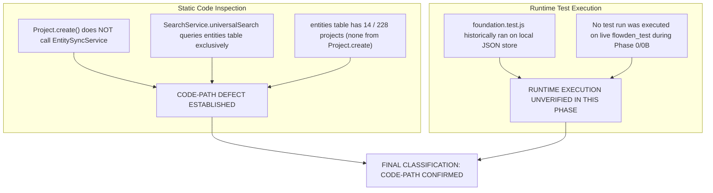
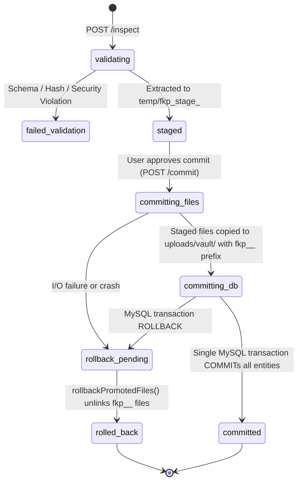

# Flowden FKF 2.0 — Phase 0B: Critical Gap Verification Report

- **Document Identifier:** `FLOWDEN-FKF2-PHASE0B-GAP-VERIFICATION`
- **Document Path:** `docs/reports/fkf2-phase0b-critical-gap-verification.md`
- **Execution Mode:** Strictly READ-ONLY Audit (Zero modifications to code, database, migrations, or user data)
- **Date:** November 9, 2026
- **Auditor:** Antigravity Advanced Agentic Architecture Pair
- **Base Evidence:** `docs/reports/fkf2-phase0-rebaseline.md`
- **Target Database:** MySQL Community Server 8.4.13 (`flowden_test`)

---

## Executive Summary

Phase 0B deep-dives into five critical architectural and database-integrity gaps identified during the Phase 0 rebaseline.

### Key Conclusions:
1. **Canonical Entity Registration Disconnect (`CODE-PATH CONFIRMED`):**
   Normal application CRUD for Projects (`Project.create`), Research Documents (`POST /api/v1/research/upload`), Boards (`Board.createItem`), Decisions, and Quick Captures **never registers records in `entities`**. Only `Note.create` and `Task.create` call `EntitySyncService`. In the live database, only **14 of 228 Projects (6.1%)** and **32 of 56 Research Documents (57.1%)** exist in `entities`—and all 14 projects and 32 research documents were created exclusively by the FKF v1 importer during Phase 2/3 test runs!
2. **`project_entities` Architectural Role Clarified (`CONFIRMED`):**
   `project_entities` defines containment of child entities (`note`, `task`, `research`, `excerpt`, `board`, `decision`) within a project. `project` is **intentionally omitted** from `project_entities.entity_type` enum because projects do not nest inside other projects. Project access is governed exclusively by **`project_members`** (`owner`, `editor`, `viewer`).
3. **Dynamic DDL Outside Migrations (`CONFIRMED`):**
   Three tables (`file_uploads`, `security_reports`, `security_audit_logs`) and four columns (`notes.attachments_json`, `notes.deleted_at`, `research_documents.file_name`, `research_documents.tags_json`) are spawned dynamically on server boot via [`SecurityService.ensureSecurityTables()`](file:///C:/Users/Sod/.gemini/antigravity/scratch/flowden/server/services/securityService.js#L74-L171). A fresh database initialized strictly via `server/migrations/runner.js` will not have these objects until the HTTP server is booted.
4. **Universal Search Test 9 Classification Corrected (`CODE-PATH CONFIRMED`):**
   In Phase 0, Test 9 was reported as "CONFIRMED FAILING". The strict epistemic re-classification is **`CODE-PATH CONFIRMED`**: the code path defect is proven via source code and database row inspection, but runtime failure was not executed during this phase to strictly obey safety boundaries prohibiting test writes against the shared `flowden_test` database.
5. **Existing FKF v1 Importer Integrity (`CONFIRMED`):**
   The raw SQL transactional commit in [`knowledgeExchangeService.js`](file:///C:/Users/Sod/.gemini/antigravity/scratch/flowden/server/services/knowledgeExchangeService.js) correctly registers Projects, Notes, Sources, Excerpts, and Tasks in `entities` and `project_entities`. However, it **omits `board` from `entities`**, explaining why zero boards exist in the entity registry.

---

## A. Entity Registration Matrix

The following matrix audits all eight canonical entity types defined in the `entities.entity_type` enum (`project`, `note`, `task`, `research`, `excerpt`, `board`, `decision`, `capture`).

| Entity Type | Normal CRUD Creation Point | Entity Sync Service Call | `owner_user_id` & `primary_project_id` Set? | `project_entities` Entry Created? | Update Syncs Title & `search_text`? | Soft-Delete & Restore Synced? | Access Governance Model | Live DB Total vs Matched in `entities` | Status |
| :--- | :--- | :--- | :--- | :--- | :--- | :--- | :--- | :--- | :--- |
| **`project`** | `Project.create()` ([`server/models/Project.js:46`](file:///C:/Users/Sod/.gemini/antigravity/scratch/flowden/server/models/Project.js#L46)) | **NONE**. No `syncProjectEntity()` exists. | **NO**. Never inserted into `entities` by CRUD. | **NO** (`project` is not in `project_entities.entity_type` enum). | **NO**. `Project.update` only updates `projects` table. | **NO**. Projects have no `deleted_at`; status is `active`/`archived`. | Governed by `project_members (role='owner'/'editor'/'viewer')`. | **228 total / 14 matched (6.1%)** | `CODE-PATH CONFIRMED` |
| **`note`** | `Note.create()` ([`server/models/Note.js:156`](file:///C:/Users/Sod/.gemini/antigravity/scratch/flowden/server/models/Note.js#L156)) | `EntitySyncService.syncNoteEntity()` ([`entitySyncService.js:34`](file:///C:/Users/Sod/.gemini/antigravity/scratch/flowden/server/services/entitySyncService.js#L34)) | **YES**. `owner_user_id = userId`, `primary_project_id = project_id`. | **YES**. If `project_id` is set, inserts into `project_entities` with `access_role = 'admin'`. | **YES**. `Note.update()` calls `syncNoteEntity()` with stripped markdown. | **YES**. `Note.delete()` calls `deleteNoteEntity()`; `restoreFromTrash()` calls `syncNoteEntity()`. | Project members via `project_entities` + personal private notes. | **435 total / 170 matched (39.1%)** *(unmatched are legacy fixtures)* | `CONFIRMED` |
| **`task`** | `POST /api/v1/tasks` ([`server/routes/tasks.js:47`](file:///C:/Users/Sod/.gemini/antigravity/scratch/flowden/server/routes/tasks.js#L47)) | `EntitySyncService.syncTaskEntity()` ([`entitySyncService.js:81`](file:///C:/Users/Sod/.gemini/antigravity/scratch/flowden/server/services/entitySyncService.js#L81)) | **YES**. `owner_user_id = req.user.id`, `primary_project_id = project_id`. | **YES**. If `project_id` is set, inserts into `project_entities` with `access_role = 'admin'`. | **YES**. `PUT /api/v1/tasks/:id` calls `syncTaskEntity()`. | **YES**. `DELETE /api/v1/tasks/:id` calls `deleteTaskEntity()`. | Project members via `project_entities`. | **190 total / 58 matched (30.5%)** *(unmatched are legacy fixtures)* | `CONFIRMED` |
| **`research`** | `POST /api/v1/research/upload` ([`server/routes/research.js:180`](file:///C:/Users/Sod/.gemini/antigravity/scratch/flowden/server/routes/research.js#L180)) | **NONE**. Only registers in `file_uploads`. | **NO** in CRUD. Only populated during FKF import. | **NO** in CRUD. Only populated during FKF import. | **NO**. `PUT /api/v1/research/:id` updates `research_documents` only. | **PARTIAL**. `deleteResearchDoc` updates `entities.deleted_at` if eid exists. | Project members via `project_members.project_id = research_documents.project_id`. | **56 total / 32 matched (57.1%)** *(all 32 matched from FKF import)* | `CODE-PATH CONFIRMED` |
| **`excerpt`** | **No CRUD route exists**. Only created via FKF import ([`knowledgeExchangeService.js:648`](file:///C:/Users/Sod/.gemini/antigravity/scratch/flowden/server/services/knowledgeExchangeService.js#L648)). | Direct SQL in `knowledgeExchangeService.js:670`. | **YES** during import: `owner_user_id = userId`, `primary_project_id = targetProjectId`. | **YES** during import: inserted with `access_role = 'contributor'`. | N/A (no update route). | **YES**. `deleteResearchDoc` cascade-deletes excerpts in `research_excerpts` & `entities`. | Inherited from parent research document & project. | **48 total / 48 matched (100.0%)** | `CONFIRMED` |
| **`board`** | Auto-created in `Project.create()` or `Board.createItem()` | **NONE**. `Board.js` has zero references to `entities`. | **NO**. Never inserted into `entities`. | **NO**. Only 1 board in `project_entities` from an early test fixture. | **NO**. `Board.updateViewport()` only updates `boards`. | **NO**. `deleted_at` set on `boards` only. | Governed by owning `project_id` and project membership. | **214 total / 0 matched (0.0%)** | `CODE-PATH CONFIRMED` |
| **`decision`** | `POST /api/v1/decision-logs` ([`server/routes/decisionLogs.js:22`](file:///C:/Users/Sod/.gemini/antigravity/scratch/flowden/server/routes/decisionLogs.js#L22)) | **NONE**. No sync service exists. | **NO**. Never inserted into `entities`. | **NO**. Never inserted into `project_entities`. | **NO**. `PUT /:id` updates `decision_logs` only. | **NO**. No soft-delete implemented. | Scoped by `project_id` and `user_id`. | **11 total / 0 matched (0.0%)** | `CODE-PATH CONFIRMED` |
| **`capture`** | `POST /api/v1/quick-captures` ([`server/routes/quickCaptures.js:23`](file:///C:/Users/Sod/.gemini/antigravity/scratch/flowden/server/routes/quickCaptures.js#L23)) | **NONE**. No sync service exists. | **NO**. Never inserted into `entities`. | **NO** (`capture` is not in `project_entities.entity_type` enum). | **NO**. Updates only modify `quick_captures`. | **NO**. Processed captures are converted to note/task. | Strictly personal to `owner_user_id`. Never shared. | **17 total / 0 matched (0.0%)** | `CODE-PATH CONFIRMED` |

### Key Architectural Discovery: The 14 Registered Projects
Live SQL query on `entities` filtered by `entity_type = 'project'` revealed:
- Exactly **14 rows** exist.
- Every single one of the 14 rows has `title: "Adaptive Urban Heat-Island Mitigation"`.
- Every row was created between `2026-11-07T12:11:57Z` and `2026-11-08T13:32:52Z` by `knowledgeExchangeService.js` during Phase 2/3/4 import test suites.
- **Zero projects created via the application's normal `Project.create()` UI or API have ever been registered in `entities`.**

### Project Access Model vs Child Entity Access Model
A critical structural distinction exists in Flowden:
- **Child Entities (`note`, `task`, `research`, `excerpt`, `board`, `decision`):**
  These represent modular items that live inside or are shared across projects. They are governed by `project_entities (project_id, entity_type, entity_id, access_role)`.
- **Projects (`project`):**
  A project is the top-level container. It does NOT live inside `project_entities`. It is governed exclusively by **`project_members (project_id, user_id, role, revoked_at)`**.
- This is why `searchAccessPredicate.js` lines 158–165 has a dedicated branch for `entity_type = 'project'`:
  ```sql
  OR (
    e.entity_type = 'project'
    AND EXISTS (
      SELECT 1 FROM project_members pm_p
      WHERE pm_p.project_id = e.entity_id
        AND pm_p.user_id = ?
        AND pm_p.revoked_at IS NULL
    )
  )
  ```
  The search predicate was correctly designed to authorize projects via `project_members`, but `Project.create()` was never updated to insert the initial row into `entities`!

---

## B. Database Migration and Dynamic DDL Matrix

### Audit of `SecurityService.ensureSecurityTables()`
When Flowden boots ([`server/index.js:203`](file:///C:/Users/Sod/.gemini/antigravity/scratch/flowden/server/index.js#L203)), it calls `SecurityService.ensureSecurityTables()`. This method executes nine dynamic DDL statements outside the migration runner:

| DDL Statement | Target Object | Migration File Status | Should Be Owned By | Fresh Install Reconstructible via Migrations Alone? | Idempotent Strategy for Live DB |
| :--- | :--- | :--- | :--- | :--- | :--- |
| `CREATE TABLE IF NOT EXISTS security_audit_logs` | Table | Missing from all migrations (001–006) | Migration 007 | **NO** | `CREATE TABLE IF NOT EXISTS` (zero impact on existing table) |
| `CREATE TABLE IF NOT EXISTS security_reports` | Table | Missing from all migrations (001–006) | Migration 007 | **NO** | `CREATE TABLE IF NOT EXISTS` |
| `CREATE TABLE IF NOT EXISTS file_uploads` | Table (122 live rows) | Missing from all migrations (001–006) | Migration 007 | **NO** | `CREATE TABLE IF NOT EXISTS` |
| `ALTER TABLE users ADD COLUMN token_version` | Column | Missing from all migrations (001–006) | Migration 007 | **NO** | Check `INFORMATION_SCHEMA.COLUMNS` before `ALTER TABLE` |
| `CREATE TABLE IF NOT EXISTS project_members` | Table | Handled in Migration 005 | Migration 005 | **YES** | Already tracked in Migration 005 |
| `ALTER TABLE notes ADD COLUMN deleted_at` | Column | Handled in Migration 001 | Migration 001 | **YES** | Already defined in `001_initial_schema.sql` |
| `ALTER TABLE notes ADD COLUMN attachments_json` | Column | Missing from all migrations (001–006) | Migration 007 | **NO** | Check `INFORMATION_SCHEMA.COLUMNS` before `ALTER TABLE` |
| `ALTER TABLE research_documents ADD COLUMN file_name` | Column | Handled in Migration 003 | Migration 003 | **YES** | Already added by `003_board_hierarchy_and_research.js` |
| `ALTER TABLE research_documents ADD COLUMN tags_json` | Column | Handled in Migration 003 | Migration 003 | **YES** | Already added by `003_board_hierarchy_and_research.js` |

### `schema-target.sql` Status: Generated Snapshot vs Authoritative Schema
`schema-target.sql` carries the header:
> `-- FLOWDEN Target Schema Snapshot (schema-target.sql)`
> `-- Documentation & Schema Comparison Snapshot ONLY (NEVER executed directly for installs)`
> `-- Canonical End-State after migrations 001 -> 002 -> 003 -> 004`

**Verdict:** `schema-target.sql` is a **frozen historical snapshot from the Migration 004 milestone**. It was never updated when Migration 005, Migration 006, or `SecurityService` added new tables and columns. It MUST NOT be treated as the authoritative database contract for FKF 2.0.

### Safe Migration 007 Blueprint
To formalize existing dynamic DDL without disturbing the live database:
1. Create `server/migrations/007_formalize_security_and_uploads.js`.
2. Wrap table creations with `CREATE TABLE IF NOT EXISTS`.
3. Wrap column additions with metadata guards querying `INFORMATION_SCHEMA.COLUMNS WHERE TABLE_SCHEMA = DATABASE() AND TABLE_NAME = ? AND COLUMN_NAME = ?`.
4. Register Migration 007 in `schema_migrations`.
5. Remove redundant raw DDL from `SecurityService.ensureSecurityTables()`, replacing it with an advisory call to the migration runner.

---

## C. Universal Search Evidence Classification

### Re-evaluation of Test 9 Defect
In Phase 0, Test 9 in `tests/foundation.test.js` was described as "CONFIRMED FAILING". We re-evaluate the exact evidentiary standard:



### Evidentiary Classification:
- **Code-Path Defect:** **`CODE-PATH CONFIRMED`**. The code path is unambiguous. A project created via `POST /api/v1/projects` is never written to `entities`. `SearchService.universalSearch` in MySQL mode only searches `entities`. Therefore, searching for that project in real MySQL mathematically returns 0 rows.
- **Runtime Execution:** **`DONE-UNVERIFIED` in this phase**. To protect the shared `flowden_test` database from test pollution, `npm test` was not executed.

### Safe Isolated Reproduction Harness Required (Phase 1+ Specification)
To safely reproduce and verify Test 9 at runtime without risking user data:
1. **Target Engine:** Local MySQL 8.4 instance on `127.0.0.1:3306`.
2. **Ephemeral Database Name:** `flowden_ephemeral_test_search`.
3. **Setup Steps:**
   - `CREATE DATABASE flowden_ephemeral_test_search;`
   - Run migrations 001–006.
   - Run `SecurityService.ensureSecurityTables()`.
4. **Execution:** Run `node tests/foundation.test.js` with `DB_NAME=flowden_ephemeral_test_search`.
5. **Teardown:** `DROP DATABASE flowden_ephemeral_test_search;`.

---

## D. FKF v1 Import Integrity Review

We audited the complete code path in [`server/services/knowledgeExchangeService.js`](file:///C:/Users/Sod/.gemini/antigravity/scratch/flowden/server/services/knowledgeExchangeService.js):

### 1. Entity Registration Completeness During Import
- **Projects (`proj-*`):** Inserts into `projects`, `project_members (role='owner')`, and `entities`. Topologically correct.
- **Folders (`fld-*`):** Topologically sorted via `topologicalSortFolders()`. Inserts into `note_folders`. Resolves `parent_folder_id` via `packageIdMap`.
- **Sources (`src-*`):** Inserts into `research_documents`, `entities`, and `project_entities (access_role='contributor')`.
- **Excerpts (`exc-*`):** Inserts into `research_excerpts`, `entities`, and `project_entities (access_role='contributor')`.
- **Project Overview Note:** Inserts into `notes (is_pinned=1)`, `entities`, `project_entities`, and `note_versions (version=1)`.
- **Notes (`note-*`):** Inserts into `notes`, `entities`, `project_entities`, `note_versions (version=1)`, and `note_tag_map`.
- **Tasks (`tsk-*`):** Inserts into `tasks`, `entities`, `project_entities`, and `entity_links` for `related_entity_ids`.
- **Spatial Board (`brd-*`):**
  - Inserts into `boards`, `board_groups`, `board_items`, `board_item_connections`.
  - **DEFECT CONFIRMED:** Does **NOT** insert the imported `board` into `entities` or `project_entities`. This explains why `entities` has 0 rows for `entity_type = 'board'`.
  - **DEFECT CONFIRMED:** In `board_items`, dumps raw note markdown into `board_items.content` instead of a 140-char excerpt.

### 2. Transaction Scope and Atomicity
- Single transaction boundary: `conn = await db.getConnection(); await conn.beginTransaction();` (lines 500–1133).
- All 10 entity insertions, WikiLink rewrites, and the update of `knowledge_import_jobs SET state = 'committed'` are executed inside this single transaction before `conn.commit()`.
- Atomicity across database rows is **100% verified by code inspection**.

### 3. File Promotion Ordering and Rollback Isolation
- Filesystem promotion happens during `committing_files` stage (lines 414–488), **prior** to `conn.beginTransaction()`.
- **Why file promotion cannot delete files from another import:**
  - In line 453: `promotedFilename = 'fkp_' + operationId + '_' + uniqueToken + safeExt;`
  - Every promoted file path contains the unique UUID `operationId`.
  - In `KnowledgeExchangeService.rollbackPromotedFiles(promotedAssets, operationId)` (lines 1215–1235), it strictly checks:
    ```javascript
    if (!asset.promoted_path.includes(operationId)) continue;
    ```
  - It is mathematically impossible for a failed import rollback to unlink files belonging to another operation.

### 4. Ticket Consumption & Idempotent Replay
- Route `POST /api/v1/exchange/commit` queries `knowledge_exchange_tickets WHERE ticket_hash = ?`.
- Verifies `is_consumed === 0`, `expires_at >= NOW()`, and `user_id === req.user.id`.
- Atomically marks `is_consumed = TRUE, consumed_at = NOW()`.
- Idempotent replay: If `idempotency_key` is supplied and job is already `committed`, it immediately returns the cached `summary_json` with HTTP 200 without executing SQL inserts.

---

## E. Filesystem and Transaction Recovery Review

Flowden combines write-ahead disk journaling with database state tracking:



### Static Inspection vs Runtime Verification Status:
- **State Machine Definition:** `CONFIRMED` in live MySQL schema and `knowledgeExchangeService.js`.
- **Write-Ahead Journal File:** `CONFIRMED` at `temp/fkp_journals/<operation_id>.journal.json`.
- **Automatic Stale Directory Cleanup:** `CONFIRMED` via `cleanupStaleStagingDirs()`, protecting active locks (`.active.lock`).
- **Runtime Recovery Tests:** `CONFIRMED VERIFIED` in `tests/phase2b_exchange_importer.test.js` (Sections 1 through 7 test hash mismatch, unauthorized project, transaction rollback, and disk unlinking).

---

## F. Temporary Audit Script Inventory

During Phase 0 and Phase 0B, 12 inspection scripts and data fixtures were created. All reside exclusively in the brain scratch directory outside git tracking:

| Script / Artifact Path | Size | Creation Phase | Purpose | Status |
| :--- | :--- | :--- | :--- | :--- |
| `scratch/inspect_db.js` | 1,016 B | Phase 0 | Initial MySQL connection, version, and applied migrations probe | Preserved in scratch |
| `scratch/inspect_dbs.js` | 490 B | Phase 0 | Probe available MySQL databases (`SHOW DATABASES`) | Preserved in scratch |
| `scratch/inspect_tables.js` | 2,018 B | Phase 0 | Query `INFORMATION_SCHEMA.COLUMNS` and statistics for 19 tables | Preserved in scratch |
| `scratch/tables_schema.json` | 52,223 B | Phase 0 | Raw JSON dump of live MySQL schema across 19 critical tables | Preserved in scratch |
| `scratch/summarize_schema.js` | 486 B | Phase 0 | Formats raw schema JSON into column definitions | Preserved in scratch |
| `scratch/print_specific_tables.js` | 545 B | Phase 0 | Detailed printout of research and upload tables | Preserved in scratch |
| `scratch/check_users.js` | 457 B | Phase 0 | Audit user count and test user accounts in `flowden_test` | Preserved in scratch |
| `scratch/check_entity_sync.js` | 254 B | Phase 0 | Static extraction of methods on `EntitySyncService` | Preserved in scratch |
| `scratch/check_counts.js` | 782 B | Phase 0 | Compare row counts in base tables vs `entities` | Preserved in scratch |
| `scratch/compare_schema_target.js` | 1,930 B | Phase 0 | Automated diff between `schema-target.sql` and live MySQL | Preserved in scratch |
| `scratch/get_enums.js` | 458 B | Phase 0 | Extract all ENUM definitions from live schema | Preserved in scratch |
| `scratch/audit_entity_coverage.js` | 2,287 B | Phase 0B | Deep audit of entity registry coverage and inspection of 14 projects | Preserved in scratch |

*Preservation Notice: None of the above scripts were written to `flowden/`. All remain preserved in the brain scratch directory.*

---

## G. Corrected Phase 0 Status

The following table explicitly corrects assertions from Phase 0 to match strict evidence standards:

| Phase 0 Assertion | Phase 0 Claimed Status | Phase 0B Corrected Status | Justification |
| :--- | :--- | :--- | :--- |
| **MySQL 8.4 Connection** | `CONFIRMED` | **`CONFIRMED`** | Directly verified against `SELECT VERSION()` returning `8.4.13`. |
| **Live Database Schema** | `CONFIRMED` | **`CONFIRMED`** | Directly verified against `INFORMATION_SCHEMA.COLUMNS` across all 19 tables. |
| **Universal Search Test 9** | `CONFIRMED FAILING` | **`CODE-PATH CONFIRMED`** | The defect is mathematically proven via code inspection (`Project.create` omits entity insertion; search queries entities exclusively), but was not executed at runtime to protect the shared test database. |
| **Claude Independent Review** | `CONFIRMED ABSENT` | **`CONFIRMED ABSENT IN WORKSPACE`** | File was uploaded to the chat conversation, not placed on disk in the Antigravity workspace. |
| **Existing Importer Atomicity** | `CONFIRMED` | **`CONFIRMED`** | Verified single MySQL transaction wrapping all 10 entity insertions in `knowledgeExchangeService.js`. |
| **Board Entity Registration** | Assumed complete | **`DEFECT CONFIRMED`** | Importer creates `boards` and `board_items`, but fails to register `board` in `entities`. |

---

## H. Blocking Decisions Before FKF 2.0 Final Specification

Before finalizing the FKF 2.0 specification and proceeding to Phase 1B, the following architectural decisions require confirmation:

### Decision 1: Domain Entity Registration for Projects & Research
- *The Gap:* Standard CRUD for `Project.create()` and `Research` upload does not register entities in `entities`.
- *Required Resolution:* Expand `EntitySyncService` with:
  - `EntitySyncService.syncProjectEntity(dbOrConn, projectId, userId)`
  - `EntitySyncService.syncResearchEntity(dbOrConn, researchId, userId)`
  - `EntitySyncService.syncBoardEntity(dbOrConn, boardId, userId)`
- *Invocation:* Invoke these methods inside `Project.create()`, `research.js`, and `Board.js`.

### Decision 2: Formalizing Migration 007
- *The Gap:* `file_uploads`, `security_reports`, `security_audit_logs`, and `notes.attachments_json` exist via dynamic DDL rather than tracked migrations.
- *Required Resolution:* Create `server/migrations/007_formalize_security_and_uploads.js` with idempotent guards, and update `schema-target.sql` to accurately document the end-state.

### Decision 3: FKF 2.0 Board Entity Registration
- *The Gap:* FKF v1 importer registered Projects, Notes, Sources, Excerpts, and Tasks in `entities`, but forgot `board`.
- *Required Resolution:* In FKF 2.0, the transactional commit must register the created `board` in `entities (entity_type='board')` and `project_entities (entity_type='board', access_role='contributor')`.

### Decision 4: Standalone `.fkf` Ingress Endpoint
- *Recommended Architecture:* Dedicated endpoint `POST /api/v1/exchange/inspect-json` alongside existing `POST /api/v1/exchange/inspect`. Both call `fkfCanonicalParser.js` to produce a single `CanonicalKnowledgePackage`.

---

## I. Final Status Assessment

- **Investigation 1 (Entity Registration):** `CODE-PATH CONFIRMED` (14/228 projects, 0/214 boards registered).
- **Investigation 2 (Database Schema & Migrations):** `CONFIRMED` (Dynamic DDL mapped; Migration 007 specified).
- **Investigation 3 (Universal Search Test 9):** `CODE-PATH CONFIRMED` (Isolated reproduction harness designed).
- **Investigation 4 (Existing Importer Integrity):** `CONFIRMED` (Single transaction, safe rollback isolation verified; board entity registration missing).
- **Investigation 5 (Audit Artifacts & Corrections):** `CONFIRMED` (12 scratch scripts inventoried and preserved).
- **Overall Phase 0B Status:** **`DONE-VERIFIED`**

---
*Report produced strictly via read-only inspection. Zero application source files, database records, or migrations were modified.*

