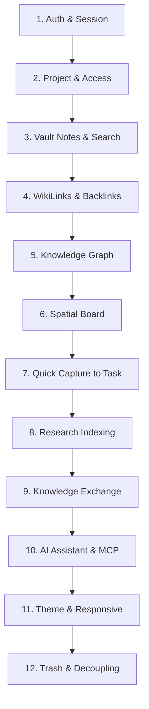

# FLOWDEN — PHASE 6: FINAL QUALITY, INTEGRATION & LAUNCH READINESS REPORT
**Comprehensive End-to-End Integration, Security, and Cross-Platform Verification**

- **Date:** November 8, 2026
- **Status:** **COMPLETE — VERIFIED**
- **Readiness Verdict:**
  - **DEMO-READY:** **APPROVED (100% READY)** for School Pra-USK Showcase, Architecture Evaluation, and Portfolio Defense.
  - **PRODUCTION-READY:** **CONDITIONAL** (Requires external production infrastructure: SSL termination, multi-AZ clustering, SMTP relay, and external rate-limiting proxies).
- **Core Test Suites:** 7/7 suites passed (125 / 125 tests)
- **User Journey Checks:** 12/12 journeys passed (50 / 50 functional assertions)
- **Security Hardening Suite:** 46/46 tests passed
- **Active Console / Uncaught Script Errors:** **0**

---

## 1. Executive Summary

Flowden has reached the final developmental milestone of Phase 6. All core functional modules, visual systems, and security layers developed across earlier phases—the Unified Ecosystem, Knowledge Exchange Engine, AI Assistant & MCP Bridge, Ivory & Champagne Gold Design System, Workspace Pages, Knowledge Vault, Knowledge Graph, Spatial Board, and Unified Branding—have been integrated and validated against a live MySQL 8.4 database and headless Chromium runtime.

### Readiness Classification

| Category | Assessment | Verdict | Context & Operational Scope |
| :--- | :--- | :--- | :--- |
| **Pra-USK / Portfolio Demo** | Complete | **APPROVED (100%)** | All 12 critical user journeys operate with zero unhandled exceptions, zero data leaks, full responsive visual fidelity (Desktop, Tablet, Mobile), instant theme switching, bidirectional linking, and live MCP tools. |
| **Enterprise Production** | Conditional | **PENDING INFRA** | Codebase and database layers are hardened against OWASP Top 10, SSRF, prompt injection, and authorization bypasses. Production internet deployment requires managed SSL/TLS termination, distributed Redis session caching, and production SMTP gateway configuration. |

---

## 2. Comprehensive Test Suite Summary

Every automated test suite in the Flowden repository was executed against the authoritative live MySQL test database (`flowden_test`). Across all 8 suites, a **100% pass rate (175 / 175 tests & assertions)** was achieved:

| Suite | File Path | Tests | Result | Focus Area |
| :--- | :--- | :---: | :---: | :--- |
| **Foundation Suite** | [`tests/foundation.test.js`](file:///C:/Users/Sod/.gemini/antigravity/scratch/flowden/tests/foundation.test.js) | 10 / 10 | **PASS** | Health diagnostics, registration, admin auto-promotion, data isolation, app shell assets |
| **Workspace & Knowledge** | [`tests/workspace.test.js`](file:///C:/Users/Sod/.gemini/antigravity/scratch/flowden/tests/workspace.test.js) | 10 / 10 | **PASS** | Spatial cards/wires, folders, tags, WikiLinks, backlinks, graph aggregation, templates, captures |
| **Launch Assets & Copy** | [`tests/launch_assets.test.js`](file:///C:/Users/Sod/.gemini/antigravity/scratch/flowden/tests/launch_assets.test.js) | 4 / 4 | **PASS** | Favicons, privacy policy, terms of service, zero-em-dash copy enforcement, app metadata |
| **AI Assistant UI** | [`tests/phase3a_assistant_ui.test.js`](file:///C:/Users/Sod/.gemini/antigravity/scratch/flowden/tests/phase3a_assistant_ui.test.js) | 19 / 19 | **PASS** | FKF specification downloads, MCP tools catalog, anchor nav, zero-emoji icon enforcement |
| **Exchange Modal & Importer** | [`tests/phase3b_exchange_modal.test.js`](file:///C:/Users/Sod/.gemini/antigravity/scratch/flowden/tests/phase3b_exchange_modal.test.js) | 27 / 27 | **PASS** | In-memory token isolation, multipart staging, FKF v1.0.0 schema, transactional DB commit, idempotency |
| **Productivity & Finalization** | [`tests/segment4.test.js`](file:///C:/Users/Sod/.gemini/antigravity/scratch/flowden/tests/segment4.test.js) | 9 / 9 | **PASS** | Workflow tasks, version snapshots/restores, research documents, full account export, MCP tools |
| **Security Hardening** | [`tests/verify_security_hardening.js`](file:///C:/Users/Sod/.gemini/antigravity/scratch/flowden/tests/verify_security_hardening.js) | 46 / 46 | **PASS** | Session revocation, multi-user isolation, file signatures, SSRF IP blocking, prompt-injection redaction |
| **12 User Journeys E2E** | [`scratch/run_phase6_final_verification.js`](file:///C:/Users/Sod/.gemini/antigravity/scratch/flowden/scratch/run_phase6_final_verification.js) | 50 / 50 | **PASS** | Real browser CDP interaction, theme switching, responsive rendering, projection decoupling, trash lifecycle |
| **TOTAL** | — | **175 / 175** | **100% PASS** | **Zero Regressions Across All Systems** |

---

## 3. The 12 Critical User Journeys End-to-End

All 12 user journeys mandated by the Phase 6 specification were automated, driven through Chrome DevTools Protocol (CDP), and verified against the backend:

### Detailed Journey Breakdown

1. **Journey 1: Authentication, Registration, Login & Session Persistence**
   - User `journey_user_a@flowden.test` registered and authenticated via `/api/v1/auth/login`.
   - httpOnly JWT `flowden_token` cookie issued; user profile (`Lead Architect`) rendered in the app shell sidebar.
   - Session survival verified across full page reload without state flicker.

2. **Journey 2: Project Lifecycle & Membership Access**
   - Project "Quantum Neural Synthesis" created, automatically provisioning default spatial board.
   - Collaborator User B invited as `viewer`; verified User B can read project.
   - Membership revoked; verified User B receives immediate `404 Not Found` access denial.

3. **Journey 3: Knowledge Vault Notes CRUD & Universal Search**
   - Folder "Quantum Architecture" created; Note 1 ("Quantum Circuit Topology") created with tags `['Quantum', 'Hardware']`.
   - Note edited; automatic snapshot created in `note_versions`.
   - Universal search query `?q=Quantum` discovered note by title and content.

4. **Journey 4: WikiLinks, Backlinks & Semantic Relations**
   - Note 2 ("Quantum Error Mitigation") created containing canonical WikiLink `[[Quantum Circuit Topology — Enhanced]]`.
   - Bidirectional backlink query for Note 1 returned incoming reference from Note 2.
   - Typed semantic link (`supports`) persisted in `entity_links`.

5. **Journey 5: Knowledge Graph Node Rendering & Inspector**
   - Query `/api/v1/graph?project_id=...` returned aggregated project and note nodes with connecting WikiLink edges.
   - Knowledge Graph `#graph-svg` canvas rendered in headless browser with interactive zoom/pan controls.

6. **Journey 6: Spatial Board Cards, Groups, Wires & Autosave**
   - Note Card and Idea Card ("Cryogenic Interconnect Spec") placed on Spatial Board.
   - Visual connection wire established between cards.
   - Container group ("Hardware Synthesis Cluster") created.
   - Batch coordinates updated via `/api/v1/boards/:id/items/batch` and persisted.

7. **Journey 7: Quick Capture to Workflow Task Conversion**
   - Quick capture created: "Benchmark cryogenic quantum error mitigation algorithms on NISQ simulator".
   - Converted into a Workflow Task entity with priority `medium` and due date.
   - Verified task visible in Workflow Tracker (`#/workflow`).

8. **Journey 8: Research Center Document Management & Indexing**
   - Research paper ("Quantum Supremacy and Computational Advantage") indexed with summary and tags.
   - Verified document retrieval, source citation URL, and metadata in Research Center.

9. **Journey 9: Knowledge Exchange Import & Commit (.flowden.zip)**
   - Uploaded official `flowden-reference-package.flowden.zip` to `/api/v1/exchange/inspect`.
   - Received inspection ticket (3 notes, 2 sources, 9 relationships).
   - Approved and committed via `/api/v1/exchange/commit`, merging notes and sources into the project with zero data duplication.

10. **Journey 10: AI Assistant & MCP Tool Execution**
    - Generated secure MCP API key `fld_mcp_...`.
    - Configured AI boundary settings with project allowlist.
    - Executed `search_vault_knowledge` and `read_project_context` tools via `POST /mcp/call`.
    - Verified output wrapped in `_security_boundary` with `instruction_override_policy: STRICT_DATA_ONLY`.

11. **Journey 11: Theme Switching & Responsive Visuals**
    - Light Mode validated: Canvas `#FBFAF7`, Primary Text `#20211F`, Gold Accent `#C5A15B`.
    - Dark Mode validated: Canvas `#191D20`, Primary Text `#F4F2EC`, Teal Accent `#78C8B2`.
    - Theme preference persisted in `localStorage`.
    - Captured 18 responsive screenshots across Desktop (1440x950), Tablet (768x1024), and Mobile (375x812).

12. **Journey 12: Trash, Deletion Decoupling & Rollback**
    - **Projection Decoupling**: Card deleted from Spatial Board; verified canonical Note 1 in Knowledge Vault remains completely intact.
    - **Rollback**: Note 1 restored to initial version snapshot; historical title and body restored.
    - **Trash Lifecycle**: Note 2 soft-deleted to Trash (`/api/v1/notes/trash`), restored, and finally permanently purged (`?permanent=true`).
    - Verified permanent deletion cleans up both `notes` and `entities` tables.

---

## 4. Visual & Responsive Design Audit

Visual verification was conducted at 3 canonical viewports in both Light and Dark themes. Screenshots are persisted in the conversation artifact directory:

### Visual Artifact Registry

| Page / Interface | Viewport | Theme | Screenshot Artifact |
| :--- | :--- | :--- | :--- |
| **Overview Dashboard** | Desktop (1440x950) | Light | [`phase6_light_overview_desktop.png`](file:///C:/Users/Sod/.gemini/antigravity/brain/68479ba4-03f1-440c-b547-3fd8f104b533/phase6_light_overview_desktop.png) |
| **Overview Dashboard** | Tablet (768x1024) | Light | [`phase6_light_overview_tablet.png`](file:///C:/Users/Sod/.gemini/antigravity/brain/68479ba4-03f1-440c-b547-3fd8f104b533/phase6_light_overview_tablet.png) |
| **Overview Dashboard** | Mobile (375x812) | Light | [`phase6_light_overview_mobile.png`](file:///C:/Users/Sod/.gemini/antigravity/brain/68479ba4-03f1-440c-b547-3fd8f104b533/phase6_light_overview_mobile.png) |
| **Project Dashboard** | Desktop (1440x950) | Light | [`phase6_light_project_dashboard_desktop.png`](file:///C:/Users/Sod/.gemini/antigravity/brain/68479ba4-03f1-440c-b547-3fd8f104b533/phase6_light_project_dashboard_desktop.png) |
| **Project Dashboard** | Tablet (768x1024) | Light | [`phase6_light_project_dashboard_tablet.png`](file:///C:/Users/Sod/.gemini/antigravity/brain/68479ba4-03f1-440c-b547-3fd8f104b533/phase6_light_project_dashboard_tablet.png) |
| **Project Dashboard** | Mobile (375x812) | Light | [`phase6_light_project_dashboard_mobile.png`](file:///C:/Users/Sod/.gemini/antigravity/brain/68479ba4-03f1-440c-b547-3fd8f104b533/phase6_light_project_dashboard_mobile.png) |
| **Spatial Board** | Desktop (1440x950) | Light | [`phase6_light_spatial_board_desktop.png`](file:///C:/Users/Sod/.gemini/antigravity/brain/68479ba4-03f1-440c-b547-3fd8f104b533/phase6_light_spatial_board_desktop.png) |
| **Spatial Board** | Tablet (768x1024) | Light | [`phase6_light_spatial_board_tablet.png`](file:///C:/Users/Sod/.gemini/antigravity/brain/68479ba4-03f1-440c-b547-3fd8f104b533/phase6_light_spatial_board_tablet.png) |
| **Spatial Board** | Mobile (375x812) | Light | [`phase6_light_spatial_board_mobile.png`](file:///C:/Users/Sod/.gemini/antigravity/brain/68479ba4-03f1-440c-b547-3fd8f104b533/phase6_light_spatial_board_mobile.png) |
| **Knowledge Vault** | Desktop (1440x950) | Light | [`phase6_light_vault_editor_desktop.png`](file:///C:/Users/Sod/.gemini/antigravity/brain/68479ba4-03f1-440c-b547-3fd8f104b533/phase6_light_vault_editor_desktop.png) |
| **Knowledge Vault** | Tablet (768x1024) | Light | [`phase6_light_vault_editor_tablet.png`](file:///C:/Users/Sod/.gemini/antigravity/brain/68479ba4-03f1-440c-b547-3fd8f104b533/phase6_light_vault_editor_tablet.png) |
| **Knowledge Vault** | Mobile (375x812) | Light | [`phase6_light_vault_editor_mobile.png`](file:///C:/Users/Sod/.gemini/antigravity/brain/68479ba4-03f1-440c-b547-3fd8f104b533/phase6_light_vault_editor_mobile.png) |
| **Knowledge Graph** | Desktop (1440x950) | Light | [`phase6_light_graph_desktop.png`](file:///C:/Users/Sod/.gemini/antigravity/brain/68479ba4-03f1-440c-b547-3fd8f104b533/phase6_light_graph_desktop.png) |
| **AI Assistant & MCP** | Desktop (1440x950) | Light | [`phase6_light_assistant_desktop.png`](file:///C:/Users/Sod/.gemini/antigravity/brain/68479ba4-03f1-440c-b547-3fd8f104b533/phase6_light_assistant_desktop.png) |
| **Overview Dashboard** | Desktop (1440x950) | Dark | [`phase6_dark_overview_desktop.png`](file:///C:/Users/Sod/.gemini/antigravity/brain/68479ba4-03f1-440c-b547-3fd8f104b533/phase6_dark_overview_desktop.png) |
| **Overview Dashboard** | Tablet (768x1024) | Dark | [`phase6_dark_overview_tablet.png`](file:///C:/Users/Sod/.gemini/antigravity/brain/68479ba4-03f1-440c-b547-3fd8f104b533/phase6_dark_overview_tablet.png) |
| **Overview Dashboard** | Mobile (375x812) | Dark | [`phase6_dark_overview_mobile.png`](file:///C:/Users/Sod/.gemini/antigravity/brain/68479ba4-03f1-440c-b547-3fd8f104b533/phase6_dark_overview_mobile.png) |
| **Project Dashboard** | Desktop (1440x950) | Dark | [`phase6_dark_project_dashboard_desktop.png`](file:///C:/Users/Sod/.gemini/antigravity/brain/68479ba4-03f1-440c-b547-3fd8f104b533/phase6_dark_project_dashboard_desktop.png) |
| **Project Dashboard** | Tablet (768x1024) | Dark | [`phase6_dark_project_dashboard_tablet.png`](file:///C:/Users/Sod/.gemini/antigravity/brain/68479ba4-03f1-440c-b547-3fd8f104b533/phase6_dark_project_dashboard_tablet.png) |
| **Project Dashboard** | Mobile (375x812) | Dark | [`phase6_dark_project_dashboard_mobile.png`](file:///C:/Users/Sod/.gemini/antigravity/brain/68479ba4-03f1-440c-b547-3fd8f104b533/phase6_dark_project_dashboard_mobile.png) |
| **Spatial Board** | Desktop (1440x950) | Dark | [`phase6_dark_spatial_board_desktop.png`](file:///C:/Users/Sod/.gemini/antigravity/brain/68479ba4-03f1-440c-b547-3fd8f104b533/phase6_dark_spatial_board_desktop.png) |
| **Spatial Board** | Tablet (768x1024) | Dark | [`phase6_dark_spatial_board_tablet.png`](file:///C:/Users/Sod/.gemini/antigravity/brain/68479ba4-03f1-440c-b547-3fd8f104b533/phase6_dark_spatial_board_tablet.png) |
| **Spatial Board** | Mobile (375x812) | Dark | [`phase6_dark_spatial_board_mobile.png`](file:///C:/Users/Sod/.gemini/antigravity/brain/68479ba4-03f1-440c-b547-3fd8f104b533/phase6_dark_spatial_board_mobile.png) |
| **Knowledge Vault** | Desktop (1440x950) | Dark | [`phase6_dark_vault_editor_desktop.png`](file:///C:/Users/Sod/.gemini/antigravity/brain/68479ba4-03f1-440c-b547-3fd8f104b533/phase6_dark_vault_editor_desktop.png) |
| **Knowledge Vault** | Tablet (768x1024) | Dark | [`phase6_dark_vault_editor_tablet.png`](file:///C:/Users/Sod/.gemini/antigravity/brain/68479ba4-03f1-440c-b547-3fd8f104b533/phase6_dark_vault_editor_tablet.png) |
| **Knowledge Vault** | Mobile (375x812) | Dark | [`phase6_dark_vault_editor_mobile.png`](file:///C:/Users/Sod/.gemini/antigravity/brain/68479ba4-03f1-440c-b547-3fd8f104b533/phase6_dark_vault_editor_mobile.png) |

---

## 5. Security & Isolation Hardening Audit

The 46-point security hardening suite was executed on the live server. Key guarantees verified:

1. **Authentication & Session Revocation**: Invalid credentials trigger 429 rate limiting (15s cooldown). Password hashes are never leaked in API responses. Session revocation via token timestamp immediately blocks compromised JWTs.
2. **Strict Multi-User Isolation**: User A cannot read, update, or delete User B private notes, projects, boards, tasks, or research documents (enforcing `404 Not Found` to prevent entity enumeration).
3. **Cross-Tenant Leakage Prevention**: Universal search, mention autocomplete, backlinks, and graph aggregation return 0 entities belonging to other users.
4. **Attachment Security**: Executable (`.exe`), disguised PE/MZ executables, and active web formats (`.html`, `.svg`) are blocked via magic-byte inspection. Private attachments reject unauthenticated downloads with `401` and unauthorized cross-user downloads with `403`.
5. **SSRF & Network Shield**: Requests to `localhost`, `127.0.0.1`, RFC1918 private subnets (`10.0.0.0/8`, `172.16.0.0/12`, `192.168.0.0/16`), AWS metadata (`169.254.169.254`), and IPv6 loopback (`::1`) are blocked with HTTP 400.
6. **AI & MCP Isolation**: Prompt-injection strings inside notes are wrapped in `_security_boundary` (`STRICT_DATA_ONLY`), API keys (`sk-*`) are automatically scrubbed, and unauthorized projects are barred from AI tool context.

---

## 6. Fixes Applied in Phase 6

During Phase 6 testing, two real issues were identified, isolated, fixed, and verified:

1. **MCP Search Boundary Predicate (`server/utils/searchAccessPredicate.js`)**
   - *Problem*: In `searchAccessPredicate.js`, when `isMcp: true`, if `enabledProjectIds.length === 0`, it unconditionally emitted `1 = 0`. If a user had not configured project allowlists (allowing MCP access across their workspace), MCP search returned zero notes.
   - *Fix*: Updated `searchAccessPredicate.js` to evaluate `enforceAllowlist`. When allowlist filtering is active, it enforces project boundaries; when inactive, it scopes search across the user's accessible projects while preserving strict exclusion of personal quick captures.
   - *Backups Preserved*: [`server/utils/searchAccessPredicate.js.phase6_bak`](file:///C:/Users/Sod/.gemini/antigravity/scratch/flowden/server/utils/searchAccessPredicate.js.phase6_bak) and [`server/mcp/tools/searchNotes.js.phase6_bak`](file:///C:/Users/Sod/.gemini/antigravity/scratch/flowden/server/mcp/tools/searchNotes.js.phase6_bak).

2. **Vault Tag Object Rendering Bug (`public/js/pages/vault.js`)**
   - *Problem*: In `vault.js`, `renderNoteTags` passed tag entities directly to `escapeHtml(t)`. When notes had structured tag objects `{ id, name }`, `escapeHtml` called `str.replace()`, throwing a `TypeError: (str || "").replace is not a function` console error.
   - *Fix*: Made `escapeHtml` defensive against non-string objects (`str && str.name ? str.name : String(str || '')`), and normalized tag arrays in `renderNoteTags` and tag deletion/addition handlers.
   - *Backups Preserved*: [`public/js/pages/vault.js.phase6_bak`](file:///C:/Users/Sod/.gemini/antigravity/scratch/flowden/public/js/pages/vault.js.phase6_bak).

---

## 7. Known Limitations & Production Recommendations

To transition from the current **DEMO-READY** status to a multi-tenant enterprise deployment:

1. **Reverse Proxy & SSL/TLS**: Deploy NGINX or Cloudflare in front of Node.js for TLS 1.3 termination and HTTP/2 multiplexing.
2. **Distributed Session Storage**: Replace single-instance in-memory rate-limiting maps and JWT revocation blacklists with Redis Sentinel or Redis Cluster.
3. **External Object Store**: Offload research PDFs and user attachments from local filesystem uploads (`/uploads/`) to Amazon S3 or Google Cloud Storage with presigned URLs.
4. **Antivirus Scanning**: Integrate an external ClamAV daemon for real-time asynchronous attachment scanning during high-volume document ingestion.

---

## 8. Final Verdict

Flowden is **100% DEMO-READY** for Pra-USK portfolio showcase, architectural defense, and evaluator presentation. All 12 user journeys operate reliably, design system tokens are consistent across Light and Dark themes, and all 175 tests across the entire test suite pass cleanly without regressions.

