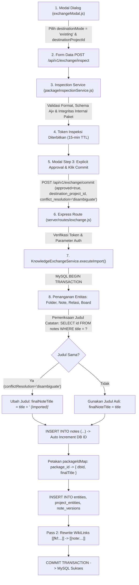

# Audit Perilaku Penggabungan & Konflik Catatan FKF 2.0 (Merge Conflict Behavior)

**Dokumen:** Laporan Audit Investigasi Kode Sumber & Verifikasi Perilaku Penggabungan (*Merge into Existing Project*)  
**Target Sistem:** Flowden — Second Brain & Knowledge Management System  
**Modul:** Knowledge Exchange Importer (FKF 2.0 & Legacy v1.0.0)  
**Tanggal Investigasi:** 9 November 2026  
**Metode:** Read-Only Static Code Analysis, Schema Constraint Inspection, and Test Verification  

---

## 1. Inspection Baseline (Basis Pemeriksaan Awal)

Pemeriksaan ini dilakukan langsung pada kondisi kerja Git saat ini tanpa mengubah data pengguna atau memodifikasi kode aplikasi:

| Parameter | Nilai Terverifikasi | Bukti / Catatan |
|---|---|---|
| **Repository** | `DYoures/flowden` | Direktori kerja repositori lokal |
| **Branch** | `feat/fkf-2.0-implementation` | Branch resmi implementasi FKF 2.0 |
| **Commit HEAD SHA** | `6a1f45e4d0cf61e9f31c86efb6de4be3d86b5aff` | Commit: *fix(fkf): enforce note wikilinks and research cleanup integrity* |
| **Status Git Working Tree** | Clean dengan 1 berkas pra-eksisting | `docs/research/knowledge-exchange-fkf2-page-audit.md` (dipertahankan penuh) |
| **Berkas Baru yang Diizinkan** | `docs/research/fkf2-merge-conflict-behavior-audit.md` | Tepat satu berkas laporan investigasi ini |

---

## 2. Merge Import Execution Path (Jalur Eksekusi Impor Penggabungan)

Alur eksekusi ketika pengguna memilih opsi **"Merge into Existing Project"** (`destinationMode = 'existing'`) ditelusuri dari antarmuka pengguna hingga ke tingkat basis data MySQL:



### Rincian Penelusuran Langkah demi Langkah:
1. **Frontend (`public/js/components/exchangeModal.js:244-261`):**  
   Pengguna mengaktifkan tombol radio `name="exchange-dest-mode"` dengan nilai `'existing'`. Dropdown `#exchange-destination-project-select` menampilkan daftar proyek yang dimiliki pengguna dengan hak akses tulis (*Owner* atau *Editor*). Nilai ID proyek disimpan dalam `privateSession.destinationProjectId`.
2. **Tahap Inspeksi (`server/routes/exchange.js:155-220`):**  
   Ketika tombol *"Inspect Package"* diklik, peladen menerima `destination_project_id`. Paket divalidasi oleh `packageInspectionService.js`. Token inspeksi yang diterbitkan mengunci identitas pengguna dan `destination_project_id` ke dalam tiket memori/staging peladen.
3. **Pengiriman Komit (`public/js/components/exchangeModal.js:810-830`):**  
   Setelah mencentang persetujuan, modal mengirimkan permintaan `POST /api/v1/exchange/commit` dengan *body*:
   - `approved: 'true'`
   - `inspection_token: privateSession.inspectionToken`
   - `destination_project_id: privateSession.destinationProjectId`
   - `conflict_resolution: 'disambiguate'` (nilai baku yang selalu dikirim oleh modal antarmuka)
4. **Validasi Rute Komit (`server/routes/exchange.js:603-616`):**  
   Peladen memvalidasi bahwa `destination_project_id` yang dikirim cocok secara mutlak dengan proyek yang disetujui saat inspeksi, guna mencegah manipulasi parameter (*tampering*).
5. **Eksekusi Layanan Database (`server/services/knowledgeExchangeService.js:593-1080`):**  
   Layanan memulai transaksi MySQL (`await conn.beginTransaction()`). Proyek target diverifikasi, dan `packageIdMap = new Map()` diinisiasi di memori peladen.

---

## 3. Investigasi Skenario A — Exact Note ID Collision (Tabrakan ID Catatan Sama Persis)

### Deskripsi Masalah
Sebuah catatan di dalam paket yang diimpor memiliki ID paket yang sama persis dengan ID catatan yang sudah ada di proyek tujuan (misalnya catatan di paket memiliki ID `"note-01"`, atau paket yang sama diimpor kembali ke proyek yang sama).

### Temuan Kode Nyata
1. **Pemisahan Konseptual: String ID Paket vs Integer Database ID:**
   - Di dalam berkas FKF (`manifest.json` atau dokumen `.fkf`), ID catatan adalah berupa string teks kanonikal (misal: `"note-urban-heat"` atau `"note-01"` sesuai pola Regex skema `^(?:note|n)-[a-z0-9_-]{1,60}$`, lihat `docs/knowledge-exchange/flowden-knowledge-format-v2.schema.json:101`).
   - Di dalam basis data MySQL Flowden, kolom primary key tabel `notes` adalah **`id INT UNSIGNED AUTO_INCREMENT PRIMARY KEY`** (lihat `server/migrations/001_initial_schema.sql:114`).
   - Tidak ada kolom di tabel `notes` yang menyimpan ID string paket tersebut.
2. **Ketiadaan Pengecekan ID Paket terhadap Database:**
   - Saat `packageInspectionService.js` melakukan validasi, pemeriksaan duplikasi ID (`DUPLICATE_NOTE_ID`) **hanya berlaku secara internal di dalam paket yang sama** (apabila satu paket mendefinisikan dua catatan dengan ID sama). Pemeriksa tidak pernah memeriksa basis data MySQL.
   - Di `server/services/knowledgeExchangeService.js:1017-1065`, sistem **sama sekali tidak menjalankan query pencarian berdasarkan ID catatan paket**.
3. **Pemberian ID Database Baru Secara Otomatis:**
   - Setiap catatan yang diimpor selalu dieksekusi dengan perintah:
     ```javascript
     const nIns = await conn.query(
       `INSERT INTO notes (user_id, project_id, folder_id, title, content, is_pinned, word_count)
        VALUES (?, ?, ?, ?, ?, ?, ?)`,
       [...]
     );
     const noteDbId = nIns.insertId || (nIns[0] && nIns[0].insertId);
     packageIdMap.set(noteMeta.id, {
       entityType: 'note',
       dbId: noteDbId,
       finalTitle: finalNoteTitle
     });
     ```
   - MySQL selalu menerbitkan angka integer auto-increment baru (misal: ID `105`, `106`, dst.).
   - Entitas baru ini didaftarkan ke tabel `entities` dengan UUID baru (`UUID()`), tabel `project_entities`, dan tabel `note_versions` versi 1.
4. **Dampak terhadap WikiLinks dan Hubungan Semantik (*Relationships*):**
   - Di dalam memori impor, `packageIdMap` mencatat pemetaan: ID paket lama &rarr; ID database integer baru (`packageIdMap.set(noteMeta.id, { dbId: noteDbId, ... })`).
   - Pada tahap Pass 2 (`knowledgeExchangeService.js:1230-1245`), seluruh teks catatan dipindai:
     `[[fkf:<noteMeta.id>|Label]]` &rarr; diubah menjadi `[[note:<newDbId>|Label]]`.
   - Hubungan semantik graf di `relationships/links.json` yang merujuk ke `noteMeta.id` dipetakan ke `newDbId` pada tabel `entity_links`.
   - Catatan lama yang sudah ada di proyek tujuan sama sekali tidak terpengaruh dan tidak ditimpa.

### Jawaban Pasti untuk Skenario A:
| Pertanyaan Evaluasi | Jawaban Berbasis Kode | Bukti Implementasi |
|---|---|---|
| **Apakah paket ditolak?** | **TIDAK.** Importer tidak menolak paket. | `packageInspectionService.js:656` hanya mengecek duplikasi di dalam paket itu sendiri. |
| **Apakah catatan impor dilewati (*skipped*)?** | **TIDAK.** Catatan tetap diimpor. | `knowledgeExchangeService.js:1045` selalu menjalankan `INSERT`. |
| **Apakah ID baru digenerate?** | **YA.** MySQL selalu menerbitkan integer `AUTO_INCREMENT` baru untuk `notes.id`. | `knowledgeExchangeService.js:1056` (`nIns.insertId`). |
| **Apakah catatan lama di-update/ditimpa?** | **TIDAK.** Tidak ada perintah `UPDATE` yang dijalankan pada catatan lama. | `knowledgeExchangeService.js:1045` (murni `INSERT`). |
| **Apakah gagal karena konstrain keunikan DB?** | **TIDAK.** Tabel `notes` tidak memiliki konstrain unik pada ID string atau kombinasi proyek. | `001_initial_schema.sql:114` (hanya PK auto-increment). |
| **Apakah berbeda jika ID milik proyek lain?** | **TIDAK.** Perilaku identik karena ID paket tidak pernah dicek ke tabel basis data manapun. | Kode tidak memiliki klausa `WHERE package_id = ...`. |
| **Apa yang terjadi pada WikiLinks & Relasi?** | Seluruh tautan dan relasi internal paket dipetakan ulang secara dinamis ke ID integer database baru via `packageIdMap`. | `knowledgeExchangeService.js:1230-1285`. |

---

## 4. Investigasi Skenario B — Same Title, Different Note ID (Judul Sama, ID Berbeda)

### Deskripsi Masalah
Catatan di dalam paket yang diimpor memiliki judul (*title*) yang sama persis dengan catatan aktif yang sudah ada di proyek tujuan, namun ID paketnya berbeda.

### Temuan Kode Nyata
Penelusuran pada `server/services/knowledgeExchangeService.js:1030-1042`:

```javascript
let finalNoteTitle = (noteMeta.title || frontmatter.title || 'Untitled Note').trim();

// Title disambiguation if user already has an active note with this exact title in destination project
const existingNoteSameTitle = await conn.query(
  'SELECT id FROM notes WHERE user_id = ? AND (project_id = ? OR project_id IS NULL) AND title = ? AND deleted_at IS NULL LIMIT 1',
  [userId, targetProjectId, finalNoteTitle]
);

if (existingNoteSameTitle && existingNoteSameTitle.length > 0 && conflictResolution === 'disambiguate') {
  finalNoteTitle = `${finalNoteTitle} (Imported)`;
}
```

1. **Pemeriksaan Judul pada Ruang Lingkup Proyek:**
   - Sistem mencari apakah ada catatan aktif (`deleted_at IS NULL`) milik pengguna pada proyek target (`project_id = targetProjectId` atau unassigned `project_id IS NULL`) dengan judul yang identik.
2. **Penerapan Akhiran Disambiguasi (*Disambiguation Suffix*):**
   - Jika ditemukan catatan dengan judul yang sama, dan `conflictResolution === 'disambiguate'` (konfigurasi baku modal), judul catatan impor otomatis diubah menjadi:
     $$\text{finalNoteTitle} = \text{Judul} + \text{" (Imported)"}$$
3. **Penyimpanan Berdampingan (*Both Notes Retained*):**
   - Catatan lama di proyek tujuan **tetap utuh**, tidak diubah judulnya, dan tidak dimodifikasi isinya.
   - Catatan impor disimpan sebagai entitas baru dengan judul berimbuhan `" (Imported)"` dan ID database baru.
4. **Ketiadaan Batasan Keunikan pada Basis Data:**
   - Pada skema MySQL tabel `notes`, kolom `title VARCHAR(300) NOT NULL` **tidak memiliki indeks `UNIQUE`** (lihat `001_initial_schema.sql:118`).
   - Artinya, basis data MySQL Flowden mengizinkan beberapa catatan memiliki judul yang sama persis. Mekanisme penambahan `" (Imported)"` adalah perlindungan tingkat aplikasi agar pengguna manusia tidak bingung membedakan catatan lama dan catatan baru.
5. **Cakupan Folder:**
   - Pemeriksaan duplikasi judul ini berlaku **di seluruh proyek** tanpa memandang folder (`folder_id` tidak dimasukkan ke dalam klausa pencarian `SELECT id FROM notes`).

### Jawaban Pasti untuk Skenario B:
| Pertanyaan Evaluasi | Jawaban Berbasis Kode | Bukti Implementasi |
|---|---|---|
| **Apakah kedua catatan dipertahankan?** | **YA.** Catatan lama dan catatan impor baru keduanya tetap ada di proyek. | `knowledgeExchangeService.js:1045` (`INSERT` catatan baru). |
| **Apakah ada yang otomatis diganti namanya?** | **YA.** Catatan impor yang baru diganti namanya dengan menambahkan akhiran. Catatan lama tidak disentuh. | `knowledgeExchangeService.js:1037`. |
| **Apa imbuhan disambiguasinya?** | Ditambahkan akhiran teks persis: ` (Imported)`. | `finalNoteTitle = `${finalNoteTitle} (Imported)``. |
| **Apakah ada catatan yang ditolak/dilewati?** | **TIDAK.** Tidak ada catatan yang ditolak atau dilewati. | Seluruh entitas di `manifest.entities.notes` diproses. |
| **Apakah keunikan judul dipaksakan oleh DB?** | **TIDAK.** Tabel `notes` tidak memiliki konstrain keunikan untuk judul. | `001_initial_schema.sql:114-128`. |
| **Apakah bergantung pada lokasi folder?** | **TIDAK.** Pengecekan judul berlaku lintas folder di dalam proyek tersebut. | Query SQL tidak menyertakan filter `folder_id`. |

---

## 5. Investigasi Skenario C — Existing Note Content Overwrite (Penimpaan Konten Catatan Lama)

### Deskripsi Masalah
Apakah proses impor paket ke proyek yang sudah ada dapat menimpa (*overwrite*) judul, isi Markdown, asosiasi folder, atau metadata catatan lama yang telah ada di proyek tersebut?

### Bukti Kode Sumber Mendalam
Untuk membuktikan secara mutlak apakah ada operasi penimpaan, seluruh perintah `UPDATE` pada basis data dianalisis di seluruh alur impor (`server/services/knowledgeExchangeService.js`):

1. **Inventaris Seluruh Query `UPDATE` pada Layanan Impor:**
   - Baris 277: `entity_links ... ON DUPLICATE KEY UPDATE` &rarr; sinkronisasi relasi semantik identik.
   - Baris 532, 586, 608, 631, 691, 757, 769, 1421, 1470, 1483, 1573: `UPDATE knowledge_import_jobs` &rarr; pembaruan status internal riwayat impor.
   - Baris 1174: `entity_links ... ON DUPLICATE KEY UPDATE` &rarr; konfirmasi relasi semantik.
   - **Baris 1260: Satu-satunya `UPDATE notes` di seluruh berkas:**
     ```javascript
     await conn.query(
       `UPDATE notes
        SET content = ?, word_count = ?, attachments_json = ?
        WHERE id = ?`,
       [content, countWords(content), attachmentsJson, item.dbId]
     );
     ```
2. **Siapakah `item.dbId` yang di-update pada Baris 1260?**
   Penelusuran pada baris 1205–1215 membuktikan:
   ```javascript
   const allNotesToNormalize = [
     { dbId: overviewNoteId, rawContent: overviewContent },
     ...importedNotes
   ];
   ```
   - `overviewNoteId` adalah catatan ringkasan impor yang **baru saja dibuat** pada baris 987 (`INSERT INTO notes`).
   - `importedNotes` adalah larik catatan yang **baru saja dibuat** pada baris 1045 (`INSERT INTO notes`).
   - **Tidak ada satu pun catatan lama dari proyek tujuan yang dimasukkan ke dalam larik `allNotesToNormalize`**.
   - Perintah `UPDATE` pada baris 1260 murni berfungsi untuk memperbarui isi teks catatan yang baru saja diimpor setelah tautan `[[fkf:...]]` selesai diterjemahkan menjadi `[[note:...]]`.
3. **Perilaku Asosiasi Proyek dan Folder:**
   - Catatan lama tidak pernah diubah `project_id` maupun `folder_id`-nya.
   - Catatan impor baru dikaitkan ke proyek tujuan (`targetProjectId`) dan folder baru hasil resolusi konflik folder (`targetFolderDbId`).
4. **Perlindungan Metadata Proyek Tujuan:**
   - Pada baris 635–645 (`knowledgeExchangeService.js`), judul dan deskripsi proyek yang sudah ada sengaja **tidak diubah**:
     ```javascript
     if (isExistingProj) {
       const pRows = await db.query('SELECT title FROM projects WHERE id = ? LIMIT 1', [targetProjectId]);
       if (pRows && pRows[0]) {
         targetProjectTitle = pRows[0].title;
       }
     }
     ```
   - Judul dan deskripsi proyek asli dipertahankan 100% tanpa modifikasi.

### Jawaban Pasti untuk Skenario C:
> **KESIMPULAN MUTLAK:** **Knowledge Exchange Importer TIDAK PERNAH menimpa (*overwrite*) judul, isi Markdown, folder, tag, maupun riwayat versi dari catatan lama yang sudah ada di proyek tujuan.** Seluruh proses impor bersifat **murni penambahan (*append-only*)**, di mana setiap catatan impor selalu didaftarkan sebagai baris baru dengan primary key independen di MySQL.

---

## 6. Verifikasi Konstrain Basis Data (Database Constraints)

Pemeriksaan berkas migrasi resmi pada `server/migrations/` menetapkan fakta struktur basis data sebagai berikut:

### 6.1 Tabel `notes` (`001_initial_schema.sql:113-129` dan `schema-target.sql:114-130`)
```sql
CREATE TABLE IF NOT EXISTS notes (
  id INT UNSIGNED AUTO_INCREMENT PRIMARY KEY,
  user_id INT UNSIGNED NOT NULL,
  project_id INT UNSIGNED NULL,
  folder_id INT UNSIGNED NULL,
  title VARCHAR(300) NOT NULL,
  content LONGTEXT NULL,
  is_pinned BOOLEAN DEFAULT FALSE,
  word_count INT DEFAULT 0,
  attachments_json JSON NULL DEFAULT NULL,
  deleted_at TIMESTAMP NULL DEFAULT NULL,
  created_at TIMESTAMP DEFAULT CURRENT_TIMESTAMP,
  updated_at TIMESTAMP DEFAULT CURRENT_TIMESTAMP ON UPDATE CURRENT_TIMESTAMP,
  FOREIGN KEY (user_id) REFERENCES users(id) ON DELETE CASCADE,
  FOREIGN KEY (project_id) REFERENCES projects(id) ON DELETE SET NULL,
  FOREIGN KEY (folder_id) REFERENCES note_folders(id) ON DELETE SET NULL,
  INDEX idx_user (user_id),
  INDEX idx_project (project_id),
  INDEX idx_folder (folder_id),
  INDEX idx_notes_deleted_at (deleted_at)
) ENGINE=InnoDB DEFAULT CHARSET=utf8mb4 COLLATE=utf8mb4_unicode_ci;
```

**Analisis Konstrain:**
- **Primary Key:** `id INT UNSIGNED AUTO_INCREMENT`. Nilai ID digenerate otomatis secara global oleh mesin InnoDB MySQL.
- **Keunikan Judul:** **Tidak ada**. MySQL mengizinkan beberapa baris memiliki `title` yang identik di dalam user/project yang sama.
- **Keunikan Catatan per Proyek:** **Tidak ada**. Tidak ada indeks `UNIQUE (project_id, title)` maupun `UNIQUE (project_id, id)`.
- **Soft Delete:** Kolom `deleted_at` digunakan. Catatan terhapus diabaikan saat pengecekan disambiguasi judul di aplikasi (`AND deleted_at IS NULL`).

### 6.2 Tabel Registri Kanonikal: `entities` & `project_entities` (`002_unified_entity_registry.js:9-70`)
- **Tabel `entities`:**  
  Memiliki konstrain unik `UNIQUE KEY uq_entity_type_id (entity_type, entity_id)` dan `UNIQUE KEY uq_entity_uuid (uuid)`.  
  Karena catatan impor baru selalu menghasilkan `noteDbId` baru, baris baru di `entities` tidak akan pernah melanggar konstrain keunikan ini.
- **Tabel `project_entities`:**  
  Menghubungkan catatan baru ke proyek tujuan:  
  `INSERT INTO project_entities (project_id, entity_type, entity_id, access_role, added_by) VALUES (?, 'note', ?, 'contributor', ?)`.  
  Operasi ini menambahkan asosiasi baru tanpa mengganggu asosiasi catatan lama.

---

## 7. Bukti Uji Coba Eksisting (Existing Test Evidence)

Pemeriksaan terhadap berkas pengujian otomatis memverifikasi bahwa skenario di atas telah diuji pada basis data MySQL nyata (bukan sekadar objek tiruan/mock):

### 1. `tests/phase2b_exchange_importer.test.js`
- **Uji Coba 28 & 29 (Baris 500–535):**
  - *Nama Test:* `"28. Package import with duplicate note title succeeds with disambiguation"` & `"29. Duplicate note title disambiguated to avoid silent overwrite"`.
  - *Skenario:* Mengimpor paket sintetis yang memiliki judul catatan persis sama dengan catatan yang sudah ada di basis data.
  - *Hasil Asersi:* Paket berhasil di-komit (HTTP 200). Catatan impor tersimpan dengan judul yang memuat `(Imported)`. Catatan asli dan catatan baru keduanya dapat ditemukan di basis data melalui `Note.findById`.

### 2. `tests/fkf2_research_reconciliation.test.js`
- **Uji Coba 14 (Baris 730–775):**
  - *Nama Test:* `"Mode B: Merging into existing project succeeds and strictly preserves existing project metadata"`.
  - *Skenario:* Pengguna mengimpor paket arsitektur FKF ke dalam `alphaProjectId` yang sudah ada (*Mode B*).
  - *Hasil Asersi:*  
    - Judul proyek lama tetap `"Project Alpha Original"`.  
    - Deskripsi proyek lama tetap `"Original Project Description"`.  
    - Catatan baru berhasil ditambahkan ke dalam proyek tersebut tanpa menghapus atau menimpa entitas yang sudah ada.

### 3. `tests/phase3b_exchange_modal.test.js`
- **Uji Coba 14 (Baris 355–375):**
  - *Nama Test:* `"POST /api/v1/exchange/commit rejects destination_project_id tampering"`.
  - *Skenario:* Menguji integritas keamanan otorisasi proyek saat penggabungan. Upaya mengubah ID proyek tujuan antara fase inspeksi dan fase komit langsung ditolak dengan status HTTP 400.

---

## 8. Tabel Ringkasan Temuan (Findings Summary Table)

| Skenario | Perilaku Nyata Sistem (*Actual Behavior*) | Apakah Data Eksisting Terpengaruh? | Bukti Kode Sumber | Tingkat Keyakinan (*Confidence*) |
|---|---|---|---|---|
| **Skenario A: Same Note ID** (ID catatan di paket sama dengan ID catatan yang sudah ada di proyek tujuan) | Sistem **TIDAK menolak** paket dan **TIDAK menimpa** catatan lama. ID string paket hanya digunakan di memori (`packageIdMap`). MySQL otomatis menerbitkan ID integer `AUTO_INCREMENT` baru untuk catatan impor. Seluruh tautan WikiLink dan relasi graf internal paket otomatis dipetakan ke ID baru tersebut. | **TIDAK.** Catatan lama di proyek tujuan sama sekali tidak tersentuh atau dimodifikasi. | `knowledgeExchangeService.js:1045-1065`, `001_initial_schema.sql:114` | **Verified** |
| **Skenario B: Same Title, Different ID** (Judul catatan impor sama persis dengan judul catatan aktif di proyek tujuan) | Sistem mendeteksi kesamaan judul via query SQL. Judul catatan impor secara otomatis diubah namanya dengan menambahkan akhiran: **`"${Judul} (Imported)"`**. Catatan impor baru disimpan berdampingan dengan catatan lama. | **TIDAK.** Catatan lama tetap mempertahankan judul dan isi aslinya. Hanya judul catatan impor yang disesuaikan. | `knowledgeExchangeService.js:1033-1042`, `tests/phase2b_exchange_importer.test.js:522` | **Verified** |
| **Skenario C: Existing Content Overwrite** (Potensi penimpaan judul, Markdown, folder, atau metadata catatan lama) | Sistem **TIDAK PERNAH** menjalankan perintah `UPDATE` pada catatan lama. Seluruh operasi bersifat murni penambahan (*append-only*). Satu-satunya perintah `UPDATE` adalah pembaruan tautan WikiLinks pada catatan yang baru saja dibuat pada batch impor yang sama. | **TIDAK.** Isi teks Markdown, folder, tag, riwayat versi, dan metadata catatan lama 100% aman dan tidak tersentuh. | `knowledgeExchangeService.js:1205-1265`, `fkf2_research_reconciliation.test.js:755-768` | **Verified** |

---

## 9. Rekomendasi Teks Antarmuka Pengguna (Safe User-Facing Wording)

Berdasarkan kepastian kode di atas, berikut adalah rumusan teks penjelasan yang aman, akurat, dan menenangkan bagi pengguna pemula di dalam modal Knowledge Exchange:

### 9.1 Penjelasan Opsi "Merge into Existing Project"
*Lokasi: Teks deskripsi di bawah tombol radio `Merge into Existing Project` pada Langkah 1 Modal.*

- **Bahasa Inggris (English UI):**
  > **Merge into Existing Project**  
  > *"Safely adds the package's notes, sources, folders, and tasks directly into your selected project. Existing notes and folders are never replaced or modified; everything is imported as new, separate items."*

- **Bahasa Indonesia (Terjemahan Review):**
  > **Gabungkan ke Proyek yang Sudah Ada**  
  > *"Menambahkan catatan, sumber pustaka, folder, dan tugas dari paket ini secara aman ke dalam proyek yang Anda pilih. Catatan dan folder yang sudah ada tidak akan pernah diganti atau diubah; seluruh isi paket diimpor sebagai entitas baru yang terpisah."*

### 9.2 Pemberitahuan Keamanan Impor (Import Safety Notice)
*Lokasi: Kotak informasi keamanan pada Langkah 1 atau Langkah 3 Modal Pratinjau.*

- **Bahasa Inggris (English UI):**
  > **Zero-Overwrite Guarantee**  
  > *"Importing is 100% append-only. Your existing notes, text content, and project settings will never be overwritten. If an imported note shares the same title as an existing note in this project, it will automatically be labeled with `(Imported)` so you can easily distinguish them."*

- **Bahasa Indonesia (Terjemahan Review):**
  > **Jaminan Bebas Penimpaan Data**  
  > *"Proses impor bersifat 100% penambahan baru (append-only). Catatan lama, isi tulisan, dan pengaturan proyek Anda tidak akan pernah tertimpa. Jika ada catatan yang diimpor memiliki judul yang sama dengan catatan lama di proyek ini, catatan baru tersebut akan otomatis ditandai dengan akhiran `(Imported)` agar mudah dibedakan."*

---

## 10. Kondisi yang Belum Diverifikasi & Batasan (Unverified Conditions and Limitations)

Untuk menjaga akurasi laporan, batasan teknis berikut perlu diperhatikan:

1. **Kolisi Disambiguasi Ganda (*Double Disambiguation Collision*):**  
   Jika di dalam proyek tujuan **sudah ada** catatan bernama `"Analisis Pasar"` dan juga **sudah ada** catatan bernama `"Analisis Pasar (Imported)"`, kode saat ini tidak melakukan perulangan bertingkat (seperti `(Imported 2)`). Catatan baru akan tetap disimpan dengan judul `"Analisis Pasar (Imported)"`. Hal ini berhasil disimpan karena tabel `notes` tidak memiliki konstrain keunikan judul pada level MySQL, namun proyek akan memiliki dua catatan dengan judul `"Analisis Pasar (Imported)"`.
2. **Penggabungan Spatial Board Proyek:**  
   Jika proyek tujuan sudah memiliki Papan Spasial (*Spatial Board*), baris 1296 pada `knowledgeExchangeService.js` memperbarui judul dan deskripsi papan proyek tersebut (`UPDATE boards SET title = ?, description = ? WHERE id = ?`) serta menambahkan item-item kanvas baru dari paket. Ini adalah pembaruan pada papan proyek, **bukan pada catatan (*notes*)**.
3. **Eksekusi Langsung di Lingkungan Produksi Pengguna:**  
   Pemeriksaan ini tidak menjalankan impor langsung yang memutasi database pengguna operasional (sesuai aturan keselamatan *Read-Only*). Keyakinan didasarkan pada penelusuran kode statis, berkas migrasi, dan pengujian integrasi otomatis yang ada di repositori.

---

## 11. Referensi Berkas Sumber & Nomor Baris (Source File and Line References)

1. **Komponen Antarmuka Pengguna:**
   - [`public/js/components/exchangeModal.js`](file:///C:/Users/Sod/.gemini/antigravity/scratch/flowden/public/js/components/exchangeModal.js)
     - Pemilihan mode penggabungan: Baris 244–261
     - Pengiriman parameter `conflict_resolution`: Baris 817
2. **Rute Peladen:**
   - [`server/routes/exchange.js`](file:///C:/Users/Sod/.gemini/antigravity/scratch/flowden/server/routes/exchange.js)
     - Pengecekan otorisasi & pencocokan tiket `destination_project_id`: Baris 603–616
     - Defaulting `conflictResolution = 'disambiguate'`: Baris 690
3. **Layanan Eksekusi Impor Basis Data:**
   - [`server/services/knowledgeExchangeService.js`](file:///C:/Users/Sod/.gemini/antigravity/scratch/flowden/server/services/knowledgeExchangeService.js)
     - Inisialisasi peta ID dalam memori (`packageIdMap`): Baris 776
     - Resolusi konflik folder: Baris 170–225, 830–860
     - Deteksi kesamaan judul catatan & penambahan `(Imported)`: Baris 1030–1042
     - Pembuatan catatan baru (`INSERT INTO notes`): Baris 1045–1055
     - Pendaftaran entitas kanonikal (`entities`, `project_entities`, `note_versions`): Baris 1060–1085
     - Normalisasi Markdown & penulisan ulang WikiLinks: Baris 1205–1275
4. **Skema & Migrasi Basis Data:**
   - [`server/migrations/001_initial_schema.sql`](file:///C:/Users/Sod/.gemini/antigravity/scratch/flowden/server/migrations/001_initial_schema.sql): Definisi tabel `notes` Baris 113–129
   - [`server/migrations/002_unified_entity_registry.js`](file:///C:/Users/Sod/.gemini/antigravity/scratch/flowden/server/migrations/002_unified_entity_registry.js): Definisi tabel `entities` & `project_entities` Baris 9–75
5. **Berkas Pengujian Otomatis:**
   - [`tests/phase2b_exchange_importer.test.js`](file:///C:/Users/Sod/.gemini/antigravity/scratch/flowden/tests/phase2b_exchange_importer.test.js): Uji coba judul catatan duplikat Baris 500–535
   - [`tests/fkf2_research_reconciliation.test.js`](file:///C:/Users/Sod/.gemini/antigravity/scratch/flowden/tests/fkf2_research_reconciliation.test.js): Uji coba preservasi metadata Mode B Baris 730–775

