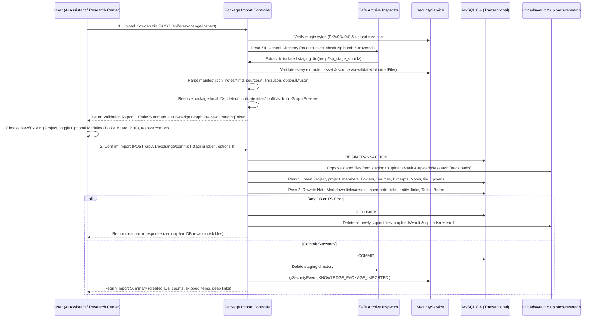

# FLOWDEN KNOWLEDGE EXCHANGE — PHASE 0 ARCHITECTURE BLUEPRINT (v1.0)

- **Document Status**: Phase 0 Architecture Discovery & Technical Blueprint (Read-Only Analysis)
- **Target System**: Flowden Workspace v1.0 (`Node.js` + `Express 5.3.0` + `MySQL 8.0+ / 8.4` + Vanilla JS SPA)
- **Scope**: Flowden Research Spec (`FLOWDEN_RESEARCH_SPEC.md`), Flowden Knowledge Format (`FKF`), Flowden Knowledge Package (`.flowden.zip` / `FKP`), and Shared Package Importer

---

## Status Legend

Throughout this blueprint, every architectural element is tagged with one of four verification statuses:
- **`[VERIFIED EXISTING]`**: Inspected in source code and database schema; currently operational and verified.
- **`[PARTIALLY IMPLEMENTED]`**: Exists in schema or partial routes/services, but lacks complete coverage or multi-entity orchestration required for package import.
- **`[NOT IMPLEMENTED]`**: Does not exist in the current Flowden codebase and must be built in subsequent phases.
- **`[PROPOSED]`**: New specification, format, or service design recommended by this blueprint.

---

## 1. Executive Summary

**Flowden Knowledge Exchange** is a first-class capability enabling external AI systems (Claude, NotebookLM, ChatGPT, Perplexity, and deep-research agents) to generate structured, multi-document research packages (`.flowden.zip`) that Flowden can validate, preview, and import transactionally into a complete, interconnected workspace.

### Core Architectural Findings from Phase 0 Inspection
1. **Strong Canonical Foundation (`[VERIFIED EXISTING]`)**: Flowden already implements a unified canonical registry (`entities`), a typed semantic relationship ledger (`entity_links`), project-scoped access tables (`project_entities`, `project_members`), full-text search (`SearchService.universalSearch`), and defense-in-depth security controls (`SecurityService`).
2. **Fragmented Single-Item Importers Today (`[PARTIALLY IMPLEMENTED]`)**:
   - **Research Center** (`POST /api/v1/research/import` and `/upload` in `server/routes/research.js`) imports flat files (`.pdf`, `.docx`, `.md`, `.txt`) into `research_documents`, extracts raw text via `pdf-parse` and `mammoth`, and registers files in `file_uploads`, but **does not** synchronize rows into `entities` / `project_entities` automatically (`EntitySyncService` has `syncNoteEntity` and `syncTaskEntity`, but no `syncResearchEntity`) and cannot import structured folders, notes, or semantic edges.
   - **Knowledge Vault** (`POST /api/v1/notes/import` in `server/routes/notes.js` and `#btn-vault-import-md` in `public/js/pages/vault.js`) imports only a single `.md`/`.txt` file into a single `notes` row without frontmatter parsing, asset bundling, or multi-note relationship wiring.
   - **Quick Capture** (`server/routes/quickCaptures.js`, `public/js/pages/capture.js`) is a lightweight personal staging inbox (`quick_captures`) that converts single text/link snippets into one Note or Task. It must remain a fast capture inbox and **must not** be overloaded as a package importer.
3. **No ZIP Archive Extraction Dependency Installed (`[NOT IMPLEMENTED]`)**: `package.json` currently includes `bcryptjs`, `cookie-parser`, `cors`, `dotenv`, `express`, `helmet`, `jsonwebtoken`, `mammoth`, `multer`, `mysql2`, and `pdf-parse`. It does **not** include a ZIP parser; a streaming/central-directory reader (or Node `zlib` + strict ZIP central-directory parser) must be added for `.flowden.zip` inspection.
4. **Canonical Schema Alignment Required (`[VERIFIED EXISTING]`)**: All package entities and relationships must map strictly into Flowden's existing MySQL `ENUM` constraints (`entities.entity_type`, `entity_links.link_type`, `entity_links.origin`, `board_items.item_type`, `board_items.reference_type`) without inventing unsupported types or duplicating canonical entities on Spatial Boards.

---

## 2. Existing Architecture Map

### 2.1 Subsystem & Source File Inventory

| Subsystem | Backend Routes & Models | Services & Security | Frontend Components | Database Tables | Status |
| :--- | :--- | :--- | :--- | :--- | :--- |
| **Projects & Membership** | `server/routes/projects.js`<br>`server/models/Project.js` | `SecurityService.logSecurityEvent` | `public/js/pages/projects.js` | `projects`, `project_members`, `project_entities` | `[VERIFIED EXISTING]` |
| **Knowledge Vault & Notes** | `server/routes/notes.js`<br>`server/models/Note.js` | `EntitySyncService.syncNoteEntity`<br>`SecurityService.validateUploadedFile` | `public/js/pages/vault.js`<br>`public/js/components/vaultEditor.js`<br>`public/js/components/smartLinkHandler.js` | `notes`, `note_folders`, `note_tags`, `note_tag_map`, `note_links`, `note_versions`, `file_uploads` | `[VERIFIED EXISTING]` |
| **Research Center (Research Bridge)** | `server/routes/research.js` | `pdf-parse`, `mammoth`, `SecurityService.validateUploadedFile` | `public/js/pages/research.js` | `research_documents`, `research_excerpts`, `file_uploads` | `[PARTIALLY IMPLEMENTED]` |
| **Workflow Tracker (Tasks)** | `server/routes/tasks.js` | `EntitySyncService.syncTaskEntity`<br>`EntitySyncService.linkNoteAndTask` | `public/js/pages/workflow.js` | `tasks`, `entities`, `entity_links` | `[VERIFIED EXISTING]` |
| **Spatial Boards** | `server/routes/boards.js`<br>`server/models/Board.js` | `Board.enrichItem` (live projection of notes/tasks) | `public/js/pages/board.js` | `boards`, `board_groups`, `board_items`, `board_item_connections` | `[VERIFIED EXISTING]` |
| **Knowledge Graph & Connections** | `server/routes/graph.js`<br>`server/routes/connections.js`<br>`server/models/Connection.js` | `SearchService.getGraph`<br>`EntitySyncService.linkNotes` | `public/js/pages/graph.js` | `entity_links`, `note_links`, `smart_connections` | `[VERIFIED EXISTING]` |
| **Universal Search & Discovery** | `server/routes/search.js` | `server/services/searchService.js`<br>`server/utils/searchAccessPredicate.js` | `public/js/components/commandPalette.js` | `entities` (`FULLTEXT ft_entity_search`), `entity_links` | `[VERIFIED EXISTING]` |
| **Quick Capture** | `server/routes/quickCaptures.js` | `Note.create` (on convert) | `public/js/pages/capture.js` | `quick_captures` | `[VERIFIED EXISTING]` |
| **Templates** | `server/routes/templates.js` | `Project.create`, `Note.create`, `Board.createGroup`, `Board.createItem` | `public/js/pages/projects.js` | `templates` | `[VERIFIED EXISTING]` |
| **AI Assistant & MCP Bridge** | `server/routes/mcp.js`<br>`server/mcp/index.js`<br>`server/mcp/tools/*.js` | `server/mcp/middleware/mcpAuth.js`<br>`SecurityService.wrapUntrustedWorkspaceData` | `public/js/pages/assistant.js` | `users.settings_json`, `security_audit_logs` | `[VERIFIED EXISTING]` |
| **Security & Access Control** | `server/middleware/auth.js`<br>`server/routes/auth.js`<br>`server/routes/users.js`<br>`server/routes/admin.js` | `server/services/securityService.js` | `public/js/pages/assistant.js` | `security_audit_logs`, `security_reports`, `file_uploads`, `users.token_version` | `[VERIFIED EXISTING]` |

---

### 2.2 Detailed Subsystem Discovery Findings

#### A. Research Center (`server/routes/research.js`, `public/js/pages/research.js`)
- **Current Upload/Import Workflow (`[VERIFIED EXISTING]`)**:
  - Frontend (`public/js/pages/research.js`) provides a drag-and-drop zone (`#research-dropzone`) and file picker (`#research-file-input`) accepting `.md,.txt,.pdf,.docx` and posting `multipart/form-data` to `POST /api/v1/research/import` (also aliased at `POST /api/v1/research/upload`).
  - Backend (`server/routes/research.js`) uses `multer.diskStorage` storing files in `uploads/research/` with a 15 MB per-file limit.
  - Each file is validated via `SecurityService.validateUploadedFile(file.path, file.originalname, file.mimetype, { allowedExtensions: new Set(['.md', '.txt', '.pdf', '.docx']), allowArchives: false })`.
  - Text extraction (`extractDocumentText` in `server/routes/research.js#L45-L78`):
    - `.md` / `.txt`: `fs.readFileSync(filePath, 'utf8')`
    - `.pdf`: `pdf-parse` (`await pdfParse(dataBuffer)`)
    - `.docx`: `mammoth.extractRawText({ path: filePath })`
  - Inserts into `research_documents` (`user_id, project_id, title, original_filename, file_name, file_path, file_type, file_size, content_text, summary, source_url, tags_json`) and registers ownership in `file_uploads` via `SecurityService.registerUploadedFile`.
- **Bridge to Notes (`[VERIFIED EXISTING]`)**:
  - In `public/js/pages/research.js#L350-L366`, clicking **"Bridge to Vault Note"** in the document preview modal calls `POST /api/v1/notes` with a Markdown template containing `doc.title`, `doc.file_name`, `doc.summary`, and `doc.source_url`, but does **not** create an `entity_links` row (`link_type = 'cites'` or `'derived_from'`) linking the new Note to the `research_documents` row.
- **Current Limitations (`[PARTIALLY IMPLEMENTED]`)**:
  1. `EntitySyncService` (`server/services/entitySyncService.js`) does not have a `syncResearchEntity` method, so newly imported `research_documents` are not automatically indexed in the `entities` and `project_entities` tables for `SearchService.universalSearch` (when running in MySQL mode).
  2. `research_documents.file_type` in `server/migrations/schema-target.sql#L173` is `ENUM('md', 'pdf', 'docx', 'txt')`. Pure web URL citations without a physical document file require either a synthesized `.md` source note in `uploads/research/` (with `file_type = 'md'`) or `source_url` populated alongside the source summary markdown.
  3. `research_excerpts` table exists in schema (`server/migrations/schema-target.sql#L187-L203` with `research_id, user_id, project_id, quoted_text, annotation, location_anchor, color`), but has no backend CRUD routes yet (`[PARTIALLY IMPLEMENTED]`).

#### B. Quick Capture (`server/routes/quickCaptures.js`, `public/js/pages/capture.js`)
- **Current Purpose & Implementation (`[VERIFIED EXISTING]`)**:
  - Stores short personal snippets (`content`, `capture_type` in `ENUM('text', 'link', 'image')`, `is_processed`, `project_id`) in `quick_captures`.
  - `POST /api/v1/quick-captures/:id/process` converts one capture into either a single Note (`Note.create`) or a single Task (`INSERT INTO tasks`), then marks `is_processed = 1`.
  - Enforces strict personal-only visibility in `accessPredicate` (`server/utils/searchAccessPredicate.js#L8`: `${alias}.entity_type <> 'capture' OR ${alias}.owner_user_id = ?`).
- **Reuse Decision**: Quick Capture must remain focused on fast personal inbox capture. Do **not** place package import UI or logic inside Quick Capture.

#### C. Canonical Entity Architecture (`entities`, `entity_links`, `project_entities`, `project_members`)
- **`entities` Table (`server/migrations/schema-target.sql#L279-L300`, `[VERIFIED EXISTING]`)**:
  - Columns: `id`, `uuid` (`VARCHAR(36)`), `entity_type` (`ENUM('project', 'note', 'task', 'research', 'excerpt', 'board', 'decision', 'capture')`), `entity_id`, `owner_user_id`, `primary_project_id`, `title`, `search_text`, `is_archived`, `deleted_at`, `cascade_deleted_by`, `created_at`, `updated_at`.
  - Unique constraints: `uq_entity_type_id (entity_type, entity_id)` and `uq_entity_uuid (uuid)`.
  - Full-text index: `FULLTEXT KEY ft_entity_search (title, search_text)`.
- **`project_entities` Table (`server/migrations/schema-target.sql#L323-L334`, `[VERIFIED EXISTING]`)**:
  - Columns: `id`, `project_id`, `entity_type` (`ENUM('note', 'task', 'research', 'excerpt', 'board', 'decision')`), `entity_id`, `access_role` (`ENUM('viewer', 'contributor', 'admin')`), `added_by`, `created_at`.
  - **Architectural Invariant (`SearchService.checkInvariant` in `server/services/searchService.js#L259-L276`)**: Every entity in `entities` with a non-null `primary_project_id` (and `entity_type NOT IN ('project', 'capture')`) **must** have a corresponding row in `project_entities`.
- **`project_members` Table (`server/migrations/schema-target.sql#L336-L346`, `[VERIFIED EXISTING]`)**:
  - Columns: `id`, `project_id`, `user_id`, `role` (`ENUM('owner', 'editor', 'viewer')`), `created_at`, `revoked_at`.
  - **Architectural Invariant**: Project owners must have an active row (`role = 'owner'`, `revoked_at IS NULL`) in `project_members` so `accessPredicate` (`server/utils/searchAccessPredicate.js`) authorizes project-scoped and MCP queries. (Currently `Project.create` in `server/models/Project.js#L46-L67` inserts into `projects` and `boards`, while `SearchService.backfillProjectOwners` backfills `project_members`; the package importer and `Project.create` should ensure the owner's `project_members` row is inserted immediately).
- **`entity_links` Table (`server/migrations/schema-target.sql#L302-L321`, `[VERIFIED EXISTING]`)**:
  - Columns: `id`, `user_id`, `source_type`, `source_id`, `target_type`, `target_id`, `link_type`, `origin`, `context_snippet`, `is_confirmed`, `deleted_at`, `created_at`, `updated_at`.
  - **`source_type` / `target_type` ENUM**: `('project', 'note', 'task', 'research', 'excerpt', 'board', 'decision', 'capture')`
  - **`link_type` ENUM**: `('references', 'embeds', 'cites', 'derived_from', 'supports', 'contradicts', 'inspired_by', 'depends_on', 'blocks', 'relates_to')`
  - **`origin` ENUM**: `('inline_link', 'embed', 'board_promoted', 'citation', 'task_sync', 'capture_convert', 'manual', 'ai_suggested')`
  - Unique key: `uq_relationship (source_type, source_id, target_type, target_id, link_type)`.
- **Spatial Boards vs. Canonical Entities (`server/models/Board.js`, `[VERIFIED EXISTING]`)**:
  - `board_items` has `item_type` (`ENUM('note', 'idea', 'image', 'link', 'research_ref', 'task', 'document')`), `reference_type` (`ENUM('project', 'note', 'task', 'research', 'excerpt', 'board', 'decision') NULL`), and `reference_id` (`INT UNSIGNED NULL`).
  - When `reference_type = 'note'` or `'task'` and `reference_id` is set, `Board.enrichItem` (`server/models/Board.js#L4-L32`) dynamically projects the canonical entity's live `title`, `content`, `status`, and `priority`.
  - `board_item_connections` stores visual canvas wires between `board_items` (`source_item_id`, `target_item_id`, `connection_type`, `label`) and is strictly separate from semantic graph relationships in `entity_links`.

#### D. Knowledge Vault & Markdown (`server/models/Note.js`, `public/js/components/vaultEditor.js`)
- **Column Naming Fact (`[VERIFIED EXISTING]`)**:
  - In the `notes` table (`server/migrations/schema-target.sql#L114-L130` and `server/models/Note.js`), the Markdown body column is named **`notes.content`** (`LONGTEXT`), **not** `notes.content_markdown`.
  - In the `note_versions` table (`server/migrations/001_initial_schema.sql#L160-L171`), the column is `content` in `001_initial_schema.sql`, while `server/models/Note.js#L209` and `server/routes/notes.js#L510` query `content_markdown` inside a `try/catch`.
- **Folders & Tags (`[VERIFIED EXISTING]`)**:
  - `note_folders`: Supports hierarchical folders via `parent_folder_id` (`id, user_id, parent_folder_id, name, sort_order`). Note that `Note.createFolder(userId, name, parent_folder_id)` in `server/models/Note.js#L351-L358` already supports nested folders!
  - `note_tags` & `note_tag_map`: `Note.syncTags(noteId, userId, tagNames)` (`server/models/Note.js#L312-L329`) automatically creates missing tags per user and maps them in `note_tag_map`.
- **Internal WikiLinks (`[VERIFIED EXISTING]`)**:
  - `Note.syncWikiLinks(sourceNoteId, userId, content)` (`server/models/Note.js#L331-L349`) parses `[[Target Note Title]]` in Markdown and inserts rows into `note_links (source_note_id, target_note_id)`.
  - `SearchService.autocompleteWikilinks` (`server/services/searchService.js#L108-L111`) also emits typed wikilinks in the format `[[type:id|Title]]` (and `stripMarkdown` in `server/services/entitySyncService.js#L13` strips `[[(?:[^|\]]*\|)?([^\]]+)]]`).
  - However, `Note.syncWikiLinks` currently only matches exact `[[Title]]` without `|` aliases (`/\[\[(.*?)\]\]/g`), and only populates `note_links`, not `entity_links`.
- **External Smart Links & Attachments (`[VERIFIED EXISTING]`)**:
  - `VaultEditor` (`public/js/components/vaultEditor.js`) supports standard Markdown links `[Label](https://...)`, Mention links `[mention: Title](https://...)`, Bookmark cards `[bookmark: Title](https://...)`, Embed blocks `[embed: Title](https://...)`, images ``, video `[video: name](/uploads/vault/...)`, audio `[audio: name](/uploads/vault/...)`, and file cards `[attachment: name (size)](/uploads/vault/...)`.
- **Markdown Frontmatter (`[NOT IMPLEMENTED]`)**:
  - Neither `Note.create` nor `VaultEditor.markdownToHtml` currently strips or parses YAML frontmatter (`--- ... ---`). If a Markdown file with YAML frontmatter is imported directly into `notes.content`, the raw `---` lines are rendered as divider/paragraph blocks in the editor. Therefore, the Package Importer must parse YAML frontmatter into structured metadata (tags, folder, summary, status, package-local ID) and strip the frontmatter header before storing clean Markdown in `notes.content`.

#### E. Knowledge Graph (`server/routes/graph.js`, `server/services/searchService.js`, `public/js/pages/graph.js`)
- **How Graph Nodes & Edges Are Generated (`[VERIFIED EXISTING]`)**:
  - `GET /api/v1/graph` (`server/routes/graph.js`) queries user-owned `projects`, `notes`, `tasks`, and `research_documents`, creating nodes with IDs `project_${id}`, `note_${id}`, `task_${id}`, and `research_${id}`.
  - It generates structural containment edges (`part_of` for Project -> Note, `task_of` for Project -> Task, `references` for Project -> Research), WikiLink edges from `note_links` (`related_to`), semantic edges from `entity_links` (`el.link_type`), and legacy fallback edges from `smart_connections`.
- **Important Graph Rendering Finding (`[PARTIALLY IMPLEMENTED]`)**:
  - In `server/routes/graph.js#L22-L164`, the queries for `projects`, `notes`, `tasks`, and `research_documents` filter by `WHERE user_id = ?` and do **not** filter `AND deleted_at IS NULL` on `notes`, `tasks`, or `research_documents`. When importing a package for the authenticated user, `user_id` is the importing user so all imported entities appear immediately in `GET /api/v1/graph`.
  - Folders (`note_folders`) are **never** rendered as Knowledge Graph nodes (`server/routes/graph.js` only includes `project`, `note`, `task`, `research`), which naturally preserves the architectural distinction between folder hierarchy and semantic graph relationships.

#### F. Attachments and Storage (`server/routes/notes.js`, `server/routes/research.js`, `server/index.js`, `server/services/securityService.js`)
- **Physical Storage (`[VERIFIED EXISTING]`)**:
  - Knowledge Vault attachments are stored on disk at `uploads/vault/<sanitized-base>-<timestamp>-<random>.<ext>` and referenced via `/uploads/vault/<filename>`.
  - Research documents are stored on disk at `uploads/research/<sanitized-base>-<timestamp>-<random>.<ext>` and referenced via `/uploads/research/<filename>`.
- **Authorization & Serving (`[VERIFIED EXISTING]`)**:
  - `app.use('/uploads', authenticateToken, ...)` in `server/index.js#L82-L153` intercepts every request to `/uploads/:category/:filename`, blocks path traversal (`..`, null bytes), verifies ownership or active shared-project membership via `SecurityService.canUserAccessUploadedFile(req.user.id, urlPath)`, and serves the file with `X-Content-Type-Options: nosniff` and sandboxed `Content-Security-Policy`.
  - `file_uploads` table (`server/services/securityService.js#L110-L128`) tracks `(user_id, project_id, entity_type, entity_id, filename, original_name, file_path, mime_type, file_size)`.

---

## 3. Existing Import Capability Inventory

| Import Mechanism | Endpoint & UI Trigger | Supported Input Format | Entities Created | Preserves Relationships? | Multi-File Support? | Validation / Preview? | Reusability Assessment |
| :--- | :--- | :--- | :--- | :--- | :--- | :--- | :--- |
| **1. Research Center Multi-File Import** | `POST /api/v1/research/import`<br>`POST /api/v1/research/upload`<br>(`server/routes/research.js`)<br>UI: `#research-dropzone` in `public/js/pages/research.js` | `.pdf`, `.docx`, `.md`, `.txt` (up to 10 files, 15 MB each) | `research_documents` + `file_uploads` | **No** (assigns optional `project_id`, no semantic links) | **Yes** (`upload.any()`, up to 10 files) | **Validation**: `SecurityService.validateUploadedFile`<br>**Preview**: None before DB insert | **`[VERIFIED EXISTING]`**: Reuse `extractDocumentText` (`pdf-parse`, `mammoth`) and `SecurityService.validateUploadedFile` + `registerUploadedFile`. |
| **2. Vault Single Markdown Import (API)** | `POST /api/v1/notes/import`<br>(`server/routes/notes.js#L406-L434`) | JSON body `{ title, content, project_id, folder_id, tags }` | Single `notes` row + `entities` + `project_entities` + `note_links` + `note_tags` | **Partial** (`Note.syncWikiLinks` links exact `[[Title]]` if target note already exists) | **No** (single note per request) | **No** | **`[VERIFIED EXISTING]`**: Reuse `Note.create`, `Note.syncTags`, `Note.syncWikiLinks`, and `EntitySyncService.syncNoteEntity`. |
| **3. Vault Single Markdown Import (UI Button)** | `#btn-vault-import-md` in `public/js/pages/vault.js#L2794-L2816` | Single `.md` or `.txt` file read in browser via `file.text()` | Calls `POST /api/v1/notes` (not `/notes/import`) to create 1 `notes` row | **Partial** (only `[[Title]]` to already-existing notes) | **No** (single file input) | **No** | **`[VERIFIED EXISTING]`**: Keep for quick single-note `.md` import in Vault sidebar. |
| **4. Vault Media & Attachment Upload** | `POST /api/v1/notes/upload`<br>`POST /api/v1/notes/:id/upload`<br>(`server/routes/notes.js#L145-L185`) | Single image, video, audio, document, archive, or code file (max 100 MB) | Physical file in `uploads/vault/` + row in `file_uploads` | **No** (returns `{ url: '/uploads/vault/...' }` for editor insertion) | **No** (single file per call) | **Validation**: `SecurityService.validateUploadedFile` (magic-byte check) | **`[VERIFIED EXISTING]`**: Reuse `uploads/vault/` naming, categorization, and `file_uploads` registration for package `assets/*`. |
| **5. System Project Templates** | `POST /api/v1/templates/:id/apply`<br>(`server/routes/templates.js#L82-L141`) | Internal JSON template definition (`SYSTEM_TEMPLATES`) | 1 `projects` + 1 `boards` + `note_folders` + `notes` + `board_groups` + `board_items` | **Partial** (creates project, folders, notes, and board items sequentially, but no `entity_links` or transactional rollback) | **N/A** (in-memory template) | **No** | **`[PARTIALLY IMPLEMENTED]`**: Demonstrates the exact multi-entity creation sequence (`Project` -> `Board` -> `Folders` -> `Notes` -> `Board Groups/Items`), which the Package Importer will generalize and make transactional. |

---

## 4. Reusable Services and Components

The following existing Flowden services and functions **must be reused directly** (or extended cleanly without duplication) by the Flowden Knowledge Package Importer:

1. **`SecurityService.validateUploadedFile(filePath, originalName, declaredMime, options)`** (`server/services/securityService.js#L384-L522`, `[VERIFIED EXISTING]`):
   - Performs extension allowlisting, double-extension blocking, zero-byte rejection, PE/MZ (`0x4D 0x5A`), ELF (`0x7F 'E' 'L' 'F'`), Mach-O, shell shebang (`#!`), and disguised HTML/SVG/Script rejection, plus magic-byte verification for `.png`, `.jpg`, `.gif`, `.webp`, `.pdf`, and `.zip`/`.docx`/`.xlsx`/`.pptx`.
2. **`SecurityService.registerUploadedFile({...})`** (`server/services/securityService.js#L734-L764`, `[VERIFIED EXISTING]`):
   - Registers imported Vault assets (`/uploads/vault/...`) and Research documents (`/uploads/research/...`) in `file_uploads` so `/uploads/*` authorization (`SecurityService.canUserAccessUploadedFile`) works automatically.
3. **`SecurityService.validateExternalUrl(rawUrl, options)`** (`server/services/securityService.js#L562-L623`, `[VERIFIED EXISTING]`):
   - Validates external `source_url` citations and Smart Links in imported packages (with `skipDnsLookup: true` during offline manifest validation to reject `javascript:`, `data:`, `file:`, `localhost`, RFC1918 private IPs, and cloud metadata IPs).
4. **`SecurityService.logSecurityEvent({...})`** (`server/services/securityService.js#L166-L202`, `[VERIFIED EXISTING]`):
   - Records structured audit trail entries in `security_audit_logs` with automatic secret scrubbing.
5. **`EntitySyncService`** (`server/services/entitySyncService.js`, `[VERIFIED EXISTING]`):
   - `EntitySyncService.syncNoteEntity(dbOrConn, noteId, userId)`
   - `EntitySyncService.syncTaskEntity(dbOrConn, taskId, userId)`
   - `EntitySyncService.linkNoteAndTask(dbOrConn, userId, noteId, taskId, linkType)`
   - `EntitySyncService.linkNotes(dbOrConn, userId, sourceNoteId, targetNoteId, linkType)`
   - *Note*: `EntitySyncService` accepts `dbOrConn` (any object with `.query(sql, params)`), making it compatible with a dedicated transactional MySQL connection wrapper!
6. **`Note` Model Methods** (`server/models/Note.js`, `[VERIFIED EXISTING]`):
   - `Note.createFolder(userId, name, parent_folder_id)`
   - `Note.syncTags(noteId, userId, tagNames)`
7. **`Board` Model Methods** (`server/models/Board.js`, `[VERIFIED EXISTING]`):
   - `Board.findByProject(projectId, userId)`
   - `Board.createGroup(boardId, userId, groupData)`
   - `Board.createItem(boardId, userId, itemData)`
   - `Board.createConnection(boardId, userId, connData)`
8. **`extractDocumentText(filePath, ext)`** (`server/routes/research.js#L45-L78`, `[VERIFIED EXISTING]`):
   - Extracts full text from `.md`, `.txt`, `.pdf` (`pdf-parse`), and `.docx` (`mammoth`) for `research_documents.content_text`.

---

## 5. Gaps and Missing Capabilities

| Gap ID | Missing Capability | Root Cause in Current Codebase | Required Addition in Later Phases | Status |
| :--- | :--- | :--- | :--- | :--- |
| **GAP-01** | **ZIP Central Directory Reader & Safe Extractor** | No ZIP library in `package.json`; `multer` only saves single flat files. | Add a zero-execution ZIP reader (e.g., `yauzl` or native Node `zlib.inflateRawSync` central-directory parser) enforcing entry count, compression ratio, path traversal, and symlink checks before extracting to a staging directory. | `[NOT IMPLEMENTED]` |
| **GAP-02** | **Transactional MySQL Connection Wrapper** | `db.query(sql, params)` in `server/config/database.js#L147-L159` acquires a random connection from `pool` per query and does not expose `withTransaction( async (txConn) => ... )`. | Add `db.withTransaction(fn)` in `server/config/database.js` that acquires a single `conn = await pool.getConnection()`, runs `await conn.beginTransaction()`, wraps `conn.query` to return `rows` (matching `db.query` signature), commits on success, and rolls back on error. | `[NOT IMPLEMENTED]` |
| **GAP-03** | **`EntitySyncService.syncResearchEntity` & `syncProjectEntity`** | `EntitySyncService` (`server/services/entitySyncService.js`) only implements `syncNoteEntity` and `syncTaskEntity`. `research_documents` and `projects` are not synced into `entities` / `project_entities` on creation. | Add `EntitySyncService.syncResearchEntity(dbOrConn, researchId, userId)` and `EntitySyncService.syncProjectEntity(dbOrConn, projectId, userId)` (plus `project_members` owner row creation). | `[PARTIALLY IMPLEMENTED]` |
| **GAP-04** | **Package-Local ID Resolution & Markdown Link Rewriting** | `Note.syncWikiLinks` (`server/models/Note.js#L331-L349`) runs during `Note.create` before target notes in a batch exist, and only resolves exact `[[Title]]`. Package notes reference each other via stable package IDs (`[[note:ring-arc-volcanism|Arc Volcanism]]` or `[[Arc Volcanism]]`) and relative asset paths (`../assets/diagram.png`). | Perform a **Two-Pass Import**: Pass 1 creates folders, assets, sources, and notes (recording `packageId -> dbId` and `assetPath -> /uploads/vault/...`); Pass 2 rewrites relative asset paths and package-local WikiLinks in note Markdown, updates `notes.content`, and inserts `note_links` + `entity_links`. | `[NOT IMPLEMENTED]` |
| **GAP-05** | **YAML Frontmatter Parser** | `VaultEditor` and `Note.create` do not parse `---` YAML frontmatter blocks at the top of `.md` files. | Add a lightweight, safe YAML frontmatter parser (no arbitrary JS evaluation) in the package parser to extract `id`, `title`, `folder`, `tags`, `summary`, `source_url`, `citations`, and `created_at`, stripping the frontmatter before storing `notes.content`. | `[NOT IMPLEMENTED]` |
| **GAP-06** | **Staging Preview Session & Graph Preview Generator** | Existing importers write directly to the database on upload with no validation report or preview step. | Implement a two-stage import pipeline: Stage 1 (`POST /api/v1/exchange/inspect`) validates the `.flowden.zip` in a temporary staging directory and returns a complete JSON preview (entities, counts, conflicts, and preview graph nodes/edges); Stage 2 (`POST /api/v1/exchange/commit`) executes the transactional import. | `[NOT IMPLEMENTED]` |

---

## 6. Proposed FKF / FKP Package Architecture (`[PROPOSED]`)

### 6.1 Evaluation of the Proposed Archive Structure

We evaluated the candidate archive structure:

```text
ring-fire-research.flowden.zip
├── manifest.json
├── project/
│   └── overview.md
├── notes/
│   └── *.md
├── sources/
│   └── *.md
├── relationships/
│   └── links.json
├── assets/
│   └── *
├── optional/
│   ├── tasks.json
│   └── spatial-board.json
└── exports/
    └── research-report.pdf
```

### 6.2 Technical Verdict & Refinements

The proposed directory structure is **highly suitable** and maps cleanly to Flowden's domain model, with the following **four concrete refinements**:

1. **Nested Subfolders in `notes/` (`notes/**/*.md`) OR `folders` Registry in `manifest.json`**:
   - Allow either nested paths under `notes/` (e.g., `notes/01-tectonics/subduction-zones.md`) or explicit `folder_id` mapping in `manifest.json` (`folders: [{ id: "fld-tectonics", name: "01 Tectonics", parent_id: null }]`). Supporting both (manifest folder definitions + path-based fallback) makes it effortless for LLMs and humans to author packages.
2. **Rich Source Formats in `sources/` (`sources/*.md`, plus optional `.pdf`, `.docx`, `.txt`)**:
   - External AI tools (Claude, ChatGPT, NotebookLM) primarily generate `.md` source summaries with structured citation metadata (`source_url`, `authors`, `year`, `doi`, `quoted_excerpts`), which map to `research_documents` (`file_type = 'md'`) and `research_excerpts`. If a user or tool bundles original `.pdf`, `.docx`, or `.txt` files under `sources/`, Flowden's existing `extractDocumentText` (`server/routes/research.js`) can ingest them directly as well.
3. **Optional `exports/research-report.pdf` Registration**:
   - When `exports/research-report.pdf` is present and valid (verified by `%PDF-` magic bytes in `SecurityService.validateUploadedFile`), it should be imported as an optional companion `research_documents` entry (`title: "<Project Title> — Compiled Research Report"`, `file_type: 'pdf'`) or project attachment, while `manifest.json` + `notes/*.md` + `sources/*` remain the canonical source of workspace structure.
4. **Canonical Relationship Type Enforcement in `relationships/links.json`**:
   - Every relationship in `relationships/links.json` must use one of Flowden's 10 canonical `entity_links.link_type` values (`references`, `embeds`, `cites`, `derived_from`, `supports`, `contradicts`, `inspired_by`, `depends_on`, `blocks`, `relates_to`). Common AI synonyms (e.g., `related_to` -> `relates_to`) will be normalized by a strict mapping table during validation.

---

## 7. Proposed Manifest Structure (`manifest.json`) (`[PROPOSED]`)

```json
{
  "$schema": "https://flowden.io/schemas/fkf-manifest-v1.json",
  "fkf_version": "1.0.0",
  "package_id": "pkg_ring_of_fire_2026_11",
  "created_at": "2026-11-07T11:00:00Z",
  "provenance": {
    "generator": "Claude 3.7 Sonnet / NotebookLM / ChatGPT Deep Research",
    "generator_version": "2026-11",
    "research_prompt_summary": "Circum-Pacific seismic and volcanic arc synthesis",
    "spec_version": "FLOWDEN_RESEARCH_SPEC_v1"
  },
  "project": {
    "id": "proj_ring_of_fire",
    "title": "Circum-Pacific Ring of Fire: Tectonic & Magmatic Synthesis",
    "description": "Multi-source synthesis of subduction mechanics, arc volcanism, and seismic hazard coupling.",
    "color": "#7c5cbf",
    "icon": "globe",
    "overview_file": "project/overview.md"
  },
  "folders": [
    {
      "id": "fld_subduction",
      "name": "01 Subduction Mechanics",
      "parent_id": null,
      "sort_order": 1
    },
    {
      "id": "fld_volcanism",
      "name": "02 Arc Volcanism",
      "parent_id": null,
      "sort_order": 2
    },
    {
      "id": "fld_rench_coupling",
      "name": "Trench-Slab Coupling",
      "parent_id": "fld_subduction",
      "sort_order": 1
    }
  ],
  "notes": [
    {
      "id": "note_slab_dehydration",
      "file": "notes/slab-dehydration.md",
      "title": "Slab Dehydration & Mantle Wedge Partial Melting",
      "folder_id": "fld_volcanism",
      "tags": ["geophysics", "magmatism", "subduction"],
      "is_pinned": true
    },
    {
      "id": "note_megathrust_cycles",
      "file": "notes/megathrust-cycles.md",
      "title": "Megathrust Seismic Slip & Asperity Locking",
      "folder_id": "fld_rench_coupling",
      "tags": ["seismology", "megathrust"],
      "is_pinned": false
    }
  ],
  "sources": [
    {
      "id": "src_stern_2002",
      "file": "sources/stern-2002-subduction-zones.md",
      "title": "Subduction Zones (Stern, 2002 - Reviews of Geophysics)",
      "source_url": "https://doi.org/10.1029/2001RG000108",
      "summary": "Foundational review of subduction zone thermal structure, dehydration reactions, and back-arc spreading.",
      "tags": ["DOI", "Literature"],
      "excerpts": [
        {
          "id": "exc_stern_01",
          "quoted_text": "Aqueous fluids released from the subducting oceanic crust hydrate the overlying mantle wedge, lowering its solidus.",
          "annotation": "Primary mechanism driving calc-alkaline arc volcanism.",
          "location_anchor": "Section 4.2, p. 18",
          "color": "yellow"
        }
      ]
    }
  ],
  "assets": [
    {
      "id": "asset_slab_diagram",
      "file": "assets/slab-wedge-diagram.png",
      "original_name": "slab-wedge-diagram.png",
      "mime_type": "image/png",
      "referenced_by": ["note_slab_dehydration"]
    }
  ],
  "relationships_file": "relationships/links.json",
  "optional_modules": {
    "tasks": {
      "enabled_by_default": false,
      "file": "optional/tasks.json"
    },
    "spatial_board": {
      "enabled_by_default": true,
      "file": "optional/spatial-board.json"
    },
    "pdf_report": {
      "enabled_by_default": true,
      "file": "exports/research-report.pdf",
      "title": "Ring of Fire Synthesis — Printable Report"
    }
  }
}
```

---

## 8. Entity and Relationship Mapping (`[PROPOSED]` -> `[VERIFIED EXISTING]`)

### 8.1 Canonical Entity Mapping Table

Every item in a Flowden Knowledge Package maps deterministically into Flowden's existing MySQL tables without creating redundant records:

| Package Item | Primary Domain Table | Canonical `entities` Row | `project_entities` Row | `project_members` Row | Notes on Mapping |
| :--- | :--- | :--- | :--- | :--- | :--- |
| **`project`** (`manifest.project`) | `projects` (`user_id, title, description, color, icon, status='active'`) | `entity_type = 'project'`, `entity_id = projects.id`, `primary_project_id = projects.id` | *None* (`project_entities` excludes `'project'` per `SearchService.checkInvariant`) | `project_id = projects.id`, `user_id = req.user.id`, `role = 'owner'`, `revoked_at = NULL` | If `project/overview.md` is present, it is imported as a pinned overview Note (`is_pinned = 1`) inside the project so its full Markdown and WikiLinks are editable in Knowledge Vault. |
| **`folders[]`** | `note_folders` (`user_id, parent_folder_id, name, sort_order`) | *None* (`note_folders` are organizational containers, not graph entities) | *None* | *None* | Topologically sorted by `parent_id` so parent folders are inserted before child folders. |
| **`notes[]`** (`notes/*.md`) | `notes` (`user_id, project_id, folder_id, title, content, is_pinned, word_count, attachments_json`) | `entity_type = 'note'`, `entity_id = notes.id`, `primary_project_id = projectId` (via `EntitySyncService.syncNoteEntity`) | `entity_type = 'note'`, `entity_id = notes.id`, `access_role = 'admin'` | Inherited via project | Tags synced into `note_tags` and `note_tag_map`. Initial version snapshot (`version_number = 1`) optionally recorded in `note_versions`. |
| **`sources[]`** (`sources/*`) | `research_documents` (`user_id, project_id, title, original_filename, file_name, file_path, file_type, file_size, content_text, summary, source_url, tags_json`) | `entity_type = 'research'`, `entity_id = research_documents.id`, `primary_project_id = projectId` | `entity_type = 'research'`, `entity_id = research_documents.id`, `access_role = 'admin'` | Inherited via project | Physical file stored in `uploads/research/` and registered in `file_uploads` (`entity_type = 'research'`). |
| **`sources[].excerpts[]`** | `research_excerpts` (`research_id, user_id, project_id, quoted_text, annotation, location_anchor, color`) | `entity_type = 'excerpt'`, `entity_id = research_excerpts.id`, `primary_project_id = projectId` | `entity_type = 'excerpt'`, `entity_id = research_excerpts.id`, `access_role = 'admin'` | Inherited via project | Connects granular citations directly to `research_documents`. |
| **`optional/tasks.json`** | `tasks` (`user_id, project_id, title, description, status, priority, due_date, sort_order`) | `entity_type = 'task'`, `entity_id = tasks.id`, `primary_project_id = projectId` (via `EntitySyncService.syncTaskEntity`) | `entity_type = 'task'`, `entity_id = tasks.id`, `access_role = 'admin'` | Inherited via project | `status` validated against `ENUM('planned', 'in_progress', 'done')`; `priority` validated against `ENUM('low', 'medium', 'high', 'urgent')`. |
| **`optional/spatial-board.json`** | `boards`, `board_groups`, `board_items`, `board_item_connections` | `entity_type = 'board'`, `entity_id = boards.id`, `primary_project_id = projectId` | `entity_type = 'board'`, `entity_id = boards.id`, `access_role = 'admin'` | Inherited via project | **CRITICAL**: Board items referencing a package Note (`note_...`), Task (`task_...`), or Research source (`src_...`) set `reference_type` (`'note'`, `'task'`, `'research'`) and `reference_id = <resolved DB ID>`. They **do not** create duplicate Notes or Tasks! |

### 8.2 Semantic Relationship Mapping (`relationships/links.json`)

In `server/migrations/schema-target.sql#L309-L310`, `entity_links` defines:
- **`link_type` ENUM**:
  `references`, `embeds`, `cites`, `derived_from`, `supports`, `contradicts`, `inspired_by`, `depends_on`, `blocks`, `relates_to`
- **`origin` ENUM**:
  `inline_link`, `embed`, `board_promoted`, `citation`, `task_sync`, `capture_convert`, `manual`, `ai_suggested`

Each entry in `relationships/links.json` has the structure:
```json
{
  "source_id": "note_slab_dehydration",
  "target_id": "src_stern_2002",
  "link_type": "cites",
  "context_snippet": "Stern (2002) demonstrates that aqueous fluids from slab dehydration lower the mantle wedge solidus."
}
```

#### Normalization & Persistence Rules:
1. **Package ID Resolution**: `source_id` and `target_id` are looked up in the importer's `packageIdMap` (`Map<packageLocalId, { entityType, dbId, title }>`).
2. **`link_type` Validation & Alias Normalization**:
   - Direct canonical types: `references`, `embeds`, `cites`, `derived_from`, `supports`, `contradicts`, `inspired_by`, `depends_on`, `blocks`, `relates_to`.
   - Normalized aliases: `related_to` -> `relates_to`, `cited_by` -> (invert direction with `cites`), `blocked_by` -> (invert direction with `blocks`). Any unknown `link_type` is flagged as a validation warning and either rejected (strict mode) or normalized to `relates_to`.
3. **`origin` Assignment**:
   - Links from `relationships/links.json` between a Note and a Source with `link_type = 'cites'` use `origin = 'citation'`.
   - Links extracted from inline `[[...]]` WikiLinks use `origin = 'inline_link'`.
   - Links between Notes and Tasks use `origin = 'task_sync'`.
   - All other explicit package links use `origin = 'ai_suggested'` (with `is_confirmed = 1` upon user import confirmation).
4. **Dual-Table Sync for Note-to-Note Links**:
   - When both `source` and `target` are Notes (`entity_type = 'note'`), the importer inserts into `entity_links` (for semantic typed graph edges and Inspector "Connected Notes") **and** into `note_links` (`source_note_id, target_note_id`) if `link_type` is `references` or `relates_to`, ensuring both `Note.findById` (`outgoing_links` / `backlinks`) and `GET /api/v1/graph` work seamlessly.

---

## 9. Markdown Mapping (`[PROPOSED]`)

To ensure imported notes behave identically to natively authored notes in `VaultEditor` (`public/js/components/vaultEditor.js`):

1. **Single Canonical Content Store**:
   - Imported Markdown is stored exclusively in `notes.content` (`LONGTEXT`). No secondary content store is introduced.
2. **YAML Frontmatter Extraction**:
   - If a `notes/*.md` file begins with a YAML frontmatter block (`---\n...\n---`), the parser extracts metadata fields (`id`, `title`, `tags`, `folder_id`, `is_pinned`, `summary`) to merge with `manifest.json` (where `manifest.json` takes precedence on structural IDs) and strips the YAML header so `notes.content` starts cleanly with the Markdown body.
3. **Internal WikiLink Rewriting (Two-Pass Resolution)**:
   - AI-generated notes in a package may link to other package notes using:
     - Package-ID WikiLinks: `[[note:note_slab_dehydration|Slab Dehydration]]` or `[[note_slab_dehydration]]`
     - Title WikiLinks: `[[Slab Dehydration & Mantle Wedge Partial Melting]]`
   - During Pass 2 of import (after all notes have database IDs and final titles), the importer rewrites package-ID WikiLinks to canonical Flowden WikiLinks (`[[Final Note Title]]`) and populates `note_links` and `entity_links`.
4. **Asset Reference Rewriting**:
   - Relative asset paths in Markdown images (`` or ``) and attachment links (`[attachment: paper.pdf](assets/paper.pdf)`) are rewritten during Pass 2 to their stored `/uploads/vault/<generated-filename>` URLs, and the resolved attachment objects are stored in `notes.attachments_json`.
5. **XSS & Dangerous Protocol Sanitization**:
   - All imported Markdown is rendered through `VaultEditor.markdownToHtml` (`public/js/components/vaultEditor.js`), which escapes raw `<script>` / `` HTML and blocks `javascript:`, `vbscript:`, and `data:text/html` URLs via `sanitizeHref`. Additionally, the backend importer scans Markdown links during inspection and strips or rejects `javascript:` / `vbscript:` / `data:` link targets before database insertion.

---

## 10. Asset Storage Mapping (`[PROPOSED]` -> `[VERIFIED EXISTING]`)

Package assets must use Flowden's existing physical storage and authorization pipeline without creating a parallel file store:

| Package File Location | Destination Disk Directory | Public URL Path | Database Registry | Security & Serving Route |
| :--- | :--- | :--- | :--- | :--- |
| `assets/*` (images, media, PDFs, datasets referenced by Notes) | `uploads/vault/` | `/uploads/vault/<base>-<ts>-<rand>.<ext>` | `file_uploads` (`entity_type = 'note'`, `entity_id = note.id`, `project_id = project.id`) + `notes.attachments_json` | `app.use('/uploads', authenticateToken, ...)` in `server/index.js` (`SecurityService.canUserAccessUploadedFile`, `X-Content-Type-Options: nosniff`, sandboxed CSP) |
| `sources/*` (`.md`, `.pdf`, `.docx`, `.txt` research sources) | `uploads/research/` | `/uploads/research/<base>-<ts>-<rand>.<ext>` | `research_documents` + `file_uploads` (`entity_type = 'research'`, `entity_id = research_documents.id`, `project_id = project.id`) | `app.use('/uploads', authenticateToken, ...)` in `server/index.js` |
| `exports/research-report.pdf` (optional companion PDF) | `uploads/research/` | `/uploads/research/<base>-<ts>-<rand>.pdf` | `research_documents` (`file_type = 'pdf'`) + `file_uploads` (`entity_type = 'research'`) | `app.use('/uploads', authenticateToken, ...)` in `server/index.js` |

---

## 11. Import and Validation Workflow (`[PROPOSED]`)

The import workflow is split into two distinct backend stages (**Inspect/Preview** and **Transactional Commit**) so users can review everything before a single database row is written:



---

## 12. Conflict Handling Strategy (`[PROPOSED]`)

Conflicts can occur at two levels: **intra-package** (malformed AI output) and **workspace-level** (when importing into an **Existing Project** or when a project title already exists).

| Conflict Type | Detection Phase | Resolution Strategy |
| :--- | :--- | :--- |
| **1. Duplicate Package-Local IDs** (e.g., two notes in `manifest.json` share `"id": "note_1"`) | Stage 1 (Inspect) | **Hard Validation Error** (blocks import until fixed, or offers auto-disambiguation `note_1_dup2` with warning). |
| **2. Dangling Internal Reference** (e.g., `links.json` or `spatial-board.json` references `"target_id": "note_missing"`) | Stage 1 (Inspect) | **Non-Fatal Warning**: Flagged in the Validation Report; dangling link is skipped during commit and reported in `skipped_items`. |
| **3. Project Title Collision** (when creating a **New Project** whose title matches an existing user project) | Stage 1 (Inspect) | User can rename the project title in the preview modal or append a suffix (e.g., `" (Imported 2026-11-07)"`). |
| **4. Folder Name Collision** (when importing into an **Existing Project** / user vault) | Stage 2 (Commit) | Note folders in `note_folders` are scoped to `(user_id, parent_folder_id, name)`. The importer offers two modes: **Merge into matching folder names** (default) or **Create under dedicated root folder** (`"<Package Title>"`). |
| **5. Note Title Collision** (note with identical title already exists in target folder/project) | Stage 1 (Inspect) & Stage 2 (Commit) | User selects conflict policy in Preview UI:<br>• **Keep Both (Suffix)** *(Default)*: Appends `" (Imported)"` to new note title and updates intra-package WikiLinks to match.<br>• **Skip Existing**: Skips creating the duplicate note and maps its `package_id` to the existing note's `id`.<br>• **Update as New Version**: Snapshots existing note into `note_versions` and updates `notes.content`. |
| **6. Duplicate Asset / Source Filenames** | Stage 2 (Commit) | Physical files in `uploads/vault/` and `uploads/research/` always receive a unique server-generated suffix (`<sanitized-base>-<timestamp>-<random>.<ext>`), so disk filename collisions can never occur. |

---

## 13. Transaction and Rollback Strategy (`[PROPOSED]`)

Because MySQL transactions cover database tables (`projects`, `notes`, `research_documents`, `entities`, `entity_links`, `file_uploads`, etc.) while physical files live on the filesystem (`uploads/vault/`, `uploads/research/`), the importer must coordinate **atomic DB + filesystem cleanup**:

1. **Dedicated MySQL Transaction Connection**:
   - Acquire a single connection from the pool (`const conn = await pool.getConnection()`), call `await conn.beginTransaction()`, and pass a transactional query wrapper `txDb` to all model/service operations.
2. **Tracked Physical File Ledger (`copiedFiles = []`)**:
   - Files stay in the isolated staging folder (`temp/fkp_stage_<uuid>/`) during Stage 1 preview.
   - During Stage 2 (`commit`), as each validated asset or source file is copied into `uploads/vault/` or `uploads/research/`, its absolute destination path is pushed onto `copiedFiles`.
3. **Failure Rollback Protocol (`catch (err)`)**:
   - Execute `await conn.rollback()` to revert all inserted rows across `projects`, `project_members`, `note_folders`, `notes`, `note_tags`, `note_tag_map`, `note_links`, `research_documents`, `research_excerpts`, `tasks`, `boards`, `board_groups`, `board_items`, `board_item_connections`, `entities`, `project_entities`, `entity_links`, and `file_uploads`.
   - Iterate over `copiedFiles` and `fs.unlinkSync(f)` every newly written file in `uploads/vault/` and `uploads/research/`.
   - Remove the staging directory (`fs.rmSync(stagingDir, { recursive: true, force: true })`).
   - Log `KNOWLEDGE_PACKAGE_IMPORT_FAILED` via `SecurityService.logSecurityEvent`.

---

## 14. Security Threat Model (`[VERIFIED EXISTING]` + `[PROPOSED]`)

Every `.flowden.zip` archive and all AI-generated Markdown/JSON inside it must be treated as **untrusted external input**.

### 14.1 Preservation of Existing Security Controls (`[VERIFIED EXISTING]`)
- **Authentication & CSRF**: All package import endpoints (`/api/v1/exchange/*`) must sit behind `authenticateToken` (`server/middleware/auth.js`).
- **Project Authorization**: Importing into an existing project must verify ownership (`projects.user_id = req.user.id`) or active editor/owner membership (`project_members.revoked_at IS NULL AND role IN ('owner', 'editor')`).
- **File Signature & Magic-Byte Validation**: Every file in `assets/*`, `sources/*`, and `exports/*` must pass `SecurityService.validateUploadedFile` (`server/services/securityService.js#L384-L522`).
- **Authenticated Attachment Serving**: Imported files are registered in `file_uploads` via `SecurityService.registerUploadedFile` and served exclusively through `/uploads/:category/:filename` with `X-Content-Type-Options: nosniff` and sandboxed CSP.
- **SSRF Protection**: Any URL in `sources[].source_url` or Smart Links is validated via `SecurityService.validateExternalUrl`. The package importer **must not** automatically fetch external URLs during package import.
- **Audit Logging**: Package inspection blocks, signature rejections, and completed imports are logged to `security_audit_logs` via `SecurityService.logSecurityEvent`.

### 14.2 ZIP-Specific Threat Mitigations (`[PROPOSED]`)

| Threat | Attack Vector | Mandatory Technical Control |
| :--- | :--- | :--- |
| **1. ZIP Slip (Path Traversal)** | Archive entry with filename `../../server/index.js` or `notes/..\..\..\evil.js` or absolute path `/etc/passwd` | Normalize entry path with POSIX slashes; reject the entire archive immediately if any entry contains `..`, starts with `/` or `\`, contains a drive letter (`C:`), or contains null bytes (`\0`). Verify `path.resolve(stagingDir, entryPath).startsWith(stagingDir + path.sep)`. |
| **2. ZIP Bomb / Decompression DoS** | Tiny `.flowden.zip` (e.g., 1 MB) that expands to 10 GB of zeros or contains 100,000 tiny files | Enforce hard limits while reading the ZIP central directory and streaming inflation:<br>• **Max Compressed Archive Size**: `100 MB`<br>• **Max Total Uncompressed Size**: `250 MB`<br>• **Max Single Entry Uncompressed Size**: `50 MB`<br>• **Max Compression Ratio per Entry**: `100:1`<br>• **Max Total Entry Count**: `500 files`<br>Count actual decompressed bytes in a `Transform` stream (never trust the ZIP header's declared `uncompressedSize` alone). |
| **3. Symlink / Hardlink Escape** | Archive entry with Unix symlink external attributes (`S_IFLNK`, `0o120000`) pointing to `/etc/shadow` or `.env` | Inspect external file attributes in the ZIP central directory header (`(externalAttrs >> 16) & 0o170000 === 0o120000`); immediately reject any archive containing symlinks, hardlinks, FIFOs, or device nodes. |
| **4. Nested Archives** | `.zip`, `.tar.gz`, or `.7z` nested inside `assets/` or `sources/` to bypass inspection | Reject nested archives inside `sources/` and `notes/`; if an archive is in `assets/`, validate its header via `SecurityService.validateUploadedFile` and store it strictly as an inert download-only attachment (never recursively extract nested archives). |
| **5. Disguised Executables / Active Web Payloads** | `.exe`, `.bat`, `.ps1`, `.sh`, `.html`, `.svg`, or `MZ` binary renamed to `assets/chart.png` | Run `SecurityService.validateUploadedFile(extractedFilePath, entryName, declaredMime)` on every extracted file in the staging directory; reject on `EXECUTABLE_SIGNATURE_MZ`, `EXECUTABLE_SIGNATURE_ELF`, `ACTIVE_HTML_SVG_CONTENT`, or `SIGNATURE_MISMATCH_*`. |
| **6. Stored XSS / Script Injection in Markdown or JSON** | `<script>`, ``, `<iframe src="javascript:...">`, or `[Click](javascript:alert(1))` in `notes/*.md` or `manifest.json` | All titles/descriptions are HTML-escaped on render; `VaultEditor.markdownToHtml` escapes raw HTML tags and `sanitizeHref` blocks `javascript:`/`vbscript:`/`data:text/html`. Importer additionally strips dangerous URI schemes from Markdown links and `source_url` fields. |
| **7. Prompt Injection Persistence** | Adversarial instructions embedded in imported notes later read by MCP tools (`read_project_context`, `search_vault_knowledge`) | Automatically mitigated by `SecurityService.wrapUntrustedWorkspaceData` (`_security_boundary: { untrusted_workspace_content: true, instruction_override_policy: 'STRICT_DATA_ONLY' }`) across all MCP tool responses. |

---

## 15. AI Assistant and Research Center Integration (`[PROPOSED]`)

### 15.1 AI Assistant Page (`public/js/pages/assistant.js` — `#/assistant`)
- **Top-Level Navigation & Visibility**:
  - Add a sticky or top-of-page segmented overview bar introducing the three pillars of Flowden AI Intelligence:
    1. **Overview & Security Commitments**
    2. **MCP Live Workspace Bridge**
    3. **Flowden Knowledge Exchange (`.flowden.zip`)** — visibly introduced near the top of `#/assistant` with a quick-jump action button (**"Import `.flowden.zip` Package"** and **"Download Research Spec"**) so users immediately discover Knowledge Exchange without scrolling past all MCP documentation.
- **Full Knowledge Exchange Section (Placed After MCP Integration, Before Security, Privacy & Responsible AI)**:
  - **Introduction & Why Structured Research**: Explains how external AI tools can generate complete multi-note, citation-backed workspaces rather than flat chat transcripts.
  - **How It Works (3-Step Visual Flow)**:
    1. Give `FLOWDEN_RESEARCH_SPEC.md` to Claude, NotebookLM, ChatGPT, or Deep Research.
    2. External AI generates a `.flowden.zip` package (or JSON/Markdown bundle).
    3. Preview the Knowledge Graph and import transactionally into Flowden.
  - **Downloadable Artifacts**:
    - **Download `FLOWDEN_RESEARCH_SPEC.md`** (`GET /api/v1/exchange/spec`)
    - **Download FKF JSON Schema (`fkf-manifest-v1.schema.json`)** (`GET /api/v1/exchange/schema`)
    - **Download Example Package (`ring-fire-research.flowden.zip`)** (`GET /api/v1/exchange/example-package`)
  - **Interactive Shared Package Importer Card**: Drag-and-drop `.flowden.zip` uploader opening the unified Preview & Graph Inspection Modal.
  - **Package Structure, Optional Modules & Compatibility FAQ**.

### 15.2 Research Center Integration (`public/js/pages/research.js` — `#/research`)
- Add an **"Import Flowden Package (`.flowden.zip`)"** button in the Research Center header next to **"Import Document"**, and allow dropping a `.flowden.zip` file onto `#research-dropzone` to automatically invoke the **exact same shared Package Importer modal component** (`public/js/components/packageImporterModal.js`).

### 15.3 Quick Capture Boundary (`public/js/pages/capture.js` — `#/capture`)
- Quick Capture remains untouched and dedicated strictly to fast text/link capture.

---

## 16. Optional Tasks, Scheduling, Board, and PDF Modules (`[PROPOSED]`)

A core principle of Flowden Knowledge Exchange is that **Tasks, Scheduling, Spatial Boards, and PDF Reports are optional modules** — external AI systems must never fabricate artificial tasks or boards when a research topic is purely informational.

### 16.1 Optional Tasks & Scheduling (`optional/tasks.json`)
- **Schema**:
  ```json
  {
    "tasks": [
      {
        "id": "task_verify_seismic_catalog",
        "title": "Cross-check USGSslab2.0 depth contours against Stern (2002)",
        "description": "Validate intermediate-depth Wadati-Benioff seismicity distribution.",
        "status": "planned",
        "priority": "high",
        "due_date": "2026-11-20",
        "sort_order": 1,
        "linked_note_ids": ["note_slab_dehydration"]
      }
    ]
  }
  ```
- **Mapping**: Inserts into `tasks`, syncs via `EntitySyncService.syncTaskEntity`, and links to referenced notes via `EntitySyncService.linkNoteAndTask(txDb, userId, noteDbId, taskDbId, 'relates_to')`.
- **UI Toggle**: Unchecked or checked in the Import Preview Modal based on `manifest.optional_modules.tasks.enabled_by_default`.

### 16.2 Optional Spatial Board (`optional/spatial-board.json`)
- **Schema**:
  ```json
  {
    "board": {
      "title": "Ring of Fire Synthesis Canvas",
      "description": "Spatial synthesis of subduction zones, magmatic arcs, and primary citations"
    },
    "groups": [
      {
        "id": "grp_mechanisms",
        "title": "Subduction & Melting Mechanisms",
        "color": "#7c5cbf",
        "position_x": 80,
        "position_y": 80,
        "width": 520,
        "height": 360
      }
    ],
    "items": [
      {
        "id": "bi_note_slab",
        "item_type": "note",
        "reference_type": "note",
        "reference_package_id": "note_slab_dehydration",
        "group_id": "grp_mechanisms",
        "position_x": 110,
        "position_y": 140,
        "width": 240,
        "height": 160,
        "color": "#5b8fd9"
      },
      {
        "id": "bi_src_stern",
        "item_type": "research_ref",
        "reference_type": "research",
        "reference_package_id": "src_stern_2002",
        "group_id": "grp_mechanisms",
        "position_x": 380,
        "position_y": 140,
        "width": 240,
        "height": 160,
        "color": "#dba54a"
      }
    ],
    "connections": [
      {
        "source_item_id": "bi_note_slab",
        "target_item_id": "bi_src_stern",
        "connection_type": "cites",
        "label": "cites Stern (2002)"
      }
    ]
  }
  ```
- **Non-Duplication Guarantee**: `bi_note_slab` sets `reference_type = 'note'` and `reference_id = <dbId of note_slab_dehydration>`. It projects the canonical Note onto the board (`Board.enrichItem`) without duplicating the Note!

### 16.3 Optional PDF Research Report (`exports/research-report.pdf`)
- Validated via `%PDF-` magic-byte inspection (`SecurityService.validateUploadedFile`), stored in `uploads/research/`, registered in `file_uploads`, and indexed as a companion `research_documents` row (`file_type = 'pdf'`). It is a readable companion artifact and never overrides `manifest.json` or `notes/*.md`.

---

## 17. Versioning and Backward Compatibility (`[PROPOSED]`)

1. **Semantic Versioning (`fkf_version: "1.0.0"`)**:
   - **Major version (`1.x.x`)**: Breaking changes to `manifest.json` required fields.
   - **Minor version (`1.1.x`)**: Additive optional fields or new optional modules; `1.0` importers ignore unrecognized optional fields gracefully ( emitting an informational notice in the validation report).
   - **Patch version (`1.0.1`)**: Documentation or schema clarifications.
2. **Forward/Backward Compatibility Rules**:
   - If `fkf_version` major version is unsupported (e.g., `2.0.0` on a `1.x` server), the inspector rejects the package with a clear `UNSUPPORTED_FKF_VERSION` error.
   - If `manifest.json` is omitted in a minimal `.zip` of `.md` files, the inspector can optionally offer a **"Legacy/Minimal Markdown Archive Fallback"** that synthesizes a virtual manifest from folder paths and `.md` headings, while prioritizing formal `manifest.json` packages.

---

## 18. Proposed Implementation Phases

| Phase | Title | Scope & Deliverables | Dependencies |
| :--- | :--- | :--- | :--- |
| **Phase 0** *(Current)* | **Architecture Discovery & Blueprint** | Read-only codebase inspection and creation of `docs/research/flowden-knowledge-exchange-architecture-v1.md`. | Completed |
| **Phase 1** | **Flowden Research Spec, FKF Schema & Reference Package** | Author `docs/specs/FLOWDEN_RESEARCH_SPEC.md`, `public/schemas/fkf-manifest-v1.schema.json`, and a deterministic generator for the reference `ring-fire-research.flowden.zip` example package. | Phase 0 |
| **Phase 2** | **Backend Safe Archive Inspector, Transactional DB Helper & Package Importer** | 1. Add `db.withTransaction` in `server/config/database.js` and `EntitySyncService.syncResearchEntity` / `syncProjectEntity`.<br>2. Build `server/services/knowledgeExchangeService.js` (ZIP Central Directory inspector, ZIP Slip / ZIP Bomb defenses, YAML frontmatter parser, package-local ID resolver, graph preview builder, two-pass transactional importer with filesystem rollback).<br>3. Expose `/api/v1/exchange/spec`, `/api/v1/exchange/schema`, `/api/v1/exchange/example-package`, `POST /api/v1/exchange/inspect`, and `POST /api/v1/exchange/commit`. | Phase 1 |
| **Phase 3** | **Shared Importer Modal, Graph Preview & AI Assistant / Research Center UI** | 1. Create `public/js/components/packageImporterModal.js` (validation report, New vs. Existing Project selector, conflict policy selector, optional module checkboxes, interactive Knowledge Graph preview).<br>2. Integrate Knowledge Exchange into `public/js/pages/assistant.js` (`#/assistant`) and `public/js/pages/research.js` (`#/research`). | Phase 2 |
| **Phase 4** | **End-to-End Security, Rollback & Browser Verification** | Automated verification suite testing valid `.flowden.zip` import, WikiLink/asset rewriting, graph edge rendering, optional module toggling, conflict resolution, transactional rollback on fault injection, and security rejection of ZIP Slip, ZIP Bombs, symlinks, and disguised executables. | Phase 3 |

---

## 19. Risks and Unresolved Decisions

### 19.1 Major Architectural Risks & Mitigations
1. **Risk: Partial Writes Across MySQL and `uploads/` Disk Storage on Mid-Import Failure**
   - *Mitigation*: Enforce `db.withTransaction(conn)` for all SQL statements and maintain a `copiedFiles` array so any exception triggers both `await conn.rollback()` and `fs.unlinkSync()` on all newly copied files.
2. **Risk: Broken Intra-Package WikiLinks When Note Titles Are Renamed on Conflict**
   - *Mitigation*: Use the Two-Pass Import strategy: Pass 1 inserts all notes (resolving any title conflicts and recording `packageId -> { dbId, finalTitle }`); Pass 2 rewrites `[[packageId]]` and `[[Original Title]]` in Markdown to `[[finalTitle]]` before saving `notes.content` and syncing `note_links` / `entity_links`.
3. **Risk: Unindexed Research Documents in MySQL Universal Search**
   - *Mitigation*: Implement `EntitySyncService.syncResearchEntity(dbOrConn, researchId, userId)` and call it for both package-imported sources and standard Research Center uploads so `entities` and `project_entities` stay 100% synchronized.
4. **Risk: ZIP Archive Memory Exhaustion**
   - *Mitigation*: Parse the ZIP Central Directory and stream-decompress entries one at a time with strict byte counters rather than buffering an entire multi-hundred-megabyte archive in RAM.

### 19.2 Unresolved Product Decisions for User Alignment (Before Phase 1/2 Coding)
1. **`project/overview.md` Representation**:
   - *Recommended Default*: Populate `projects.description` with the executive summary from `manifest.project.description` AND create a pinned Knowledge Vault Note (`is_pinned = 1`, `title: "<Project Title> — Overview"`) from `project/overview.md` so rich Markdown, headings, and WikiLinks in `overview.md` are immediately editable in Knowledge Vault.
2. **Staging Token TTL**:
   - *Recommended Default*: Keep inspected staging folders in `temp/fkp_stage_<uuid>` for **30 minutes** (with automatic background cleanup on expiration or immediately after `commit`).

