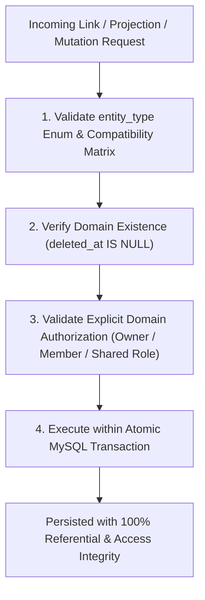
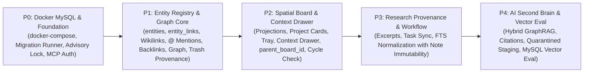

# FLOWDEN: Unified Ecosystem Architecture Blueprint (v2 - Final Technical Specification)

**Document Status:** Final Technical Specification & Consistency Review (Research Only — No Application Code Modified)  
**Date:** 2026-11-03  
**Target Repository:** `c:\Users\Sod\.gemini\antigravity\scratch\flowden`  
**Supercedes:** Research Draft v1 (`docs/research/flowden-unified-ecosystem-blueprint.md` preserved intact)  
**Author:** Antigravity (Advanced Agentic Architecture Group)  

---

## Epistemic Status & Verification Legend

To maintain strict scientific and engineering rigor, all statements throughout this document are classified using the following markers:

- **[CONFIRMED DECISION]**: Authoritative architectural directives mandated and approved by product leadership (e.g., MySQL 8.0+ as sole database, Docker Compose with environment variables and named volume, unified migration runner with advisory lock, 30-day soft deletion, multiple/nested boards, MySQL InnoDB FTS, single-user vs multi-user permission model, one unified ecosystem, single source of truth).
- **[EXISTING FUNCTIONALITY]**: Verified behavior currently implemented in the FLOWDEN codebase, cited with exact file paths and line numbers.
- **[VERIFIED PROBLEM]**: Concrete runtime bugs, schema mismatches, dead UI code, data corruption risks, or architectural silos verified by codebase inspection and execution testing.
- **[DOCUMENTED FACT]**: Verified architectural standards, open specifications, or product behaviors from official documentation (Notion API, Milanote, Obsidian, JSON Canvas, MCP).
- **[RECOMMENDED SPECIFICATION]**: Architectural designs, data schemas, API contracts, or UX patterns proposed by this architecture team to satisfy requirements.
- **[VERIFIED DATA ACTION]**: Explicit administrative actions executed and verified on the local host (such as the authorized cleanup of unrelated test data).
- **[CONFIRMED DECISION - FORMERLY PENDING]**: Implementation choices and UI display parameters that have been formally reviewed and approved by the user (Markdown search normalization with note immutability, and dual Trash UI indicators).

---

## 1. Executive Summary

### 1.1 The Challenge: Transcend Fragmented Web Tooling
FLOWDEN was conceived to blend the structural power of **Notion** (structured notes, relational databases, rollups), the spatial freedom of **Milanote** (visual whiteboards, creative card clustering, visual mapping), and the networked thought of **Obsidian** (bidirectional backlinks, local graph visualization, personal knowledge systems).

However, an exhaustive audit of the existing codebase proves that FLOWDEN currently consists of **six isolated CRUD applications housed under a single single-page application (SPA) shell**:
- A **Knowledge Vault** whose wiki-links are fragile and title-based, with version restoration broken at runtime and tags completely non-functional.
- A **Spatial Board** where cards are static text clones that completely ignore the backend `reference_id` column, disconnecting visual thinking from the Knowledge Vault and Workflow Tracker.
- A **Knowledge Graph** whose semantic connection table has zero UI support anywhere in the frontend.
- A **Research Center** whose document reader cannot anchor highlighted excerpts and whose "Bridge to Vault" copies plain text without recording source citations, navigating to a broken URL route.
- A **Workflow Tracker** where tasks cannot link to contextual notes or research documents.
- An **AI Assistant** that provides no in-app intelligence, operating merely as a test console for external MCP clients while silently bypassing user-configured project boundaries.
- A **Local Database Emulator** in `server/config/database.js` whose naive regex parser fails on table aliases (`n.user_id = ?`) and `OR` clauses, resulting in cross-tenant data leaks and wiping the entire `note_links` table across all users whenever any single note is deleted.

### 1.2 The Core Thesis: One Canonical Graph, Multiple Specialized Lenses
FLOWDEN will not be built as three separate products or six disconnected silos. 

**FLOWDEN is one unified knowledge and productivity ecosystem offering multiple specialized lenses over a single canonical entity and relationship graph:**
1. **Single Authoritative Record**: Every Note, Task, Research Document, Research Excerpt, Project, Board, and Decision Log exists as a single canonical record in MySQL. Modules never duplicate text or status just to display an item in another view.
2. **Dual-Layer Connection Architecture (`[CONFIRMED DECISION]`)**: FLOWDEN cleanly separates **Spatial Visual Connections** (canvas wires belonging strictly to a 2D board) from **Semantic Knowledge Relationships** (meaningful cross-workspace edges such as `supports`, `contradicts`, `depends_on`, `cites`). Visual wires can be explicitly promoted to semantic links, but they never pollute the global knowledge graph automatically.
3. **Cross-Project Knowledge Sharing & Authoritative Project Assignment (`[CONFIRMED DECISION]`)**: FLOWDEN establishes `entities.primary_project_id` as the authoritative assignment master while keeping domain `project_id` columns synchronized. Knowledge sharing across projects is managed via an explicit **Many-to-Many Membership Model (`project_entities`)**, cleanly separating single-user contextual organization from future multi-user team collaboration.
4. **MySQL 8.0+ as Sole Database with Docker Compose (`[CONFIRMED DECISION]`)**: FLOWDEN retires the fragile local JSON SQL emulator completely. Both local development and production run exclusively on **MySQL 8.0+ / 8.4 LTS**. Local development is containerized via Docker Compose using secure environment variables (`.env` kept out of Git, `.env.example` provided with unmistakable placeholders), a persistent named volume (`flowden_mysql_data`), and port `3306`.
5. **Unified Application Migration Runner with Advisory Locking (`[CONFIRMED DECISION]`)**: Docker is strictly responsible for running the raw MySQL engine. Database schema changes are executed exclusively by a dedicated application-level migration runner (`server/migrations/runner.js` tracking `schema_migrations`), protected against concurrent execution via MySQL advisory locks (`GET_LOCK`).
6. **Soft Deletion with 30-Day Trash & Safe Restoration Across All Views (`[CONFIRMED DECISION]`)**: Accidental deletion will not permanently sever knowledge webs. Deleting an entity sets `deleted_at`, causing it to disappear from active Boards, Graph, Search, and Backlinks while preserving its links and projections. A daily background job plus startup hook safely purges expired items.
7. **Authoritative Board Hierarchy & Nested Sub-Boards (`[CONFIRMED DECISION]`)**: `boards.parent_board_id` is the authoritative hierarchy master. Projections stay synchronized, same-project parentage is strictly validated, and circular nesting is actively prevented.
8. **MySQL InnoDB Full-Text Search Initially, MySQL-Centric Vector in P4 (`[CONFIRMED DECISION]`)**: Universal search and AI seed retrieval leverage MySQL's native full-text engine over a synchronized `entities.search_text` column. MySQL remains the authoritative database—no secondary database (PostgreSQL, SQLite, external vector DB) will be introduced without explicit approval.
9. **Centralized Polymorphic Integrity Validation (`[CONFIRMED DECISION]`)**: All polymorphic references (`entities`, `entity_links`, `project_entities`, `board_items`) are validated through a centralized integrity layer verifying existence, ownership, permissions, and atomic updates.
10. **Human-in-the-Loop AI Second Brain**: AI operates across the unified graph via permission-enforced **Hybrid GraphRAG**, retrieving project-authorized knowledge, generating strictly citable insights (`[note:42]`, `[excerpt:15]`), and proposing staged notes and tasks that require explicit user confirmation before touching canonical records. Unconfirmed AI suggestions (`is_confirmed = FALSE`) are strictly excluded from active Graph and Backlink views.

---

## 2. Confirmed Product Vision and Decisions

```mermaid
graph TD
    Vision["FLOWDEN Unified Vision:<br/>One Connected Knowledge Ecosystem"]
    
    Vision --> D1["1. One Unified Ecosystem<br/>(Shared Information & Relationships)"]
    Vision --> D2["2. Cross-Project Sharing<br/>(Authoritative Assignment + project_entities)"]
    Vision --> D3["3. MySQL 8.0+ Sole Database<br/>(Docker Compose with .env & Named Volume)"]
    Vision --> D4["4. Unified Migration Runner<br/>(Advisory Lock; No Docker Init Conflict)"]
    Vision --> D5["5. Single Source of Truth<br/>(Projections & Transclusions; No Clones)"]
    Vision --> D6["6. Dual Connection Layer<br/>(Board Wires vs Workspace Semantic Edges)"]
    Vision --> D7["7. Soft Delete with 30-Day Trash<br/>(Multi-View Filtering & Safe Restoration)"]
    Vision --> D8["8. Authoritative Board Hierarchy<br/>(parent_board_id + Cycle Prevention)"]
    Vision --> D9["9. InnoDB FTS Search Initially<br/>(search_text Sync; MySQL-Centric Vector in P4)"]
    Vision --> D10["10. Centralized Polymorphic Integrity<br/>(Existence, Ownership & Permission Checks)"]
```



---

## 3. Revalidated Existing Architecture Audit & Local Data Cleanup

### 3.1 Local Data Store Audit & Authorized Cleanup (`[VERIFIED DATA ACTION]`)

During earlier architectural analysis, an inventory of `server/data/flowden_store.json` identified 6 user accounts, 7 dummy projects, 7 dummy boards, 9 board items, 3 wires, 7 note folders, 8 dummy notes, 2 tasks, 1 research doc, 1 decision log, and 1 quick capture.

**Administrative Action & Verification**:
1. **Explicit User Authorization**: The user confirmed this dataset was unrelated sample/test data and explicitly authorized its removal.
2. **Selective Execution**: On `2026-11-03`, `server/data/flowden_store.json` was reset to the clean `initialStore` schema with all table arrays set to empty (`[]`) and `_autoInc` counters reset to 1.
3. **Preservation of Critical Assets**: All application source code, schemas, migrations, configuration, test suites, and uploaded research documents (`uploads/research/*.pdf`) were strictly preserved.
4. **Verification**: Executed verification command confirmed 0 records across all 18 tables in `flowden_store.json`.
5. **Migration Impact**: Because this unrelated dataset has been purged, **it will NOT be migrated into MySQL**. MySQL will initialize clean with versioned DDL migrations.

---

### 3.2 Persistence & Data Layer Audit

#### Finding AUD-01: Broken `WHERE` Clause Parser in Local SQL Emulator
- **Status**: **[VERIFIED PROBLEM]**.
- **Location**: [`server/config/database.js:168-234`](file:///c:/Users/Sod/.gemini/antigravity/scratch/flowden/server/config/database.js#L168-L234) (`filterRows` function).
- **Code Mechanism**: `filterRows()` splits only on `\s+and\s+` and matches `/^([a-zA-Z0-9_]+)\s*=\s*\?$/i`. In [`server/models/Note.js:5-20`](file:///c:/Users/Sod/.gemini/antigravity/scratch/flowden/server/models/Note.js#L5-L20), queries use `n.user_id = ?`. Because `.` fails regex matching, every condition falls through leaving `matchesAll = true`.
- **Actual Runtime Impact**: In local JSON mode, `GET /api/v1/notes` returns all notes across all tenants.
- **Resolution**: Fully eliminated by moving to MySQL 8.0+ via Docker Compose.
- **Severity**: **Critical (P0 Blocker)**.

#### Finding AUD-02: Catastrophic Table Wipe on Note Deletion
- **Status**: **[VERIFIED PROBLEM]**.
- **Location**: [`server/config/database.js:171`](file:///c:/Users/Sod/.gemini/antigravity/scratch/flowden/server/config/database.js#L171) & [`server/models/Note.js:206`](file:///c:/Users/Sod/.gemini/antigravity/scratch/flowden/server/models/Note.js#L206).
- **Code Mechanism**: `Note.delete()` executes `DELETE FROM note_links WHERE source_note_id = ? OR target_note_id = ?`. `filterRows()` has no `OR` support, falling through with `matchesAll = true`.
- **Actual Runtime Impact**: Deleting any single note silently deleted 100% of wiki-links across the workspace in JSON mode.
- **Resolution**: Fully eliminated by native MySQL relational deletion transactions and foreign key constraints.
- **Severity**: **Critical (Data Loss Bug)**.

#### Finding AUD-03: SQL Schema vs. Query Column Mismatches
- **Status**: **[VERIFIED PROBLEM]**.
- **Locations & Evidence**:
  1. `note_versions`: [`001_initial_schema.sql:160-171`](file:///c:/Users/Sod/.gemini/antigravity/scratch/flowden/server/migrations/001_initial_schema.sql#L160-L171) defines `(id, note_id, title, content, version_number, created_by, created_at)`. Code queries/inserts non-existent `user_id` and `content_markdown` ([Note.js:140,150](file:///c:/Users/Sod/.gemini/antigravity/scratch/flowden/server/models/Note.js#L140-L150)).
  2. `research_documents`: Schema defines `original_filename` and has no `tags_json` column. Code inserts `file_name` and `tags_json` ([research.js:151](file:///c:/Users/Sod/.gemini/antigravity/scratch/flowden/server/routes/research.js#L151)).
  3. `readProject.js`: Selects non-existent `viewport_state` from `boards` and `status, decision_context` from `decision_logs` ([readProject.js:26-27](file:///c:/Users/Sod/.gemini/antigravity/scratch/flowden/server/mcp/tools/readProject.js#L26-L27)).
- **Severity**: **High (MySQL Crash Points)**.

---

### 3.3 Module-by-Module Codebase Audit Summary
- **Spatial Board**: `board_items.reference_id` completely ignored by `board.js:1688-1855`. Hardcodes single board per project (`board.js:19-23`). Wires (`board_item_connections`) absent from Graph.
- **Knowledge Vault**: Broken version restore (`selectNote` vs `openNote` at `vault.js:823`). Missing project assignment UI (`project_id: null`). Dead tag container (`vault.js:127`). Fragile title-based links. Disabled task checkboxes (`vault.js:932`).
- **Knowledge Graph**: Zero UI anywhere in `public/js/` calls `/api/v1/connections` (`smart_connections`).
- **Research Center**: "Bridge to Vault Note" copies plain text with no provenance and routes to broken URL `/vault?note=X` (`research.js:350-366`).
- **Workflow Tracker**: Tasks store plain text description only with no entity links (`001_initial_schema.sql:194`).
- **Search & MCP**: Search UI drops research results (`search.js:55-105`). MCP auth ignores `enabledProjects` completely (`mcpAuth.js:18-40`).

---

## 4. Problems and Integration Gap Matrix

| Module Pair | Intended Ecosystem Behavior | Current Implementation Reality | Local JSON Mode Impact | MySQL Mode Impact | Gap Severity |
| :--- | :--- | :--- | :--- | :--- | :--- |
| **Vault ↔ Board** | Notes can be projected onto Boards; edits on Board update the Note; double-clicking opens full editor. | Board creates static `board_items` row; `reference_id` ignored; text changes on Board do not update Note. | Disconnected data clones. | Disconnected data clones. | **Critical** |
| **Board ↔ Graph** | Semantic wires drawn on Board contribute to Knowledge Graph. | Canvas wires stored in `board_item_connections`; graph query completely ignores boards and canvas wires. | Wires absent from Graph. | Wires absent from Graph. | **High** |
| **Vault ↔ Workflow** | `- [ ]` action items in Notes sync with Tasks; Tasks link to spec Notes. | Checkboxes are disabled HTML; `tasks` table has no note ID or link reference. | Isolated execution silo. | Isolated execution silo. | **High** |
| **Research ↔ Vault** | Passages highlighted in PDFs generate citable excerpts embedded in Notes. | No passage highlighting; "Bridge to Note" copies text with no link and broken `/vault?note=X` URL. | Lost provenance; 404 navigation. | Lost provenance; 404 navigation. | **Critical** |
| **Projects ↔ All Modules** | Knowledge can belong to a project or be shared across multiple projects. | Single nullable `project_id` on tables; Vault create ignores project; no cross-project sharing. | All Vault notes orphaned (`project_id=null`). | All Vault notes orphaned (`project_id=null`). | **Critical** |
| **MCP ↔ Projects** | External AI only reads projects explicitly enabled by user in settings. | `mcpAuth.js` and tools ignore `enabledProjects` completely. | Leaks all projects to MCP. | Leaks all projects to MCP. | **Critical** |
| **Search ↔ Research** | Universal search finds research papers and excerpts. | `search.js` frontend omits `results.research` from DOM rendering. | Research invisible in search results. | Research invisible in search results. | **High** |
| **Database ↔ Data Integrity** | Foreign key constraints, atomic transactions, no cross-tenant leaks. | Regex SQL emulator fails on aliases, `OR`, and schema columns. | `note_links` wiped on delete; cross-tenant leaks. | Syntax errors on non-existent columns. | **Critical** |

---

## 5. Reference Platform Adaptation

```mermaid
flowchart TD
    subgraph Notion["Notion Reference"]
        N_Block["Fine-grained Block Tree<br/>(Every paragraph a UUID row)"]
        N_Sync["Synced Blocks<br/>(Live cross-page embedding)"]
        N_Rel["Relational Databases & Rollups"]
    end
    
    subgraph Milanote["Milanote Reference"]
        M_Board["Infinite 2D Spatial Canvas"]
        M_Doc["Document Cards on Board<br/>(Opens focused editor)"]
        M_Tray["Unsorted Notes Inbox Tray"]
        M_Wire["Visual Connection Lines"]
        M_Nest["Nested Sub-Boards"]
    end
    
    subgraph Obsidian["Obsidian Reference"]
        O_Link["[[Wikilinks]] with Auto-Rename"]
        O_Back["Backlinks & Unlinked Mentions"]
        O_Canvas["JSON Canvas 1.0 Spec<br/>(file vs text nodes)"]
        O_Graph["Global & Local 2-Hop Graph"]
    end
    
    subgraph Flowden["FLOWDEN Unified Adaptation"]
        F_Ent["Canonical Entity Model + Soft Delete<br/>(Whole-document identity + 30-day trash)"]
        F_Proj["Spatial Board Projections & Sub-Boards<br/>(Live reference_id + Tray + parent_board_id)"]
        F_Rel["Unified entity_links Ledger<br/>(Rename-safe [[type:id|Title]])"]
        F_Dual["Dual Connection System<br/>(Visual Wires vs Semantic Edges)"]
        F_Shar["Explicit Cross-Project Sharing<br/>(project_entities)"]
    end

    N_Sync --> F_Proj
    N_Rel --> F_Rel
    N_Block -.->|"Discarded: Massive SQL Bloat"| F_Ent
    
    M_Board --> F_Proj
    M_Doc --> F_Proj
    M_Tray --> F_Proj
    M_Wire --> F_Dual
    M_Nest --> F_Proj
    
    O_Link --> F_Rel
    O_Back --> F_Rel
    O_Canvas --> F_Proj
    O_Graph --> F_Rel
```



### 5.2 Feature Preservation & Cross-Version Traceability Matrix (`[CONFIRMED DECISION]`)

To guarantee that no approved v1 capabilities from `docs/research/flowden-unified-ecosystem-blueprint.md` are lost or silently dropped during the migration to the v2 architecture, all core capabilities are mapped directly to their v2 subsystems, delivery phases, and testable acceptance criteria:

| Feature Capability Group | Core Functional Scope | v1 Blueprint Origin | v2 Unified Architectural Subsystem | Target Phase | Formal Acceptance Criteria ID |
| :--- | :--- | :--- | :--- | :---: | :--- |
| **1. Universal Wikilinks & `@` Mentions** | Rename-safe syntax `[[type:id\|Title]]` and inline `@` mention popover querying `entities` index for instant cross-module context insertion. Auto-propagates display aliases on note rename without breaking stable ID pointers. | v1 §4.2, §5.3, §6.1 | Knowledge Vault + `entities` + `entity_links` | **Phase 1** | **AC-ECO-12**, **AC-ECO-13** |
| **2. Backlinks & Unlinked Mentions** | Inspector ledger displaying explicit incoming references (`entity_links`) alongside automated full-text search discovery of unlinked title mentions with one-click "Link Now" capability. | v1 §4.2, §5.3, §6.2 | Knowledge Vault + `entity_links` + InnoDB FTS | **Phase 1** | **AC-ECO-14** |
| **3. Global & Local Knowledge Graph** | Interactive full-workspace graph visualization (`#/graph`) with project filtering and edge legends, plus 1-hop and 2-hop local contextual neighborhood explorer in the active entity drawer. | v1 §4.2, §5.3, §7.1 | Knowledge Graph + `entity_links` | **Phase 1** | **AC-ECO-15** |
| **4. Split-Screen Context Drawer** | Universal slide-over panel allowing users to inspect or edit any referenced entity (Note, Task, Excerpt, Decision) in-place without navigating away from their active canvas, kanban board, or research PDF. | v1 §4.2, §5.2, §8.3 | Shared Frontend Component Architecture | **Phase 2** | **AC-ECO-16** |
| **5. Workspace Tray & Live Entity Cards** | Slide-out staging tray grouping unplaced project entities (Notes, Tasks, Excerpts, Boards, Decisions) for spatial planning. Dragging onto canvas creates live projection cards with live chrome and status updates. | v1 §4.2, §5.2, §8.1 | Spatial Board + `board_items` Projections | **Phase 2** | **AC-ECO-01**, **AC-ECO-17** |
| **6. Research Citation Provenance** | In-reader text highlighting in research PDFs producing citable `research_excerpts` with location anchors (page, offset) and direct `![[excerpt:id]]` embeds into Vault notes. | v1 §4.2, §5.1, §9.1 | Research Center + `research_excerpts` | **Phase 3** | **AC-ECO-06** |
| **7. Bidirectional Workflow Sync** | Interactive `- [ ] [[task:id]]` checkboxes in Markdown notes synced two-way with Kanban tasks. Toggling in note completes task; dragging in Kanban updates note markdown. | v1 §4.2, §5.1, §9.2 | Knowledge Vault ↔ Workflow Tracker | **Phase 3** | **AC-ECO-07** |
| **8. Universal Omnibox Search** | Global `Ctrl+K` search querying MySQL InnoDB FTS across all entities, honoring project scoping and bidirectional personal knowledge traversal. | v1 §4.2, §5.1, §10.1 | Universal Search Engine + `entities.search_text` | **Phase 3** | **AC-ECO-08**, **AC-AI-04** |
| **9. Human-in-the-Loop AI Second Brain** | Hybrid GraphRAG generating project-scoped, citable insights with quarantined staging (`is_confirmed=FALSE`) for proposed notes, tasks, and edges requiring human review. | v1 §4.2, §5.1, §11.1 | AI Assistant + MCP Protocol | **Phase 4** | **AC-AI-01** – **AC-AI-03** |

---

## 6. Unified Entity Architecture & Soft Delete System

### 6.1 Canonical Entity Registry (`entities`) Schema (`[CONFIRMED DECISION]`)

The `entities` table acts as the authoritative indexed catalog for universal search, `@` mentions, and cross-module discovery:

```sql
CREATE TABLE IF NOT EXISTS entities (
    id INT UNSIGNED AUTO_INCREMENT PRIMARY KEY,
    uuid VARCHAR(36) NOT NULL,
    entity_type ENUM(
        'project',
        'note',
        'task',
        'research',
        'excerpt',
        'board',
        'decision',
        'capture'
    ) NOT NULL,
    entity_id INT UNSIGNED NOT NULL,
    owner_user_id INT UNSIGNED NOT NULL,
    primary_project_id INT UNSIGNED NULL,
    title VARCHAR(255) NOT NULL,
    search_text LONGTEXT NULL,
    is_archived BOOLEAN NOT NULL DEFAULT FALSE,
    deleted_at TIMESTAMP NULL DEFAULT NULL,
    created_at TIMESTAMP DEFAULT CURRENT_TIMESTAMP,
    updated_at TIMESTAMP DEFAULT CURRENT_TIMESTAMP ON UPDATE CURRENT_TIMESTAMP,
    
    UNIQUE KEY uq_entity_type_id (entity_type, entity_id),
    UNIQUE KEY uq_entity_uuid (uuid),
    INDEX idx_owner_project (owner_user_id, primary_project_id),
    INDEX idx_title (title),
    INDEX idx_deleted_at (deleted_at),
    FULLTEXT KEY ft_entity_search (title, search_text),
    CONSTRAINT fk_entities_owner FOREIGN KEY (owner_user_id) REFERENCES users(id) ON DELETE CASCADE,
    CONSTRAINT fk_entities_project FOREIGN KEY (primary_project_id) REFERENCES projects(id) ON DELETE SET NULL
) ENGINE=InnoDB DEFAULT CHARSET=utf8mb4 COLLATE=utf8mb4_unicode_ci;
```

### 6.2 Entity Type Compatibility Matrix (`[CONFIRMED DECISION]`)

To prevent architectural ambiguity between canvas-local elements, private staging buffers, and first-class shared knowledge, the system enforces a strict polymorphic compatibility matrix across all four relational subsystems:

| Entity Type | In `entities` Catalog? | In `entity_links` Graph? | In `project_entities` Sharing? | In `board_items` Projection? | Shareable Across Projects? | Subsystem Role & Isolation Boundary |
| :--- | :---: | :---: | :---: | :---: | :---: | :--- |
| `project` | **Yes** | **Yes** (source/target) | **No** (Container itself) | **Yes** (`reference_type='project'`, `item_type='board_link'`) | N/A | Root organizational container. Formally supported as a live canvas projection card (`reference_type='project'`, `item_type='board_link'`) on overview/meta-boards linking to the project overview or root board. Appears in `entities` for Omnibox navigation and in `entity_links` for cross-project dependency modeling (`depends_on`, `relates_to`). Excluded from `project_entities` (projects do not contain other projects). |
| `note` | **Yes** | **Yes** | **Yes** | **Yes** (`reference_type='note'`) | **Yes** | Canonical long-form document. Supports versioning, Markdown transclusions, and wikilinks. |
| `task` | **Yes** | **Yes** | **Yes** | **Yes** (`reference_type='task'`) | **Yes** | Executable action item with status, priority, due date, and bidirectional Markdown checkbox sync. |
| `research` | **Yes** | **Yes** | **Yes** | **Yes** (`reference_type='research'`) | **Yes** | Source reference document (PDF, academic paper, URL asset) with raw text indexing. |
| `excerpt` | **Yes** | **Yes** | **Yes** | **Yes** (`reference_type='excerpt'`) | **Yes** | Citable highlight anchored to a specific location (page, offset) within a parent research document. |
| `board` | **Yes** | **Yes** | **Yes** | **Yes** (`reference_type='board'`) | **Yes** | Spatial 2D visual thinking canvas. Projected onto other boards as a nested sub-board (`item_type='board_link'`). |
| `decision` | **Yes** | **Yes** | **Yes** | **Yes** (`reference_type='decision'`) | **Yes** | Formal decision record tracking rationale, options considered, stakeholder sign-off, and review status. |
| `capture` | **Yes** | **Limited** (`derived_from`) | **No** (Intentionally Excluded) | **No** (Intentionally Excluded) | **No** (Private Staging) | Ephemeral inbox staging buffer. Indexed in `entities` for private Omnibox search. Intentionally excluded from `project_entities` sharing and direct `board_items` canvas projection until promoted to a Note, Task, or Canvas Card. |
| `board_card` | **No** (Canvas Local) | **No** (Local Wires Only) | **No** (Intentionally Excluded) | **Is the item** (`reference_id IS NULL`) | **No** (Canvas Local) | Ephemeral sticky card or text block created directly on a Spatial Board. Lives exclusively in `board_items` (`reference_id IS NULL`). Inter-card visual wires reside in `board_item_connections`. Never enters `entities`, `entity_links`, or `project_entities` unless explicitly promoted. |

#### Detailed Subsystem Isolation Rules:
1. **`board_card` Isolation**: Native canvas cards exist solely within `board_items` for rapid visual brainstorming. Because they have no canonical domain identity, they are excluded from global graph edges and cross-project sharing. Promoting a `board_card` to a `note` or `task` creates a canonical record in `notes` or `tasks`, registers the entity in `entities`, and updates the canvas item to `reference_type = 'note'/'task', reference_id = :id`.
2. **`capture` Quarantine**: Quick captures represent unprocessed inbox items. To prevent half-baked thoughts from polluting team project dashboards and shared graphs, captures remain strictly private to the capturing user and cannot be directly shared across projects or placed as live projections. Once triaged and converted (e.g. into a Task or Note), the downstream entity participates fully in the ecosystem.

### 6.3 Centralized Integrity Validation & Per-Entity Authorization Rules (`[CONFIRMED DECISION]`)

To guarantee that polymorphic foreign keys in `entities`, `entity_links`, `project_entities`, and `board_items` never point to non-existent rows or bypass security boundaries, a centralized `EntityIntegrityValidator` is enforced across all repository operations:



#### Explicit Per-Entity Domain Authorization Rules
Generic assumptions such as checking `WHERE user_id = :userId` across all tables are prohibited because domain models have distinct ownership and assignment structures. Authorization is verified according to the following explicit matrix:

| Entity Type | Authoritative Domain Table | Primary Author Column | Project Scope Column | Authorization Criteria for Mutation (Update / Soft-Delete / Restore / Purge) |
| :--- | :--- | :--- | :--- | :--- |
| `note` | `notes` | `user_id` | `project_id` | `notes.user_id = :userId` OR caller is Project Admin of `notes.project_id` OR has `access_role = 'admin'` in `project_entities`. |
| `task` | `tasks` | `created_by` | `project_id` | `tasks.created_by = :userId` OR `tasks.assigned_to = :userId` OR caller is Project Admin of `tasks.project_id` OR has `access_role = 'admin'` in `project_entities`. |
| `research` | `research_documents` | `user_id` | `project_id` | `research_documents.user_id = :userId` OR caller is Project Admin of `research_documents.project_id` OR has `access_role = 'admin'` in `project_entities`. |
| `excerpt` | `research_excerpts` | Inherited from Document | Inherited from Document | Caller satisfies authorization on parent `research_documents` (via `research_excerpts.research_id`). |
| `board` | `boards` | `user_id` | `project_id` | `boards.user_id = :userId` OR caller is Project Admin of `boards.project_id` OR has `access_role = 'admin'` in `project_entities`. |
| `decision` | `decision_logs` | `created_by` | `project_id` | `decision_logs.created_by = :userId` OR caller is Project Admin of `decision_logs.project_id` OR has `access_role = 'admin'` in `project_entities`. |
| `capture` | `quick_captures` | `user_id` | `project_id` (nullable) | Strictly private: `quick_captures.user_id = :userId`. |
| `project` | `projects` | `owner_id` | N/A (Root) | `projects.owner_id = :userId` OR caller has role `'admin'` in `project_members`. |

### 6.4 Soft-Delete Filtering Across All Views (`[CONFIRMED DECISION]`)

When an entity is soft-deleted, it must disappear immediately from active views while remaining 100% recoverable. Active queries must handle native brainstorm cards and live projections distinctly:

```sql
-- Authoritative Active Board Items Retrieval Query
SELECT bi.*, e.title AS resolved_title, e.deleted_at AS entity_deleted_at
  FROM board_items bi
  JOIN boards b ON b.id = bi.board_id AND b.deleted_at IS NULL
  LEFT JOIN entities e ON e.entity_type = bi.reference_type AND e.entity_id = bi.reference_id
 WHERE bi.board_id = :boardId
   AND bi.deleted_at IS NULL
   AND (bi.reference_id IS NULL OR (e.id IS NOT NULL AND e.deleted_at IS NULL));
```

#### Detailed View Filtering Specifications:

| View Environment | Exact Filtering Rule | Behavior When Underlying Entity or Projection is in Trash |
| :--- | :--- | :--- |
| **Spatial Board (Active Canvas)** | `b.deleted_at IS NULL AND bi.deleted_at IS NULL AND (bi.reference_id IS NULL OR (e.id IS NOT NULL AND e.deleted_at IS NULL))` | **Preserves Native Brainstorm Cards**: If `bi.reference_id IS NULL`, the item is a native card and renders unconditionally.<br/>**Hides Deleted and Missing Projections**: If `bi.reference_id IS NOT NULL`, the card renders ONLY if the referenced entity explicitly exists in the catalog (`e.id IS NOT NULL`) and is not soft-deleted (`e.deleted_at IS NULL`). Cards referencing missing, non-existent, or purged entities are strictly suppressed.<br/>**Board State**: If containing board `b` is soft-deleted, no canvas items are returned. |
| **Spatial Board (Trash Inspection View `#/trash?view=board`)** | `bi.board_id = :id AND (bi.deleted_at IS NOT NULL OR e.id IS NULL OR e.deleted_at IS NOT NULL)` | Renders deleted native cards with a `"Deleted Card"` banner and projections of trashed or missing entities with a ghosted `"Underlying Entity in Trash / Missing"` badge and restore action. |
| **Knowledge Graph (`#/graph`)** | `el.deleted_at IS NULL AND el.is_confirmed = TRUE` + `JOIN entities se ... AND se.deleted_at IS NULL` + `JOIN entities te ... AND te.deleted_at IS NULL` | Edges connected to deleted entities disappear. If either source or target is soft-deleted, the edge is suppressed. Unconfirmed AI suggestions are quarantined. |
| **Backlinks / Inspector Drawer** | `el.target_type = :t AND el.target_id = :id AND el.deleted_at IS NULL AND el.is_confirmed = TRUE` + `JOIN entities se ... AND se.deleted_at IS NULL` | Backlinks panel suppresses mentions from deleted entities or unconfirmed AI edges. |
| **Universal Search & Command Palette (`Ctrl+K`)** | `e.deleted_at IS NULL AND (e.owner_user_id = :uid OR EXISTS (project membership))` | Omnibox and universal search omit soft-deleted items entirely. |
| **Workspace Staging Tray** | `e.deleted_at IS NULL` for all entity drawers | Trashed entities cannot be dragged onto boards. |
| **Unified Trash View (`#/trash`)** | `e.deleted_at IS NOT NULL` + owner / project permissions | Displays all soft-deleted entities with **dual retention indicators**: a dynamic countdown badge (`"{N} days remaining"`, calculated from the 30-day retention window: `GREATEST(0, 30 - DATEDIFF(NOW(), deleted_at))`) and the absolute deletion timestamp with full UTC tooltip. |

### 6.5 Complete Per-Type Restore & Permanent Purge Specifications

#### Cascade Deletion Provenance Tracking (`cascade_deleted_by`) (`[CONFIRMED DECISION]`)
To prevent a severe data corruption flaw where restoring a parent container accidentally resurrects child items that the user had independently deleted earlier, domain tables subject to cascading (`boards`, `research_excerpts`, and `board_items`) include a tracking column: `cascade_deleted_by INT UNSIGNED NULL DEFAULT NULL`.
- **On Cascade Soft-Deletion**: Only children that are *currently active* (`deleted_at IS NULL`) are marked `deleted_at = NOW()` and stamped with `cascade_deleted_by = :parentId`. Children that were already in Trash prior to this cascade retain their original deletion timestamp and keep `cascade_deleted_by = NULL`.
- **On Cascade Restoration**: The system restores *only* children where `cascade_deleted_by = :parentId` (`deleted_at = NULL, cascade_deleted_by = NULL`). Children independently trashed by the user remain safely in Trash.

#### 1. Complete Per-Type Restore Behavior (`POST /api/v1/:type/:id/restore`)
Restoring an item atomically restores the domain record, the catalog entry in `entities`, and only those child dependencies that were deleted as part of the parent's cascade:

```sql
START TRANSACTION;

-- 1. Restore domain table record
UPDATE domain_table 
   SET deleted_at = NULL,
       cascade_deleted_by = NULL 
 WHERE id = :entityId 
   AND (<explicit_domain_authorization_check>);

-- 2. Restore catalog registry entry
UPDATE entities 
   SET deleted_at = NULL 
 WHERE entity_type = :entityType 
   AND entity_id = :entityId;

-- 3. Type-Specific Cascading Restore with Provenance Validation:
-- For 'research' (Document): Restore ONLY excerpts that were deleted by cascade from this document
UPDATE research_excerpts 
   SET deleted_at = NULL,
       cascade_deleted_by = NULL 
 WHERE research_id = :entityId 
   AND cascade_deleted_by = :entityId;

UPDATE entities 
   SET deleted_at = NULL 
 WHERE entity_type = 'excerpt' 
   AND entity_id IN (SELECT id FROM research_excerpts WHERE research_id = :entityId AND deleted_at IS NULL);

-- For 'board': Genuinely recursive restoration via WITH RECURSIVE
-- Restores ONLY descendant sub-boards across arbitrary depth that were cascade-deleted by this parent
WITH RECURSIVE board_tree AS (
    SELECT id, parent_board_id
      FROM boards
     WHERE id = :entityId
    UNION ALL
    SELECT b.id, b.parent_board_id
      FROM boards b
      JOIN board_tree bt ON b.parent_board_id = bt.id
     WHERE b.cascade_deleted_by = :entityId -- Only include cascade-deleted children!
)
-- Step 3a: Restore boards table records for all cascade-deleted boards in the hierarchy
UPDATE boards b
  JOIN board_tree bt ON b.id = bt.id
   SET b.deleted_at = NULL,
       b.cascade_deleted_by = NULL;

-- Step 3b: Restore entities catalog registry across arbitrary depth using the exact same validated descendant set
WITH RECURSIVE board_tree AS (
    SELECT id, parent_board_id
      FROM boards
     WHERE id = :entityId
    UNION ALL
    SELECT b.id, b.parent_board_id
      FROM boards b
      JOIN board_tree bt ON b.parent_board_id = bt.id
     WHERE b.deleted_at IS NULL -- Traverses all restored boards in the tree, stopping at independently trashed boards
)
UPDATE entities e
  JOIN board_tree bt ON e.entity_type = 'board' AND e.entity_id = bt.id
   SET e.deleted_at = NULL;

-- Restore board items that were cascade-deleted by this board
UPDATE board_items 
   SET deleted_at = NULL,
       cascade_deleted_by = NULL 
 WHERE cascade_deleted_by = :entityId;

COMMIT;
```

#### Safe Independent Child Board Restoration (`POST /api/v1/boards/:childId/restore`)
When a user navigates to `#/trash` and chooses to restore a nested sub-board independently while its parent board remains soft-deleted in Trash:
1. **Hierarchy Integrity Check**: The system queries the parent board's status:
   ```sql
   SELECT deleted_at, project_id FROM boards 
    WHERE id = (SELECT parent_board_id FROM boards WHERE id = :childId);
   ```
2. **Safe Root Promotion Rule**: If `parent.deleted_at IS NOT NULL`, keeping `parent_board_id` attached to the trashed parent would cause the restored child board to be unreachable and invisible in active views. Therefore, the system automatically promotes the child board to become a top-level root board within the same project:
   - Sets `parent_board_id = NULL`
   - Clears `cascade_deleted_by = NULL`
   - Sets `deleted_at = NULL`
3. **Entities Registry & Canvas Items**: Restores the child board's entry in `entities (deleted_at = NULL)` and its active items in `board_items (deleted_at = NULL, cascade_deleted_by = NULL)`.
4. **Projection Card Pruning**: Prunes the former `board_link` projection card from the trashed parent's canvas (`DELETE FROM board_items WHERE board_id = @old_parent_id AND reference_type = 'board' AND reference_id = :childId`) to eliminate ghost link cards if the parent is later restored.
5. **User Feedback**: The API returns `{ promotedToRoot: true, message: "Restored board '[Title]' and promoted it to project root level because its former parent board remains in Trash." }`.

#### Research Document Soft-Deletion & Independent Excerpt Restore Guard
1. **Transactional Soft-Deletion for Research Documents (`DELETE /api/v1/research/:docId`)**:
   When soft-deleting a Research Document, all active child excerpts are soft-deleted atomically, while preserving any excerpts that were independently moved to Trash earlier:
   ```sql
   START TRANSACTION;

   -- 1. Soft-delete parent research document
   UPDATE research_documents 
      SET deleted_at = NOW() 
    WHERE id = :docId 
      AND (user_id = :userId OR EXISTS (
          SELECT 1 FROM project_members pm 
           WHERE pm.project_id = research_documents.project_id 
             AND pm.user_id = :userId 
             AND pm.role = 'admin'
      ));

   -- 2. Soft-delete parent catalog entry in entities
   UPDATE entities 
      SET deleted_at = NOW() 
    WHERE entity_type = 'research' AND entity_id = :docId;

   -- 3. Cascade soft-delete ONLY active child excerpts, stamping cascade provenance
   -- Pre-existing trashed excerpts (deleted_at IS NOT NULL) are preserved and NOT stamped!
   UPDATE research_excerpts 
      SET deleted_at = NOW(),
          cascade_deleted_by = :docId
    WHERE research_id = :docId 
      AND deleted_at IS NULL;

   -- 4. Synchronize entities registry for cascade-deleted excerpts
   UPDATE entities 
      SET deleted_at = NOW()
    WHERE entity_type = 'excerpt' 
      AND entity_id IN (
          SELECT id FROM research_excerpts 
           WHERE research_id = :docId 
             AND cascade_deleted_by = :docId
      );

   COMMIT;
   ```

2. **Independent Excerpt Restore Guard (`POST /api/v1/excerpts/:id/restore`)**:
   - Unlike boards (which can exist at the root project level), research excerpts are non-standalone atomic highlights anchored to a physical source document (via `location_anchor`, `quoted_text`, and PDF byte streams). An excerpt cannot exist or be reviewed without its backing document.
   - If a user attempts to restore an excerpt while its parent document is still in Trash:
     ```sql
     SELECT deleted_at FROM research_documents 
      WHERE id = (SELECT research_id FROM research_excerpts WHERE id = :excerptId);
     ```
   - If `parent.deleted_at IS NOT NULL`, the operation is aborted immediately with HTTP status:
     `409 Conflict: Cannot restore excerpt while parent Research Document is in Trash. Restore parent document first.`
   - Once the parent document is restored (which cascades to its cascade-deleted excerpts, or permits individual restore), the excerpt can be accessed and restored safely.

#### 2. Complete Per-Type Permanent Purge Behavior
Executed when the user clicks **"Empty Trash"** or automatically by the daily background cleanup runner for items where `deleted_at < NOW() - INTERVAL 30 DAY`. Purging an entity cascades cleanly across all four subsystems and removes physical files, eliminating orphan records:

```sql
START TRANSACTION;

-- STEP 1: Purge Child Sub-Entities (Hierarchical Cascading)
-- If purging a 'research' document, collect child excerpt IDs and purge them completely:
--   a. Remove child excerpts from board projections:
DELETE FROM board_items 
 WHERE reference_type = 'excerpt' 
   AND reference_id IN (SELECT id FROM research_excerpts WHERE research_id = :entityId);

--   b. Remove child excerpts from entity_links (both incoming and outgoing):
DELETE FROM entity_links 
 WHERE (source_type = 'excerpt' AND source_id IN (SELECT id FROM research_excerpts WHERE research_id = :entityId))
    OR (target_type = 'excerpt' AND target_id IN (SELECT id FROM research_excerpts WHERE research_id = :entityId));

--   c. Remove child excerpts from project_entities:
DELETE FROM project_entities 
 WHERE entity_type = 'excerpt' 
   AND entity_id IN (SELECT id FROM research_excerpts WHERE research_id = :entityId);

--   d. Remove child excerpts from entities registry:
DELETE FROM entities 
 WHERE entity_type = 'excerpt' 
   AND entity_id IN (SELECT id FROM research_excerpts WHERE research_id = :entityId);

--   e. Delete child excerpts from domain table:
DELETE FROM research_excerpts WHERE research_id = :entityId;

-- STEP 2: Purge Projections of the Primary Entity
DELETE FROM board_items WHERE reference_type = :entityType AND reference_id = :entityId;

-- STEP 3: Purge All Relationships (Incoming and Outgoing)
DELETE FROM entity_links 
 WHERE (source_type = :entityType AND source_id = :entityId) 
    OR (target_type = :entityType AND target_id = :entityId);

-- STEP 4: Purge Project Sharing Associations
DELETE FROM project_entities WHERE entity_type = :entityType AND entity_id = :entityId;

-- STEP 5: Purge Canonical Catalog Registry Entry
DELETE FROM entities WHERE entity_type = :entityType AND entity_id = :entityId;

-- STEP 6: Domain-Specific Purge & File System Cleanup
-- For 'note':
--   DELETE FROM note_versions WHERE note_id = :entityId;
--   DELETE FROM notes WHERE id = :entityId;
-- For 'research':
--   -- API triggers Node.js fs.unlinkSync(filePath) for stored PDF in uploads/research/
--   DELETE FROM research_documents WHERE id = :entityId;
-- For 'board':
--   DELETE FROM board_item_connections WHERE board_id = :entityId;
--   DELETE FROM board_items WHERE board_id = :entityId;
--   -- Re-parent child sub-boards to root or delete recursively:
--   UPDATE boards SET parent_board_id = NULL WHERE parent_board_id = :entityId;
--   DELETE FROM boards WHERE id = :entityId;
-- For 'task':
--   DELETE FROM tasks WHERE id = :entityId;
-- For 'decision':
--   DELETE FROM decision_logs WHERE id = :entityId;
-- For 'capture':
--   DELETE FROM quick_captures WHERE id = :entityId;

COMMIT;
```

---

## 7. Unified Relationship Architecture

### 7.1 The Consolidated `entity_links` Ledger Schema & Reactivation Pattern (`[CONFIRMED DECISION]`)

The `entity_links` table stores all workspace-wide semantic relationships, linking notes, tasks, research, excerpts, decisions, and projects:

```sql
CREATE TABLE IF NOT EXISTS entity_links (
    id INT UNSIGNED AUTO_INCREMENT PRIMARY KEY,
    user_id INT UNSIGNED NOT NULL,
    source_type ENUM(
        'project', 'note', 'task', 'research', 'excerpt', 'board', 'decision', 'capture'
    ) NOT NULL,
    source_id INT UNSIGNED NOT NULL,
    target_type ENUM(
        'project', 'note', 'task', 'research', 'excerpt', 'board', 'decision', 'capture'
    ) NOT NULL,
    target_id INT UNSIGNED NOT NULL,
    link_type ENUM(
        'references',       -- General wikilink or mention
        'embeds',           -- Transclusion (![[...]])
        'cites',            -- Source attribution from research or excerpt
        'derived_from',     -- Excerpt derived from document; note from capture
        'supports',         -- Evidence or argument supporting a claim/decision
        'contradicts',      -- Evidence or argument conflicting with a claim
        'inspired_by',      -- Conceptual origin
        'depends_on',       -- Execution dependency (Task A depends on Task B)
        'blocks',           -- Task A blocks Task B
        'relates_to'        -- General association
    ) NOT NULL DEFAULT 'references',
    origin ENUM(
        'inline_link',      -- Parsed from [[type:id|Title]]
        'embed',            -- Parsed from ![[type:id]]
        'board_promoted',   -- Explicitly promoted from a visual wire
        'citation',         -- Created via Research Reader highlight
        'task_sync',        -- Created via checkbox action-item sync
        'capture_convert',  -- Created when quick capture is promoted
        'manual',           -- Explicitly created via Inspector UI
        'ai_suggested'      -- Proposed by AI Second Brain
    ) NOT NULL DEFAULT 'inline_link',
    context_snippet VARCHAR(500) NULL,
    is_confirmed BOOLEAN NOT NULL DEFAULT TRUE,
    deleted_at TIMESTAMP NULL DEFAULT NULL,
    created_at TIMESTAMP DEFAULT CURRENT_TIMESTAMP,
    updated_at TIMESTAMP DEFAULT CURRENT_TIMESTAMP ON UPDATE CURRENT_TIMESTAMP,

    UNIQUE KEY uq_relationship (source_type, source_id, target_type, target_id, link_type),
    INDEX idx_user_source (user_id, source_type, source_id),
    INDEX idx_user_target (user_id, target_type, target_id),
    INDEX idx_link_type (link_type),
    INDEX idx_deleted_confirmed (deleted_at, is_confirmed),
    CONSTRAINT fk_entity_links_user FOREIGN KEY (user_id) REFERENCES users(id) ON DELETE CASCADE
) ENGINE=InnoDB DEFAULT CHARSET=utf8mb4 COLLATE=utf8mb4_unicode_ci;
```

#### Safe Relationship Reactivation (`ON DUPLICATE KEY UPDATE`)
Because `UNIQUE KEY uq_relationship (source_type, source_id, target_type, target_id, link_type)` enforces relational uniqueness across all rows (including soft-deleted records where `deleted_at IS NOT NULL`), re-establishing a relationship between two entities would throw `ERROR 1062 (Duplicate entry)` if a simple `INSERT` were attempted.

To resolve this conflict cleanly while preserving AI suggestion quarantining, all edge creations execute via an atomic upsert:

```sql
INSERT INTO entity_links (
    user_id, source_type, source_id, target_type, target_id, link_type,
    origin, context_snippet, is_confirmed, deleted_at, created_at
) VALUES (
    :userId, :sourceType, :sourceId, :targetType, :targetId, :linkType,
    :origin, :contextSnippet, :isConfirmed, NULL, CURRENT_TIMESTAMP
)
ON DUPLICATE KEY UPDATE
    deleted_at = NULL,
    -- Strictly preserve AI confirmation quarantine: an AI suggestion NEVER auto-confirms a previously deleted link
    is_confirmed = IF(VALUES(origin) = 'ai_suggested', FALSE, VALUES(is_confirmed)),
    origin = VALUES(origin),
    context_snippet = VALUES(context_snippet),
    updated_at = CURRENT_TIMESTAMP;
```

#### Reactivation Preservation Rules:
1. **Human Creation / Restoration**: If a user explicitly re-links two entities (via Markdown wikilink `[[note:12]]`, inspector panel, or board promotion), `:origin != 'ai_suggested'`, setting `deleted_at = NULL` and `is_confirmed = TRUE`. The edge instantly reappears in the Knowledge Graph and Backlink panels.
2. **AI Suggestion Quarantine**: If the AI Second Brain proposes a relationship that was previously deleted or already exists in staged form, `origin = 'ai_suggested'` and `is_confirmed = FALSE`. The edge is staged for human review and will NOT appear in active graphs until approved.
3. **Snippet & Origin Update**: Updating the edge refreshes `context_snippet` and `origin` to reflect the latest provenance.

---

## 8. Visual vs. Semantic Connection Rules

### 8.1 The Strict Separation Mandate (`[CONFIRMED DECISION]`)
1. **Board Projections are NOT Semantic Embeds**: Placing a Note, Task, or Excerpt on a Spatial Board creates a row in `board_items (reference_type, reference_id)`. **It does NOT create an `embeds` row in `entity_links`.** Board placement is a 2D canvas view choice, not a global knowledge statement.
2. **Visual Wires (`board_item_connections`)**: Scope is strictly local to `board_id`. Stores bezier coordinates, anchors, and color. Zero appearance in Knowledge Graph or Backlinks.
3. **Semantic Relationships (`entity_links`)**: Workspace-wide assertions (`supports`, `contradicts`, `depends_on`, `cites`). Directly powers the Knowledge Graph, Backlinks, and AI GraphRAG.
4. **Promotion Workflow**: When two entity-backed cards are connected by a visual wire, clicking the wire reveals **"Promote to Semantic Relationship"**. User selects the relationship type, inserting a row into `entity_links (origin='board_promoted')`.

### 8.2 Unconfirmed AI Suggestions Quarantine (`[CONFIRMED DECISION]`)
When the AI Assistant proposes a new relationship, it is created with `is_confirmed = FALSE`. Active Graph queries (`#/graph`) and Backlink panels strictly filter `AND el.is_confirmed = TRUE`. Unconfirmed suggestions are surfaced exclusively in a dedicated review tray with **[Accept]** and **[Dismiss]** buttons.

---

## 9. Cross-Project Knowledge, Entity Sharing & Permissions

### 9.1 Authoritative Source for Project Assignment & Moving vs. Sharing (`[CONFIRMED DECISION]`)
1. **Master Assignment**: `entities.primary_project_id` is the **authoritative catalog master**.
2. **Domain Synchronization**: For relational constraints and existing module queries, domain tables (`notes.project_id`, `tasks.project_id`, `boards.project_id`, `research_documents.project_id`, `decision_logs.project_id`) maintain a synchronized duplicate column.
3. **Distinguishing Entity Moving vs. Sharing**:
   - **Sharing Across Projects (`POST /api/v1/:type/:id/share`)**:
     - Primary project assignment does **not** change (`entities.primary_project_id` and `domain_table.project_id` remain intact).
     - Inserts a new membership row into `project_entities (project_id, entity_type, entity_id, access_role, added_by)`.
     - The entity becomes visible, searchable, and usable in the target project with a `"Shared from [Origin Project]"` badge.
   - **Moving Between Projects (`PATCH /api/v1/:type/:id/move`)**:
     - Atomically transfers the entity's primary home project to `:newProjectId`.
     - Request parameter: `{ target_project_id: :newProjectId, retain_former_as_shared: false }`.
     - Executes an atomic transaction:
       ```sql
       START TRANSACTION;
       -- 1. Read existing primary project
       SELECT primary_project_id INTO @former_project_id FROM entities 
        WHERE entity_type = :entityType AND entity_id = :entityId;

       -- 2. Update domain table primary project
       UPDATE domain_table SET project_id = :newProjectId WHERE id = :entityId;

       -- 3. Update authoritative catalog primary project
       UPDATE entities SET primary_project_id = :newProjectId 
        WHERE entity_type = :entityType AND entity_id = :entityId;

       -- 4. Upsert membership for new primary project with admin role
       INSERT INTO project_entities (project_id, entity_type, entity_id, access_role, added_by)
       VALUES (:newProjectId, :entityType, :entityId, 'admin', :userId)
       ON DUPLICATE KEY UPDATE access_role = 'admin';

       -- 5. Handle former project membership:
       -- If retain_former_as_shared is FALSE (default), delete former project association:
       DELETE FROM project_entities 
        WHERE project_id = @former_project_id 
          AND entity_type = :entityType 
          AND entity_id = :entityId;
       -- If retain_former_as_shared is TRUE, keep row and downgrade role:
       -- UPDATE project_entities SET access_role = 'contributor' 
       --  WHERE project_id = @former_project_id AND entity_type = :entityType AND entity_id = :entityId;

       COMMIT;
       ```
   - **Detachment to Personal Knowledge (`PATCH /api/v1/:type/:id/detach-project`)**:
     - Sets both `entities.primary_project_id = NULL` and `domain_table.project_id = NULL`.
     - Removes the item from `project_entities` for the former primary project.
     - The canonical entity is **never deleted** upon detachment; it transitions safely into the user's private personal knowledge vault.

### 9.2 The `project_entities` Association Schema

```sql
CREATE TABLE IF NOT EXISTS project_entities (
    id INT UNSIGNED AUTO_INCREMENT PRIMARY KEY,
    project_id INT UNSIGNED NOT NULL,
    entity_type ENUM(
        'note', 'task', 'research', 'excerpt', 'board', 'decision'
    ) NOT NULL,
    entity_id INT UNSIGNED NOT NULL,
    access_role ENUM('viewer', 'contributor', 'admin') NOT NULL DEFAULT 'contributor',
    added_by INT UNSIGNED NOT NULL,
    created_at TIMESTAMP DEFAULT CURRENT_TIMESTAMP,
    
    UNIQUE KEY uq_project_entity (project_id, entity_type, entity_id),
    INDEX idx_entity (entity_type, entity_id),
    INDEX idx_project (project_id),
    CONSTRAINT fk_pe_project FOREIGN KEY (project_id) REFERENCES projects(id) ON DELETE CASCADE,
    CONSTRAINT fk_pe_user FOREIGN KEY (added_by) REFERENCES users(id) ON DELETE CASCADE
) ENGINE=InnoDB DEFAULT CHARSET=utf8mb4 COLLATE=utf8mb4_unicode_ci;
```

---

## 10. Spatial Board Live Projection Design & Multiple Boards

### 10.1 Authoritative Board Hierarchy (`boards.parent_board_id`) & 4 Atomic Operations (`[CONFIRMED DECISION]`)

#### Authoritative `boards` Table Schema with Cascade Provenance Tracking
`boards.parent_board_id` is the **authoritative hierarchy master**. The `boards` domain table maintains recursive hierarchy, soft-delete lifecycle, and cascade provenance:

```sql
CREATE TABLE IF NOT EXISTS boards (
    id INT UNSIGNED AUTO_INCREMENT PRIMARY KEY,
    project_id INT UNSIGNED NOT NULL,
    parent_board_id INT UNSIGNED NULL,
    user_id INT UNSIGNED NOT NULL,
    title VARCHAR(255) NOT NULL,
    description TEXT NULL,
    cascade_deleted_by INT UNSIGNED NULL DEFAULT NULL,
    deleted_at TIMESTAMP NULL DEFAULT NULL,
    created_at TIMESTAMP DEFAULT CURRENT_TIMESTAMP,
    updated_at TIMESTAMP DEFAULT CURRENT_TIMESTAMP ON UPDATE CURRENT_TIMESTAMP,

    INDEX idx_project (project_id),
    INDEX idx_parent (parent_board_id),
    INDEX idx_cascade (cascade_deleted_by),
    INDEX idx_deleted_at (deleted_at),
    CONSTRAINT fk_boards_project FOREIGN KEY (project_id) REFERENCES projects(id) ON DELETE CASCADE,
    CONSTRAINT fk_boards_parent FOREIGN KEY (parent_board_id) REFERENCES boards(id) ON DELETE SET NULL,
    CONSTRAINT fk_boards_user FOREIGN KEY (user_id) REFERENCES users(id) ON DELETE CASCADE
) ENGINE=InnoDB DEFAULT CHARSET=utf8mb4 COLLATE=utf8mb4_unicode_ci;
```

#### Dedicated Versioned Migration (`004_add_cascade_deleted_by.sql`)
To ensure complete schema compatibility, the migration script explicitly adds the `cascade_deleted_by` column and its index to all three cascading domain tables:

```sql
-- server/migrations/004_add_cascade_deleted_by.sql
-- Migration 004: Explicit DDL adding cascade_deleted_by provenance tracking across domain tables

ALTER TABLE boards 
    ADD COLUMN cascade_deleted_by INT UNSIGNED NULL DEFAULT NULL AFTER description,
    ADD INDEX idx_boards_cascade (cascade_deleted_by);

ALTER TABLE board_items 
    ADD COLUMN cascade_deleted_by INT UNSIGNED NULL DEFAULT NULL AFTER metadata_json,
    ADD INDEX idx_board_items_cascade (cascade_deleted_by);

ALTER TABLE research_excerpts 
    ADD COLUMN cascade_deleted_by INT UNSIGNED NULL DEFAULT NULL AFTER color,
    ADD INDEX idx_excerpts_cascade (cascade_deleted_by);
```

To prevent inconsistencies between the relational board tree and canvas visual link projections, four centralized atomic operations synchronize the hierarchy:

#### 1. Atomic Sub-Board Creation (`POST /api/v1/boards/:parentId/sub-boards`)
```sql
START TRANSACTION;
-- 1. Validate parent board is active and retrieve its project_id
SELECT project_id INTO @proj_id FROM boards WHERE id = :parentId AND deleted_at IS NULL;

-- 2. Insert new child board with parent_board_id
INSERT INTO boards (title, project_id, parent_board_id, user_id) 
VALUES (:title, @proj_id, :parentId, :userId);
SET @new_board_id = LAST_INSERT_ID();

-- 3. Register board in canonical entities catalog
INSERT INTO entities (uuid, entity_type, entity_id, owner_user_id, primary_project_id, title)
VALUES (UUID(), 'board', @new_board_id, :userId, @proj_id, :title);

-- 4. Create project membership
INSERT INTO project_entities (project_id, entity_type, entity_id, access_role, added_by)
VALUES (@proj_id, 'board', @new_board_id, 'admin', :userId);

-- 5. Automatically project sub-board card onto parent canvas
INSERT INTO board_items (board_id, item_type, reference_type, reference_id, title, pos_x, pos_y, width, height)
VALUES (:parentId, 'board_link', 'board', @new_board_id, :title, :posX, :posY, 260, 160);

COMMIT;
```

#### 2. Atomic Sub-Board Movement (`PATCH /api/v1/boards/:childId/move-parent`)
Moves a board under a different parent board within the same project, enforcing cycle prevention:
- **Pre-flight Validation**: Verifies `:newParentId` belongs to the same `project_id` and has `deleted_at IS NULL`.
- **Recursive Cycle Check**: Traverses the hierarchy upward from `:newParentId` to root. If `:newParentId === :childId` or any ancestor ID equals `:childId`, the operation aborts immediately with `400 Bad Request: Circular board nesting detected`.
- **Atomic Execution**:
  ```sql
  START TRANSACTION;
  SELECT parent_board_id INTO @old_parent_id FROM boards WHERE id = :childId;
  UPDATE boards SET parent_board_id = :newParentId WHERE id = :childId;
  
  -- Remove projection card from former parent canvas
  DELETE FROM board_items 
   WHERE board_id = @old_parent_id 
     AND reference_type = 'board' 
     AND reference_id = :childId;

  -- Add projection card onto new parent canvas
  INSERT INTO board_items (board_id, item_type, reference_type, reference_id, title, pos_x, pos_y, width, height)
  SELECT :newParentId, 'board_link', 'board', :childId, title, 100, 100, 260, 160
    FROM boards WHERE id = :childId;
  COMMIT;
  ```

#### 3. Atomic Sub-Board Detachment (`PATCH /api/v1/boards/:childId/detach`)
Promotes a nested sub-board into a top-level root project board:
```sql
START TRANSACTION;
SELECT parent_board_id INTO @old_parent_id FROM boards WHERE id = :childId;
UPDATE boards SET parent_board_id = NULL WHERE id = :childId;

-- Remove projection card from former parent canvas
DELETE FROM board_items 
 WHERE board_id = @old_parent_id 
   AND reference_type = 'board' 
   AND reference_id = :childId;
COMMIT;
```
*Result*: The board remains 100% intact with all its cards and visual wires, appearing in the Project Board list at the root level.

#### 4. Genuinely Recursive Sub-Board Soft Deletion (`DELETE /api/v1/boards/:boardId`)
```sql
START TRANSACTION;
-- 1. Soft-delete the target board and its entities catalog row
UPDATE boards 
   SET deleted_at = NOW(),
       cascade_deleted_by = NULL 
 WHERE id = :boardId;

UPDATE entities 
   SET deleted_at = NOW() 
 WHERE entity_type = 'board' AND entity_id = :boardId;

-- 2. Genuinely recursive cascading: soft-delete active descendant boards across arbitrary depth
-- CRITICAL: Only active boards (deleted_at IS NULL) are cascaded and stamped with cascade_deleted_by!
-- Any child board already in Trash retains its original deleted_at and cascade_deleted_by = NULL.
WITH RECURSIVE board_tree AS (
    SELECT id, parent_board_id
      FROM boards
     WHERE id = :boardId
    UNION ALL
    SELECT b.id, b.parent_board_id
      FROM boards b
      JOIN board_tree bt ON b.parent_board_id = bt.id
     WHERE b.deleted_at IS NULL
)
UPDATE boards b
  JOIN board_tree bt ON b.id = bt.id
   SET b.deleted_at = NOW(),
       b.cascade_deleted_by = :boardId
 WHERE b.id != :boardId;

UPDATE entities e
  JOIN boards b ON e.entity_type = 'board' AND e.entity_id = b.id
   SET e.deleted_at = b.deleted_at
 WHERE b.cascade_deleted_by = :boardId;

-- 3. Soft-delete active items on the board and cascade-deleted sub-boards
UPDATE board_items 
   SET deleted_at = NOW(),
       cascade_deleted_by = :boardId
 WHERE board_id IN (SELECT id FROM boards WHERE id = :boardId OR cascade_deleted_by = :boardId)
   AND deleted_at IS NULL;

-- Note: Projections on parent canvas are automatically hidden from active view
-- by the authoritative filter: AND (bi.reference_id IS NULL OR (e.id IS NOT NULL AND e.deleted_at IS NULL)).
COMMIT;
```

### 10.2 Spatial Board Projections (`board_items`) Schema & Authoritative Retrieval

```sql
CREATE TABLE IF NOT EXISTS board_items (
    id INT UNSIGNED AUTO_INCREMENT PRIMARY KEY,
    board_id INT UNSIGNED NOT NULL,
    item_type ENUM(
        'note', 'idea', 'image', 'link', 'research_ref', 'excerpt_ref', 'task', 'document', 'board_link'
    ) NOT NULL DEFAULT 'note',
    reference_type ENUM(
        'project', 'note', 'task', 'research', 'excerpt', 'board', 'decision'
    ) NULL,
    reference_id INT UNSIGNED NULL,
    title VARCHAR(255) NULL,
    content TEXT NULL,
    pos_x FLOAT NOT NULL DEFAULT 0,
    pos_y FLOAT NOT NULL DEFAULT 0,
    width FLOAT NOT NULL DEFAULT 260,
    height FLOAT NOT NULL DEFAULT 160,
    color VARCHAR(30) NOT NULL DEFAULT 'default',
    z_index INT NOT NULL DEFAULT 1,
    metadata_json JSON NULL,
    cascade_deleted_by INT UNSIGNED NULL DEFAULT NULL,
    deleted_at TIMESTAMP NULL DEFAULT NULL,
    created_at TIMESTAMP DEFAULT CURRENT_TIMESTAMP,
    updated_at TIMESTAMP DEFAULT CURRENT_TIMESTAMP ON UPDATE CURRENT_TIMESTAMP,
    
    INDEX idx_board (board_id),
    INDEX idx_reference (reference_type, reference_id),
    INDEX idx_deleted_at (deleted_at),
    INDEX idx_cascade (cascade_deleted_by),
    CONSTRAINT fk_board_items_board FOREIGN KEY (board_id) REFERENCES boards(id) ON DELETE CASCADE
) ENGINE=InnoDB DEFAULT CHARSET=utf8mb4 COLLATE=utf8mb4_unicode_ci;
```

#### Authoritative Canvas Retrieval Query (Preserving Native Cards & Validating Existence)
```sql
SELECT bi.*, e.title AS resolved_title, e.deleted_at AS entity_deleted_at
  FROM board_items bi
  JOIN boards b ON b.id = bi.board_id AND b.deleted_at IS NULL
  LEFT JOIN entities e ON e.entity_type = bi.reference_type AND e.entity_id = bi.reference_id
 WHERE bi.board_id = :boardId
   AND bi.deleted_at IS NULL
   AND (bi.reference_id IS NULL OR (e.id IS NOT NULL AND e.deleted_at IS NULL));
```
- **Preserves Native Brainstorm Cards**: When `bi.reference_id IS NULL`, the condition evaluates to `TRUE`. Native brainstorm stickies, images, text blocks, and visual ideas render unconditionally without requiring a backing catalog row.
- **Hides Both Trashed AND Missing/Purged Entities**: When `bi.reference_id IS NOT NULL`, `(e.id IS NOT NULL AND e.deleted_at IS NULL)` enforces that the backing canonical entity must explicitly exist in `entities` AND not be in Trash. Projections referencing deleted, purged, or non-existent rows are strictly suppressed from the active canvas.
- **Validates Containing Board Status**: `JOIN boards b ON b.id = bi.board_id AND b.deleted_at IS NULL` guarantees that if Board #8 is soft-deleted, its cards are never returned.

---

## 11. Research and Workflow Integration

### 11.1 Research Excerpts & Citation Provenance
```sql
CREATE TABLE IF NOT EXISTS research_excerpts (
    id INT UNSIGNED AUTO_INCREMENT PRIMARY KEY,
    research_id INT UNSIGNED NOT NULL,
    user_id INT UNSIGNED NOT NULL,
    project_id INT UNSIGNED NULL,
    quoted_text TEXT NOT NULL,
    annotation TEXT NULL,
    location_anchor VARCHAR(100) NOT NULL, -- e.g. "p.4", "p.12#para-3"
    color VARCHAR(30) NOT NULL DEFAULT 'yellow',
    cascade_deleted_by INT UNSIGNED NULL DEFAULT NULL,
    deleted_at TIMESTAMP NULL DEFAULT NULL,
    created_at TIMESTAMP DEFAULT CURRENT_TIMESTAMP,
    
    INDEX idx_research (research_id),
    INDEX idx_user_project (user_id, project_id),
    INDEX idx_cascade (cascade_deleted_by),
    INDEX idx_deleted_at (deleted_at),
    CONSTRAINT fk_re_doc FOREIGN KEY (research_id) REFERENCES research_documents(id) ON DELETE CASCADE,
    CONSTRAINT fk_re_user FOREIGN KEY (user_id) REFERENCES users(id) ON DELETE CASCADE,
    CONSTRAINT fk_re_project FOREIGN KEY (project_id) REFERENCES projects(id) ON DELETE SET NULL
) ENGINE=InnoDB DEFAULT CHARSET=utf8mb4 COLLATE=utf8mb4_unicode_ci;
```

### 11.2 Bidirectional Note-to-Task Synchronization
1. **Interactive Checkboxes**: Clicking `- [ ]` in Live Preview toggles state directly in the raw Markdown source.
2. **Promoting to Workflow Task**: Hovering over a checkbox reveals **"⚡ Track in Workflow"**, inserting a row into `tasks` and rewriting markdown to `- [ ] [[task:108|Task Title]]` with link in `entity_links (origin='task_sync')`.
3. **Two-Way Status Sync**: Marking Task #108 "Done" in Workflow Kanban updates referencing notes to `- [x] [[task:108|...]]`. Checking the box in the Note updates `tasks.status = 'done'`.

---

## 12. AI Second Brain Architecture & MySQL-Centric Semantic Search

### 12.1 Universal Search & Retrieval SQL (`[CONFIRMED DECISION]`)
Universal Search (`Ctrl+K`) and AI seed retrieval query `entities` via native MySQL InnoDB FTS with correct domain ID comparison, bidirectional graph relationship traversal, and explicit personal knowledge scoping.

#### Project Member Authorization vs. Personal Knowledge Isolation
To ensure seamless collaboration while strictly safeguarding private notes:
1. **Project Knowledge Scope (Case A)**: When querying within an active project context (`:activeProjectId`), callers who are authorized members (either the project owner `p.owner_id = :userId` or an active member in `project_members`) can discover and retrieve all entities belonging primarily to that project (`e.primary_project_id = :activeProjectId`) or explicitly shared with it via `project_entities`, **regardless of which user originally authored the entity**. Applying a naive `e.owner_user_id = :userId` filter at the root of the query would break collaborative projects by hiding entities created by project teammates or shared from peer projects.
2. **Personal Knowledge Scope (Case B)**: For unparented personal knowledge (`e.primary_project_id IS NULL`), the item lives in the user's private Personal Vault. Such entities are **strictly isolated** to `e.owner_user_id = :userId`. They are included in search results only when the caller explicitly enables the Personal Vault toggle (`:includePersonal = TRUE`) or when the personal entity is bidirectionally linked to an active, accessible project entity via `entity_links`.

```sql
SELECT e.entity_type, e.entity_id, e.title, e.uuid, e.primary_project_id,
       MATCH(e.title, e.search_text) AGAINST(:query IN NATURAL LANGUAGE MODE) AS relevance
  FROM entities e
 WHERE e.deleted_at IS NULL
   AND (
         -- Case A: Project Knowledge (Caller is an authorized member of active project)
         (
           EXISTS (
             SELECT 1 FROM projects p
              LEFT JOIN project_members pm ON pm.project_id = p.id AND pm.user_id = :userId
             WHERE p.id = :activeProjectId
               AND (p.owner_id = :userId OR pm.user_id = :userId)
           )
           AND (
             -- A1: Primary Project Membership
             e.primary_project_id = :activeProjectId 

             -- A2: Explicitly Shared with Active Project via project_entities
             OR EXISTS (
                 SELECT 1 
                   FROM project_entities pe 
                  WHERE pe.project_id = :activeProjectId 
                    AND pe.entity_type = e.entity_type
                    AND pe.entity_id = e.entity_id
             )
           )
         )

         -- Case B: Personal Knowledge Scoping (Strictly owned by caller, primary_project_id IS NULL)
         OR (
             e.primary_project_id IS NULL 
             AND e.owner_user_id = :userId
             AND (
                 -- B1: Explicit user toggle to search entire Personal Vault
                 :includePersonal = TRUE

                 -- B2: Bidirectional Traversal to Active & Accessible Project Entity
                 OR EXISTS (
                     SELECT 1 
                       FROM entity_links el
                       JOIN entities connected_e ON (
                            -- Outgoing Link: e -> connected_e
                            (el.source_type = e.entity_type AND el.source_id = e.entity_id 
                             AND connected_e.entity_type = el.target_type AND connected_e.entity_id = el.target_id)
                            OR
                            -- Incoming Link: connected_e -> e
                            (el.target_type = e.entity_type AND el.target_id = e.entity_id 
                             AND connected_e.entity_type = el.source_type AND connected_e.entity_id = el.source_id)
                       )
                      WHERE el.deleted_at IS NULL
                        AND el.is_confirmed = TRUE
                        AND connected_e.deleted_at IS NULL
                        AND (
                            -- Connected target is in active project
                            connected_e.primary_project_id = :activeProjectId
                            -- OR connected target is shared with active project
                            OR EXISTS (
                                SELECT 1 FROM project_entities pe_target 
                                 WHERE pe_target.project_id = :activeProjectId 
                                   AND pe_target.entity_type = connected_e.entity_type 
                                   AND pe_target.entity_id = connected_e.entity_id
                            )
                        )
                 )
             )
         )
       )
   AND MATCH(e.title, e.search_text) AGAINST(:query IN NATURAL LANGUAGE MODE)
 ORDER BY relevance DESC
 LIMIT :limit;
```

### 12.2 Search Text (`entities.search_text`) Generation, Synchronization & Re-indexing Architecture (`[CONFIRMED DECISION]`)

The `entities.search_text` column powers the native MySQL InnoDB Full-Text Search index (`ft_entity_search`). To ensure instant retrieval across heterogeneous modules without joining 8 domain tables at query time, `search_text` is maintained via a centralized generation pipeline:

#### 1. Content Extraction Pipeline by Entity Type:
- **`note`**: Concatenates `title` and normalized Markdown body. Markdown formatting syntax (`#`, `*`, `_`, `~`, `\`, code fences, blockquotes, horizontal rules) is lightly stripped to avoid noise in MySQL FTS scoring, while internal wikilinks `[[type:id|Display Title]]` are resolved to `"Display Title"`, preserving meaningful vocabulary, numbers, and `#tags`. **Core Immutability Guarantee**: Original Markdown content in `notes.content_markdown` (and `note_versions`) is preserved 100% byte-for-byte verbatim; search indexing is strictly a read-only projection that never alters the user's note source.
- **`task`**: Concatenates `title`, `description`, `priority`, `status`, and any task tags (e.g. `"Priority: high | Status: in_progress | Refactor token validation"`).
- **`research`**: Concatenates `title`, `original_filename`, author metadata, and the first 10,000 characters of extracted plain text / OCR content.
- **`excerpt`**: Concatenates `location_anchor` (e.g. `"p.12"`), verbatim `quoted_text`, and user `annotation`.
- **`board`**: Concatenates board `title`, `description`, and the aggregated text of all active native brainstorm cards (`SELECT GROUP_CONCAT(COALESCE(title, ''), ' ', COALESCE(content, '') SEPARATOR ' ') FROM board_items WHERE board_id = :boardId AND deleted_at IS NULL AND reference_type IS NULL`).
- **`decision`**: Concatenates decision `title`, `context`, `decision`, `rationale`, and `consequences`.
- **`capture`**: Concatenates raw captured `content` and optional `source_url`.
- **`project`**: Concatenates project `name`, `description`, and `category`.

#### 2. Synchronization Lifecycle:
- **Insert / Create**: Handled inside the domain creation transaction. The extractor compiles `search_text` and writes it to `entities (title, search_text)` atomically with the domain record.
- **Update / Mutation**: Whenever a note body, task title, research excerpt, or board card changes, the repository triggers a re-extraction and issues:
  ```sql
  UPDATE entities 
     SET title = :newTitle, 
         search_text = :newSearchText, 
         updated_at = CURRENT_TIMESTAMP 
   WHERE entity_type = :type AND entity_id = :id;
  ```
- **Soft Deletion (`deleted_at = NOW()`)**: `entities.deleted_at` is updated to match. FTS queries instantly and automatically ignore the record via `WHERE e.deleted_at IS NULL` without modifying or truncating the search index.
- **Restoration (`deleted_at = NULL`)**: `entities.deleted_at` is cleared, immediately restoring searchability without re-parsing.
- **Permanent Purge**: `DELETE FROM entities WHERE entity_type = :type AND entity_id = :id` permanently prunes the FTS index entry.

#### 3. CLI Full Re-indexing Utility (`npm run search:reindex`):
For schema migrations, bulk imports, or text normalization updates, a standalone utility script (`server/scripts/reindexSearch.js`) processes domain tables in batches of 500 records:
```bash
npm run search:reindex
# Output:
# [FTS Reindex] Reindexing notes... (8 processed)
# [FTS Reindex] Reindexing tasks... (12 processed)
# [FTS Reindex] Reindexing research & excerpts... (15 processed)
# [FTS Reindex] Reindexing boards & decisions... (7 processed)
# [FTS Reindex] Complete: 42 entities reindexed in 140ms.
```
The script uses `ON DUPLICATE KEY UPDATE search_text = VALUES(search_text), updated_at = CURRENT_TIMESTAMP`, allowing live re-indexing without downtime or write locking.

---

## 13. MySQL-Only Database Strategy & Docker Compose Specification

### 13.1 Docker Compose Specification with Placeholder Credentials (`[CONFIRMED DECISION]`)

```yaml
version: '3.8'

services:
  flowden-mysql:
    image: mysql:8.4
    container_name: flowden-mysql
    restart: unless-stopped
    environment:
      MYSQL_ROOT_PASSWORD: ${DB_ROOT_PASSWORD}
      MYSQL_DATABASE: ${DB_NAME:-flowden}
      MYSQL_USER: ${DB_USER:-flowden_user}
      MYSQL_PASSWORD: ${DB_PASSWORD}
    ports:
      - "${DB_PORT:-3306}:3306"
    volumes:
      - flowden_mysql_data:/var/lib/mysql
    healthcheck:
      test: ["CMD", "mysqladmin", "ping", "-h", "localhost"]
      interval: 5s
      timeout: 5s
      retries: 10

volumes:
  flowden_mysql_data:
    driver: local
```

#### `.env.example` Safe Reference Template
```env
PORT=3000
NODE_ENV=development
DB_HOST=localhost
DB_PORT=3306
DB_ROOT_PASSWORD=<your-local-db-root-password>
DB_NAME=flowden
DB_USER=flowden_user
DB_PASSWORD=<your-local-db-user-password>
JWT_SECRET=<your-jwt-secret-min-32-characters>
JWT_EXPIRES_IN=7d
```

### 13.2 Unified Migration Runner with Advisory Locking & DDL Reliability (`[CONFIRMED DECISION]`)
To prevent concurrent execution race conditions during multi-instance startup or testing:

#### MySQL 8.4 DDL Implicit Commits & Failure Recovery Runbook
> [!IMPORTANT]
> **DDL Non-Atomicity in MySQL 8.4**: In MySQL, DDL statements (`CREATE TABLE`, `ALTER TABLE`, `DROP TABLE`, `CREATE INDEX`) trigger an **implicit commit**. Consequently, numbered migration files containing multiple DDL statements cannot be rolled back atomically via a `ROLLBACK` block if a subsequent statement fails. 

To manage this limitation reliably:
1. **Per-File Version Tracking**: The runner records a migration version in `schema_migrations` **only after** all statements in that file have executed without error.
2. **Immediate Halt on Failure**: If any statement within a migration file fails, the runner immediately logs the failing statement and MySQL error code, halts the startup sequence with `process.exit(1)`, and does **not** record the version.
3. **Failure Recovery Runbook for Operators**:
   - **Step 1 (Audit)**: Query `SELECT * FROM schema_migrations;` to confirm the last successfully recorded version.
   - **Step 2 (Inspect)**: Review runner error logs to identify the specific DDL statement that failed in the unrecorded migration file.
   - **Step 3 (Remediate)**: Inspect the database catalog (`SHOW TABLES; SHOW CREATE TABLE <table_name>;`) to determine which statements prior to the failure were committed. Manually rollback the partial changes or make the failing statement idempotent (e.g., using conditional checks or manual cleanup).
   - **Step 4 (Re-run)**: Restart the application or run `npm run migrate` to resume execution.

#### Hardened Migration Runner Implementation

```javascript
// server/migrations/runner.js
async function runMigrations(pool) {
  const conn = await pool.getConnection();
  let lockAcquired = false;
  try {
    // 1. Acquire MySQL Advisory Lock (timeout 10s) to prevent parallel runner races
    const [lockRows] = await conn.query(
      "SELECT GET_LOCK('flowden_migrations_lock', 10) AS lock_acquired;"
    );
    lockAcquired = Boolean(lockRows && lockRows[0] && lockRows[0].lock_acquired === 1);
    if (!lockAcquired) {
      throw new Error('Migration lock timeout (10s): Another migration runner instance is currently active.');
    }

    // 2. Ensure schema_migrations table exists
    await conn.query(`
      CREATE TABLE IF NOT EXISTS schema_migrations (
        version VARCHAR(100) PRIMARY KEY,
        applied_at TIMESTAMP DEFAULT CURRENT_TIMESTAMP
      ) ENGINE=InnoDB;
    `);

    // 3. Execute unapplied numbered migrations sequentially
    // Note: DDL triggers implicit commits in MySQL 8.4. Each file is recorded only upon full completion.
    const appliedRows = await conn.query("SELECT version FROM schema_migrations;");
    const appliedSet = new Set(appliedRows.map(r => r.version));
    const migrationFiles = getSortedMigrationFiles(); // e.g. ['001_...', '002_...', '003_...', '004_...']

    for (const file of migrationFiles) {
      if (appliedSet.has(file)) continue;

      console.log(`[Migration Runner] Applying ${file}...`);
      const sqlStatements = parseSqlStatements(file);

      for (const sql of sqlStatements) {
        try {
          await conn.query(sql);
        } catch (stmtErr) {
          console.error(`[Migration Runner] FATAL: Statement in ${file} failed: ${sql}`);
          console.error(`[Migration Runner] MySQL Error: ${stmtErr.message} (Code: ${stmtErr.code})`);
          throw new Error(`Migration ${file} failed: ${stmtErr.message}`);
        }
      }

      // Record successful version only after all statements complete cleanly
      await conn.query("INSERT INTO schema_migrations (version) VALUES (?);", [file]);
      console.log(`[Migration Runner] Applied ${file} successfully.`);
    }
  } finally {
    // 4. Safe Lock Release & Connection Cleanup:
    if (lockAcquired) {
      try {
        await conn.query("SELECT RELEASE_LOCK('flowden_migrations_lock');");
        conn.release();
      } catch (releaseErr) {
        console.error('[Migration Runner] Critical error releasing advisory lock; destroying connection:', releaseErr.message);
        // CRITICAL: If RELEASE_LOCK throws or connection is corrupted, do NOT return it to the pool!
        // conn.destroy() forcibly terminates the TCP session, guaranteeing MySQL frees all session locks.
        conn.destroy();
      }
    } else {
      conn.release();
    }
  }
}
```

---

## 14. Cross-Module End-to-End Workflows

### Scenario A: Knowledge to Visual Thinking (Corrected)
**User Action**: Create Note in Vault $\rightarrow$ view in Graph $\rightarrow$ place on Spatial Board (projection only, no spurious embeds link) $\rightarrow$ edit from either view.

```mermaid
sequenceDiagram
    autonumber
    actor User
    participant Vault as Knowledge Vault (#/vault)
    participant API as Express API (/api/v1)
    participant MySQL as MySQL 8.0+ Database
    participant Graph as Knowledge Graph (#/graph)
    participant Board as Spatial Board (#/board)

    User->>Vault: Create Note "OAuth Architecture" in Project #3
    Vault->>API: POST /notes { title: "OAuth Architecture", project_id: 3, content: "Spec details [[note:12|JWT Standard]]" }
    API->>MySQL: START TRANSACTION;<br/>INSERT INTO notes (id=50, project_id=3);<br/>INSERT INTO entities (type='note', entity_id=50, search_text=...);<br/>INSERT INTO project_entities (project_id=3, entity_type='note', entity_id=50);<br/>INSERT INTO entity_links (source='note:50', target='note:12', type='references');<br/>COMMIT;
    API-->>Vault: Returns Note #50
    User->>Graph: Open Knowledge Graph focused on Note #50
    Graph->>API: GET /graph?focus=note:50
    API->>MySQL: SELECT * FROM entity_links WHERE (source_id=50 OR target_id=50) AND deleted_at IS NULL AND is_confirmed=TRUE
    API-->>Graph: Renders Note #50 connected to Note #12 and Project #3
    User->>Board: Open Board #8 -> Open Tray -> Drag Note #50 onto Canvas (x=300, y=200)
    Board->>API: POST /boards/8/items { reference_type: 'note', reference_id: 50, pos_x: 300, pos_y: 200 }
    API->>MySQL: INSERT INTO board_items (board_id=8, reference_type='note', reference_id=50, pos_x=300, pos_y=200);<br/>-- NOTE: Zero entity_links inserted! Board projection strictly isolated.
    API-->>Board: Renders live Note Card (shows title & preview)
    User->>Board: Double-click Card -> Edit content in slide-over drawer
    Board->>API: PUT /notes/50 { content: "Updated spec with refresh tokens" }
    API->>MySQL: UPDATE notes SET content_markdown = ... WHERE id=50;<br/>UPDATE entities SET search_text = ... WHERE entity_type='note' AND entity_id=50;
    Note over Vault,Board: Single source of truth updated! Next Vault view immediately shows updated text.
```

- **Data Created**: `notes (id=50)`, `entities (note:50)`, `project_entities (proj:3, note:50)`, `entity_links (note:50 -> note:12)`, `board_items (id=201, reference_type='note', reference_id=50)`.
- **Relationship Guarantee**: Board placement creates **zero spurious `embeds` rows in `entity_links`**.

---

### Scenario B: Research to Knowledge
**User Action**: Import PDF $\rightarrow$ highlight passage $\rightarrow$ create citable Excerpt $\rightarrow$ embed in Vault Note $\rightarrow$ display on Spatial Board $\rightarrow$ find in Universal Search.

```mermaid
sequenceDiagram
    autonumber
    actor User
    participant Reader as Research Center (#/research)
    participant API as Express API (/api/v1)
    participant MySQL as MySQL 8.0+ Database
    participant Vault as Knowledge Vault (#/vault)
    participant Search as Universal Search (Ctrl+K)

    User->>Reader: Upload "NIST_Auth_Guidelines.pdf"
    Reader->>API: POST /research/upload (multipart)
    API->>MySQL: INSERT INTO research_documents (id=15, original_filename='NIST_Auth_Guidelines.pdf');<br/>INSERT INTO entities (type='research', entity_id=15, search_text=...);
    User->>Reader: Highlight sentence on page 6 & click "Create Excerpt"
    Reader->>API: POST /research/15/excerpts { quoted_text: "Passwords must be min 16 chars...", location_anchor: "p.6" }
    API->>MySQL: INSERT INTO research_excerpts (id=40, research_id=15, location_anchor='p.6');<br/>INSERT INTO entities (type='excerpt', entity_id=40, search_text=...);<br/>INSERT INTO entity_links (source='excerpt:40', target='research:15', type='derived_from');
    User->>Reader: Click "Bridge to Vault Note"
    Reader->>API: POST /research/15/bridge { excerpt_id: 40 }
    API->>MySQL: INSERT INTO notes (id=55, title='NIST Compliance Notes', content='NIST standard: ![[excerpt:40]]');<br/>INSERT INTO entity_links (source='note:55', target='excerpt:40', type='cites');
    API-->>Reader: Returns { noteId: 55, url: "/vault/55" }
    Reader->>Vault: Navigate to #/vault/55
    Vault-->>User: Displays Note #55 with live quote block citing NIST p.6
    User->>Search: Press Ctrl+K and type "Passwords must be min 16 chars"
    Search->>API: GET /search?q=Passwords+must+be+min+16+chars
    API->>MySQL: Queries FULLTEXT index on entities (title, search_text)
    API-->>Search: Returns Excerpt #40, Document #15, and Note #55 with instant jump links
```

---

### Scenario C: Ideas to Execution (Private Capture to Canvas Card to Workflow Task)
**User Action**: Quick Capture idea $\rightarrow$ explicitly promote to native Canvas Card on Spatial Board $\rightarrow$ promote to Workflow Task $\rightarrow$ track in Kanban.

```mermaid
sequenceDiagram
    autonumber
    actor User
    participant Cap as Quick Capture (Ctrl+Shift+C)
    participant Board as Spatial Board (#/board)
    participant API as Express API (/api/v1)
    participant MySQL as MySQL 8.0+ Database
    participant Flow as Workflow Tracker (#/workflow)

    User->>Cap: Capture: "Implement Redis token blacklist"
    Cap->>API: POST /quick-captures { content: "Implement Redis token blacklist", project_id: 3 }
    API->>MySQL: INSERT INTO quick_captures (id=90, user_id=1, is_processed=0, project_id=3)
    Note over Cap,MySQL: Stored in private staging buffer. Intentionally quarantined from project sharing & graph.
    User->>Board: Open Board #8 -> Open "Captures Tray" -> Drag Capture #90 onto Canvas
    Board->>API: POST /quick-captures/90/promote-to-card { board_id: 8, pos_x: 500, pos_y: 350 }
    API->>MySQL: START TRANSACTION;<br/>-- 1. Insert native brainstorm card (reference_type & reference_id NULL)<br/>INSERT INTO board_items (id=210, board_id=8, item_type='idea', reference_type=NULL, reference_id=NULL, title='Implement Redis token blacklist');<br/>-- 2. Mark capture processed and preserve conversion lineage<br/>UPDATE quick_captures SET is_processed=1, converted_to_type='board_card', converted_to_id=210 WHERE id=90;<br/>-- 3. Record conversion provenance edge in entity_links<br/>INSERT INTO entity_links (user_id=1, source_type='capture', source_id=90, target_type='board', target_id=8, link_type='derived_from', origin='capture_convert');<br/>COMMIT;
    API-->>Board: Renders native Brainstorm Card #210 on canvas
    User->>Board: Right-click Card #210 -> "Promote to Workflow Task" (Priority: High)
    Board->>API: POST /boards/8/items/210/promote-to-task { priority: 'high', status: 'todo' }
    API->>MySQL: START TRANSACTION;<br/>-- 1. Create canonical task in tasks table<br/>INSERT INTO tasks (id=120, title='Implement Redis token blacklist', priority='high', status='todo', project_id=3);<br/>-- 2. Register in universal catalog & project associations<br/>INSERT INTO entities (type='task', entity_id=120, search_text=...);<br/>INSERT INTO project_entities (project_id=3, entity_type='task', entity_id=120);<br/>-- 3. Convert board item from native card to live task projection<br/>UPDATE board_items SET item_type='task', reference_type='task', reference_id=120 WHERE id=210;<br/>COMMIT;
    Board-->>User: Card chrome updates from idea sticky to interactive Task widget with checkbox & priority
    User->>Flow: Open Workflow Tracker (#/workflow)
    Flow->>API: GET /tasks?project_id=3
    API-->>Flow: Displays Task #120 in "To Do" column with origin link to Board #8
    User->>Flow: Drag Task #120 to "Done"
    Flow->>API: PUT /tasks/120 { status: 'done' }
    API->>MySQL: UPDATE tasks SET status='done' WHERE id=120
    Note over Board,Flow: Single source of truth: Card #210 on Board #8 immediately displays green "Done" checkmark!
```

---

### Scenario D: Cross-Project Knowledge Sharing & Moving
1. **Creation**: User creates Note #50 in Project #3. Stored in `notes.id = 50`, `primary_project_id = 3`, and `project_entities (project_id=3, entity_type='note', entity_id=50, role='admin')`.
2. **Explicit Sharing (`POST /notes/50/share`)**: User opens Note #50 inspector $\rightarrow$ "Share with Projects" $\rightarrow$ selects Project #5 (`role='contributor'`). Inserts row into `project_entities (project_id=5, entity_type='note', entity_id=50)`. Primary project remains Project #3. Note #50 appears in Project #5 Dashboard with a `"Shared from Project #3"` badge and becomes available in Project #5's board tray.
3. **Single Source of Truth**: Editing Note #50 from Project #5 dispatches `PUT /notes/50`. Both Project #3 and Project #5 view the updated text with zero duplication.
4. **Moving Between Projects (`PATCH /notes/50/move`)**: User decides Note #50 permanently belongs to Project #5:
   - Dispatches `PATCH /notes/50/move { target_project_id: 5, retain_former_as_shared: false }`.
   - Atomic transaction updates `primary_project_id = 5` in both `notes` and `entities`.
   - Upserts `project_entities (project_id=5, role='admin')`.
   - Automatically removes Note #50 from Project #3's `project_entities` membership table. Note #50 now has Project #5 as its home.
5. **Revocation / Detachment**: If detached from Project #5 to personal knowledge, `primary_project_id` becomes `NULL`, removing it from project lists while preserving Note #50 safely in the user's private vault.

---

### Scenario E: Project-Wide AI Intelligence
1. **Context-Scoped Query**: User asks AI in Project #3 Dashboard: *"What open tasks depend on our OAuth architecture spec, and what does research say about token lifetimes?"*
2. **Permission Check**: Verifies caller has access to Project #3 (`allowedProjects = [3]`).
3. **Retrieval**: Executes corrected Universal Search SQL comparing `pe.entity_id = e.entity_id AND pe.entity_type = e.entity_type`. Traverses `entity_links` bidirectionally, strictly enforcing that connected target entities have `deleted_at IS NULL` and belong to or are shared with Project #3 (or are personal knowledge owned by caller). Excludes all unconfirmed AI suggestions (`is_confirmed = TRUE`).
4. **Grounded Answer**: Returns answer citing `[task:120]` and `[excerpt:40]`. Offers button: **"Stage Suggested Follow-Up Task"**.
5. **Human Review**: User approves staged task $\rightarrow$ created in Project #3 with `is_confirmed = TRUE`.

---

## 15. Revised Implementation Roadmap



### Phase-by-Phase Feature Delivery & Preservation Mapping:
1. **Phase 0: Persistence, Docker & Core Foundation**
   - Containerized MySQL 8.4 LTS via root `docker-compose.yml` with `.env` variables and named volume `flowden_mysql_data` on port 3306.
   - Hardened application migration runner with `GET_LOCK` advisory locking, acquired status tracking, safe lock release, and guaranteed connection return.
   - Secure interactive CLI admin provisioning (`npm run db:init-admin`).
   - Strict MCP project permission middleware enforcement (`mcpAuth.js`).
2. **Phase 1: Canonical Entity Registry, Graph & Navigation**
   - Canonical `entities` catalog with atomic polymorphic integrity verification.
   - Unified `entity_links` ledger with rename-safe wikilinks (`[[type:id|Title]]`) and `@` mention context popovers.
   - Inspector Backlinks panel and full-text search unlinked mention discovery with 1-click linking.
   - Interactive Global Knowledge Graph (`#/graph`) and focused 1-hop / 2-hop Local Knowledge Graph in entity drawers.
   - Soft-delete system with 30-day retention and genuinely recursive cascade deletion/restoration with `cascade_deleted_by` provenance tracking.
3. **Phase 2: Spatial Board Projections, Sub-Boards & Context Drawer**
   - Spatial Board live projections for Notes, Tasks, Research Excerpts, Decisions, and formally supported **Project Cards** (`reference_type='project', item_type='board_link'`).
   - Workspace Tray with staging drawers for dragging unplaced project entities onto canvas.
   - Universal Split-Screen Context Drawer for viewing/editing connected entities in-place without page navigation.
   - Authoritative board hierarchy (`boards.parent_board_id`) with 4 atomic operations and recursive cycle check.
   - Strict separation of canvas visual wires (`board_item_connections`) from semantic relationships (`entity_links`).
4. **Phase 3: Research Provenance, Workflow Tracker & Universal Search**
   - Research Center PDF reader with passage highlighting, location anchors, and direct `![[excerpt:id]]` embeds.
   - Bidirectional task sync between Markdown checkbox action items (`- [ ] [[task:id]]`) and Kanban board status.
   - Universal Omnibox (`Ctrl+K`) search powered by MySQL InnoDB FTS over lightly stripped plain text (`entities.search_text`) while guaranteeing 100% note source immutability.
   - Cross-project entity sharing via `project_entities` with distinction between moving and sharing.
5. **Phase 4: AI Second Brain & Vector Evaluation**
   - Project-scoped Hybrid GraphRAG generating strictly cited responses (`[note:id]`, `[excerpt:id]`).
   - Quarantined human-in-the-loop review tray for AI-suggested tasks and relationships (`is_confirmed = FALSE`).
   - Formal evaluation of in-MySQL vector indexing (MySQL 8.4+ / HeatWave vector capabilities) without adding secondary databases.

---

## 16. Risks and Trade-Offs

| Risk / Trade-Off | Classification | Impact | Architectural Mitigation |
| :--- | :--- | :--- | :--- |
| **1. Docker Availability on Dev Machine** | **[CONFIRMED DECISION]** | Requires developer to have Docker installed for local development. | Standard `docker-compose.yml` with healthchecks ensures 1-click startup (`docker compose up -d`). Fallback setup script provided for developers using local MySQL services. |
| **2. Soft Delete Query Overhead** | **[CONFIRMED DECISION]** | Every select query must include `WHERE deleted_at IS NULL`. | Add B-tree index on `deleted_at`; encapsulate query logic in repository base classes to guarantee filter is never missed. |
| **3. Bidirectional Sync Infinite Loops** | **[RECOMMENDED SPECIFICATION]** | Syncing task checkboxes between Markdown notes and Kanban could trigger infinite save loops. | Enforce unidirectional mutation: UI views dispatch mutations strictly to `PUT /tasks/:id`; background markdown rewriter uses an idempotency token to prevent echo loops. |
| **4. Accidental Cross-Project Data Leaks** | **[CONFIRMED DECISION]** | Multi-hop graph traversal could inadvertently pull confidential Project B knowledge into a Project A query. | Strict per-hop scope filter in GraphRAG: every traversed edge must verify both source and target belong to the caller's authorized project set. |

---

## 17. Decision Register

| Decision ID | Architectural Decision | Core Rationale | Alternatives Considered | Selected Approach | Trade-Offs | Approval Status |
| :--- | :--- | :--- | :--- | :--- | :--- | :--- |
| **DEC-01** | **One Unified Knowledge Ecosystem** | Users should not need to duplicate information across views. | Building 3 separate sub-apps; leaving modules isolated. | Canonical entities with view projections (`board_items.reference_id`). | Requires synchronization engine across views. | **[CONFIRMED DECISION]** (Approved) |
| **DEC-02** | **MySQL 8.0+ as Sole Database** | Eliminates divergence between local JSON emulator and production; guarantees ACID transactions and data safety. | SQLite for local dev; keeping JSON SQL emulator; MongoDB. | Standard MySQL 8.0+ / 8.4 LTS for both dev and production. | Developers must run MySQL locally (addressed via Docker). | **[CONFIRMED DECISION]** (Approved) |
| **DEC-03** | **Single Source of Truth** | Prevents copy-paste drift and data inconsistency across views. | Copying data rows on conversion; separate board documents. | Projections and transclusions over canonical domain tables. | Removing a card from a board requires distinct "remove" vs "delete" semantics. | **[CONFIRMED DECISION]** (Approved) |
| **DEC-04** | **Cross-Project Knowledge Sharing** | General knowledge often spans multiple projects without belonging to only one. | Single nullable `project_id`; cloning notes per project. | Explicit many-to-many `project_entities` membership table. | More complex queries when fetching project dashboards. | **[CONFIRMED DECISION]** (Approved) |
| **DEC-05** | **Separate Visual Wires from Semantic Relationships** | Canvas visual layout wires are not necessarily workspace knowledge relationships. | Automatically mapping all board wires into the knowledge graph. | Visual wires (`board_item_connections`) strictly local; explicit promotion to `entity_links`. | Requires explicit user action to turn a canvas line into a graph edge. | **[CONFIRMED DECISION]** (Approved) |
| **DEC-06** | **Synchronized `entities` Registry Table** | Enables fast universal search and autocomplete without querying 8 separate tables with `UNION`. | Single Table Inheritance (one giant table); purely in-memory service layer. | Lightweight `entities` index synchronized with domain tables. | Requires updating `entities` whenever domain rows are created or renamed. | **[CONFIRMED DECISION]** (Approved) |
| **DEC-07** | **Rename-Safe Wikilink Syntax (`[[type:id\|Title]]`)** | Prevents link rot when note titles change over time. | Exact-title matching `[[Title]]` (legacy FLOWDEN); plain markdown URLs. | Stable ID-backed references with display aliases; auto-alias update on rename. | Slightly more complex raw markdown syntax. | **[CONFIRMED DECISION]** (Approved) |
| **DEC-08** | **Research Excerpts & Provenance Anchors** | Bridging research to notes must retain citation context and source document location. | Plain text copy-paste ("Bridge to Note" legacy). | Dedicated `research_excerpts` table with `![[excerpt:id]]` embeds and page anchors. | Requires text-highlighting UI in Research Reader. | **[CONFIRMED DECISION]** (Approved) |
| **DEC-09** | **Human-in-the-Loop AI Staging Buffer** | Prevents AI hallucinations from silently corrupting or deleting user notes and tasks. | Autonomous AI write access; read-only AI. | AI creates staged proposals (`is_confirmed=FALSE`) requiring user review. | Adds one user review step before AI-generated tasks enter workflow. | **[CONFIRMED DECISION]** (Approved) |
| **DEC-10** | **Docker Compose with Env Variables & Named Volume** | Resolves local closed port 3306 with secure configuration; keeps `.env` out of Git. | Hardcoded docker credentials; host-mounted directories. | Root `docker-compose.yml` reading `.env`, using named volume `flowden_mysql_data` on port 3306. | Requires Docker installation on dev machine. | **[CONFIRMED DECISION]** (Approved) |
| **DEC-11** | **Unified Application Migration Runner with Advisory Lock & DDL Reliability** | Resolves race conditions and initialization conflicts with Docker init scripts; safely manages MySQL 8.4 DDL implicit commits. | Mounting migrations to `/docker-entrypoint-initdb.d`; assuming DDL transactions can be rolled back. | Application-level migration runner (`server/migrations/runner.js`) with `GET_LOCK` protection, per-file version tracking, runbook for DDL non-atomicity, and `conn.destroy()` on release failure. | DDL statements are non-atomic across script failures, requiring operator runbook for partial failure remediation. | **[CONFIRMED DECISION]** (Approved) |
| **DEC-12** | **Soft Deletion with Daily & Startup Purge** | Protects interconnected knowledge from accidental permanent loss. | Immediate hard deletion with confirmation prompt. | 30-day soft deletion bin (`deleted_at` timestamp) with daily + startup purge. | Requires all queries to filter `WHERE deleted_at IS NULL`. | **[CONFIRMED DECISION]** (Approved) |
| **DEC-13** | **Multiple Named Boards & Authoritative Hierarchy** | Fully unlocks Milanote visual thinking hierarchy with cycle prevention. | Single board per project hardcoding. | `boards.parent_board_id` with recursive cycle check and spatial breadcrumbs. | Requires board hierarchy management UI. | **[CONFIRMED DECISION]** (Approved) |
| **DEC-14** | **MySQL InnoDB FTS Initially, MySQL-Centric Vector in P4** | Fast, reliable universal search without premature external database complexity. | Introducing PostgreSQL, SQLite, or external vector DBs. | Native MySQL Full-Text Search in P0–P3; vector engine evaluated strictly within MySQL in P4. | Semantic vector search deferred to dedicated AI phase. | **[CONFIRMED DECISION]** (Approved) |
| **DEC-15** | **Secure CLI Initial Admin Provisioning** | Clean, secure provisioning of workspace root administrator on fresh databases. | Hardcoded seed migrations; insecure default credentials. | Dedicated interactive CLI tool (`npm run db:init-admin`) using bcrypt. | Developer runs one setup command after initial boot. | **[CONFIRMED DECISION]** (Approved) |
| **DEC-16** | **Polymorphic Compatibility Matrix & Ephemeral Item Isolation** | Clear subsystem boundaries prevent ephemeral brainstorming cards and raw inbox items from polluting team graphs and project dashboards. | Allowing all canvas stickies into global graph; separate database tables for every view. | Strict compatibility matrix: `board_card` is canvas-local; `capture` is private staging; only promoted entities enter `project_entities` and `entity_links`. | Requires explicit user action ("Promote") to graduate brainstorm stickies to workspace entities. | **[CONFIRMED DECISION]** (Approved) |
| **DEC-17** | **Board Filtering with Native Card Preservation & Existence Check** | Ensures active board canvases display local brainstorm notes and stickies while strictly hiding projections of soft-deleted, missing, or purged workspace entities. | Generic inner joins hiding native cards; showing broken cards for trashed or purged entities. | `(bi.reference_id IS NULL OR (e.id IS NOT NULL AND e.deleted_at IS NULL))` with `JOIN boards b ON b.id = bi.board_id AND b.deleted_at IS NULL`. | Requires conditional projection evaluation in canvas renderers. | **[CONFIRMED DECISION]** (Approved) |
| **DEC-18** | **Safe Relationship Reactivation via `ON DUPLICATE KEY UPDATE`** | Prevents MySQL unique constraint collisions on `uq_relationship` when re-linking soft-deleted edges while preserving AI confirmation quarantine. | Relaxing unique constraint; recreating links with surrogate ID auto-increment without deduplication. | Atomic upsert setting `deleted_at = NULL` and enforcing `is_confirmed = FALSE` when `origin = 'ai_suggested'`. | Re-established AI suggestions require re-approval by human user. | **[CONFIRMED DECISION]** (Approved) |
| **DEC-19** | **Authoritative Project Reassignment (Moving vs. Sharing)** | Distinguishes transferring an item's primary home project from sharing it across projects. | Conflating move and share into a single operation; leaving orphaned memberships in former projects. | `primary_project_id` master assignment: moving purges former primary `project_entities` row by default; sharing adds secondary membership without modifying primary project. | Clear user prompt required when moving entities between projects. | **[CONFIRMED DECISION]** (Approved) |
| **DEC-20** | **Nested Board Synchronization, Recursive Provenance & Independent Child Restore** | Guarantees relational hierarchy in `boards.parent_board_id` matches visual `board_items` projections on canvas without drift or circular nesting; recursive restoration restores both `boards` and `entities` across arbitrary depth; prevents accidental restoration of independently deleted children via `cascade_deleted_by` provenance; safely promotes independently restored child boards to root. | Allowing unconstrained visual sub-board placement; non-recursive cascading without provenance; leaving independently restored children unparented or broken. | Four atomic transactional operations (Create, Move, Detach, Delete) with recursive ancestor cycle check, arbitrary-depth recursive restore of `boards` and `entities`, `cascade_deleted_by` provenance tracking, and safe root promotion for independent child board restore. | Restoring a child board whose parent is in Trash promotes the child to project root level and prunes the parent's projection card. | **[CONFIRMED DECISION]** (Approved) |
| **DEC-21** | **Authorized Project Search & Bidirectional Knowledge Retrieval** | Enables project members to discover project-owned and cross-project shared entities across all authors, while guaranteeing unparented personal knowledge remains strictly private to its owner with bidirectional target validation. | Naive global `e.owner_user_id = :userId` filter (blocking shared project collaboration); unrestricted cross-user data leakage. | Two-branch search authorization: project scope permits authorized project members to retrieve all primary and shared entities across all authors, while personal knowledge (`primary_project_id IS NULL`) remains strictly private to `e.owner_user_id = :userId` with bidirectional traversal validation. | Requires explicit project membership check and two-branch SQL evaluation in search and AI retrieval. | **[CONFIRMED DECISION]** (Approved) |
| **DEC-22** | **Markdown Search Normalization with Note Source Immutability** | Eliminates punctuation and syntax noise in MySQL FTS scoring while guaranteeing canonical user notes are never modified. | Indexing raw markdown; stripping markdown in-place in `notes` table; HTML indexing. | Lightly strip Markdown syntax (`#`, `*`, `_`, `~`, code fences) for `entities.search_text` while preserving `notes.content_markdown` 100% verbatim. | Requires read-only normalization pass on note save. | **[CONFIRMED DECISION]** (Approved) |
| **DEC-23** | **Trash UI Dual Retention Indicator** | Transparent retention countdown prevents surprise purges while absolute timestamps support precise recovery audits. | Relative countdown badge only; deletion date timestamp only; no indicator. | Render both dynamic countdown badge (`GREATEST(0, 30 - DATEDIFF(NOW(), deleted_at))`) and deletion timestamp with localized UTC tooltip. | Requires dynamic client-side calculation from `deleted_at`. | **[CONFIRMED DECISION]** (Approved) |
| **DEC-24** | **Feature Preservation & Cross-Version Traceability** | Guarantees that all accepted v1 capabilities (universal wikilinks, @ mentions, backlinks, unlinked mentions, global/local graph, context drawer, workspace tray, research provenance, workflow sync) are maintained without feature loss. | Deprecating or deferring accepted v1 features; fragmenting modules. | Explicit Phase 0–Phase 4 feature preservation matrix (§5.2) with mapped acceptance criteria IDs (AC-ECO-12 through AC-ECO-18). | Requires rigorous end-to-end regression testing across phases. | **[CONFIRMED DECISION]** (Approved) |
| **DEC-25** | **Formally Supported Project Board Projections** | Unlocks Milanote-style project overview canvases where Project cards can be placed on meta-boards with live status and links. | Disallowing project cards on canvas; creating artificial pseudo-entities. | Support `reference_type='project'` and `item_type='board_link'` in `board_items` referencing canonical `projects.id`. | Board projection query joins `projects` domain table for project chrome. | **[CONFIRMED DECISION]** (Approved) |

---

## 18. Acceptance Criteria

### 18.1 Persistence & Data Safety Acceptance Criteria
- [ ] **AC-DB-01 (Docker Compose Startup)**: Running `docker compose up -d` starts a healthy MySQL 8.4 container on port 3306 using variables from `.env`; credentials match `.env.example` placeholders.
- [ ] **AC-DB-02 (Unified Migration Runner with Lock & DDL Implicit Commit Safety)**: Running `npm run migrate` acquires MySQL advisory lock `flowden_migrations_lock`, executes numbered DDL scripts in sequence, records versions in `schema_migrations` upon file completion, and halts on error without recording the failed version. If lock release fails, `conn.destroy()` terminates the connection cleanly.
- [ ] **AC-DB-03 (Clean Admin Provisioning)**: Running `npm run db:init-admin` creates the root admin user with bcrypt password hashing; logging in with those credentials succeeds.
- [ ] **AC-DB-04 (Soft Delete & 30-Day Trash)**: Deleting Note #50 sets `deleted_at = NOW()` on both `notes` and `entities`. Note #50 disappears from active Boards, Graph, Search, and Backlinks, appears in `#/trash`, and can be restored with 100% of its links intact.
- [ ] **AC-DB-05 (Automated Trash Purge)**: Daily background job and startup cleaner purge any records where `deleted_at < NOW() - INTERVAL 30 DAY`, cascading through projections and links.
- [ ] **AC-DB-06 (Cascading Excerpt Purge & File Cleanup)**: Purging a Research Document deletes all child excerpts from `research_excerpts`, `entities`, `entity_links`, and `project_entities`, and unlinks the uploaded PDF file from disk storage (`uploads/research/`).
- [ ] **AC-DB-07 (Relationship Reactivation Upsert)**: Re-creating a previously soft-deleted relationship executes `ON DUPLICATE KEY UPDATE deleted_at = NULL` without throwing `ERROR 1062`; AI-suggested reactivations set `is_confirmed = FALSE` for review.
- [ ] **AC-DB-08 (Trash UI Dual Retention Display)**: In `#/trash` and recovery drawers, every soft-deleted entity displays both a dynamic countdown badge (`"{N} days remaining"`, where `N = GREATEST(0, 30 - DATEDIFF(NOW(), deleted_at))`) and the human-readable deletion timestamp with localized UTC tooltip. When `deleted_at` exceeds 30 days, the item is permanently purged by the daily cleanup runner.
- [ ] **AC-DB-09 (Recursive Board Deletion, 3-Level Provenance & Independent Child Promotion)**: Deleting Board #8 with nested sub-boards #9 and #10 (3 nesting levels: #8 $\rightarrow$ #9 $\rightarrow$ #10, where #10 was already trashed by user) soft-deletes #8 and #9 with `cascade_deleted_by = 8` and synchronizes `entities` for both #8 and #9, leaving #10 with `cascade_deleted_by = NULL`. Restoring Board #8 restores both #8 and #9 in `boards` and `entities`, leaving #10 in Trash. Attempting to restore Board #10 independently while Board #9 is in Trash restores #10, promotes it to root (`parent_board_id = NULL`), restores its items and `entities` row, and prunes the projection card from #9's canvas.
- [ ] **AC-DB-10 (Research Excerpt Soft-Deletion, Entity Sync & Independent Restore Guard)**: Deleting a Research Document soft-deletes active child excerpts with `cascade_deleted_by = doc.id` and synchronizes corresponding rows in `entities`, while leaving pre-existing trashed excerpts with `cascade_deleted_by = NULL`. Attempting to restore an excerpt independently while its parent document is in Trash returns `409 Conflict`. Restoring the parent document restores only excerpts with matching cascade provenance, while pre-existing trashed excerpts remain in Trash.

### 18.2 Cross-Module Ecosystem Acceptance Criteria
- [ ] **AC-ECO-01 (Live Board Projection Isolation)**: Dragging Note #50 from the Workspace Tray onto Board #8 creates a `board_items` row with `reference_type='note'` and `reference_id=50`. Zero rows are inserted into `entity_links`. Editing Note #50 on the Board updates the canonical record in `notes`.
- [ ] **AC-ECO-02 (Card Promotion)**: Right-clicking a local brainstorm card and selecting "Promote to Vault Note" creates a canonical record in `notes`, links `reference_id`, updates the card chrome, and preserves all existing visual wires connected to the card.
- [ ] **AC-ECO-03 (Visual Wire vs. Semantic Edge)**: Drawing a wire between two cards creates a record in `board_item_connections` only; the wire does not appear in `/graph` until the user explicitly clicks "Define as Knowledge Relationship".
- [ ] **AC-ECO-04 (Cross-Project Sharing)**: Adding Note #50 to Project #5 via `project_entities` makes Note #50 visible in Project #5's dashboard without creating a duplicate record in `notes`.
- [ ] **AC-ECO-05 (Authoritative Sub-Boards & Cycle Check)**: Creating a sub-board validates same-project parentage and prevents circular nesting. Double-clicking the card opens the sub-board with breadcrumbs: `Project > Board #8 > Sub-Board`.
- [ ] **AC-ECO-06 (Research Citation Provenance)**: Highlighting a passage in a Research PDF creates a `research_excerpts` record; clicking "Bridge to Vault Note" creates a Note embedding `![[excerpt:id]]` and navigates cleanly to `#/vault/:noteId`.
- [ ] **AC-ECO-07 (Task Checkbox Sync)**: Clicking a checkbox `- [ ] [[task:108]]` inside a Vault Note updates `tasks.status = 'done'` in the Workflow Tracker; dragging Task #108 on the Kanban board updates the Markdown checkbox in referencing notes.
- [ ] **AC-ECO-08 (Universal FTS Search & Member Sharing Discovery)**: Searching via `#/search` or `Ctrl+K` queries MySQL InnoDB FTS comparing `(pe.entity_type = e.entity_type AND pe.entity_id = e.entity_id)`. Within an active project context, authorized members can discover entities created by other users or shared from peer projects, while personal unassigned entities remain strictly private to their owner.
- [ ] **AC-ECO-09 (Board Filtering with Native Cards & Existence Check)**: Spatial board query returns native brainstorm cards (`reference_id IS NULL`) while strictly hiding projected cards whose underlying entity has `deleted_at IS NOT NULL` OR whose entity record is missing/purged (`e.id IS NULL`). Soft-deleted boards return zero items.
- [ ] **AC-ECO-10 (Moving vs. Sharing Semantics)**: Moving Note #50 to Project #5 with `retain_former_as_shared = false` removes Note #50 from Project #3's `project_entities` list and updates `primary_project_id = 5`.
- [ ] **AC-ECO-11 (Markdown Search Normalization & Note Immutability)**: Saving Note #50 with `# Architecture [[note:12|JWT Standard]]` generates `entities.search_text` as `"Architecture JWT Standard"` without markdown tokens, enabling FTS discovery via `"JWT Standard"`. The canonical `notes.content_markdown` and `note_versions` retain raw markdown byte-for-byte unaltered.
- [ ] **AC-ECO-12 (Universal Wikilinks & Rename Propagation)**: Writing `[[note:50|Old Title]]` inside Note #60 resolves correctly; renaming Note #50 to "New Title" updates display text across references without breaking target ID `50`.
- [ ] **AC-ECO-13 (@ Mention Context Selection Popover)**: Typing `@` in Vault editor or comment field opens instant autocomplete popover querying MySQL FTS on `entities`, allowing 1-click insertion of `[[type:id|Title]]`.
- [ ] **AC-ECO-14 (Backlinks Ledger & Unlinked Mentions)**: Opening the inspector on Note #50 displays all incoming confirmed edges from `entity_links` (Linked Mentions) and identifies unlinked mentions via FTS title scanning with a "Link Now" button.
- [ ] **AC-ECO-15 (Global & Local 2-Hop Knowledge Graph)**: `#/graph` renders workspace-wide interactive canvas of all entities and confirmed edges; inspector panel renders focused 1-hop and 2-hop local graph for the active entity.
- [ ] **AC-ECO-16 (Split-Screen Context Drawer)**: Clicking any entity card, reference, or mention opens a slide-over Context Drawer allowing live reading and editing without leaving the active Board canvas, Kanban board, or Research view.
- [ ] **AC-ECO-17 (Workspace Tray Filtering & Drag-and-Drop)**: Spatial Board drawer includes a Workspace Tray filtering unplaced Notes, Tasks, Excerpts, and Project Boards; dragging an item onto canvas creates a live `board_items` projection.
- [ ] **AC-ECO-18 (Project Card Canvas Projection)**: Projecting a Project onto a Board canvas creates a `board_items` row with `reference_type='project'`, `reference_id=project.id`, and `item_type='board_link'`, displaying live project metadata and linking to `#/projects/:id`.

### 18.3 AI Second Brain & Security Acceptance Criteria
- [ ] **AC-AI-01 (Strict Project Scope Enforcement)**: When a user unchecks Project #2 in MCP settings, calling any MCP tool with `project_id = 2` returns `403 Forbidden`. External MCP tools cannot read or query disabled projects under any condition.
- [ ] **AC-AI-02 (Cross-Project Traversal Guard)**: When the AI Assistant answers a query scoped to Project #1, GraphRAG traversal stops at edges pointing to entities in Project #2 unless Project #2 is also in the active authorized scope.
- [ ] **AC-AI-03 (Human-in-the-Loop Writeback & Quarantined Suggestions)**: AI-generated tasks and suggested connections are created with `is_confirmed = FALSE` and are strictly excluded from active Graph and Backlink views until approved by the user.
- [ ] **AC-AI-04 (Bidirectional Traversal, Target Validation & Personal Privacy Guard)**: Universal Search and AI seed retrieval traverse links bidirectionally to discover accessible project knowledge, including personal knowledge owned by caller when toggled, while skipping soft-deleted entities, unauthorized projects, and other users' private personal vaults.

---

## 19. Confirmed UI & Implementation Specifications (`[CONFIRMED DECISION]`)

Both previously open interface and formatting parameters have been formally **APPROVED** by product stakeholders and are now finalized as architectural requirements:

### 19.1 Markdown Search Text Normalization Specification (`[CONFIRMED DECISION]`)
- **Status**: **APPROVED** by User.
- **Authoritative Rule**: When compiling `entities.search_text` from Markdown notes (and any rich-text domain fields), the extraction pipeline uses **lightly stripped plain text**:
  1. **Formatting Syntax Removal**: Markdown structure symbols (`#`, `##`, `###`, `*`, `**`, `_`, `~`, `==`, `` ` ``, code block fences ` ``` `, blockquote markers `>`, and horizontal rules `---`) are cleanly stripped from the index string to prevent syntax noise and punctuation penalties in MySQL InnoDB Full-Text Search.
  2. **Token & Alias Preservation**: Meaningful alphanumeric words, numbers, and user hashtags (`#engineering`) are fully preserved.
  3. **Wikilink Display Resolution**: Internal wikilinks written as `[[type:id|Display Alias]]` or `[[type:id]]` resolve to `"Display Alias"` (or the referenced entity's resolved title), ensuring natural search queries find referenced concepts accurately.
  4. **Strict Note Source Immutability**: The user's original Markdown document in `notes.content_markdown` and its historical revisions in `note_versions` are preserved **100% byte-for-byte verbatim**. The indexing pipeline operates strictly as a read-only projection; it **never modifies, normalizes, strips, or alters the user's stored notes**.

### 19.2 Trash UI Retention Indicator Specification (`[CONFIRMED DECISION]`)
- **Status**: **APPROVED** by User.
- **Authoritative Rule**: All soft-deleted entity listings—including the unified Trash view (`#/trash`), the trash slide-over recovery drawer, and board canvas trash inspection (`#/trash?view=board`)—display **both** a dynamic countdown badge and an absolute deletion timestamp:
  1. **Dynamic Countdown Badge**: Prominently renders `"{N} days remaining"`, dynamically computed against the 30-day retention window:
     $$\text{Days Remaining} = \max\left(0, 30 - \text{DATEDIFF}(\text{NOW}(), \text{deleted\_at})\right)$$
     In MySQL queries: `GREATEST(0, 30 - DATEDIFF(NOW(), deleted_at))`.
     - Days 15–30: Neutral gray badge.
     - Days 4–14: Amber caution badge.
     - Days 0–3: Red urgency badge warning of imminent automated purge.
  2. **Absolute Deletion Timestamp**: Renders a readable deletion date (e.g., `"Deleted Nov 3, 2026"`) with a localized UTC tooltip on hover (e.g., `"2026-11-03 14:30:15 UTC"`).
  3. **Automated Purge Synchronization**: The countdown directly mirrors the scheduled daily background cleanup job and startup hook (`DELETE ... WHERE deleted_at < NOW() - INTERVAL 30 DAY`), ensuring zero drift between UI representations and database purging.

---

## 20. Research Sources and References

### 20.1 Official Platform & Specification Documentation (`[DOCUMENTED FACT]`)
1. **Notion Developer Platform**:
   - *Block Object Model & Synced Blocks*: `https://developers.notion.com/reference/block` (Accessed: 2026-11-03).
   - *Database & Property Relations*: `https://developers.notion.com/reference/property-object` (Accessed: 2026-11-03).
2. **Milanote Help & Workflow Architecture**:
   - *Boards & Nested Boards*: `https://help.milanote.com/en/articles/1184266-working-with-boards` (Accessed: 2026-11-03).
   - *Unsorted Notes Staging Tray*: `https://help.milanote.com/en/articles/1184274-unsorted-notes` (Accessed: 2026-11-03).
   - *Document Cards on Canvas*: `https://help.milanote.com/en/articles/1961270-using-documents` (Accessed: 2026-11-03).
3. **Obsidian & Open Standards**:
   - *Internal Links & Rename Propagation*: `https://help.obsidian.md/Linking+notes+and+files/Internal+links` (Accessed: 2026-11-03).
   - *JSON Canvas 1.0 Specification*: `https://jsoncanvas.org/spec/1.0/` (Accessed: 2026-11-03).
   - *Backlinks & Unlinked Mentions*: `https://help.obsidian.md/Plugins/Backlinks` (Accessed: 2026-11-03).
4. **Model Context Protocol (MCP)**:
   - *Architecture & JSON-RPC 2.0 Specification*: `https://modelcontextprotocol.io/specification` (Accessed: 2026-11-03).

### 20.2 FLOWDEN Codebase Verification Evidence (`[EXISTING FUNCTIONALITY]` & `[VERIFIED PROBLEM]`)
- **Database & Local Emulator**: [`server/config/database.js:168-234`](file:///c:/Users/Sod/.gemini/antigravity/scratch/flowden/server/config/database.js#L168-L234), [`server/migrations/001_initial_schema.sql:1-298`](file:///c:/Users/Sod/.gemini/antigravity/scratch/flowden/server/migrations/001_initial_schema.sql#L1-L298).
- **Backend Models & Queries**: [`server/models/Note.js:5-251`](file:///c:/Users/Sod/.gemini/antigravity/scratch/flowden/server/models/Note.js#L5-L251), [`server/models/Board.js:60-81`](file:///c:/Users/Sod/.gemini/antigravity/scratch/flowden/server/models/Board.js#L60-L81), [`server/models/Connection.js:12`](file:///c:/Users/Sod/.gemini/antigravity/scratch/flowden/server/models/Connection.js#L12).
- **Backend Routes & MCP**: [`server/routes/notes.js`](file:///c:/Users/Sod/.gemini/antigravity/scratch/flowden/server/routes/notes.js), [`server/routes/research.js:151,350`](file:///c:/Users/Sod/.gemini/antigravity/scratch/flowden/server/routes/research.js#L151-L350), [`server/routes/search.js:32,59`](file:///c:/Users/Sod/.gemini/antigravity/scratch/flowden/server/routes/search.js#L32-L59), [`server/routes/graph.js:172-192`](file:///c:/Users/Sod/.gemini/antigravity/scratch/flowden/server/routes/graph.js#L172-L192), [`server/mcp/middleware/mcpAuth.js:18-40`](file:///c:/Users/Sod/.gemini/antigravity/scratch/flowden/server/mcp/middleware/mcpAuth.js#L18-L40), [`server/mcp/tools/readProject.js:26`](file:///c:/Users/Sod/.gemini/antigravity/scratch/flowden/server/mcp/tools/readProject.js#L26).
- **Frontend SPA**: [`public/js/pages/board.js:1688-1855`](file:///c:/Users/Sod/.gemini/antigravity/scratch/flowden/public/js/pages/board.js#L1688-L1855), [`public/js/pages/vault.js:127,823,863,932`](file:///c:/Users/Sod/.gemini/antigravity/scratch/flowden/public/js/pages/vault.js#L127-L932), [`public/js/pages/research.js:350-366`](file:///c:/Users/Sod/.gemini/antigravity/scratch/flowden/public/js/pages/research.js#L350-L366), [`public/js/pages/search.js:55-105`](file:///c:/Users/Sod/.gemini/antigravity/scratch/flowden/public/js/pages/search.js#L55-L105), [`public/js/pages/assistant.js:222`](file:///c:/Users/Sod/.gemini/antigravity/scratch/flowden/public/js/pages/assistant.js#L222), [`public/js/components/commandPalette.js:9-29`](file:///c:/Users/Sod/.gemini/antigravity/scratch/flowden/public/js/components/commandPalette.js#L9-L29).
- **Verified Local Storage State**: `server/data/flowden_store.json` verified completely reset and clean (0 records across all 18 tables) following authorized cleanup on 2026-11-03. All uploaded research assets (`uploads/research/*.pdf`) preserved intact.
