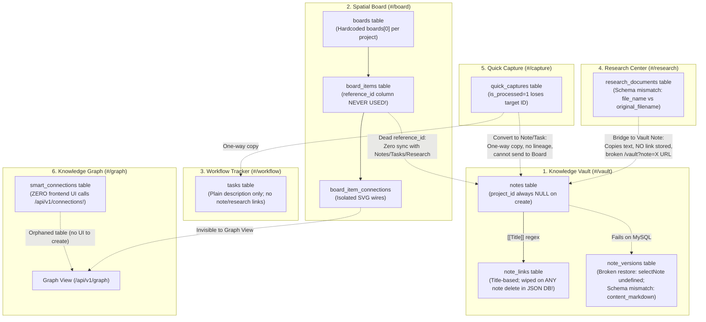
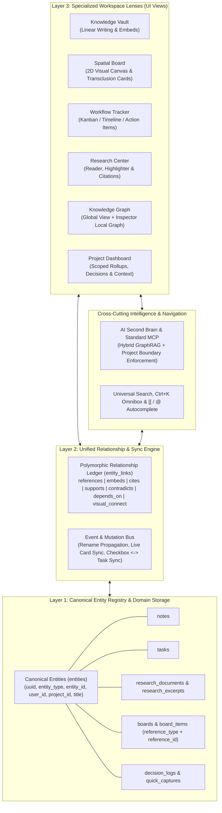
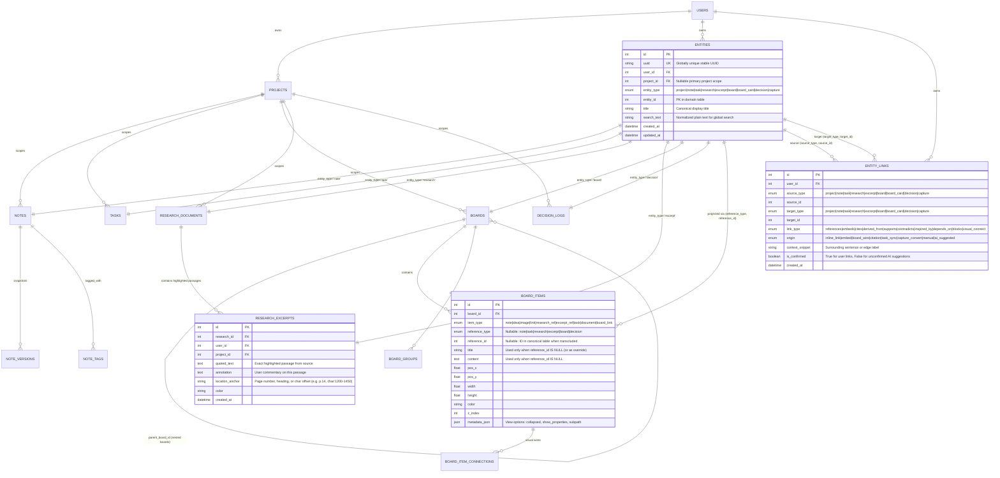
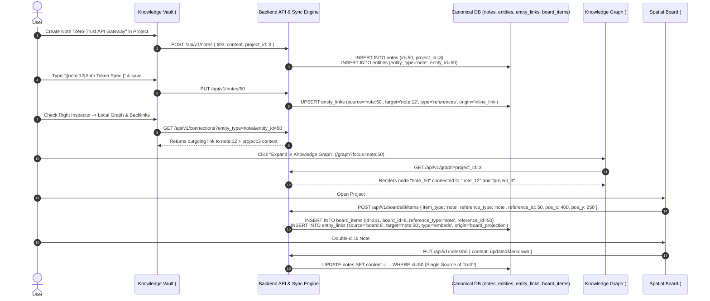
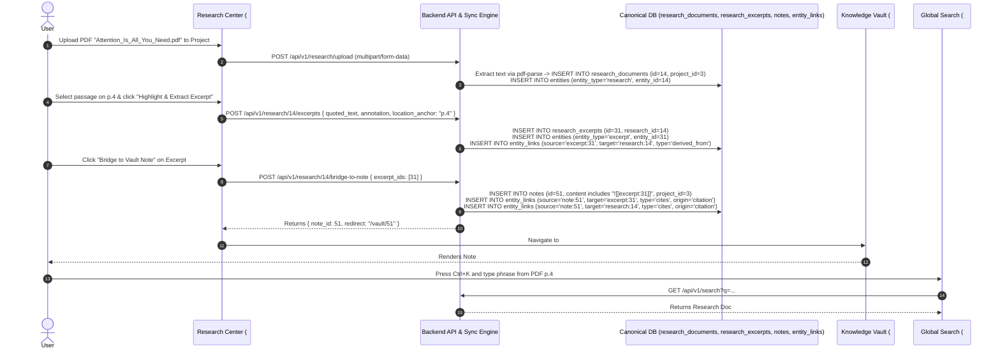
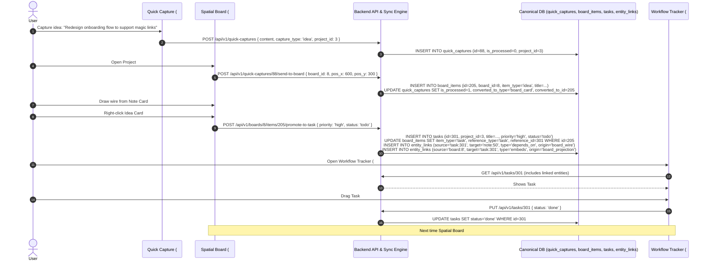
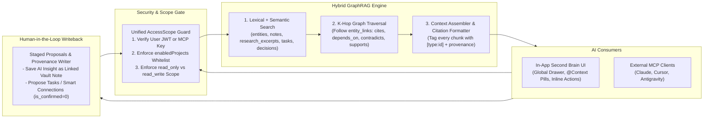
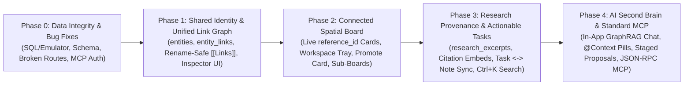

# FLOWDEN: Deep Research & Unified Ecosystem Blueprint

**Document Status:** Architectural Research & Ecosystem Blueprint (Research Only — No Code Modified)  
**Date:** 2026-11-03  
**Target System:** FLOWDEN (`c:\Users\Sod\.gemini\antigravity\scratch\flowden`)  
**Reference Platforms:** Notion, Milanote, Obsidian  

---

## Epistemic Status Legend

Throughout this blueprint, statements and findings are explicitly categorized to separate empirical evidence from architectural proposals:

- **[EXISTING FUNCTIONALITY]**: Verified behavior currently working in the FLOWDEN codebase, cited with file paths and line numbers.
- **[VERIFIED PROBLEM]**: Concrete bugs, schema mismatches, dead UI controls, security flaws, or architectural silos confirmed by source code inspection.
- **[DOCUMENTED FACT]**: Verified architectural or product behavior of Notion, Milanote, Obsidian, JSON Canvas, or the Model Context Protocol (MCP) from official documentation.
- **[PROPOSED IMPROVEMENT]**: Recommended architectural, data-model, or UX design to unify FLOWDEN into a single connected ecosystem.
- **[UNVERIFIED ASSUMPTION]**: Hypotheses regarding scale, deployment targets, or user behavior that cannot be proven from static repository inspection alone.
- **[OPEN TECHNICAL DECISION]**: Engineering trade-offs requiring explicit team sign-off before implementation begins.

---

## 1. Executive Summary

### 1.1 The Core Problem: Six Isolated CRUD Silos Inside One Shell

FLOWDEN aspires to synthesize the structured pages and relational databases of **Notion**, the spatial boards and visual thinking of **Milanote**, and the networked knowledge graph and bi-directional linking of **Obsidian**. Visually, FLOWDEN presents a cohesive, high-craft interface (`public/css/main.css`, `public/js/app.js`) with modules for the **Knowledge Vault**, **Spatial Board**, **Knowledge Graph**, **Workflow Tracker**, **Research Center**, **Quick Capture**, **Project Dashboard**, and **AI Assistant (MCP)**.

However, an exhaustive audit of the backend (`server/`) and frontend (`public/js/`) reveals that **FLOWDEN currently operates as six disconnected CRUD silos sharing only a top-level `user_id` and an optional `project_id` foreign key**:

1. **Spatial Board items are dead copies, not live workspace entities (`[VERIFIED PROBLEM]`)**: Although the `board_items` table (`server/migrations/001_initial_schema.sql:64-85`) includes a `reference_id` column and `item_type` values for `'note'`, `'task'`, and `'research_ref'`, the frontend canvas (`public/js/pages/board.js:1688-1855`) **never reads, sets, or renders `reference_id`**. Creating a "Note Card" or "Task Deliverable" on a Spatial Board creates an isolated row in `board_items` that never appears in the Knowledge Vault, Workflow Tracker, or Knowledge Graph.
2. **Three incompatible relationship tables that do not talk to each other (`[VERIFIED PROBLEM]`)**:
   - Wiki-links between notes are stored in `note_links` (`001_initial_schema.sql:150-158`) using fragile exact-title matching (`server/models/Note.js:232-251`) that silently deletes links when a note title is renamed.
   - Visual wires on the Spatial Board are stored in `board_item_connections` (`001_initial_schema.sql:87-98`) and are invisible to the Knowledge Graph (`server/routes/graph.js`).
   - Polymorphic semantic links (`smart_connections`, `001_initial_schema.sql:255-268`) have backend routes (`server/routes/connections.js`) and graph rendering (`server/routes/graph.js:172-192`), **but zero frontend UI calls `/api/v1/connections` anywhere in `public/js/`**. Users have no way to create, edit, or delete `smart_connections`.
3. **One-way "Copy & Forget" bridges lose provenance (`[VERIFIED PROBLEM]`)**:
   - Clicking **"Bridge to Vault Note"** in the Research Center (`public/js/pages/research.js:350-366`) copies the summary text into a new note without recording a foreign key or `smart_connection` back to the source `research_documents.id`, and then navigates to a broken route (`/vault?note=X` instead of `/vault/X`).
   - Converting a **Quick Capture** into a Note or Task (`server/routes/quickCaptures.js:43-77`) marks `is_processed = 1` and discards the ID of the newly created entity.
4. **Critical Data Layer & Local SQL Emulator Corruption (`[VERIFIED PROBLEM]`)**:
   - FLOWDEN's embedded JSON database engine (`server/config/database.js:168-234`) uses a naive regex `WHERE` parser (`/([a-zA-Z0-9_]+)\s*=\s*\?/i`) that fails on table aliases (`n.user_id = ?`) and `OR` clauses. Consequently, `Note.findAll` (`server/models/Note.js:5-20`) returns **all notes across all users, folders, and projects**, and `Note.delete` (`server/models/Note.js:206`, `DELETE FROM note_links WHERE source_note_id = ? OR target_note_id = ?`) **wipes every row in `note_links` across the entire database whenever a single note is deleted**.
   - Multiple SQL queries reference non-existent schema columns (`note_versions.content_markdown`, `research_documents.file_name`, `boards.viewport_state`, `decision_logs.status`), causing silent failures or crashes when switched from the JSON emulator to MySQL.
5. **AI Assistant is an external MCP testing console with un-enforced security boundaries (`[VERIFIED PROBLEM]`)**:
   - `public/js/pages/assistant.js` provides no in-app AI chat, synthesis, or Q&A; it only generates an API key and tests 5 read-only MCP endpoints.
   - Despite UI assurances of strict project isolation (`assistant.js:222`), `server/mcp/middleware/mcpAuth.js` and the 5 MCP tools (`server/mcp/tools/*.js`) **never check `settings_json.mcp.enabledProjects`**, exposing every project and note to any valid token.

### 1.2 The Architectural Thesis: One Canonical Graph, Multiple Specialized Lenses

To answer the central question—*"How can all of FLOWDEN's different systems operate as one connected knowledge ecosystem instead of isolated features?"*—FLOWDEN must transition from **module-owned data silos** to a **Unified Canonical Entity & Relationship Graph** viewed through specialized workspace lenses:

- **Canonical Entities (`entities` + Domain Tables)**: Every Note, Task, Research Document, Research Excerpt, Project, Board, Decision Log, and Board Card shares a globally addressable identity (`entity_type`, `entity_id`, `uuid`) and common metadata (`title`, `project_id`, `tags`, `updated_at`).
- **One Polymorphic Relationship Graph (`entity_links`)**: Unifies `note_links`, `smart_connections`, and semantic `board_item_connections` into a single, ID-backed, rename-safe relationship ledger supporting typed edges (`references`, `embeds`, `derived_from`, `cites`, `supports`, `contradicts`, `depends_on`, `blocks`, `visual_connect`).
- **Spatial Board as a Transclusion & Visual Thinking Lens**: Inspired by **Obsidian JSON Canvas (`type: "file"` vs `type: "text"`)** and **Notion Synced Blocks**, `board_items` actively utilizes `reference_type` + `reference_id`. Placing an existing Vault Note, Task, or Research Excerpt on a Spatial Board renders a **live transcluded card** that reads and writes directly to the canonical record without duplication, while rapid brainstorming uses lightweight canvas-native cards that can be promoted to Vault Notes or Workflow Tasks in one click.
- **Knowledge Vault as a Polymorphic Editor**: Supports stable ID-backed `[[entity_type:id|Display Title]]` links and `![[...]]` transclusions across Notes, Tasks, Research Sources, Projects, and Boards, plus synchronized action items (`- [ ]`) connected to the Workflow Tracker.
- **AI Second Brain via Hybrid GraphRAG + Enforced MCP**: Combines full-text/vector retrieval with 1-to-2 hop traversal over `entity_links`, enforces project-level permissions in `mcpAuth.js`, and ensures AI outputs are grounded in citable workspace entities and saved back as linked notes or staged task proposals.

---

## 2. FLOWDEN Current Architecture Audit

### 2.1 System Stack & Dual-Storage Architecture

- **Runtime & Backend (`[EXISTING FUNCTIONALITY]`)**: Node.js + Express (`server/app.js`, `server/index.js`) serving a REST API under `/api/v1/*`, an MCP endpoint under `/mcp/*` (`server/routes/mcp.js`), and static frontend assets from `public/`.
- **Frontend (`[EXISTING FUNCTIONALITY]`)**: Vanilla ES Modules SPA (`public/js/app.js`, `public/js/router.js`) using hash routing (`#/overview`, `#/vault`, `#/board`, `#/graph`, `#/workflow`, `#/research`, `#/capture`, `#/projects`, `#/assistant`, `#/search`).
- **Persistence Layer (`[EXISTING FUNCTIONALITY]`)**: `server/config/database.js` attempts to connect to MySQL (`mysql2/promise`) and falls back (`lines 42-69`) to a custom in-memory + file-persisted JSON store (`data/flowden_local_db.json`) with a regex-based SQL emulator (`executeLocalQuery`, `lines 72-246`).

#### Critical Data Layer & SQL Emulator Findings (`[VERIFIED PROBLEM]`)

| Finding ID | Component & Location | Verified Issue | Impact |
| :--- | :--- | :--- | :--- |
| **DB-01** | `server/config/database.js:168-234` & `server/models/Note.js:5-20` | `filterRows()` parses `WHERE` clauses using `/^([a-zA-Z0-9_]+)\s*=\s*\?$/i` (`line 182`). `Note.findAll()` uses table alias `n.` (`WHERE n.user_id = ?`, `n.folder_id = ?`, `n.project_id = ?`). Because `.` is not matched by `[a-zA-Z0-9_]+`, every `n.*` condition falls through to `line 227`, leaving `matchesAll = true`. | In local JSON mode, `GET /api/v1/notes` **ignores `user_id`, `folder_id`, and `project_id`**, leaking all users' notes and breaking folder/project filtering. |
| **DB-02** | `server/config/database.js:171` & `server/models/Note.js:206` | `filterRows()` splits only on `\s+and\s+` and has zero support for `OR` or parentheses. `Note.delete()` executes `DELETE FROM note_links WHERE source_note_id = ? OR target_note_id = ?`. The unparsed `OR` clause falls through with `matchesAll = true`. | **Deleting any single note deletes 100% of rows in `note_links` across the entire database** in local JSON mode. |
| **DB-03** | `server/models/Connection.js:12` & `server/mcp/tools/getConnections.js:23` | Both queries use parenthesized `OR` conditions (`WHERE user_id = ? AND ((source_type = ? AND ...) OR (...))`). In local JSON mode, the parenthesized `OR` condition is ignored. | `GET /api/v1/connections?entity_type=X&entity_id=Y` and MCP `get_connections` return **all connections in the workspace** instead of filtering by the requested entity. |
| **DB-04** | `server/migrations/001_initial_schema.sql:160-171` vs `server/models/Note.js:140,150` & `server/routes/notes.js:156,169,200` | SQL schema defines `note_versions (id, note_id, title, content, version_number, created_by, created_at)`. Code queries/inserts `user_id` and `content_markdown`. | On MySQL, version snapshotting silently fails (`catch (verErr)` at `Note.js:154`) and `GET /notes/:id/versions` throws `ER_BAD_FIELD_ERROR`. |
| **DB-05** | `001_initial_schema.sql:173-192` vs `server/routes/research.js:151` & `server/routes/search.js:32,56` | Schema defines `original_filename` and lacks `tags_json`. `research.js:151` inserts `file_name` and `tags_json`; `search.js:32,56` selects `original_filename`. | On MySQL, uploading research fails (`Unknown column 'file_name'`). In JSON mode, `search.js` returns `title: undefined` for uploaded research documents. |
| **DB-06** | `server/mcp/tools/readProject.js:26-27` vs `001_initial_schema.sql:46-62, 224-239` | `readProject.js` selects `viewport_state` from `boards` (actual columns: `zoom_level, viewport_x, viewport_y`) and `status, decision_context` from `decision_logs` (actual columns: `context, decision, outcome`). | Fails with SQL column errors on MySQL and returns `undefined` fields in MCP `read_project` output. |

---

### 2.2 Module-by-Module Implementation Audit

#### 1. Knowledge Vault & Notes (`public/js/pages/vault.js`, `server/routes/notes.js`, `server/models/Note.js`)
- **Existing Functionality (`[EXISTING FUNCTIONALITY]`)**:
  - Hierarchical folders (`folders.parent_folder_id`, `001_initial_schema.sql:102-116`) with recursive deletion (`server/routes/notes.js:68-100`).
  - Split/Live/Preview Markdown editor (`vault.js:595-642`), word count, auto-save (`vault.js:649-684`), and starter templates (`vault.js:735-777`).
  - Forward wiki-link parsing via regex `/\[\[([^\]]+)\]\]/g` (`Note.js:221-251`) and a right-hand Context Inspector showing Outgoing Links and Backlinks (`vault.js:522-575`).
- **Verified Problems & Missing Links (`[VERIFIED PROBLEM]`)**:
  - **Broken Version Restore (`vault.js:823`)**: Clicking "Restore" on a version calls `await selectNote(restRes.note.id)`, throwing `ReferenceError: selectNote is not defined` (the function is `openNote` at `line 490`).
  - **Notes Created Orphaned from Projects (`vault.js:863-872`)**: `createNoteAction()` only sends `{ title, content, folder_id }`. There is no UI in the Vault to view or set a note's `project_id`, move a note to another folder, or toggle `is_pinned`.
  - **Dead Tag Container (`vault.js:127`)**: `<div class="note-tags" id="note-tags-container"></div>` is rendered in the editor header but never populated or wired to `note_tags` (`Note.js:254-275`).
  - **Fragile Title-Based Wiki-Links (`Note.js:232-251`)**: `syncWikiLinks()` matches `[[Title]]` by exact string equality (`WHERE user_id = ? AND title = ?`). Renaming Note B does **not** update `[[Old Title]]` in Note A; the next time Note A is saved, `syncWikiLinks` deletes all its `note_links` (`line 233`) and fails to resolve the renamed target, silently severing the link.
  - **Note-Only Wiki-Links & No Autocomplete**: `[[...]]` cannot reference Tasks, Projects, Research Documents, Decision Logs, or Board Cards, and typing `[[` offers no autocomplete popover.
  - **Dead Task Checkboxes (`vault.js:932-933`)**: Markdown `- [ ]` renders as `<input type="checkbox" disabled />`. Action items written inside notes cannot be toggled in preview mode and have zero connection to the `tasks` table in Workflow Tracker.

#### 2. Spatial Board (`public/js/pages/board.js`, `server/routes/boards.js`, `server/models/Board.js`)
- **Existing Functionality (`[EXISTING FUNCTIONALITY]`)**:
  - Infinite 2D pan/zoom canvas (`board.js:353-530`), multi-selection marquee, snap-to-grid, alignment/distribution tools, minimap (`board.js:1460-1540`), visual groups (`board_groups`), and SVG bezier connection wires (`board_item_connections`, `board.js:1165-1330`).
- **Verified Problems & Isolation (`[VERIFIED PROBLEM]`)**:
  - **Dead `reference_id` Column (`001_initial_schema.sql:78`, `board.js:1688-1855`)**: While `board_items` has a `reference_id` column in the schema and model (`Board.js:60,81`), `board.js` never passes or reads `reference_id`. Creating a "Note Card", "Task Deliverable", or "Research Reference" on the canvas (`board.js:1689-1693`) only inserts a static text row into `board_items`.
  - **No Drag-from-Vault or Promote-to-Task/Note**: Users cannot place an existing Vault Note, Workflow Task, or Research Document onto the Spatial Board, nor can they convert a brainstormed Board Card into a Vault Note or Workflow Task.
  - **Isolated Wire Graph**: Wires drawn between cards (`board_item_connections`) only link `board_items.id` to `board_items.id` and are completely absent from `/api/v1/graph` (`server/routes/graph.js`).
  - **Single-Board-Per-Project Limitation (`board.js:19-23`)**: `board.js` fetches `/boards/project/${projectId}` and hard-selects `bData.boards[0]`. There is no UI for multiple boards per project, standalone boards, or Milanote-style nested sub-boards (boards inside boards).

#### 3. Knowledge Graph (`public/js/pages/graph.js`, `server/routes/graph.js`, `server/routes/connections.js`)
- **Existing Functionality (`[EXISTING FUNCTIONALITY]`)**:
  - Force-directed HTML5 Canvas graph (`graph.js`) rendering `project`, `note`, `task`, and `research` nodes with category filters, search highlighting, physics controls, and a side inspector panel.
- **Verified Problems & Missing Links (`[VERIFIED PROBLEM]`)**:
  - **Zero UI for `smart_connections`**: Although `server/routes/connections.js` exposes `GET/POST/DELETE /api/v1/connections` and `server/routes/graph.js:172-192` renders them as semantic edges, **no frontend file in `public/js/` ever calls `/api/v1/connections`**. Users cannot create semantic links (`supports`, `contradicts`, `inspired_by`, `depends_on`, `related_to`) from the Graph, Vault, Research Center, or Workflow Tracker.
  - **Spatial Boards & Decision Logs Excluded from Graph**: `server/routes/graph.js` never queries `boards`, `board_items`, `board_item_connections`, or `decision_logs`.
  - **Shallow Deep-Links (`server/routes/graph.js:115,150`)**: Clicking "Open in Workflow" on a Task node navigates to `#/workflow` without selecting or highlighting the task; clicking "Open in Research" on a Research node navigates to `#/research` without opening the document.
  - **Unfiltered Project Graph (`public/js/pages/projectDashboard.js:177`, `graph.js:169`)**: Clicking "Project Knowledge Graph" on a Project Dashboard navigates to `/graph` globally without filtering to that project's neighborhood.

#### 4. Research Center (`public/js/pages/research.js`, `server/routes/research.js`)
- **Existing Functionality (`[EXISTING FUNCTIONALITY]`)**:
  - Supports uploading `.pdf` (`pdf-parse`), `.docx` (`mammoth`), `.txt`, `.md` files (`server/routes/research.js:61-165`) and saving web URL bookmarks (`lines 168-218`), with heuristic key-point extraction (`lines 17-37`).
- **Verified Problems & Missing Links (`[VERIFIED PROBLEM]`)**:
  - **Broken & Unlinked "Bridge to Vault Note" (`public/js/pages/research.js:350-366`)**:
    1. Creates a new note via `POST /notes` by copying text, but records **no foreign key, citation link, or `smart_connection`** to `doc.id`.
    2. Calls `window.appRouter.navigate('/vault?note=' + res.note.id)` (`line 362`), whereas `app.js:47` registers `/vault/:noteId`. The router fails to parse `?note=`, so the newly bridged note does not open.
  - **No Excerpt Highlighting or Citation Anchors**: Extracted text (`content_text`) is rendered in a static `<div>` (`research.js:342`). Users cannot highlight passages to extract atomic citations or link claims in a Vault Note back to a specific paragraph/page of a source document.

#### 5. Workflow Tracker & Quick Capture (`public/js/pages/workflow.js`, `public/js/pages/capture.js`, `server/routes/tasks.js`, `server/routes/quickCaptures.js`)
- **Existing Functionality (`[EXISTING FUNCTIONALITY]`)**:
  - Kanban board (`todo`, `in_progress`, `review`, `done`), List view, Priority Matrix, and Timeline view (`workflow.js`), plus Quick Capture inbox (`capture.js`).
- **Verified Problems & Missing Links (`[VERIFIED PROBLEM]`)**:
  - **Tasks Cannot Link to Context**: `tasks` (`001_initial_schema.sql:194-211`) only has `project_id`. A task cannot attach or reference the Vault Notes, Research Documents, Spatial Board cards, or Decision Logs needed to complete it.
  - **Quick Capture Lineage Lost (`server/routes/quickCaptures.js:43-77`)**: Converting a capture creates a Note or Task and sets `is_processed = 1`, without storing `converted_entity_type` / `converted_entity_id` or allowing conversion into a Spatial Board card (`Unsorted Notes` inbox workflow).
  - **Mislabeled Capture Type (`public/js/pages/capture.js:23`)**: The third capture button is labeled `"Reference"` with `data-type="image"`, storing plain text under `capture_type = 'image'`.

#### 6. Projects, Overview, Search & Command Palette (`projects.js`, `projectDashboard.js`, `overview.js`, `search.js`, `commandPalette.js`)
- **Verified Problems (`[VERIFIED PROBLEM]`)**:
  - **Overview Research Metric Hardcoded to `0` (`public/js/pages/overview.js:68, 131-143`)**: `#metric-research-count` is hardcoded to `0` and `/research` is never fetched.
  - **Search UI Drops Research Results (`public/js/pages/search.js:55-105`)**: `server/routes/search.js:59-69` returns `results.research` and counts them in `total`, but `public/js/pages/search.js` only renders `projects`, `notes`, and `tasks`—silently hiding all matched research documents!
  - **Incomplete Backend Search (`server/routes/search.js:19-39`)**: Does not search `research_documents.content_text`, `board_items`, `board_groups`, `decision_logs`, or `note_tags`.
  - **Static Command Palette (`public/js/components/commandPalette.js:9-29`)**: `Ctrl+K` only filters 16 hardcoded navigation links. It does not query `/api/v1/search` to jump to notes, tasks, boards, projects, or research.

#### 7. AI Assistant & MCP Server (`public/js/pages/assistant.js`, `server/mcp/*`)
- **Existing Functionality (`[EXISTING FUNCTIONALITY]`)**:
  - Exposes `GET /mcp/tools` and `POST /mcp/call` (`server/routes/mcp.js`) with 5 read tools (`search_notes`, `read_project`, `get_tasks`, `get_research`, `get_connections`) and an interactive test console in `assistant.js`.
- **Verified Problems (`[VERIFIED PROBLEM]`)**:
  - **Project Boundary Bypass (`server/mcp/middleware/mcpAuth.js:18-40` & `server/mcp/tools/*.js`)**: In `assistant.js:222, 321-329`, users configure `enabledProjects` ("Strict boundary: Only checked projects are accessible to external MCP models") and `scope` (`read_only` vs `read_write`). However, `mcpAuth.js` only sets `req.mcpUser = { id, email, role }` and discards `settings.mcp.enabledProjects` and `settings.mcp.scope`. None of the 5 MCP tools filter by `enabledProjects`.
  - **No In-App AI Workspace Experience**: There is no in-app AI assistant to answer questions across projects, summarize research into linked notes, or suggest connections.
  - **Non-Standard MCP Protocol**: Uses a custom REST `/mcp/tools` and `/mcp/call` JSON payload rather than standard MCP JSON-RPC 2.0 (`initialize`, `tools/list`, `tools/call`, `resources/list`, `resources/read`) over Streamable HTTP or SSE.

---

## 3. Notion Feature Research and Comparison

### 3.1 Analysis of Core Notion Mechanisms

#### A. Unified Block & Page Data Model
1. **How it works in Notion (`[DOCUMENTED FACT]`)**: In Notion's architecture, almost every piece of content—a paragraph, heading, to-do item (`to_do`), image, page (`page`), or database row—is a **Block Object** with a globally unique UUID, `type`, `properties`, `content` (ordered array of child block IDs), and `parent` pointer. A "Page" is simply a block capable of rendering as a full document view, and a database item is a page whose properties conform to its parent database's schema (Sources: Notion API Block & Page Object Reference, accessed 2026-11-03).
2. **What problem it solves**: Eliminates impedance mismatch between content types. Because a task, a note, and a project row are all pages/blocks, any item can contain rich child blocks, be linked via `@mention`, or be transformed (`Turn into`) from a bullet point into a task or sub-page without losing its identity or backlinks.
3. **How FLOWDEN currently handles it (`[EXISTING FUNCTIONALITY]`)**: FLOWDEN stores `projects`, `notes`, `tasks`, `research_documents`, `board_items`, `decision_logs`, and `quick_captures` in completely separate SQL tables (`001_initial_schema.sql`) with integer `AUTO_INCREMENT` IDs scoped only to their own table.
4. **What is missing or implemented differently (`[VERIFIED PROBLEM]`)**: A `task` row in FLOWDEN has only a plain-text `description` (`001_initial_schema.sql:198`) and cannot contain structured Markdown sub-notes or child blocks; a `note` cannot be viewed as a row in a workflow board; and converting an item requires copying text into a different table.
5. **Whether and how it should be adapted into FLOWDEN (`[PROPOSED IMPROVEMENT]`)**: **Do NOT rewrite FLOWDEN into a fine-grained per-paragraph block database** (which adds massive operational complexity and breaks clean Markdown editing). Instead, adopt Notion's **Unified Entity Identity (`entities` registry)** at the document/item level so Notes, Tasks, Research Documents, Excerpts, Projects, Boards, and Cards share a unified UUID/entity address space, rich Markdown bodies, and seamless `Turn Into / Promote` transformations.

#### B. Synced Blocks (Transclusion)
1. **How it works in Notion (`[DOCUMENTED FACT]`)**: A `synced_block` allows an original block (and its children) to be referenced across multiple pages via a `synced_from: { block_id }` pointer. Editing the content in any location mutates the canonical block, updating all instances in real time (Source: Notion Help Center & API Reference, accessed 2026-11-03).
2. **What problem it solves**: Prevents copy-paste drift when the same meeting action items, project brief, or research summary must appear in both a knowledge doc and a project dashboard.
3. **How FLOWDEN currently handles it (`[VERIFIED PROBLEM]`)**: FLOWDEN copies strings across tables (e.g., Research "Bridge to Vault Note" at `research.js:355`, Spatial Board cards at `board.js:1688`).
4. **What is missing**: Zero live transclusion between Vault Notes, Spatial Board cards, and Project Dashboards.
5. **Adaptation into FLOWDEN (`[PROPOSED IMPROVEMENT]`)**: Implement **Entity-Level & Section-Level Transclusion** (`![[note:42]]` or `![[research:12#excerpt-5]]` in Markdown, and live `reference_type` + `reference_id` cards on the Spatial Board).

#### C. Relational Databases, Two-Way Relations & Rollups
1. **How it works in Notion (`[DOCUMENTED FACT]`)**: A Database defines a property schema (`status`, `date`, `person`, `relation`, `rollup`). A `dual_property` Relation links rows between two databases (e.g., *Projects* ↔ *Tasks* or *Tasks* ↔ *Notes*) as an array of target page UUIDs, automatically maintaining the inverse property on the target database. Rollups aggregate properties across a relation (e.g., `% of Tasks Done` or count of linked Research sources) (Source: Notion API Property Object & Database Reference, accessed 2026-11-03).
2. **What problem it solves**: Connects execution (Tasks/Projects) with knowledge (Notes/Research) using structured metadata and automated progress rollups.
3. **How FLOWDEN currently handles it (`[EXISTING FUNCTIONALITY]`)**: Hardcodes a single nullable `project_id` column on `notes`, `tasks`, `boards`, `research_documents`, and `decision_logs`.
4. **What is missing (`[VERIFIED PROBLEM]`)**: Tasks cannot relate to Notes or Research; Notes cannot belong to multiple projects or relate to Tasks; and Vault Notes lack structured frontmatter/property editors (`vault.js:127`).
5. **Adaptation into FLOWDEN (`[PROPOSED IMPROVEMENT]`)**: Keep specialized tables for `projects`, `tasks`, `notes`, and `research_documents` (avoiding the complexity of user-defined custom SQL schemas), but connect them with **Two-Way Relational Properties** backed by the unified `entity_links` table and expose structured property headers in the Vault, Task modal, and Research drawer.

#### D. `@Mentions`, Backlinks & Workspace AI Q&A
1. **How it works in Notion (`[DOCUMENTED FACT]`)**: Typing `@` anywhere in a page or property opens an omnibox searching pages, people, and dates. Mentioning a page inserts a live UUID pointer that updates its label automatically if the target page is renamed and registers an automatic backlink on the target page. **Notion AI Q&A** indexes pages and database properties across the workspace (respecting user permissions) to answer natural-language queries with inline clickable citations `[1]` to the source pages (Source: Notion Help Center, accessed 2026-11-03).
2. **How FLOWDEN currently handles it (`[VERIFIED PROBLEM]`)**: No `@` omnibox exists; `[[Title]]` only matches Notes by exact title string; AI Assistant is only an external MCP configuration screen (`assistant.js`).
3. **Adaptation into FLOWDEN (`[PROPOSED IMPROVEMENT]`)**: Add universal `[[` and `@` autocomplete across all entity types, store stable entity IDs under the hood, and provide an in-app **Second Brain AI Q&A drawer** with clickable `[Entity]` citations.

### 3.2 Notion vs. FLOWDEN Comparison Matrix

| Capability | Notion (`[DOCUMENTED FACT]`) | Current FLOWDEN (`[EXISTING]` / `[VERIFIED PROBLEM]`) | Recommended FLOWDEN Adaptation (`[PROPOSED IMPROVEMENT]`) |
| :--- | :--- | :--- | :--- |
| **Core Unit** | Fine-grained UUID Block (`paragraph`, `to_do`, `page`) | Isolated SQL rows per module (`notes`, `tasks`, `board_items`) | Canonical **Workspace Entity** (`entities` registry + Markdown body) |
| **Cross-Type Linking** | `@Page` / Relation property across any page or DB item | `[[Title]]` links Notes to Notes only; breaks on rename | Polymorphic `[[type:id\|Title]]` & `entity_links` across all modules |
| **Live Reuse (Sync)** | Synced Blocks (`synced_from.block_id`) | Manual copy-paste or one-way copy ("Bridge to Note") | Transcluded Board Cards (`reference_id`) & Markdown `![[type:id]]` embeds |
| **Tasks + Context** | Every Task row is a full Page with child notes & relations | Task has only plain text `description` + `project_id` | Tasks have Markdown body + bidirectional `entity_links` to Notes/Research/Cards |
| **AI Workspace Q&A** | Permission-aware RAG + inline page citations | External MCP test console only (`assistant.js`); project filter broken | Built-in Second Brain Chat + GraphRAG + strictly enforced MCP scopes |

---

## 4. Milanote Feature Research and Comparison

### 4.1 Analysis of Core Milanote Mechanisms

#### A. Infinite Visual Boards & Nested Sub-Boards
1. **How it works in Milanote (`[DOCUMENTED FACT]`)**: Everything lives on visual spatial canvases called **Boards**. Critically, a **Board is itself a card that can be placed inside another Board**, creating an infinite hierarchy of nested boards navigated via a top-left breadcrumb trail (e.g., `Home > Brand Redesign > Moodboard > Typography`) (Source: Milanote Help Center — Boards & Nested Boards, accessed 2026-11-03).
2. **What problem it solves**: Allows spatial thinkers to organize both macro-level project architecture and micro-level visual brainstorms using the same spatial paradigm, without hitting a flat single-canvas ceiling.
3. **How FLOWDEN currently handles it (`[VERIFIED PROBLEM]`)**: `public/js/pages/board.js:19-23` fetches `/boards/project/${projectId}` and hard-selects `bData.boards[0]`. There is no UI to create multiple boards in a project, no standalone boards outside a project, and no `board_link` item type to nest a sub-board inside a parent board.
4. **Adaptation into FLOWDEN (`[PROPOSED IMPROVEMENT]`)**: Add `parent_board_id` to `boards` and support `'board'` as a `reference_type` in `board_items`. Double-clicking a Sub-Board card on the Spatial Board navigates into that board and updates a spatial breadcrumb trail in the board header.

#### B. Cards vs. Long-Form Documents on Canvas
1. **How it works in Milanote (`[DOCUMENTED FACT]`)**: Milanote distinguishes between lightweight **Note Cards** (short sticky notes/snippets on the canvas), **To-Do Cards** (interactive checklists on the canvas), **Link/Image Cards** (rich visual previews), **Columns** (vertical containers that group cards), and **Document Cards** (long-form rich-text documents that appear as compact preview cards on the canvas and open a focused split/modal editor when double-clicked) (Source: Milanote Help Center — Cards & Documents, accessed 2026-11-03).
2. **What problem it solves**: Keeps the 2D canvas uncluttered while keeping long-form specifications and research briefs spatially anchored next to moodboards and tasks.
3. **How FLOWDEN currently handles it (`[VERIFIED PROBLEM]`)**: `board_items` (`001_initial_schema.sql:68`) defines `item_type ENUM('note', 'idea', 'image', 'link', 'research_ref', 'task', 'document')`, but in `board.js:900-1080`, all text-based cards simply render truncated inline text on the canvas with an inline `<textarea>` editor—none of them link to or open a Knowledge Vault Note, Workflow Task, or Research Document.
4. **Adaptation into FLOWDEN (`[PROPOSED IMPROVEMENT]`)**: Unify Milanote's **Document Card** concept with FLOWDEN's **Knowledge Vault**: a Document/Note card on the Spatial Board references a canonical `notes.id` (`reference_type = 'note'`, `reference_id = note.id`). Double-clicking it opens the full Vault Note in a slide-over split drawer right alongside the canvas. Similarly, a Task Card references a canonical `tasks.id` with a live interactive checkbox and status badge on the canvas.

#### C. Unsorted Notes Inbox Drawer (Capture-to-Canvas Workflow)
1. **How it works in Milanote (`[DOCUMENTED FACT]`)**: When users clip web pages via the Milanote Web Clipper, capture thoughts on mobile, or do a rapid brain dump, items land in the collapsible **Unsorted Notes** sidebar drawer on the board. Users then drag items from Unsorted Notes directly onto the 2D canvas to arrange and connect them spatially (Source: Milanote Help Center — Unsorted Notes, accessed 2026-11-03).
2. **What problem it solves**: Bridges rapid, linear, zero-friction capture with deliberate spatial organization.
3. **How FLOWDEN currently handles it (`[VERIFIED PROBLEM]`)**: FLOWDEN has a dedicated **Quick Capture** page (`public/js/pages/capture.js`), but captures live on a separate route (`#/capture`) and can only be converted via modal into a Vault Note or Workflow Task (`server/routes/quickCaptures.js:43-77`). There is no way to view or drag Quick Captures onto the Spatial Board.
4. **Adaptation into FLOWDEN (`[PROPOSED IMPROVEMENT]`)**: Add a collapsible **"Workspace Inbox & Vault Tray"** drawer inside the Spatial Board (`board.js`). Users can drag unprocessed **Quick Captures**, **Vault Notes**, **Research Documents**, and **Workflow Tasks** directly from this tray onto the canvas!

#### D. Visual Connections (Lines & Labelled Arrows)
1. **How it works in Milanote (`[DOCUMENTED FACT]`)**: Users drag connection handles between any two cards or containers to draw directional arrows with optional text labels, visually mapping flows and dependencies.
2. **How FLOWDEN currently handles it (`[EXISTING FUNCTIONALITY]` / `[VERIFIED PROBLEM]`)**: `board.js:1165-1330` implements SVG bezier wires stored in `board_item_connections` (`label`, `color`, `line_style`), which works visually on the canvas, **but is completely invisible to the Knowledge Graph and Vault Backlinks**.
3. **Adaptation into FLOWDEN (`[PROPOSED IMPROVEMENT]`)**: When a user draws a visual wire on the Spatial Board between two cards that reference canonical entities (e.g., Note A → Task B, or Research Doc C → Note A), FLOWDEN automatically synchronizes a corresponding semantic edge in `entity_links` so that visual thinking on the Board immediately enriches the Knowledge Graph and Backlink panels!

### 4.2 Milanote vs. FLOWDEN Comparison Matrix

| Capability | Milanote (`[DOCUMENTED FACT]`) | Current FLOWDEN (`[EXISTING]` / `[VERIFIED PROBLEM]`) | Recommended FLOWDEN Adaptation (`[PROPOSED IMPROVEMENT]`) |
| :--- | :--- | :--- | :--- |
| **Board Hierarchy** | Infinite nested sub-boards + breadcrumb trail | Hardcoded `boards[0]` per project (`board.js:23`); flat | Multiple boards per project + nested `sub-board` cards + breadcrumbs |
| **Long-Form Docs on Board** | Document Card opens focused writer while living on board | Static `board_items` text; disconnected from Vault Notes | Live transcluded Vault Note card (`reference_type='note'`); opens split drawer |
| **Unsorted Inbox Drawer** | Sidebar tray on board for dragging captures onto canvas | Isolated `#/capture` page; cannot convert or drag to board | Collapsible **Capture & Entity Tray** inside Spatial Board for drag-and-drop |
| **Task Cards on Board** | Interactive To-Do cards & Kanban columns | Static `item_type='task'` text box; not in `tasks` table | Live Task Card synced with `tasks` table (status toggleable on canvas) |
| **Connection Wires** | Visual lines/labels between cards on a single board | `board_item_connections` isolated from Knowledge Graph | Canvas wires between entity-backed cards auto-sync to `entity_links` & Graph |

---

## 5. Obsidian Feature Research and Comparison

### 5.1 Analysis of Core Obsidian Mechanisms

#### A. Internal Links (`[[Wikilinks]]`), Automatic Rename Propagation & Subpath Links
1. **How it works in Obsidian (`[DOCUMENTED FACT]`)**: Obsidian connects Markdown notes via `[[Note Title]]`, `[[Note Title|Custom Alias]]`, heading links `[[Note Title#Heading]]`, and block links `[[Note Title#^block-id]]`. Crucially, Obsidian maintains an in-memory metadata cache of the vault graph and **automatically rewrites all incoming `[[wikilinks]]` across the vault whenever a note is renamed or moved**, ensuring links never rot (Source: Obsidian Help — Internal Links & Rename Notes, accessed 2026-11-03).
2. **What problem it solves**: Enables frictionless associative writing while guaranteeing referential integrity over years of note evolution.
3. **How FLOWDEN currently handles it (`[VERIFIED PROBLEM]`)**: `Note.syncWikiLinks()` (`server/models/Note.js:221-251`) parses `[[Title]]` by exact title match and does **not** update referencing notes when a note's title changes—causing subsequent saves of referencing notes to delete the `note_links` rows.
4. **Adaptation into FLOWDEN (`[PROPOSED IMPROVEMENT]`)**:
   - Support stable ID-backed syntax (`[[note:42|Architecture Overview]]`, `[[task:108|API Migration]]`, `[[research:7|vaswani2017.pdf]]`) inserted via an interactive `[[` autocomplete menu, while continuing to resolve plain `[[Architecture Overview]]` by title.
   - When any entity's `title` is updated (`Note.update`, `Task.update`, `Project.update`, `Research.update`), `entity_links` remain intact because they reference integer/UUID entity IDs, and a background/transactional helper updates display aliases in referencing Markdown documents.

#### B. Backlinks Panel: Linked & Unlinked Mentions
1. **How it works in Obsidian (`[DOCUMENTED FACT]`)**: Every note has a Backlinks pane showing:
   - **Linked Mentions**: Every note that explicitly links to the current note, including the surrounding paragraph context snippet.
   - **Unlinked Mentions**: Every note where the current note's title or alias appears as plain text without brackets, with a one-click **"Link"** button that converts the plain text occurrence into `[[Note Title]]` (Source: Obsidian Help — Backlinks, accessed 2026-11-03).
2. **What problem it solves**: Surfaces serendipitous connections across notes written months apart without requiring the user to remember every existing note title while writing.
3. **How FLOWDEN currently handles it (`[EXISTING FUNCTIONALITY]` / `[VERIFIED PROBLEM]`)**: `vault.js:542-575` renders simple title pills for `links.incoming` (`note_links`), without showing the surrounding sentence snippet, without showing links from Tasks/Boards/Research (`smart_connections` / `board_items`), and without Unlinked Mentions detection.
4. **Adaptation into FLOWDEN (`[PROPOSED IMPROVEMENT]`)**: Upgrade the Context Inspector across Vault, Research, and Workflow to show **Contextual Backlinks** (grouped by source module: Notes, Spatial Boards, Tasks, Research, Decisions, with surrounding text snippets) plus **Unlinked Mentions** with one-click linking.

#### C. Transclusion (`![[Embeds]]`)
1. **How it works in Obsidian (`[DOCUMENTED FACT]`)**: Prefixing a link with `!` (`![[Note]]`, `![[Note#Heading]]`, `![[image.png]]`) renders the target content inline inside the host note (Source: Obsidian Help — Embed files, accessed 2026-11-03).
2. **How FLOWDEN currently handles it (`[VERIFIED PROBLEM]`)**: `renderMarkdown()` (`vault.js:908-958`) converts `[[Title]]` into `<span class="wiki-link">`, with no support for `![[...]]` embeds.
3. **Adaptation into FLOWDEN (`[PROPOSED IMPROVEMENT]`)**: Support `![[note:id]]`, `![[research:id#excerpt-id]]`, and `![[task:id]]` in `renderMarkdown()` to render live embedded cards inside Vault Notes (e.g., embedding a live Research Excerpt quote box or a live Task status widget directly inside a specification note).

#### D. JSON Canvas Open Specification (`.canvas` Architecture)
1. **How it works in Obsidian & JSON Canvas (`[DOCUMENTED FACT]`)**: Obsidian Canvas uses the open **JSON Canvas 1.0** specification (`https://jsoncanvas.org/spec/1.0/`, accessed 2026-11-03). A canvas contains `nodes` and `edges`. Crucially, JSON Canvas distinguishes between:
   - **`type: "text"` nodes**: Canvas-local Markdown cards whose text lives strictly inside the canvas.
   - **`type: "file"` nodes**: Cards that reference an actual file in the vault (`file: "path/to/note.md"`, optional `subpath: "#heading"`), rendering and editing the live vault file directly on the 2D canvas without duplicating it.
   - **`type: "link"` nodes**: External web URLs.
   - **`type: "group"` nodes**: Spatial bounding boxes with `label` and `background`.
2. **What problem it solves**: Solves the exact architectural dilemma between Milanote (freeform cards) and Obsidian (canonical vault notes): **a canvas can hold both ephemeral scratchpad cards (`text`) and live references to canonical vault entities (`file`) side by side!**
3. **How FLOWDEN currently handles it (`[VERIFIED PROBLEM]`)**: Every card on FLOWDEN's Spatial Board behaves like a `type: "text"` node, completely ignoring its own `reference_id` column (`001_initial_schema.sql:78`).
4. **Adaptation into FLOWDEN (`[PROPOSED IMPROVEMENT]`)**: Adopt the JSON Canvas architectural split in `board_items`:
   - When `reference_id IS NULL`, the card is a **Canvas-Local Card** (rapid sticky note / brainstorm idea, with a one-click **"Promote to Vault Note / Task"** action).
   - When `reference_type` + `reference_id` are set, the card is a **Live Entity Projection Card** (rendering the live Vault Note, Workflow Task, Research Document/Excerpt, or nested Sub-Board).
   - Furthermore, support importing/exporting `.canvas` (JSON Canvas 1.0) files for open interoperability!

#### E. Global vs. Local Graph View & Properties
1. **How it works in Obsidian (`[DOCUMENTED FACT]`)**: Alongside the global Graph View, Obsidian provides a **Local Graph** panel that dynamically follows the currently active note, showing its 1-to-3 hop neighborhood filtered by link type or tag. Notes also support **Properties** (YAML frontmatter at the top of the file) with typed fields (`text`, `list`, `number`, `checkbox`, `date`, ` links`) (Source: Obsidian Help — Graph View & Properties, accessed 2026-11-03).
2. **How FLOWDEN currently handles it (`[VERIFIED PROBLEM]`)**: FLOWDEN only has a full-page global `#/graph` view (`public/js/pages/graph.js`) and lacks a Local Graph in the Vault/Project inspector or a working Property editor in the Vault (`vault.js:127`).
3. **Adaptation into FLOWDEN (`[PROPOSED IMPROVEMENT]`)**: Embed an interactive **Mini Local Graph** component in the right-hand Context Inspector of the Knowledge Vault, Research Center, and Project Dashboard, showing the active entity's immediate 1-hop/2-hop cross-module connections.

### 5.2 Obsidian vs. FLOWDEN Comparison Matrix

| Capability | Obsidian (`[DOCUMENTED FACT]`) | Current FLOWDEN (`[EXISTING]` / `[VERIFIED PROBLEM]`) | Recommended FLOWDEN Adaptation (`[PROPOSED IMPROVEMENT]`) |
| :--- | :--- | :--- | :--- |
| **Link Integrity** | Automatic link rewriting across vault on note rename | Exact-title match in `Note.js:239`; rename breaks links | ID-backed `entity_links` + `[[type:id\|Title]]` + auto-alias sync |
| **Backlinks** | Linked Mentions (with context) + Unlinked Mentions | Title-only incoming note list (`vault.js:559`); no context | Cross-module Contextual Backlinks + Unlinked Mention detector |
| **Canvas Architecture** | JSON Canvas 1.0: `text` (local) vs `file` (live vault note) | All `board_items` are isolated text rows; `reference_id` unused | Dual-mode `board_items`: Canvas-Local Cards + Live Entity Cards |
| **Transclusion** | `![[Note#Heading]]` live embeds in Markdown | Unsupported | Support `![[note:id]]`, `![[task:id]]`, `![[excerpt:id]]` embeds |
| **Graph View** | Global Graph + real-time Local Graph sidebar pane | Global `#/graph` only; `smart_connections` has no creation UI | Global Graph + Inspector Local Graph + interactive edge creation UI |

---

## 6. Existing Integration Gaps

### 6.1 Visual Map of Current Disconnected Architecture (`[VERIFIED PROBLEM]`)

The following diagram illustrates how FLOWDEN's database tables and frontend modules currently operate in isolation, highlighting broken bridges and unused columns discovered during the codebase audit:



### 6.2 Comprehensive Cross-Module Integration Gap Matrix (`[VERIFIED PROBLEM]`)

| Source Module | Target Module | Intended Workflow | Actual Codebase Behavior (with Evidence) | Gap Severity |
| :--- | :--- | :--- | :--- | :--- |
| **Knowledge Vault** | **Projects** | Organize notes under a Project and view them in Project Dashboard | `vault.js:863-872` (`createNoteAction`) never sends `project_id`, and `vault.js` has no project selector UI. All Vault-created notes have `project_id: null`. | **Critical** |
| **Knowledge Vault** | **Spatial Board** | Place an existing Note on a Spatial Board or edit a Note from a Board | Impossible. `board.js:1688-1855` never sets `reference_id`. Board "Note Cards" are isolated `board_items` rows. | **Critical** |
| **Knowledge Vault** | **Workflow Tracker** | Turn `- [ ]` action items in a Note into tracked Tasks, or link a Spec Note to a Task | `vault.js:932` renders `- [ ]` as `<input type="checkbox" disabled />`. `tasks` table has no note relation. | **High** |
| **Research Center** | **Knowledge Vault** | Extract findings/citations from a PDF or URL into linked Vault Notes | `research.js:350-366` ("Bridge to Vault Note") copies summary text into `POST /notes` with **no link/provenance** to `research_documents.id` and routes to broken URL `/vault?note=X`. | **Critical** |
| **Spatial Board** | **Knowledge Graph** | Visual connections drawn on a Board appear in the Knowledge Graph | `board_item_connections` only links `board_items.id` to `board_items.id`. `server/routes/graph.js` ignores `boards`, `board_items`, and `board_item_connections`. | **High** |
| **Any Module** | **Knowledge Graph** | Create typed semantic links (`supports`, `contradicts`, `depends_on`, `inspired_by`) | `smart_connections` backend (`server/routes/connections.js`) exists, but **0 files in `public/js/` call `/api/v1/connections`**. | **Critical** |
| **Quick Capture** | **Spatial Board / Lineage** | Drag captured ideas onto a Board (Milanote Unsorted Notes) or trace capture origin | `quickCaptures.js:43-77` only converts to `'note'` or `'task'`, discards the created entity ID, and cannot target a Spatial Board. | **Medium** |
| **Global Search & `Ctrl+K`** | **All Modules** | Find and jump to any Note, Task, Research Doc, Board Card, or Decision Log | `public/js/pages/search.js:55-105` omits `results.research`; `server/routes/search.js` ignores `board_items` and `decision_logs`; `commandPalette.js` only lists 16 static links. | **High** |
| **AI Assistant (MCP)** | **Project Security & Workspace Context** | Query workspace with strict project boundaries (`enabledProjects`) | `mcpAuth.js` and `server/mcp/tools/*.js` ignore `settings_json.mcp.enabledProjects`, leaking all user projects to any MCP key. No in-app AI chat exists. | **Critical** |

---

## 7. Proposed Unified Architecture

### 7.1 Architectural Vision: "One Canonical Graph, Six Specialized Lenses" (`[PROPOSED IMPROVEMENT]`)

Instead of treating Knowledge Vault, Spatial Board, Knowledge Graph, Workflow Tracker, Research Center, and Project Dashboard as separate applications with separate data silos, the unified FLOWDEN architecture establishes **three foundational layers**:

1. **Layer 1 — Canonical Storage & Identity Layer (`entities` + Domain Tables)**:
   - Every meaningful workspace object (Project, Note, Task, Research Source, Research Excerpt, Spatial Board, Decision Log, and Standalone Board Card) is registered in a lightweight **Canonical Entity Registry (`entities`)** or addressed via a uniform `(entity_type, entity_id)` composite key with a stable `uuid`.
   - Domain tables (`notes`, `tasks`, `research_documents`, `research_excerpts`, `boards`, `board_items`, `decision_logs`, `projects`) store domain-specific attributes, while avoiding duplicate copies of text across modules.
2. **Layer 2 — Unified Polymorphic Relationship & Backlink Engine (`entity_links`)**:
   - Replaces the fragmented `note_links` and unused `smart_connections` tables with a single, indexed **`entity_links`** table that records **every directed relationship across the workspace**, whether created via:
     - Inline `[[type:id|Title]]` or `@mention` in Markdown (`origin = 'inline_link'`),
     - Inline `![[type:id]]` transclusion (`origin = 'embed'`),
     - Spatial Board placement or wire connection (`origin = 'board_projection'` / `'board_wire'`),
     - Research citation/bridge (`origin = 'citation'`),
     - Task/Note action-item sync (`origin = 'task_sync'`), or
     - Explicit user/AI semantic connection (`origin = 'manual'` / `'ai_suggested'`).
3. **Layer 3 — Specialized Workspace Lenses (Views)**:
   - **Knowledge Vault (`#/vault`)**: The *Structured Writing & Synthesis Lens* (Markdown, properties header, inline transclusions, bidirectional backlinks, synchronized task checkboxes).
   - **Spatial Board (`#/board`)**: The *2D Visual & Spatial Thinking Lens* (infinite canvas rendering both ephemeral brainstorm cards and **live transcluded projections** of Vault Notes, Workflow Tasks, Research Excerpts, and nested Sub-Boards).
   - **Knowledge Graph (`#/graph` & Local Graph Inspector)**: The *Relationship & Discovery Lens* (global and local neighborhood force-directed graphs over `entities` + `entity_links`, with interactive edge creation).
   - **Workflow Tracker (`#/workflow`)**: The *Execution Lens* (Kanban, List, Matrix, and Timeline views over `tasks`, enriched with linked context notes, research sources, and origin board cards).
   - **Research Center (`#/research`)**: The *Source & Evidence Lens* (document reader, passage highlighter producing citable `research_excerpts`, and provenance tracker).
   - **Projects (`#/projects/:id`)**: The *Contextual Boundary & Aggregation Lens* (scoping all lenses, rollups, graphs, and AI permissions to a specific initiative).
   - **Second Brain AI & MCP (`#/assistant` + Global AI Drawer)**: The *Cross-Workspace Intelligence Layer* operating over the unified entity graph with strict project-scoped permissions.



---

### 7.2 Definitive Answers to the 10 Critical Architectural Questions (`[PROPOSED IMPROVEMENT]`)

#### Q1. Can the same note exist across multiple views without creating duplicate records?
**Yes—via View Projections (`board_items` with `reference_type` + `reference_id`) and Inline Transclusions (`![[note:id]]`).**
- A Note is stored **once** in the `notes` table (`id = 42`).
- When placed on one or more Spatial Boards, `board_items` stores only the spatial layout metadata (`board_id`, `x`, `y`, `width`, `height`, `color`, `z_index`) along with `reference_type = 'note'` and `reference_id = 42`.
- The Spatial Board API (`GET /api/v1/boards/:id`) performs a `LEFT JOIN` against `notes`, `tasks`, `research_documents`, `research_excerpts`, and `boards` to hydrate live `referenced_entity` payloads. Editing the note's title or content on the Spatial Board dispatches `PUT /api/v1/notes/42`, updating the single source of truth immediately across the Vault, all Boards, Project Dashboards, and the Knowledge Graph.

#### Q2. How should cards, notes, tasks, projects, and research sources share identities?
**Through a Unified Polymorphic Address Space (`entity_type:entity_id` + `uuid`).**
- Every entity type belongs to the canonical set: `'project' | 'note' | 'task' | 'research' | 'excerpt' | 'board' | 'board_card' | 'decision' | 'capture'`.
- Internally and in API/Markdown references, entities are addressed deterministically as `note:42`, `task:105`, `research:12`, `excerpt:31`, `project:3`, `board:8`, or `decision:5`.
- A lightweight `entities` registry table (or unified database view + service layer) maps every `(entity_type, entity_id)` to a globally unique `uuid`, `user_id`, `project_id`, `title`, `snippet`, `created_at`, and `updated_at`.

#### Q3. How should backlinks and relationships work across modules?
**Through a single polymorphic `entity_links` table with automatic inverse querying.**
- Every link has `(source_type, source_id, target_type, target_id, link_type, origin, context_snippet)`.
- Querying **Outgoing Links** for any entity `E` selects `WHERE source_type = E.type AND source_id = E.id`.
- Querying **Backlinks (Incoming Links)** for any entity `E` selects `WHERE target_type = E.type AND target_id = E.id`.
- Because `entity_links` spans all modules, opening **Note #42** in the Knowledge Vault shows not only other Notes that link to it, but also **Spatial Boards where Note #42 is placed**, **Workflow Tasks that depend on Note #42**, **Research Excerpts cited in Note #42**, and **Decision Logs that reference Note #42**.

#### Q4. How should creating an item in one module make it available in others?
**Immediate indexing into the shared Entity & Project scope, plus two-mode creation on the Spatial Board:**
- Creating a Note, Task, or Research Document immediately registers it in the shared entity index, making it instantaneously available in:
  1. Universal `[[` and `@` autocomplete in any editor,
  2. The Spatial Board's **"Workspace Inbox & Vault Tray"** for drag-and-drop onto any canvas,
  3. Project Dashboard views (if `project_id` is set), and
  4. Global Search and `Ctrl+K` Command Palette.
- On the Spatial Board, users can either:
  - Create a **Quick Canvas Card** (`reference_id = NULL`) for low-friction visual brainstorming without cluttering the Knowledge Vault with 50 sticky notes, OR
  - Click **"Promote to Vault Note" / "Promote to Workflow Task"** on any Quick Canvas Card (or create a linked Note/Task card directly), which creates the canonical `notes` or `tasks` record and sets `board_items.reference_type` + `reference_id` in one atomic transaction.

#### Q5. How should edits and deletions propagate?
- **Edits (Single Source of Truth)**:
  - Updating `notes.title` or `notes.content` updates the canonical row in `notes`, re-parses inline `[[type:id|Title]]` and `- [ ]` task blocks to diff-sync `entity_links`, and updates any display aliases. Because Spatial Board cards, Project Dashboards, and Graph nodes read from the canonical row via `reference_id`, they automatically reflect the edit on next fetch or frontend event bus broadcast.
  - Toggling a task's status on a Spatial Board Task Card, inside a Vault Note's synced checkbox (`- [x] [[task:105]]`), or in the Workflow Kanban calls the same `PUT /api/v1/tasks/105` endpoint.
- **Deletions (Safe Referential Semantics)**:
  - **Removing a card from a Spatial Board** (`DELETE /api/v1/boards/:boardId/items/:itemId`) deletes **only the spatial projection (`board_items` row)**, leaving the underlying Vault Note, Task, or Research Document untouched (matching Obsidian Canvas and Milanote expectations, with a clear UI prompt: *"Remove from Board (keeps in Vault)"* vs *"Delete Permanently from Workspace"*).
  - **Deleting a canonical entity** (e.g., `DELETE /api/v1/notes/42`) runs inside a transaction that:
    1. Removes its `entity_links` rows (`WHERE (source_type='note' AND source_id=42) OR (target_type='note' AND target_id=42)`),
    2. Converts any `board_items` referencing `('note', 42)` into either removed projections or detached archive cards (`reference_id = NULL`), and
    3. Soft-deletes (`deleted_at` trash bin) or permanently deletes the canonical row.

#### Q6. How should users move information between systems?
**Through 4 standardized cross-module interaction primitives:**
1. **Drag-and-Drop Projections**: Dragging from the Spatial Board's sidebar tray (Captures, Notes, Tasks, Research) onto the 2D canvas creates a linked `board_items` projection.
2. **One-Click Promotion ("Turn Into / Send To")**:
   - Quick Capture → Vault Note, Workflow Task, or Spatial Board Unsorted Tray (saving `converted_to_type` + `converted_to_id`).
   - Spatial Board Card → Promote to Vault Note or Workflow Task (linking `reference_type` + `reference_id`).
   - Research Text Selection → Extract as Citable Excerpt & Bridge to Vault Note or Board Card (creating `research_excerpts` + `entity_links` with `link_type = 'cites'`).
   - Note Text Selection / Checkbox → Extract to Sub-Note or Sync with Workflow Task.
3. **Inline Slash (`/`) & Bracket (`[[` / `![[`) Commands**: Typing `[[` links any entity; typing `![[` transcludes any entity; typing `/task` inside a Note creates a linked `tasks` row inline.
4. **Split-Screen Context Drawer**: Clicking any linked entity badge opens it side-by-side in a resizable right-hand drawer without losing the user's place in the current module.

#### Q7. How should global search understand all content types?
**Unified Search Index across all 8 canonical entity types with facet filtering and relationship ranking.**
- `/api/v1/search` and `Ctrl+K` query across **Projects, Notes (including tags & content), Tasks, Research Documents (including `content_text`), Research Excerpts, Spatial Boards & Board Cards, Decision Logs, and Quick Captures**.
- Search results return a normalized schema (`entity_type`, `entity_id`, `title`, `snippet`, `project_id`, `project_name`, `tags`, `link_count`, `deep_link_url`) so both `#/search` and `Ctrl+K` can render every content type and jump directly to the exact item (including centering a specific card on a Spatial Board `/board/:boardId?focusItem=:itemId` or opening a specific task `/workflow?task=:taskId`).

#### Q8. How should projects provide context across every module?
**Project as an Ambient Workspace Filter & Relational Container.**
- Every canonical entity supports `project_id` (assignable via a universal Project Pill in the Vault editor header, Task modal, Research detail drawer, Board header, and Quick Capture bar).
- Additionally, a shared foundational Note or Research paper can be linked to **multiple projects** via `entity_links` (`source_type='project'`, `link_type='references'`), solving the single-`project_id` limitation when knowledge spans initiatives.
- Selecting an **"Active Project Context"** in the topbar or entering from `#/projects/:id` automatically scopes the Knowledge Vault, Spatial Board selector, Knowledge Graph (`/graph?project_id=X`), Workflow Tracker, Research Center, and AI Assistant to that project (plus its 1-hop linked knowledge).

#### Q9. How can AI understand the relationships between notes, projects, tasks, and research?
**Hybrid GraphRAG (Lexical/Semantic Retrieval + `entity_links` Neighborhood Traversal).**
- When a user queries the AI Assistant (in-app or via MCP), the retrieval pipeline:
  1. Filters candidate entities strictly by the user's authorized `project_id` scope,
  2. Retrieves top-K matching entities via keyword/BM25 and vector similarity,
  3. Expands the context window by traversing 1-to-2 hops along `entity_links` (pulling in the Research Excerpts cited by a matched Note, the Decision Logs governing a matched Project, and the open Tasks blocking a matched Milestone), and
  4. Passes the structured subgraph (nodes + typed edges + source IDs) to the LLM so it can reason over explicit relationships (`contradicts`, `depends_on`, `cites`) and emit verifiable `[note:42]` / `[excerpt:15]` citations.

#### Q10. How can permissions and data ownership remain consistent?
**Single Ownership & Scope Enforcement Middleware across REST and MCP.**
- Every table and `entity_links` row carries `user_id` (and optional `project_id`).
- Both JWT auth (`server/middleware/auth.js`) and MCP auth (`server/mcp/middleware/mcpAuth.js`) attach a normalized `AccessScope` object (`{ userId, allowedProjectIds, mode: 'read_only' | 'read_write' }`) to `req.accessScope`.
- Repository methods enforce `user_id = req.accessScope.userId` and—for MCP requests—enforce `project_id IN (req.accessScope.allowedProjectIds)` across every query and graph traversal hop, preventing cross-project leakage via multi-hop links.

---

## 8. Shared Data Model and Relationships

### 8.1 Unified Entity-Relationship Diagram (`[PROPOSED IMPROVEMENT]`)

The following `erDiagram` defines the target relational schema that unifies FLOWDEN's modules without duplicating content records:



### 8.2 Key Schema Evolution Specifications (`[PROPOSED IMPROVEMENT]`)

#### 1. Canonical Entity Registry (`entities`)
Rather than forcing every domain entity into a single wide table with dozens of nullable columns, FLOWDEN retains clean domain tables (`notes`, `tasks`, `research_documents`, `boards`, `decision_logs`) and maintains a lightweight, synchronized **`entities`** index table:
- Provides a single table for **Universal Search**, **`Ctrl+K` Omnibox**, **`[[` / `@` Autocomplete**, and **AI GraphRAG node lookup** without executing 7 separate `SELECT ... LIKE` queries.
- Assigns a stable `uuid` and composite key `(entity_type, entity_id)` to every item.

#### 2. Unified Relationship Ledger (`entity_links`)
Consolidates `note_links` (`001_initial_schema.sql:150-158`) and `smart_connections` (`001_initial_schema.sql:255-268`):
- **Backward Compatibility**: Existing `note_links` rows migrate directly to `entity_links` with `source_type = 'note'`, `target_type = 'note'`, `link_type = 'references'`, `origin = 'inline_link'`. Existing `smart_connections` rows migrate with their exact `source_type`, `source_id`, `target_type`, `target_id`, and `relationship_type` mapped to `link_type`.
- **Rename-Safe Inline Link Syntax**:
  - When a user selects an item from the `[[` or `@` autocomplete menu in a Markdown editor, FLOWDEN inserts `[[note:42|System Architecture]]` or `[[task:108|Implement Auth Middleware]]` (or renders it as a clean pill in Live Preview).
  - Plain `[[System Architecture]]` typed manually is immediately resolved against `entities` on save and normalized to `[[note:42|System Architecture]]`.
  - If Note #42 is later renamed to `"Unified Ecosystem Architecture"`, `entity_links` (`target_type='note', target_id=42`) **never breaks**, and `Note.update()` updates the display alias in referencing notes (`[[note:42|Unified Ecosystem Architecture]]`).

#### 3. Spatial Board Live Projections (`board_items`)
- Adds `reference_type ENUM('note', 'task', 'research', 'excerpt', 'board', 'decision') NULL` alongside the existing `reference_id INT UNSIGNED NULL` (`001_initial_schema.sql:78`).
- Adds `parent_board_id INT UNSIGNED NULL` to `boards` (`001_initial_schema.sql:46-62`) to support Milanote-style nested sub-boards.
- **Two-Way Wire Synchronization**:
  - When a user draws a wire (`board_item_connections`) on a Spatial Board between Item A (`reference_type='note', reference_id=42`) and Item B (`reference_type='task', reference_id=108`) with label `"depends_on"`, `Board.createConnection()` automatically upserts a corresponding row in `entity_links` (`source_type='task', source_id=108, target_type='note', target_id=42, link_type='depends_on', origin='board_wire'`).
  - Conversely, when two entity-backed cards exist on the same Spatial Board and already share an `entity_links` relationship in the Knowledge Graph, the Spatial Board can toggle **"Show Semantic Graph Links"** as dashed ghost connectors on the canvas!

#### 4. Research Excerpts & Citation Anchors (`research_excerpts`)
- Solves the gap between raw uploaded files (`research_documents.content_text`) and synthesized Vault Notes.
- Users highlight text in the Research Reader to create a `research_excerpts` record (`id`, `research_id`, `quoted_text`, `annotation`, `location_anchor`).
- That excerpt can be embedded in any Vault Note via `![[excerpt:31]]` or dragged onto a Spatial Board as an `excerpt_ref` card, automatically recording `entity_links (source_type='note', target_type='excerpt', link_type='cites')` and `(source_type='excerpt', target_type='research', link_type='derived_from')`.

#### 5. Quick Capture Lineage (`quick_captures`)
- Adds `converted_to_type VARCHAR(30) NULL`, `converted_to_id INT UNSIGNED NULL`, and `project_id INT UNSIGNED NULL` to `quick_captures` (`001_initial_schema.sql:241-253`), preserving complete provenance from initial brain-dump to final Note, Task, or Board Card.

#### 6. Fixing the Local JSON SQL Emulator (`server/config/database.js`)
- **[OPEN TECHNICAL DECISION]**: Either replace the brittle regex parser in `server/config/database.js` with **`better-sqlite3`** (zero-configuration local SQL file supporting 100% real SQL `JOIN`, `OR`, table aliases, transactions, and `FTS5` full-text search) OR upgrade `filterRows()` to strip table aliases (`n.user_id` → `user_id`) and recursively parse `AND` / `OR` AST expressions while aligning all schema column names (`note_versions.content`, `research_documents.original_filename`). Using SQLite (`better-sqlite3` or Node's built-in `node:sqlite` in Node 22+) for local fallback is strongly recommended because it eliminates an entire class of silent data-corruption bugs.

---

## 9. Cross-Module User Workflows

Below are five concrete, end-to-end cross-module scenarios illustrating exactly how records are created, reused, linked, and updated across the unified FLOWDEN ecosystem (`[PROPOSED IMPROVEMENT]`).

---

### Scenario A: Knowledge to Visual Thinking
**User Goal:** Create a note in Knowledge Vault → connect it to related notes → view its neighborhood in Knowledge Graph → place and arrange it on a Spatial Board without duplication.



- **Data Created**: `notes (id=50)`, `entities (note:50)`, `entity_links (note:50 -> note:12)`, `board_items (id=201, reference_type='note', reference_id=50)`, `entity_links (board:8 -> note:50)`.
- **Data Reused**: `notes.title` and `notes.content` are **never copied** into `board_items`. Both the Vault and the Spatial Board render and mutate `notes (id=50)`.

---

### Scenario B: Research to Knowledge
**User Goal:** Import a research document → highlight key passages → extract linked notes with verifiable citations → make the knowledge searchable across the workspace.



- **Data Created**: `research_documents (id=14)`, `research_excerpts (id=31)`, `notes (id=51)`, and provenance links `note:51 --[cites]--> excerpt:31 --[derived_from]--> research:14`.
- **Data Reused**: Note #51 embeds `![[excerpt:31]]` dynamically; clicking the citation header in Note #51 opens Research Document #14 scrolled directly to the highlighted passage.

---

### Scenario C: Ideas to Execution
**User Goal:** Capture a raw idea → arrange and refine it on a Spatial Board → convert/promote it into a project task → track its execution in Workflow Tracker → retain bidirectional links to its visual and note context.



- **Data Created**: `quick_captures (id=88)` → promoted to `board_items (id=205)` → promoted in-place to `tasks (id=301)` with `board_items.reference_type = 'task', reference_id = 301`, plus `entity_links (task:301 -> note:50)`.
- **Data Reused & Synchronized**: The card on the Spatial Board and the card on the Workflow Kanban board are **two views of `tasks (id=301)`**.

---

### Scenario D: Project-Wide Intelligence
**User Goal:** Create a project → connect notes, boards, research, decision logs, and tasks → allow the AI Assistant to synthesize project status, surface risks, and propose action items with strict citations.

1. **Project Context Assembly**:
   - Under **Project #3 ("Q4 Security & Auth Overhaul")**, the user has linked:
     - 4 Vault Notes (`notes.project_id = 3`, plus 1 cross-project architecture note linked via `entity_links`),
     - 2 Spatial Boards (`boards.project_id = 3`),
     - 3 Research Documents & 6 highlighted `research_excerpts`,
     - 8 Workflow Tasks (`3 done`, `3 in_progress`, `2 todo`), and
     - 2 Decision Logs (`decision_logs.project_id = 3`).
2. **Project Dashboard Aggregation (`#/projects/3`)**:
   - `GET /api/v1/projects/3/full` returns live rollups (`task_completion_pct`, `recent_decisions`, `pinned_notes`, `boards`, `research_count`) and renders an embedded **Project Knowledge Graph** pre-filtered to `project_id = 3` (including 1-hop cross-project dependencies).
3. **AI Second Brain Project Query**:
   - The user opens the **AI Second Brain Drawer** on `#/projects/3` (automatically scoped to `@Project: Q4 Security & Auth Overhaul`) and asks: *"What open tasks are affected by our decision on token rotation, and does our research support this approach?"*
   - The backend **GraphRAG Engine** queries `entities` where `project_id = 3` and traverses `entity_links`:
     - Finds `decision:5 ("Adopt 15-min JWT + Refresh Token Rotation")`,
     - Traverses `entity_links` (`supports` / `cites`) to `excerpt:31` from `research:14 ("OAuth 2.0 Security Best Current Practice")`,
     - Traverses `entity_links` (`depends_on`) to open tasks `task:301` and `task:304`.
   - The AI responds with grounded prose containing clickable citations (`[decision:5]`, `[excerpt:31]`, `[task:301]`) and offers a **"Save Synthesis as Project Note"** button that creates a new Vault Note pre-linked (`derived_from`) to those exact entities.

---

### Scenario E: Knowledge Discovery
**User Goal:** Search across the workspace → discover related notes, research, and projects → follow contextual backlinks and unlinked mentions → navigate naturally between modules.

1. **Universal Omnibox (`Ctrl+K` or Topbar Search)**:
   - User presses `Ctrl+K` and types `"token rotation"`.
   - The dynamic command palette queries `GET /api/v1/search?q=token+rotation` and displays grouped results across **Notes**, **Research Excerpts**, **Decision Logs**, **Tasks**, and **Spatial Board Cards**.
2. **Contextual Backlinks & Unlinked Mentions**:
   - User selects **Note #50 ("Zero-Trust API Gateway")**.
   - In the Vault's right-hand **Context Inspector**, the user sees:
     - **Mini Local Graph**: Interactive 2-hop force graph centered on `note:50`.
     - **Incoming Backlinks (by Module)**:
       - *From Tasks*: `Task #301: Redesign onboarding flow` (`depends_on`)
       - *From Research*: `Excerpt #31: OAuth 2.0 Refresh Rotation` (`supports`)
       - *From Spatial Boards*: `Board #8: Auth Architecture Canvas` (Card at `400, 250`)
     - **Unlinked Mentions (1 found)**:
       - *Note #19 ("Mobile App Offline Sync")* mentions `"Zero-Trust API Gateway"` in paragraph 3 without a link → User clicks **[Link]** → FLOWDEN updates Note #19 to `[[note:50|Zero-Trust API Gateway]]` and inserts a new row into `entity_links`.
3. **Cross-Module Jump with Focus**:
   - User clicks the `Board #8` backlink pill → Router navigates to `#/board/8?focusItem=201`, smoothly panning and zooming the Spatial Board canvas directly onto Card #201!

---

## 10. AI Second Brain Architecture

### 10.1 Moving Beyond an Isolated MCP Console (`[PROPOSED IMPROVEMENT]`)

Currently, `public/js/pages/assistant.js` is only an API key generator and raw JSON tester for external MCP clients. To make FLOWDEN a genuine **AI-powered second brain**, the AI architecture must operate in **two complementary modes** backed by a single **Permission-Aware GraphRAG Retrieval Core**:

1. **Mode 1 — In-App Workspace Second Brain (Slide-Over Assistant & Inline AI)**:
   - Accessible from any screen via a topbar toggle (`Ctrl+J`) or inline `/ai` command in the Knowledge Vault and Spatial Board.
   - Understands the user's **active view context** (e.g., the currently open Note, the selected cards on a Spatial Board, the active Research PDF, or the active Project Dashboard).
2. **Mode 2 — Standardized External MCP Server (`server/mcp/*`)**:
   - Allows external AI hosts (Claude Desktop, Cursor, Antigravity, IDEs) to interact with FLOWDEN using the same permission-enforced GraphRAG core.



### 10.2 Core Capabilities of the Second Brain Architecture

#### 1. User-Controlled Context Selection (`@Context` Pills)
- In the AI Drawer, users can explicitly scope or pin context using `@`:
  - `@note:Zero-Trust API Gateway` (includes the note + its 1-hop linked entities),
  - `@project:Q4 Security` (scopes retrieval strictly to entities in Project #3),
  - `@board:Auth Architecture` (serializes the spatial layout, groups, cards, and wires of Board #8 into structured JSON Canvas context so the AI understands visual groupings and flow arrows!),
  - `@research:Attention_Is_All_You_Need.pdf` (restricts answers to the specified source document and its excerpts).

#### 2. Relationship-Aware Retrieval (GraphRAG vs. Naive Chunking)
- Standard RAG splits documents into isolated text chunks, losing cross-document relationships.
- FLOWDEN's **Hybrid GraphRAG** retrieves initial seed entities via full-text/vector search and then executes a 1-to-2 hop SQL query on `entity_links`:
  - If a retrieved Note has an incoming `contradicts` edge from a Research Excerpt (`link_type = 'contradicts'`), the GraphRAG assembler automatically injects that contradicting Research Excerpt into the prompt context so the AI warns the user of conflicting evidence rather than hallucinating consensus.
  - If a Project is queried, the assembler includes open `tasks` with `depends_on` edges and recent `decision_logs`.

#### 3. Strict Source Citations & Zero-Hallucination Grounding
- Every context block fed to the model is wrapped in an explicit provenance envelope:
  ```xml
  <entity id="note:50" title="Zero-Trust API Gateway" project="Q4 Security" updated="2026-11-03">
    <links>cites: excerpt:31, depends_on: note:12</links>
    <content>...</content>
  </entity>
  ```
- The system prompt instructs the model to cite every factual claim using `[note:50]` or `[excerpt:31]`, which the frontend renders as interactive hover-preview badges that open the referenced entity on click.
- If the workspace contains no relevant entities for a query, the assistant explicitly states what is missing rather than fabricating workspace facts.

#### 4. Turning AI Insights into Linked, Editable Workspace Content
- AI responses are never trapped inside an ephemeral chat log. Every AI response offers one-click actions:
  - **"Save to Vault as Linked Note"**: Creates a `notes` record and automatically populates `entity_links` (`derived_from` / `cites`) pointing to every `[type:id]` cited in the AI response!
  - **"Place on Active Spatial Board"**: Creates linked cards or a structured group on the current board.
  - **"Stage Extracted Tasks (Review Before Creating)"**: When asked to extract action items from a meeting note or research paper, the AI creates **staged task proposals** that the user reviews and approves with one click before they enter the Workflow Tracker.
  - **"Suggest Semantic Connections (`is_confirmed = 0`)"**: The AI can propose new `entity_links` (`supports`, `contradicts`, `related_to`) which appear as dotted "Suggested Links" in the Context Inspector with **[Accept]** / **[Dismiss]** buttons.

#### 5. Fixing MCP Security, Project Boundaries & Protocol Compliance
1. **Strict Project Whitelist Enforcement (`[VERIFIED PROBLEM]` Fix)**:
   - Update `server/mcp/middleware/mcpAuth.js` to parse `settings.mcp.enabledProjects` (array of integer project IDs) and `settings.mcp.scope` (`'read_only'` | `'read_write'`) and attach them to `req.mcpUser`:
     ```javascript
     req.mcpUser = {
       id: user.id,
       email: user.email,
       role: user.role,
       scope: settings.mcp.scope || 'read_only',
       enabledProjects: Array.isArray(settings.mcp.enabledProjects)
         ? settings.mcp.enabledProjects.map(Number)
         : []
     };
     ```
   - Every MCP tool (`searchNotes.js`, `readProject.js`, `getTasks.js`, `getResearch.js`, `getConnections.js`) **must** enforce `project_id IN (req.mcpUser.enabledProjects)` (and return `403 PROJECT_OUT_OF_SCOPE` if a tool requests an unauthorized `project_id`).
2. **Read & Suggest (`read_write`) MCP Tools**:
   - When `req.mcpUser.scope === 'read_write'`, expose safe write/suggest tools:
     - `create_quick_capture`: Appends an idea/snippet to the user's Quick Capture inbox.
     - `propose_note`: Creates a draft note tagged `#ai-draft` linked to source entities.
     - `propose_connection`: Inserts an unconfirmed link (`is_confirmed = 0`) into `entity_links`.
3. **Standard MCP JSON-RPC 2.0 & Resources Support**:
   - Alongside the existing REST `/mcp/tools` and `/mcp/call` endpoints (kept for backward compatibility with `assistant.js`), expose a spec-compliant **MCP JSON-RPC 2.0 over Streamable HTTP/SSE** endpoint (`POST /mcp/v1`) supporting `initialize`, `tools/list`, `tools/call`, `resources/list` (exposing `flowden://note/{id}`, `flowden://project/{id}`, `flowden://board/{id}`), and `prompts/list`.

---

## 11. UX and Interaction Recommendations

To make the unified data model feel effortless in daily use, FLOWDEN should adopt six cohesive cross-module UX patterns (`[PROPOSED IMPROVEMENT]`):

### 11.1 Universal `[[` and `@` Omnibox Autocomplete
- Typing `[[` or `@` in **any** text input (Vault Markdown editor, Spatial Board card editor, Task description, Research annotation, Decision Log, or Quick Capture) opens a floating keyboard-navigable popover.
- The popover searches `entities` in real time, displaying an icon badge (`Note`, `Task`, `Research`, `Excerpt`, `Board`, `Project`, `Decision`), title, and project name, and inserts a stable ID-backed reference (`[[note:50|Zero-Trust API Gateway]]`).
- Typing `![[` inserts an inline live transclusion preview block.

### 11.2 Resizable Split-Screen Context Drawer ("Peek & Edit Anywhere")
- Currently, clicking a link in FLOWDEN triggers a full-page route change (`window.appRouter.navigate`), tearing down the user's current view (especially disruptive when panning a large Spatial Board or reading a long Research PDF).
- **Recommendation**: Clicking (or `Ctrl/Cmd + Click` / clicking the **"Peek"** icon) on any linked entity pill opens a **Slide-Over Split Context Drawer** on the right side of the screen:
  - While on the **Spatial Board**, double-clicking a linked Vault Note card opens the full Markdown Note Editor in the right drawer so the user can write long-form prose while looking at their visual board.
  - While in the **Knowledge Vault**, clicking a `[research:14#p.4]` citation opens the Research Reader in the right drawer next to the note.
  - While in the **Workflow Tracker**, clicking a Task's linked Note opens the specification right beside the Kanban board.

### 11.3 Spatial Board: "Workspace Tray" & Visual Card Chrome
- Add a collapsible left-side **"Workspace Tray"** on the Spatial Board with 4 tabs:
  1. **Unsorted Captures** (drag from Quick Capture inbox onto canvas),
  2. **Vault Notes** (drag any note onto canvas as a live transcluded card),
  3. **Tasks** (drag any project task onto canvas),
  4. **Research & Excerpts** (drag papers or highlighted quotes onto canvas).
- **Clear Visual Distinction on Canvas**:
  - **Linked Entity Cards (`reference_id IS NOT NULL`)** display a subtle top-right **Live Sync Badge** (`🔗 Vault Note`, `☑️ Task: In Progress`, `📄 Research Excerpt`) and a one-click button to open in the Split Drawer or jump to the source module.
  - **Local Brainstorm Cards (`reference_id IS NULL`)** look like clean Milanote/sticky cards and display a **`⬆️ Promote to Note / Task`** action in their context menu.

### 11.4 Unified Context Inspector with Mini Local Graph
- Standardize the right-hand **Context Inspector** across the Knowledge Vault, Research Center, Workflow Task Detail, and Project Dashboard to include 4 consistent sections:
  1. **Properties Header**: Project selector pill (`project_id`), Folder selector, Tags editor (fixing the dead `#note-tags-container` in `vault.js:127`), Status/Priority (for tasks), and Pin toggle.
  2. **Mini Local Graph**: A compact 220px-tall interactive canvas rendering the current entity's immediate 1-hop neighborhood across all modules, with a button to **"Open Focused in Full Graph (`#/graph?focus=type:id`)"**.
  3. **Connected Entities (Outgoing & Semantic)**: Grouped list of linked items + a **`+ Add Connection`** button that opens a modal/popover to create typed `entity_links` (`supports`, `contradicts`, `depends_on`, `inspired_by`, `related_to`)—finally giving users a UI for `smart_connections`!
  4. **Backlinks & Unlinked Mentions**: Grouped by module with surrounding text snippets and one-click `[Link]` conversion for unlinked mentions.

### 11.5 Actionable Task Blocks Inside Vault Notes
- In `vault.js`, replace the disabled `<input type="checkbox" disabled />` (`line 932`) with interactive checkboxes:
  - Standard markdown `- [ ] Local checklist item` toggles its `[ ]` / `[x]` state directly in the note's Markdown source when clicked in Preview/Live mode.
  - Clicking **"⚡ Track in Workflow"** (or typing `/task`) next to a checklist item promotes it to a canonical `tasks` record (`- [ ] [[task:305|Write unit tests for auth]]`), syncing its completion state bidirectionally with the Workflow Tracker Kanban board.

### 11.6 Dynamic `Ctrl+K` Universal Search & Command Bar
- Upgrade `public/js/components/commandPalette.js` from a static 16-item list into a **two-tier Omnibox**:
  - Typing a query searches all workspace entities via `/api/v1/search` with instant keyboard navigation.
  - Prefixing with `>` filters workspace commands (`> New Note`, `> New Task`, `> Switch Theme`, `> Promote Selection`).
  - Fix `public/js/pages/search.js` so `results.research`, `results.board_items`, and `results.decisions` are rendered alongside `projects`, `notes`, and `tasks`.

---

## 12. Prioritized Improvement Roadmap

### 12.1 Strategic Trade-Offs: Avoiding Feature Bloat (`[PROPOSED IMPROVEMENT]`)

Not every feature from Notion, Milanote, and Obsidian belongs in FLOWDEN. Copying all three platforms wholesale would create a bloated, incoherent monster. Below is the architectural triage classifying what to build, keep specialized, simplify, or postpone:

| Category | Specific Features & Architectural Rationale |
| :--- | :--- |
| **1. Essential Integrations (Must Build First)** | - **Fix SQL Emulator & Schema Mismatches** (`database.js`, `Note.js`, `research.js`, `readProject.js`) to stop data loss (`note_links` wipe) and tenant leaks.<br/>- **Unified `entities` + `entity_links` Graph** replacing isolated `note_links` and orphaned `smart_connections`.<br/>- **Active `reference_type` + `reference_id` on Spatial Board (`board_items`)** so Vault Notes, Tasks, and Research items can live on boards without duplication.<br/>- **Vault Project/Tag Assignment UI & Rename-Safe `[[type:id\|Title]]` Links**.<br/>- **Enforce `enabledProjects` & `scope` in MCP Middleware (`mcpAuth.js`)**. |
| **2. High-Value Improvements (Build in Phase 2–3)** | - **Spatial Board "Workspace Tray"** (drag Unsorted Captures, Notes, Tasks, Research onto canvas) & **"Promote Card to Note/Task"**.<br/>- **Research Excerpts (`research_excerpts`)** with passage highlighting and working "Bridge to Vault Note" provenance.<br/>- **Split-Screen Context Drawer** & **Mini Local Graph** in the right inspector.<br/>- **Universal `[[` / `@` Autocomplete** & **Dynamic `Ctrl+K` Search Omnibox**.<br/>- **Bidirectional Task <-> Note Checkbox Sync**.<br/>- **In-App AI Second Brain Drawer** powered by Hybrid GraphRAG with `[type:id]` citations. |
| **3. Features to Keep Specialized to Individual Modules** | - **Spatial Freeform Alignment, Bezier Routing & Minimap**: Keep exclusive to **Spatial Board** (do not turn Vault Notes into 2D whiteboards).<br/>- **Kanban Columns, Priority Matrix & Gantt/Timeline Views**: Keep exclusive to **Workflow Tracker** (Vault Notes and Spatial Boards only embed lightweight Task projections).<br/>- **PDF/DOCX Parsing & Passage Highlighting**: Keep exclusive to **Research Center**.<br/>- **Long-Form Markdown Writing & Version Diffing**: Keep exclusive to **Knowledge Vault**. |
| **4. Redundant or Broken Patterns to Simplify / Remove** | - **Remove isolated `note_links` table** once migrated into `entity_links` (eliminates dual-maintenance between `note_links` and `smart_connections`).<br/>- **Remove copy-paste "Bridge to Note" without provenance** (`research.js:350`) in favor of linked excerpt transclusion.<br/>- **Remove misleading `data-type="image"` on Quick Capture's "Reference" button** (`capture.js:23`) and replace with `capture_type="reference"` supporting URLs/citations. |
| **5. Complex Features to Postpone (Anti-Bloat Guardrails)** | - **Do NOT build Notion-style arbitrary user-defined relational database schemas / custom formula engines**: Keep FLOWDEN's opinionated, high-craft domain entities (`Projects`, `Notes`, `Tasks`, `Research`, `Decisions`) connected via `entity_links`.<br/>- **Do NOT refactor Markdown notes into fine-grained per-paragraph SQL rows**: Keep Markdown as the canonical note format, using `[[type:id]]` and `![[type:id]]` for block/entity transclusion.<br/>- **Postpone real-time multi-user CRDT canvas/document co-editing (Yjs/WebSockets)** until single-user cross-module synchronization is rock-solid.<br/>- **Postpone open third-party JS plugin execution marketplace (Obsidian style)**; prioritize standard MCP server/client interoperability instead. |

---

### 12.2 Phased Implementation Roadmap (`[PROPOSED IMPROVEMENT]`)



| Phase | Priority | Key Deliverables | Primary Files Affected | Dependencies |
| :--- | :--- | :--- | :--- | :--- |
| **Phase 0: Foundation & Critical Fixes** | **P0 (Blocker)** | 1. Fix `database.js` `WHERE` parser (table aliases `n.*`, `OR` clauses, or migrate local store to SQLite).<br/>2. Align schema columns (`note_versions.content`, `research_documents.original_filename` + `tags_json`, `readProject.js` columns).<br/>3. Fix `vault.js:823` (`selectNote` → `openNote`), `research.js:362` (`/vault/:id`), `overview.js:68` research count, and `search.js:55` research rendering.<br/>4. Enforce `enabledProjects` & `scope` in `mcpAuth.js` and MCP tools. | `server/config/database.js`, `001_initial_schema.sql`, `Note.js`, `research.js`, `vault.js`, `search.js`, `overview.js`, `mcpAuth.js`, `server/mcp/tools/*.js` | None |
| **Phase 1: Unified Identity & Link Graph** | **P1 (Core Architecture)** | 1. Create `entities` and `entity_links` tables; migrate `note_links` and `smart_connections`.<br/>2. Implement ID-backed `[[type:id\|Title]]` parser + rename propagation.<br/>3. Add Project selector, Folder mover, and Tags editor to `vault.js` header.<br/>4. Adduniversal `[[` / `@` autocomplete component.<br/>5. Upgrade Context Inspector with `+ Add Connection` UI, Contextual Backlinks, Unlinked Mentions, and Mini Local Graph. | `server/models/Entity.js`, `Connection.js`, `Note.js`, `server/routes/connections.js`, `graph.js`, `public/js/pages/vault.js`, `public/js/pages/graph.js` | Phase 0 |
| **Phase 2: Transcluded Spatial Board** | **P1 (Core Workflow)** | 1. Activate `reference_type` + `reference_id` in `board_items` and hydrate referenced entities in `GET /boards/:id`.<br/>2. Build "Workspace Tray" on Spatial Board to drag Captures, Notes, Tasks, and Research onto canvas.<br/>3. Implement "Promote Card to Note / Task" and sync entity-backed canvas wires (`board_item_connections`) with `entity_links`.<br/>4. Support multiple boards per project, nested sub-boards (`parent_board_id`), and JSON Canvas (`.canvas`) import/export. | `server/models/Board.js`, `server/routes/boards.js`, `public/js/pages/board.js`, `server/routes/quickCaptures.js` | Phase 1 |
| **Phase 3: Research Citations, Connected Tasks & Omnibox** | **P2 (Ecosystem Polish)** | 1. Add `research_excerpts` table and passage highlighter in `research.js`; fix "Bridge to Vault Note" to create `cites` links and `![[excerpt:id]]` embeds.<br/>2. Add Linked Entities panel to Task modal in `workflow.js` and interactive synced task checkboxes in `vault.js`.<br/>3. Build Split-Screen Context Drawer (`Peek & Edit`).<br/>4. Upgrade `commandPalette.js` (`Ctrl+K`) and `/api/v1/search` to index all 8 entity types. | `server/routes/research.js`, `public/js/pages/research.js`, `tasks.js`, `workflow.js`, `commandPalette.js`, `server/routes/search.js` | Phase 1 |
| **Phase 4: AI Second Brain & MCP 2.0** | **P2 (Intelligence Layer)** | 1. Build Hybrid GraphRAG service (`server/services/graphRag.js`) with K-hop `entity_links` expansion and `[type:id]` citation formatting.<br/>2. Build global In-App AI Second Brain Drawer with `@Context` pills and "Save as Linked Note / Stage Tasks" actions.<br/>3. Add MCP `read_write` suggestion tools and JSON-RPC 2.0 / Resource URI support. | `server/services/graphRag.js`, `server/routes/assistant.js`, `public/js/pages/assistant.js`, `server/mcp/*` | Phases 1–3 |

---

## 13. Risks, Dependencies, and Technical Challenges

### 13.1 Technical Risks & Mitigation Strategies

| Risk Area | Description & Classification | Severity | Recommended Mitigation |
| :--- | :--- | :--- | :--- |
| **1. Dual-Storage Divergence (MySQL vs. Local JSON Emulator)** | **[VERIFIED PROBLEM]** / **[OPEN TECHNICAL DECISION]**: Maintaining a custom regex-based SQL parser in `server/config/database.js` alongside production MySQL queries guarantees recurring bugs whenever complex `JOIN`, `OR`, or subquery syntax is introduced for `entities` and `entity_links`. | **Critical** | Replace the custom JSON regex SQL emulator with **SQLite (`better-sqlite3` or `node:sqlite`)** for local zero-config persistence, or introduce a clean Repository abstraction so complex graph filtering happens in tested JS/SQL repository methods rather than ad-hoc SQL strings. |
| **2. Circular Update Loops in Bidirectional Sync** | **[PROPOSED IMPROVEMENT]**: When a Vault Note checkbox (`- [ ] [[task:301]]`), a Spatial Board Task Card (`reference_id=301`), and a Workflow Kanban card all mutate `tasks (id=301)`, naive event handlers could trigger infinite re-save loops. | **High** | Enforce **Unidirectional Canonical Mutation**: UI views never sync directly to other UI views. Every view dispatches mutations strictly to the canonical REST endpoint (`PUT /api/v1/tasks/301`) with an idempotency version/timestamp, and the backend emits a single normalized `entity:updated` event. |
| **3. Orphaned Projections & Broken Embeds on Delete** | **[PROPOSED IMPROVEMENT]**: If a user deletes Note #50 in the Vault while it is projected onto 3 Spatial Boards (`board_items.reference_id = 50`) and transcluded inside Note #12 (`![[note:50]]`), naive deletion could crash board rendering. | **High** | Use transactional cleanup on `DELETE`: (a) warn the user before deletion if incoming `entity_links` or `board_items` projections exist; (b) on confirm, either remove the `board_items` projection or gracefully snapshot its last title/content with a `"Deleted Source"` badge; (c) render broken `![[note:50]]` embeds as non-crashing tombstone pills. |
| **4. Knowledge Graph Visual Overload at Scale** | **[UNVERIFIED ASSUMPTION]**: Once `board_items`, `research_excerpts`, `tasks`, and `notes` all emit edges into `entity_links`, a workspace with >1,000 entities and >5,000 edges may suffer HTML5 Canvas physics frame drops and visual "hairball" clutter in `public/js/pages/graph.js`. | **Medium** | 1. Default the Knowledge Graph to **Project-Scoped** or **2-Hop Local Graph** views when >300 nodes exist.<br/>2. Filter out purely structural projections (`origin = 'board_projection'`) by default in the global graph, showing semantic links (`references`, `cites`, `depends_on`, `supports`, `contradicts`, `board_wire`) with toggleable layer controls. |
| **5. AI Prompt Injection & Cross-Project Data Leakage via Graph Traversal** | **[VERIFIED PROBLEM]**: Imported external research documents or web URLs could contain adversarial prompt-injection text. Furthermore, a 2-hop graph traversal starting from an authorized Project A note could traverse a cross-project link into a confidential Project B note. | **High** | 1. **Per-Hop Scope Filtering**: Every hop in the GraphRAG `entity_links` query must filter both source and target nodes by `project_id IN (allowedProjectIds)`.<br/>2. **Mandatory Human-in-the-Loop for AI Writes**: External MCP and in-app AI tools must never silently delete data or execute arbitrary mutations; all AI-generated tasks, notes, and connections are created as staged/draft entities (`is_confirmed = 0`). |

---

## 14. Acceptance Criteria for Future Implementation

Before any phase of implementation is marked complete, it must satisfy the following concrete, testable acceptance criteria:

### 14.1 Data Layer & Integrity Acceptance Criteria
- [ ] **AC-DB-1 (Zero Tenant/Filter Leakage)**: In both local fallback mode and MySQL mode, `GET /api/v1/notes?folder_id=X&project_id=Y` returns strictly the authenticated user's notes matching `folder_id = X` and `project_id = Y`.
- [ ] **AC-DB-2 (Safe Link Deletion)**: Deleting Note A (`DELETE /api/v1/notes/:id`) deletes only `entity_links` where Note A is the `source` or `target`, leaving all other links in the database 100% intact.
- [ ] **AC-DB-3 (Schema Parity)**: Creating/restoring `note_versions`, uploading `research_documents`, and calling MCP `read_project` execute with zero column mismatch errors on both MySQL 8.0+ and local storage.

### 14.2 Cross-Module Identity & Linking Acceptance Criteria
- [ ] **AC-LINK-1 (Rename Persistence)**: When Note #42 (`"Initial Spec"`) is linked from Note #10, Task #5, and Spatial Board #2, renaming Note #42 to `"Final Architecture Spec"` preserves all `entity_links` and updates display titles across all referencing views without broken links.
- [ ] **AC-LINK-2 (Polymorphic Autocomplete)**: Typing `[[` or `@` in the Knowledge Vault, Task description, Research annotation, or Spatial Board card opens an autocomplete menu capable of linking Notes, Tasks, Research Documents, Excerpts, Projects, Boards, and Decisions.
- [ ] **AC-LINK-3 (Interactive Semantic Connections)**: Users can create, view, filter, and delete typed semantic connections (`supports`, `contradicts`, `depends_on`, `inspired_by`, `related_to`, `cites`) from the Context Inspector and Knowledge Graph UI.

### 14.3 Spatial Board & Visual Thinking Acceptance Criteria
- [ ] **AC-BOARD-1 (Zero-Duplicate Live Projection)**: Dragging Vault Note #42 from the Spatial Board's Workspace Tray onto Board #8 creates a `board_items` record with `reference_type = 'note'` and `reference_id = 42` without creating a duplicate row in `notes`. Editing the note on the Board updates `notes (id=42)` in the Knowledge Vault.
- [ ] **AC-BOARD-2 (Promote Card Workflow)**: Clicking "Promote to Vault Note" or "Promote to Workflow Task" on a local brainstorm card (`reference_id IS NULL`) creates the canonical entity in `notes` or `tasks`, links `reference_type` + `reference_id` on the card, and preserves all visual wires connected to that card.
- [ ] **AC-BOARD-3 (Wire-to-Graph Sync)**: Drawing a connection wire between two entity-backed cards on a Spatial Board automatically creates a corresponding `entity_links` record (`origin = 'board_wire'`) visible in the Knowledge Graph and Backlinks panel.

### 14.4 Research, Workflow & Discovery Acceptance Criteria
- [ ] **AC-RES-1 (Provenance-Preserving Research Bridge)**: Highlighting a passage in a Research Document creates a `research_excerpts` record; clicking "Bridge to Vault Note" creates a Note containing `![[excerpt:id]]`, records a `cites` link in `entity_links`, and navigates cleanly to `#/vault/:noteId`.
- [ ] **AC-TASK-1 (Bidirectional Task Sync)**: Promoting a `- [ ]` checklist item in a Vault Note creates a linked `tasks` row; toggling its status in either the Vault Note, Spatial Board Task Card, or Workflow Kanban updates all three views simultaneously.
- [ ] **AC-SEARCH-1 (Universal Search & `Ctrl+K`)**: Querying via `#/search` or `Ctrl+K` returns matching Projects, Notes, Tasks, Research Documents (including body text), Research Excerpts, Spatial Board Cards, and Decision Logs, and clicking any result deep-links directly to and highlights the target entity.

### 14.5 AI Second Brain & MCP Acceptance Criteria
- [ ] **AC-AI-1 (Strict MCP Project Isolation)**: When a user unchecks Project #2 in `assistant.js` (`enabledProjects`), all MCP tool calls (`search_notes`, `read_project`, `get_tasks`, `get_research`, `get_connections`) exclude Project #2 data and return `403 Forbidden` if Project #2 is requested directly.
- [ ] **AC-AI-2 (Grounded Citations & Writeback)**: Every in-app Second Brain answer cites workspace entities using clickable `[type:id]` badges and can be saved as a new Vault Note with automatic `derived_from` / `cites` links in `entity_links`.

---

## 15. Research Sources and References

### 15.1 Verified External Platform Documentation (`[DOCUMENTED FACT]`)

1. **Notion Official Documentation & API Reference** (Accessed: `2026-11-03`):
   - *Block Object Reference*: `https://developers.notion.com/reference/block` — Documents Notion's foundational block data model, UUID identity, hierarchical `children`, and `synced_block` (`synced_from.block_id`) transclusion architecture.
   - *Page & Property Object Reference*: `https://developers.notion.com/reference/page` and `https://developers.notion.com/reference/property-object` — Documents how database rows are pages and how `relation` (`single_property` / `dual_property`) and `rollup` properties link pages across databases.
   - *Synced Blocks, Backlinks & Notion AI Help Guides*: `https://www.notion.com/help/synced-blocks`, `https://www.notion.com/help/create-links-and-backlinks`, and `https://www.notion.com/help/notion-ai-faqs` — Documents `@mention` backlinks, bi-directional relation syncing, and workspace Q&A retrieval with inline citations.

2. **Milanote Official Help Center** (Accessed: `2026-11-03`):
   - *Boards & Nested Sub-Boards*: `https://help.milanote.com/en/articles/1184266-working-with-boards` — Documents infinite 2D boards, nesting boards inside boards for hierarchical project organization, and breadcrumb navigation.
   - *Unsorted Notes Inbox & Web Clipper*: `https://help.milanote.com/en/articles/1184274-unsorted-notes` — Documents the collapsible staging drawer on boards where rapid captures land before being dragged onto the spatial canvas.
   - *Long-Form Documents on Boards*: `https://help.milanote.com/en/articles/1961270-using-documents` — Documents how compact Document cards live spatially on a board while opening a dedicated long-form editor on double-click.

3. **Obsidian Official Documentation & Open Specifications** (Accessed: `2026-11-03`):
   - *Internal Links (`[[Wikilinks]]`) & Automatic Rename Updating*: `https://help.obsidian.md/Linking+notes+and+files/Internal+links` — Documents wiki-link syntax, aliases (`[[Note|Alias]]`), heading/block subpaths (`#`, `^`), and automatic vault-wide link rewriting upon rename.
   - *Backlinks & Unlinked Mentions*: `https://help.obsidian.md/Plugins/Backlinks` — Documents Linked Mentions (with surrounding context) and Unlinked Mentions discovery with one-click link conversion.
   - *Embeds / Transclusion (`![[...]]`)*: `https://help.obsidian.md/Linking+notes+and+files/Embed+files` — Documents live inline embedding of notes, headings, and blocks.
   - *Properties & Graph View (Global & Local Graph)*: `https://help.obsidian.md/Editing+and+formatting/Properties` and `https://help.obsidian.md/Plugins/Graph+view` — Documents structured frontmatter metadata, link-enabled properties, and dynamic Local Graph neighborhood views.
   - *JSON Canvas 1.0 Open Specification*: `https://jsoncanvas.org/spec/1.0/` and `https://github.com/obsidianmd/jsoncanvas` — Documents the open `.canvas` specification distinguishing canvas-local text nodes (`type: "text"`) from live vault file projection nodes (`type: "file"` with `file` and `subpath`), `link` nodes, `group` nodes, and labeled directional `edges`.

4. **Model Context Protocol (MCP) Official Specification** (Accessed: `2026-11-03`):
   - *MCP Architecture & Specification*: `https://modelcontextprotocol.io/specification` and `https://modelcontextprotocol.io/docs/concepts/architecture` — Documents JSON-RPC 2.0 messaging, `stdio` and Streamable HTTP/SSE transports, and the three core server primitives: `tools/*` (model-controlled actions), `resources/*` (URI-addressed application context), and `prompts/*` (user-triggered workflow templates).

---

### 15.2 Audited FLOWDEN Repository Evidence (`[EXISTING FUNCTIONALITY]` & `[VERIFIED PROBLEM]`)

All codebase findings in this report were verified directly against the local FLOWDEN repository (`c:\Users\Sod\.gemini\antigravity\scratch\flowden`) on `2026-11-03`:

- **Database Schema & Local SQL Emulator**:
  - `server/migrations/001_initial_schema.sql` (Lines `1-298`)
  - `server/config/database.js` (Lines `1-251`, specifically `filterRows` at `168-234`)
- **Backend Models**:
  - `server/models/Note.js` (Lines `1-278`)
  - `server/models/Board.js` (Lines `1-147`)
  - `server/models/Connection.js` (Lines `1-47`)
  - `server/models/Project.js` (Lines `1-94`)
- **Backend API Routes**:
  - `server/routes/notes.js` (Lines `1-225`)
  - `server/routes/boards.js` (Lines `1-189`)
  - `server/routes/graph.js` (Lines `1-196`)
  - `server/routes/connections.js` (Lines `1-59`)
  - `server/routes/research.js` (Lines `1-265`)
  - `server/routes/tasks.js` (Lines `1-130`)
  - `server/routes/quickCaptures.js` (Lines `1-97`)
  - `server/routes/search.js` (Lines `1-74`)
  - `server/routes/projects.js` & `server/routes/decisionLogs.js`
- **MCP Server & Middleware**:
  - `server/routes/mcp.js`, `server/mcp/index.js`, `server/mcp/middleware/mcpAuth.js` (Lines `1-48`)
  - `server/mcp/tools/searchNotes.js`, `readProject.js`, `getTasks.js`, `getResearch.js`, `getConnections.js`
- **Frontend SPA & Modules**:
  - `public/js/app.js`, `public/js/router.js`, `public/js/components/commandPalette.js`
  - `public/js/pages/vault.js` (Lines `1-985`)
  - `public/js/pages/board.js` (Lines `1-2085`)
  - `public/js/pages/graph.js` (Lines `1-1180`)
  - `public/js/pages/research.js` (Lines `1-443`)
  - `public/js/pages/workflow.js` (Lines `1-618`)
  - `public/js/pages/capture.js` (Lines `1-230`)
  - `public/js/pages/projectDashboard.js`, `public/js/pages/projects.js`, `public/js/pages/overview.js`, `public/js/pages/search.js`, `public/js/pages/assistant.js`
