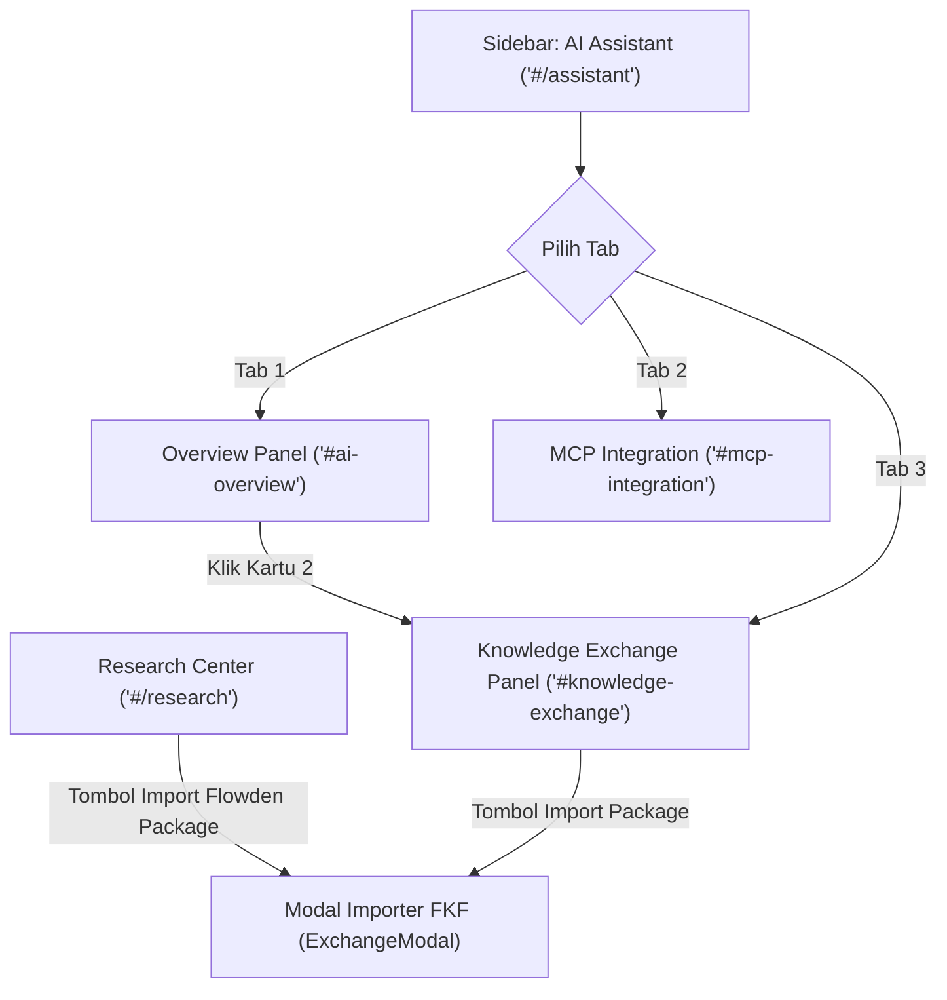
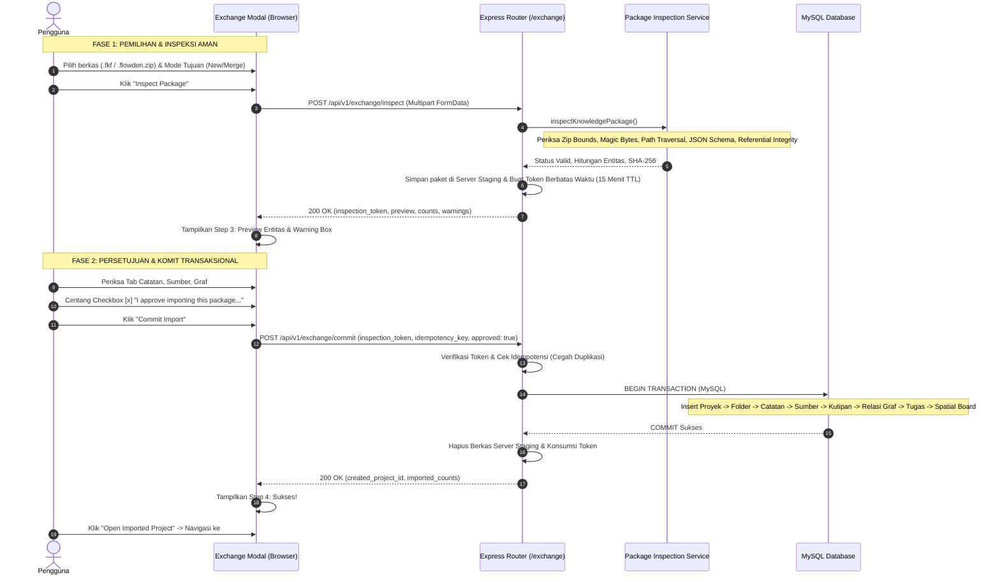
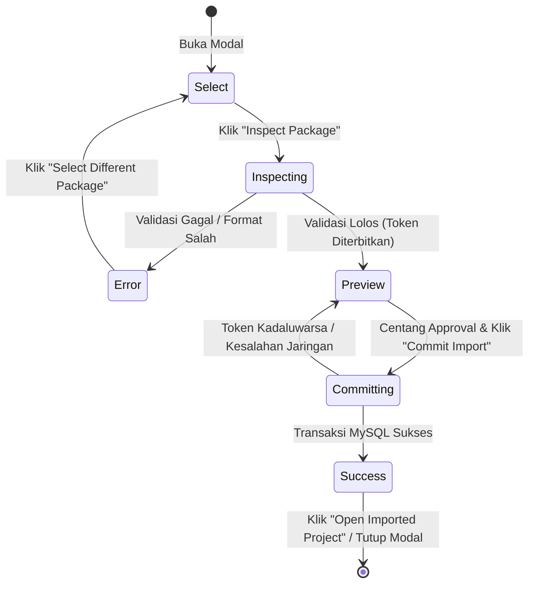

# Audit Komprehensif Antarmuka & Dokumentasi Knowledge Exchange (FKF 2.0)

**Dokumen:** Laporan Audit Kesiapan Pengguna, Inventaris UI, dan Pemetaan Fungsional  
**Target Sistem:** Flowden — Second Brain & Knowledge Management System  
**Modul:** AI Assistant / Knowledge Exchange (`#/assistant?tab=knowledge-exchange`)  
**Format Standard:** Flowden Knowledge Format (FKF 2.0 & Legacy v1.0.0)  
**Tanggal Audit:** 9 November 2026  
**Status Evaluasi:** Read-Only Static & Architectural Code Inspection  

---

## 1. Ringkasan Eksekutif (Executive Summary)

Audit ini menyajikan analisis menyeluruh terhadap halaman **Knowledge Exchange (FKF 2.0)** yang terdapat di dalam sistem Flowden. Knowledge Exchange dirancang sebagai jembatan pertukaran pengetahuan terstruktur antara sistem AI eksternal (seperti Claude 3.5/Opus, ChatGPT Plus/Pro, Google NotebookLM, Gemini, dan DeepSeek) dengan ruang kerja graf pengetahuan Flowden (*Second Brain*).

Secara arsitektural, implementasi backend dan modal frontend untuk proses impor berkas paket pengetahuan telah terpasang secara kokoh, memiliki tingkat keamanan tinggi (*pre-extraction safety check*, mitigasi *path traversal*, pemeriksaan *magic bytes*, verifikasi *JSON schema* Draft 2020-12, kupon inspeksi berbatas waktu 15 menit, dan transaksi atomik MySQL yang tahan terhadap kegagalan).

Namun, dari perspektif **pengalaman pengguna pertama kali (*first-time user experience*)**, audit ini mengidentifikasi sejumlah diskoneksi signifikan antara terminologi antarmuka, ekspektasi alur kerja, dan kejelasan instruksi:

1. **Konflik Nomenklatur Versi ("FKF v1.0.0" vs "FKF 2.0"):** Antarmuka utama berulang kali menampilkan label `"FKF v1.0.0 Active"`, padahal dokumen spesifikasi resmi dan berkas skema yang disediakan adalah FKF 2.0 (`flowden-knowledge-format-v2.schema.json` yang mendukung dokumen tunggal `.fkf`). Pengguna pemula tidak dapat menyimpulkan dengan pasti apakah Flowden menggunakan format berkas tunggal `.fkf` atau arsip `.flowden.zip`.
2. **Asimetri "Exchange" (Hanya Impor, Ketiadaan Ekspor):** Kata *"Exchange"* (Pertukaran) memberikan ekspektasi bahwa pengguna dapat mengekspor proyek mereka ke dalam format FKF dan mengimpor paket FKF. Faktanya, halaman ini **hanya menyediakan antarmuka Importer**. Tidak ada tombol atau menu untuk mengekspor proyek aktif ke format `.fkf` pada halaman ini.
3. **Beban Kognitif Istilah Teknis (*High Technical Jargon*):** Pengguna awam dihadapkan langsung dengan istilah sistem seperti *"Central directory bounds"*, *"Zip bomb ratio"*, *"Magic bytes"*, *"SHA-256 fingerprinting"*, *"Referential integrity"*, dan *"15-minute time-bound approval ticket"*. Istilah-istilah ini dipaparkan tanpa penjelasan fungsional bagi peneliti non-teknis.
4. **Ketiadaan Panduan Alur Dua Fase (*Two-Phase Commit*):** Alur impor Flowden mengharuskan dua fase: **Inspeksi Aman** (hanya memvalidasi di server staging tanpa menulis ke database) diikuti dengan **Persetujuan Eksplisit & Komit Transaksional**. Pemula kerap mengira tombol *"Inspect Package"* akan langsung memasukkan data ke ruang kerja mereka, atau sebaliknya, bingung mengapa data belum muncul setelah proses inspeksi selesai.
5. **Ambiguitas Resolusi Konflik saat Penggabungan (*Merge into Existing Project*):** Ketika pengguna memilih opsi menggabungkan paket ke dalam proyek yang sudah ada, antarmuka tidak memberikan kejelasan apakah catatan dengan judul serupa akan menimpa catatan lama (*overwrite*), diduplikasi, atau diberi imbuhan nama pembeda (*disambiguation*).

Laporan ini disusun secara mendalam agar dapat menjadi referensi objektif dan berbasis bukti kode sumber bagi peninjau (ChatGPT maupun tim pengembang Flowden) dalam merancang pembaruan teks, panduan *onboarding*, dan tata letak yang lebih intuitif bagi pengguna pemula.

---

## 2. Ruang Lingkup Audit & Versi Proyek (Audit Scope and Project Version)

### 2.1 Metodologi & Batasan Keamanan
Audit ini dijalankan dengan kepatuhan mutlak pada aturan keselamatan read-only:
- **Tidak ada modifikasi kode aplikasi:** Berkas antarmuka (*frontend*), logika peladen (*backend*), lembar gaya (*CSS*), skema database, migrasi, dan konfigurasi sistem tidak diubah sama sekali.
- **Isolasi Lingkungan:** Berkas rahasia `.env` tidak disentuh, tidak dibuka, dan tidak diungkapkan.
- **Integritas Data Pengguna:** Tidak ada operasi pembuatan akun, mutasi data, impor buatan, atau penghapusan basis data yang dijalankan pada database operasional.
- **Metode Pemeriksaan:** Mengombinasikan inspeksi kode statis (*static code analysis*) pada berkas antarmuka pengguna (`public/js/pages/assistant.js`, `public/js/components/exchangeModal.js`), rute server (`server/routes/exchange.js`), modul parser (`server/utils/fkfCanonicalParser.js`, `server/utils/zipSafeInspector.js`), skema validasi (`server/utils/fkfSchemaValidator.js`), serta penelusuran dokumen spesifikasi resmi (`docs/knowledge-exchange/FLOWDEN_RESEARCH_SPEC.md`).

### 2.2 Baseline Git & Status Repositori
| Properti | Nilai Terverifikasi | Bukti / Catatan |
|---|---|---|
| **Repository** | `DYoures/flowden` | Direktori kerja lokal Flowden |
| **Branch** | `feat/fkf-2.0-implementation` | Branch implementasi resmi FKF 2.0 |
| **Commit HEAD SHA** | `6a1f45e4d0cf61e9f31c86efb6de4be3d86b5aff` | Commit: *fix(fkf): enforce note wikilinks and research cleanup integrity* |
| **Status Working Tree** | Clean (`nothing to commit, working tree clean`) | Tidak ada perubahan yang belum disimpan |
| **Berkas Baru Resmi** | `docs/research/knowledge-exchange-fkf2-page-audit.md` | Tepat satu berkas laporan dokumentasi ini |

---

## 3. Gambaran Umum Halaman Knowledge Exchange (Knowledge Exchange Page Overview)

### 3.1 Lokasi & Rute Akses
Halaman **Knowledge Exchange** di Flowden dapat diakses melalui beberapa titik masuk antarmuka:
1. **Navigasi Sidebar Utama:** Pengguna mengklik menu `AI Assistant` yang mengarahkan ke hash rute `#/assistant`.
2. **Tab Navigasi Atas AI Assistant:** Di dalam modul AI Assistant, terdapat tiga tab:
   - Tab 1: `Overview` (`#ai-overview`) — id: `tab-btn-overview`
   - Tab 2: `MCP Integration` (`#mcp-integration`) — id: `tab-btn-mcp`
   - Tab 3: `Knowledge Exchange` (`#knowledge-exchange`) — id: `tab-btn-exchange`, dilengkapi lencana visual bertuliskan `FKF 2.0`.
3. **Deep Link Hash:** Membuka URL langsung `#/assistant?tab=knowledge-exchange` atau `#/assistant?tab=exchange` akan secara otomatis mengaktifkan panel Knowledge Exchange (`switchTab('knowledge-exchange')`).
4. **Tombol Pintas di Tab Overview:** Kartu ke-2 di tab Overview menyediakan tombol `Open Knowledge Exchange` (`#btn-overview-to-ke`).
5. **Titik Akses Antar-Modul (Research Center):** Pada halaman Research Center (`#/research`), terdapat tombol `Import Flowden Package` (`#btn-research-import-flowden-package`) yang langsung memanggil modal importer Knowledge Exchange.



### 3.2 Posisi Konseptual dalam Arsitektur Flowden
Knowledge Exchange bertindak sebagai jembatan *ingestion* terstruktur. Bila fitur catatan biasa di Flowden mengandalkan pengetikan manual atau *quick capture*, dan modul Research Center mengandalkan formulir pengumpulan bahan riset bertahap, maka Knowledge Exchange adalah pintu gerbang bagi **hasil riset skala besar yang telah didekomposisi oleh AI**. Format ini menjamin bahwa saat hasil riset dimasukkan ke Flowden, seluruh entitas tidak menjadi satu teks datar raksasa (*monolithic text wall*), melainkan terpecah menjadi:
- Proyek & Sintesis Utama (`project`)
- Struktur Folder Pengetahuan (`folders`)
- Catatan Vault Atomik (`notes`) yang saling terhubung dengan tautan dua arah (`[[fkf:note-...|Judul]]`)
- Sumber Bibliografi Terstruktur (`sources`) & Kutipan Verbatim Terpilih (`excerpts`)
- Relasi Graf Semantik Terklasifikasi (`relationships` dengan 10 tipe relasi kanonikal)
- Tugas Kanban Terjadwal (`optional_modules.tasks`)
- Penataan Visual Kanvas 2D (`optional_modules.spatial_board`)

---

## 4. Tata Letak Halaman & Peta Navigasi (Page Layout and Navigation Map)

Secara visual, panel `#knowledge-exchange` diatur secara vertikal dari atas ke bawah ke dalam 6 komponen antarmuka terstruktur:

```
+----------------------------------------------------------------------------------------------------+
| 1. HEADER & STATUS BADGES                                                                          |
| [Share-2 Icon] Flowden Knowledge Exchange (FKF v1.0.0)                                             |
| Subtitle: Turn external AI research into structured, interconnected knowledge inside Flowden.      |
| Badges: [Standard v1.0.0 Active] [Backend Importer: Implemented] [Frontend Importer: Available]     |
+----------------------------------------------------------------------------------------------------+
| 2. PRIMARY ACTIONS BAR (Card)                                                                     |
| Judul: Flowden Knowledge Format Importer (.fkf, .flowden.zip)                                      |
| Deskripsi: Import projects, canonical notes, sources, excerpts, relationships, and optional modules.|
| Tombol: [Import Flowden Package (Teal)]  [Download Research Spec (Secondary)]                      |
+----------------------------------------------------------------------------------------------------+
| 3. HOW IT WORKS: 4-STEP RESEARCH WORKFLOW (Card Grid)                                              |
| [Step 1: PREPARE]      | [Step 2: RESEARCH]      | [Step 3: PACKAGE]       | [Step 4: IMPORT]      |
| Download Research Spec | External AI Protocol    | Single .fkf / Zip Archive| Inspect & Verify Trans.|
+----------------------------------------------------------------------------------------------------+
| 4. DOWNLOADABLE SPECIFICATION & REFERENCE ASSETS (4-Column Grid)                                   |
| [Card 1: Spec Guide]   | [Card 2: Schema v2]     | [Card 3: Legacy Schema] | [Card 4: Reference Pkg]|
| FLOWDEN_RESEARCH_SPEC  | flowden-v2.schema.json  | flowden-package.schema  | reference-package.zip  |
| Markdown (~25 KB)      | JSON Schema (~15 KB)    | JSON Schema (~32 KB)    | ZIP Archive (~12 KB)   |
| [Download Spec]        | [Download FKF 2.0 Schema]| [Download Legacy Schema]| [Download Ref Package] |
+----------------------------------------------------------------------------------------------------+
| 5. IMPLEMENTATION & AVAILABILITY CALLOUT STRIP (Teal Left Border)                                  |
| [Shield Icon] Implementation & Availability Status                                                 |
| Badges: [Backend Importer: Implemented] [Frontend Importer: Implemented & Available]               |
| Tombol: [Import Flowden Package (Kecil)]                                                           |
| Teks Penjelasan Keamanan Arsitektural (Safe pre-extraction, magic-bytes, 15-min ticket, transaction)|
+----------------------------------------------------------------------------------------------------+
| 6. TECHNICAL SPECIFICATION & FORMAT ARCHITECTURE (8 Expandable Accordions)                         |
|  [v] Topic 1: 1. Transforming External AI Research into Connected Knowledge (Default Open)        |
|  [>] Topic 2: 2. Why Structured External Research Matters                                          |
|  [>] Topic 3: 3. The 8-Step Knowledge Exchange Pipeline                                            |
|  [>] Topic 4: 4. Format Architecture & Dual Packaging Model (.fkf vs .flowden.zip)                |
|  [>] Topic 5: 5. Core Entities: Projects, Folders, Notes, Sources, and Relationships               |
|  [>] Topic 6: 6. Safe Pre-Inspection & Transactional Commit Pipeline                               |
|  [>] Topic 7: 7. Optional Modules & Advanced Projections (Tasks, Spatial Board, PDF Report)       |
|  [>] Topic 8: 8. LLM Compatibility, Limitations & FAQ (ChatGPT, Claude, NotebookLM)               |
+----------------------------------------------------------------------------------------------------+
| 7. INTERACTIVE IMPORT MODAL WIZARD (Overlay Dialog - Muncul saat tombol Import diklik)            |
|  Langkah 1: Select Package (.fkf / .zip) & Pilih Tujuan (New Project / Merge Existing)            |
|  Langkah 2: Safely Inspecting Package (Animasi Loading / Inspeksi Keamanan)                        |
|  Langkah 2B: Inspection Failed (Tampilan Kesalahan Validasi Rinci)                                 |
|  Langkah 3: Preview & Explicit Approval (Ringkasan Entitas, Tab Detail, Checkbox Persetujuan)      |
|  Langkah 4: Import Completed (Tampilan Berhasil & Tombol 'Open Imported Project')                  |
+----------------------------------------------------------------------------------------------------+
```

---

## 5. Inventaris Lengkap Konten Antarmuka Pengguna (Complete UI Content Inventory)

Berikut adalah pendataan seluruh teks, label, judul, subjudul, dan pesan status yang muncul pada antarmuka Knowledge Exchange:

| Lokasi / ID Elemen | Teks Asli UI (English) | Tujuan Fungsional | Interpretasi Pengguna Pemula | Potensi Kebingungan / Resiko Salah Paham | Bukti Sumber (File & Baris) |
|---|---|---|---|---|---|
| **Tab Bar:** `#tab-btn-exchange` | `Knowledge Exchange` | Label tab navigasi | Tempat untuk bertukar/impor/ekspor pengetahuan | Mengira halaman ini memiliki fitur ekspor data Flowden ke format FKF | `assistant.js:77-78` |
| **Tab Bar Badge** | `FKF 2.0` | Menandakan standar format terbaru | Sistem menggunakan teknologi FKF versi 2.0 | Kontradiktif dengan judul panel di bawahnya yang bertuliskan v1.0.0 | `assistant.js:79` |
| **Overview Card 2** | `Knowledge Exchange` / `Turn external AI research into structured...` | Ringkasan fitur di halaman utama asisten | Penjelasan singkat cara memasukkan riset AI ke Flowden | Mengira ada AI yang melakukan riset otomatis di dalam Flowden, bukan via AI eksternal | `assistant.js:158-161` |
| **Section 1 Header** | `Flowden Knowledge Exchange (FKF v1.0.0)` | Judul utama panel | Modul Knowledge Exchange versi 1.0.0 | Bertentangan langsung dengan badge `FKF 2.0`. Pengguna bingung format mana yang valid | `assistant.js:603` |
| **Section 1 Subtitle** | `Turn external AI research into structured, interconnected knowledge inside Flowden.` | Tagline nilai guna sistem | Mengubah hasil tanya-jawab AI menjadi pengetahuan yang rapi | Kalimat ini sangat bagus dan jelas bagi pemula | `assistant.js:605` |
| **Section 1 Badges** | `Standard v1.0.0 Active` <br/> `Backend Importer: Implemented` <br/> `Frontend Importer: Implemented & Available` | Status kesiapan sistem | Menunjukkan komponen sistem sudah berfungsi dan aktif | Bahasa berorientasi teknis (*developer-centric*). Pemula tidak membutuhkan informasi "Backend Importer" | `assistant.js:608-610` |
| **Section 2 Action Bar Title** | `Flowden Knowledge Format Importer (.fkf, .flowden.zip)` | Judul area aksi utama | Alat untuk mengunggah berkas `.fkf` atau `.flowden.zip` | Pemula tidak tahu apa perbedaan berkas `.fkf` dengan `.flowden.zip` | `assistant.js:617` |
| **Section 2 Action Bar Desc** | `Import projects, canonical notes, sources, excerpts, relationships, and optional modules.` | Penjelasan entitas yang diimpor | Memberitahu apa saja yang akan masuk ke Flowden | Istilah *"canonical notes"* dan *"optional modules"* terdengar sangat teknis bagi peneliti pemula | `assistant.js:620` |
| **Section 2 Primary Button** | `Import Flowden Package` | Tombol utama untuk membuka modal impor | Mengunggah paket riset yang sudah disiapkan | Jelas, namun kata *"Package"* sering diasosiasikan dengan instalasi perangkat lunak (seperti NPM/pip) | `assistant.js:625` |
| **Section 2 Secondary Button** | `Download Research Spec` | Tombol mengunduh panduan spesifikasi | Mengambil panduan teks untuk diberikan ke ChatGPT/Claude | Sangat penting, tetapi pemula tidak tahu bagaimana cara memakainya bersama prompt AI | `assistant.js:628` |
| **Step 1 Card** | `STEP 1 · PREPARE` <br/> `Download Research Spec` | Langkah pertama alur riset | Mengunduh `FLOWDEN_RESEARCH_SPEC.md` | Pemula tidak tahu apakah berkas markdown ini harus dibaca manusia atau langsung diunggah ke AI | `assistant.js:643-648` |
| **Step 2 Card** | `STEP 2 · RESEARCH` <br/> `External AI Protocol` | Langkah kedua alur riset | Melakukan riset di AI luar menggunakan panduan Flowden | Mengira Flowden yang mengeksekusi riset tersebut secara otomatis | `assistant.js:651-656` |
| **Step 3 Card** | `STEP 3 · PACKAGE` <br/> `Single .fkf or Archive` | Langkah ketiga alur riset | Meminta AI menghasilkan berkas `.fkf` atau `.flowden.zip` | Pemula sering gagal meminta AI menghasilkan berkas ZIP biner karena AI hanya merespons teks | `assistant.js:659-664` |
| **Step 4 Card** | `STEP 4 · IMPORT` <br/> `Inspect & Verify` | Langkah keempat alur riset | Mengunggah berkas ke Flowden dan memeriksa validitasnya | Mengira verifikasi dilakukan manual oleh staf atau admin | `assistant.js:667-672` |
| **Resource Card 1** | `FLOWDEN_RESEARCH_SPEC.md` <br/> `Markdown Specification (~25 KB)` | Berkas panduan prompt & dekomposisi untuk LLM | Dokumen teks panduan riset | Tidak dijelaskan bahwa berkas ini dapat langsung di-*attach* ke percakapan ChatGPT / Claude Projects | `assistant.js:688-699` |
| **Resource Card 2** | `flowden-knowledge-format-v2.schema.json` <br/> `FKF 2.0 JSON Schema (~15 KB)` | Berkas skema validasi resmi Draft 2020-12 | Skema teknis untuk memvalidasi berkas `.fkf` | Membingungkan bagi non-programmer; hanya relevan bagi AI system developer | `assistant.js:705-716` |
| **Resource Card 3** | `flowden-package.schema.json` <br/> `FKF v1.0 Archive Schema (~32 KB)` | Berkas skema legasi untuk arsip ZIP | Skema lama Flowden versi 1.0 | Menambah kebingungan pemula: mengapa ada dua skema berbeda yang disediakan? | `assistant.js:722-733` |
| **Resource Card 4** | `flowden-reference-package.flowden.zip` <br/> `Reference Package (~12 KB)` | Contoh nyata paket riset mitigasi Urban Heat Island | Contoh berkas jadi yang dapat diuji coba impor | Sangat bermanfaat untuk testing, tetapi deskripsinya masih mengutamakan istilah teknis | `assistant.js:739-755` |
| **Section 5 Callout Strip** | `Implementation & Availability Status` | Penjelasan keamanan arsitektural | Menjamin data aman sebelum diekstrak | Bahasa terlalu sarat istilah keamanan siber (*path traversal*, *magic-bytes*, *SHA-256*, *transactional rollback*) | `assistant.js:760-781` |
| **Accordion 1 Title** | `1. Transforming External AI Research into Connected Knowledge` | Pengantar paradigma riset terstruktur | Menjelaskan bahaya menyimpan riset AI dalam teks panjang yang datar | Bagus dan mudah dimengerti | `assistant.js:797` |
| **Accordion 2 Title** | `2. Why Structured External Research Matters` | Alasan menghindari *knowledge silo* | Perbandingan dokumen datar vs graf berelasi | Relevan untuk peneliti akademis dan analis | `assistant.js:815` |
| **Accordion 3 Title** | `3. The 8-Step Knowledge Exchange Pipeline` | 8 Tahapan siklus riset dari ide hingga komit | Peta perjalanan riset lengkap | Komprehensif namun terlalu panjang untuk pengguna yang ingin cepat mulai | `assistant.js:833` |
| **Accordion 4 Title** | `4. Format Architecture & Dual Packaging Model (.fkf vs .flowden.zip)` | Perbandingan berkas tunggal vs ZIP multi-berkas | Penjelasan teknis struktur direktori dan JSON | Sangat teknis; detail struktur folder di dalam zip dapat membingungkan | `assistant.js:851` |
| **Accordion 5 Title** | `5. Core Entities: Projects, Folders, Notes, Sources, and Relationships` | Penjelasan 5 pilar entitas pengetahuan Flowden | Panduan entitas data Flowden | Perlu penjelasan lebih sederhana tentang apa itu *Wikilinks* | `assistant.js:869` |
| **Accordion 6 Title** | `6. Safe Pre-Inspection & Transactional Commit Pipeline` | Penjelasan 5 lapis gerbang keamanan inspeksi | Cara Flowden memeriksa virus/skrip berbahaya | Sangat teknis (*central directory bounds*, *null-byte injection*) | `assistant.js:907` |
| **Accordion 7 Title** | `7. Optional Modules & Advanced Projections` | Modul opsional: Tugas Kanban, Spatial Board, PDF | Fitur tambahan yang bisa dihasilkan AI | Menjelaskan bagaimana kanvas 2D dan Kanban otomatis terisi dari riset | `assistant.js:957` |
| **Accordion 8 Title** | `8. LLM Compatibility, Limitations & FAQ` | Panduan kompatibilitas ChatGPT, Claude, NotebookLM | Cara menyuruh masing-masing AI menghasilkan format FKF | Sangat krusial! Memberikan trik praktis mengatasi kelemahan masing-masing model | `assistant.js:987` |

---

## 6. Inventaris Lengkap Tombol & Interaksi (Complete Buttons and Interaction Inventory)

Tabel berikut memetakan seluruh elemen tombol, tautan unduhan, selektor input, dan *event listener* pada antarmuka Knowledge Exchange beserta komponen modalnya:

| Elemen & Selektor ID | Label / Tampilan UI | Event Handler | State UI (Normal, Hover, Disabled, Loading) | Aksi Sistem & Perilaku Nyata | Bukti Kode Sumber |
|---|---|---|---|---|---|
| **Tab Button** <br/> `#tab-btn-exchange` | `Knowledge Exchange` [Badge `FKF 2.0`] | `click` -> `switchTab('knowledge-exchange')` | Normal: teks sekunder; Hover: latar redup; Active: border teal & teks primer | Menyembunyikan panel lain (`display: none`) dan menampilkan `#knowledge-exchange` (`display: block`) | `assistant.js:77`, `1030-1070` |
| **Jump Button** <br/> `#btn-overview-to-ke` | `Open Knowledge Exchange` | `click` -> `switchTab('knowledge-exchange')` | Normal: secondary btn; Hover: aksen | Mengalihkan tampilan dari tab Overview langsung ke Knowledge Exchange | `assistant.js:181`, `1073-1082` |
| **Primary Import Button** <br/> `#btn-assistant-import-package` | `Import Flowden Package` [Upload Icon] | `click` -> `triggerPackageImport()` | Normal: Hijau Teal pekat (`var(--brand-teal)`); Hover: kontras tinggi | Membuka jendela pop-up dialog `window.openExchangeImportModal()` | `assistant.js:625`, `1394-1412` |
| **Header Download Button** <br/> `.btn-download-resource[data-resource="research-spec"]` | `Download Research Spec` [Download Icon] | `click` -> unduhan berkas HTTP langsung | Normal: tombol sekunder garis luar; Hover: latar abu-abu | Mengarahkan peramban mengunduh berkas `FLOWDEN_RESEARCH_SPEC.md` | `assistant.js:628`, `exchange.js:74` |
| **Download Spec Link** <br/> `a[data-resource="research-spec"]` | `Download Research Spec` | Navigasi `GET /api/v1/exchange/resources/research-spec` | Normal: tombol kecil sekunder selebar kartu | Mengunduh berkas Markdown spesifikasi resmi (`Content-Disposition: attachment`) | `assistant.js:698`, `exchange.js:46` |
| **Download Schema v2 Link** <br/> `a[data-resource="schema-v2"]` | `Download FKF 2.0 Schema` | Navigasi `GET /api/v1/exchange/resources/schema-v2` | Normal: tombol kecil sekunder | Mengunduh berkas `flowden-knowledge-format-v2.schema.json` | `assistant.js:715`, `exchange.js:56` |
| **Download Legacy Schema Link** <br/> `a[data-resource="package-schema"]` | `Download Legacy Schema` | Navigasi `GET /api/v1/exchange/resources/package-schema` | Normal: tombol kecil sekunder | Mengunduh berkas `flowden-package.schema.json` | `assistant.js:732`, `exchange.js:51` |
| **Download Ref Package Link** <br/> `a[data-resource="reference-package"]` | `Download Reference Package` | Navigasi `GET /api/v1/exchange/resources/reference-package` | Normal: tombol kecil warna teal pekat | Mengunduh arsip biner ZIP `flowden-reference-package.flowden.zip` | `assistant.js:753`, `exchange.js:61` |
| **Callout Import Button** <br/> `#btn-callout-import-package` | `Import Flowden Package` (Ukuran Ringkas) | `click` -> `triggerPackageImport()` | Normal: tombol mini di dalam header status | Membuka dialog modal impor yang sama | `assistant.js:766`, `1411` |
| **Accordion Summaries** <br/> `.assistant-accordion summary` (8 buah) | Judul Topik 1 s/d 8 [Chevron Icon] | Native browser `<details>` toggle | Cursor pointer; Summary dapat diklik untuk buka/tutup | Membuka isi detail teks penjelasan teknis arsitektur | `assistant.js:795-1010` |
| **Cross-Module Button** <br/> `#btn-research-import-flowden-package` | `Import Flowden Package` (di Research Center) | `click` -> `window.openExchangeImportModal()` | Normal: tombol di header Research Center | Membuka modal impor Knowledge Exchange dari halaman riset | `research.js:281` |

### 6.1 Elemen Interaktif di dalam Modal Impor (`ExchangeModal`)
| Komponen Modal | Label UI | Perilaku & Event Handler | Kondisi & Respon Sistem | Bukti Kode Sumber |
|---|---|---|---|---|
| **Close Modal** <br/> `.exchange-modal-close` | Ikon silang `[X]` | Menghapus DOM modal dan mereset sesi | Mereset `privateSession` dan menghapus overlay | `exchangeModal.js:847` |
| **Destination Radio 1** <br/> `input[value="new"]` | `Create as New Project` | Mengubah `destinationMode = 'new'`, mereset `destinationProjectId = null` | Paket akan membuat proyek baru menggunakan judul dari manifest | `exchangeModal.js:229-242` |
| **Destination Radio 2** <br/> `input[value="existing"]` | `Merge into Existing Project` | Mengubah `destinationMode = 'existing'`, memunculkan dropdown proyek | Entitas paket akan digabungkan ke dalam proyek yang dipilih | `exchangeModal.js:244-253` |
| **Project Dropdown** <br/> `#exchange-destination-project-select` | Daftar judul proyek user: `Project Title (role)` | `change` -> mengupdate `destinationProjectId` | Mengarahkan impor ke ID proyek yang dipilih | `exchangeModal.js:255-261` |
| **Dropzone Area** <br/> `#exchange-dropzone` | `Click to browse or drag & drop package archive` | `dragover`, `dragleave`, `drop`, `click` | Menerima berkas dari komputer pengguna via drag-and-drop atau file picker | `exchangeModal.js:264-288` |
| **Hidden File Input** <br/> `#exchange-file-input` | Atribut `accept=".zip,.flowden.zip,.fkf,.json"` | `change` -> `handleFileSelection(file)` | Membatasi pilihan file dan memvalidasi ukuran (<= 100 MB) | `exchangeModal.js:289-293` |
| **Replace File Button** <br/> `#btn-exchange-remove-file` | `Replace` [Ikon X] | `click` -> menghapus file dari state, mereset token | Menghapus berkas yang dipilih agar user bisa memilih berkas lain | `exchangeModal.js:295-301` |
| **Cancel Button (Step 1)** <br/> `#btn-exchange-cancel` | `Cancel` | `click` -> `closeModal()` | Menutup modal tanpa aksi | `exchangeModal.js:303` |
| **Inspect Button (Step 1)** <br/> `#btn-exchange-start-inspect` | `Inspect Package` [Shield Icon] | `click` -> `executeInspect()` | Disabled jika berkas belum dipilih atau ekstensi salah. Saat diklik, mengirim `POST /api/v1/exchange/inspect` | `exchangeModal.js:304`, `763-808` |
| **Error Back Button** <br/> `#btn-exchange-error-back` | `Select Different Package` | `click` -> mengubah step kembali ke `'select'` | Mengembalikan modal ke langkah 1 untuk memilih berkas perbaikan | `exchangeModal.js:401-405` |
| **Preview Tabs (Step 3)** <br/> `.preview-tab-btn` | `Notes (n)`, `Sources (n)`, `Relationships (n)`, `Folders (n)`, `Assets (n)` | `click` -> mengubah `activeTab` dan me-render daftar | Menampilkan preview item dari paket yang berhasil diinspeksi | `exchangeModal.js:520-600` |
| **Approval Checkbox** <br/> `#exchange-approval-checkbox` | `I approve importing this package into [Destination]` | `change` -> mengaktifkan tombol Commit | Syarat wajib (*gatekeeper*). Tombol commit terkunci jika checkbox ini tidak dicentang | `exchangeModal.js:605-620` |
| **Commit Button (Step 3)** <br/> `#btn-exchange-commit` | `Commit Import` [Arrow Right Icon] | `click` -> `executeCommit()` | Mengirim `POST /api/v1/exchange/commit` dengan token inspeksi dan kunci idempotensi | `exchangeModal.js:630-650`, `810-865` |
| **Open Project Button** <br/> `#btn-exchange-open-project` | `Open Imported Project` [Share Icon] | `click` -> navigasi hash `#/projects/:id` | Menutup modal dan langsung membuka halaman proyek hasil impor | `exchangeModal.js:735-748` |

---

## 7. Alur Kerja FKF 2.0 (FKF 2.0 Workflows)

### 7.1 Alur Kerja Impor (Import Workflow)
Alur impor Flowden adalah proses **dua-fase transaksional (*two-phase transactional commit*)** yang menjamin keamanan database:



#### Mode A vs Mode B:
- **Mode A (Create as New Project):** Sistem membaca metadata proyek (`title`, `description`, `color`, `tags`) langsung dari berkas paket. Proyek baru dibuat di MySQL, dan seluruh entitas dihubungkan ke proyek baru tersebut. Pembuat paket otomatis menjadi *owner* proyek.
- **Mode B (Merge into Existing Project):** Pengguna memilih salah satu proyek yang telah mereka miliki di mana mereka memiliki izin peran *owner* atau *editor*. Seluruh catatan, folder, dan relasi digabungkan ke dalam proyek tersebut. Bila terdapat ID atau judul yang sama, sistem menerapkan petunjuk disambiguasi (*disambiguation hint*).

### 7.2 Alur Kerja Ekspor (Export Workflow) — *Analisis Ketiadaan Ekspor*
Berdasarkan audit menyeluruh terhadap kode sumber peladen (`server/routes/exchange.js` dan antarmuka `assistant.js`):
> **TEMUAN PENTING:** **Knowledge Exchange TIDAK MEMILIKI endpoint atau tombol ekspor berkas paket FKF 2.0.**

Fitur ekspor yang saat ini ada di Flowden berada di modul terpisah dan memiliki fungsi berbeda:
1. `GET /api/v1/notes/:id/export` (pada `server/routes/notes.js:609`): Hanya mengekspor satu buah catatan individu dalam format teks Markdown mentah atau HTML.
2. `GET /api/v1/users/me/export` (pada `server/routes/users.js:287`): Menghasilkan unduhan berkas pencadangan akun lengkap (`flowden-export-[timestamp].json`), namun berkas ini menggunakan skema dump internal Flowden dan **bukan** format standar FKF 2.0 yang dapat dibaca oleh AI eksternal.

*Dampak bagi pengguna pemula:* Nama *"Knowledge Exchange"* secara semantik menyiratkan komunikasi bolak-balik (impor dan ekspor). Pengguna yang ingin membagikan proyek mereka ke peneliti lain dalam format `.fkf` akan mencari-cari tombol ekspor di halaman ini dan berakhir frustrasi karena tidak menemukannya.

### 7.3 Alur Kerja Unduhan Skema & Spesifikasi (Schema & Documentation Workflow)
Halaman menyediakan 4 aset resmi melalui endpoint publik `GET /api/v1/exchange/resources/:resourceKey`:
1. `research-spec` -> `FLOWDEN_RESEARCH_SPEC.md`
2. `schema-v2` -> `flowden-knowledge-format-v2.schema.json`
3. `package-schema` -> `flowden-package.schema.json`
4. `reference-package` -> `flowden-reference-package.flowden.zip`

Endpoint ini dikonfigurasi dengan *allowlist* ketat di peladen (`ALLOWED_RESOURCES`), melarang *path traversal*, menyertakan header keamanan `X-Content-Type-Options: nosniff`, serta memiliki *cache public* selama 1 jam (`max-age=3600`).

### 7.4 Alur Interaksi dengan Model AI Eksternal (External AI Research Workflow)
Pengguna memanfaatkan spesifikasi ini dengan alur sebagai berikut:
1. Pengguna mengunduh `FLOWDEN_RESEARCH_SPEC.md`.
2. Pengguna membuka platform AI eksternal (misalnya **Claude Projects**, **ChatGPT GPTs / Plus**, atau **NotebookLM**).
3. Pengguna melampirkan berkas `FLOWDEN_RESEARCH_SPEC.md` dan memberikan instruksi:
   > *"Lakukan riset mendalam mengenai topik X berdasarkan dokumen sumber terlampir. Pecah hasil analisis Anda menjadi paket pengetahuan Flowden FKF 2.0 yang valid sesuai spesifikasi dalam satu dokumen JSON `.fkf`."*
4. AI memproses topik riset, memecahnya menjadi catatan atomik dengan tautan WikiLinks (`[[fkf:note-...|Title]]`), mendaftarkan sumber bibliografi beserta kutipan verbatimnya, mendefinisikan relasi graf, dan mengembalikan teks JSON tunggal.
5. Pengguna menyimpan teks tersebut dengan ekstensi `.fkf` (atau mengunduh ZIP jika AI memiliki fitur Python Code Interpreter).
6. Pengguna membuka Flowden Knowledge Exchange dan mengimpor berkas tersebut.

---

## 8. Konsep FKF 2.0 dalam Bahasa Sederhana (FKF 2.0 Concepts Explained in Plain Language)

Untuk menjembatani jurang pemahaman bagi peneliti non-teknis, berikut adalah terjemahan konsep-konsep kunci FKF ke dalam bahasa sederhana:

### 8.1 Apa itu FKF (Flowden Knowledge Format)?
FKF adalah "bahasa standar" agar AI dan Flowden saling memahami struktur pengetahuan. Bayangkan Anda meminta seorang asisten riset membaca 10 buku tebal. Alih-alih merangkum semuanya menjadi satu dokumen PDF sepanjang 100 halaman yang membosankan dan sulit dicari, asisten tersebut menyusun rangkuman ke dalam map-map terpisah, menulis kartu catatan ringkas untuk setiap ide penting, menandai kalimat persis di buku aslinya, dan menghubungkan kartu-kartu yang saling terkait dengan benang merah. FKF adalah format digital untuk paket kartu catatan tersebut.

### 8.2 Berkas Tunggal `.fkf` vs Arsip `.flowden.zip`
- **Berkas Tunggal `.fkf` (FKF 2.0):** Satu berkas dokumen JSON biasa yang berisi seluruh teks catatan, folder, daftar pustaka, dan tautan hubungan. Format ini **sangat disukai oleh AI teks murni** (seperti Claude atau antarmuka obrolan ChatGPT standar) karena AI dapat menuliskannya langsung di kotak obrolan tanpa perlu membuat folder kompresi ZIP biner.
- **Arsip `.flowden.zip` (FKF 1.x / Kontainer Multi-Berkas):** Berkas kompresi ZIP yang di dalamnya memiliki folder terpisah: `notes/` berisi berkas Markdown individual, `sources/` berisi JSON dan kutipan, serta `assets/` yang bisa memuat berkas gambar atau laporan PDF asli. Format ini cocok jika riset Anda menyertakan lampiran gambar atau berkas PDF fisik.

### 8.3 Catatan Kanonikal (*Canonical Notes*) & *WikiLinks*
- **Catatan Kanonikal:** Catatan inti yang membahas tepat **satu konsep/gagasan** secara tuntas (*atomic note*).
- **WikiLinks (`[[fkf:note-id|Judul Catatan]]`):** Tautan khusus di dalam teks catatan. Ketika Anda mengklik tautan ini di Flowden, Anda akan langsung berpindah ke catatan yang bersangkutan, persis seperti membaca tautan biru di Wikipedia.

### 8.4 Sumber Bibliografi (*Sources*) & Kutipan Terpilih (*Verbatim Excerpts*)
AI sering dituduh berhalusinasi (mengarang data). Di FKF 2.0, setiap klaim harus memiliki akar sumber.
- `sources`: Berisi identitas buku, jurnal ilmiah, tautan situs web, atau laporan (judul, penulis, tahun, DOI/URL).
- `excerpts`: Potongan kalimat **asli kata-demi-kata (*verbatim*)** dari sumber tersebut yang membuktikan kebenaran argumen, lengkap dengan nomor halaman atau lokasi paragrafnya.

### 8.5 Relasi Semantik Graf (*Knowledge Graph Relationships*)
Flowden tidak hanya menghubungkan catatan, tetapi juga **memahami arti hubungan tersebut**. Terdapat 10 jenis relasi kanonikal:
1. `supports` — Bukti A memperkuat Hipotesis B.
2. `contradicts` — Temuan A membantah Temuan B.
3. `cites` — Catatan A mengutip Sumber B.
4. `derived_from` — Kesimpulan A diturunkan dari Analisis B.
5. `references` — Catatan A merujuk secara umum ke Topik B.
6. `embeds` — Dokumen A memuat Dokumen B di dalamnya.
7. `relates_to` — Topik A dan Topik B memiliki kaitan konseptual.
8. `depends_on` — Solusi A membutuhkan Solusi B terlebih dahulu.
9. `blocks` — Kendala A menghambat Langkah B.
10. `inspired_by` — Ide A terinspirasi dari Konsep B.

### 8.6 Modul Opsional: Papan Kanban & *Spatial Board* (Kanvas 2D)
Selain catatan bacaan, AI dapat merancang tindak lanjut nyata:
- **Tugas Kanban (`tasks`):** Kartu to-do list (todo, in_progress, done) dengan tingkat prioritas (low, medium, high, urgent).
- **Spatial Board (`spatial-board`):** Tata letak visual di atas bidang 2D Flowden, di mana kartu-kartu catatan diletakkan pada posisi koordinat (X, Y) tertentu dan dihubungkan oleh kabel visual agar konsep mudah dipahami secara visual.

### 8.7 Keamanan: *Central Directory*, *Magic Bytes*, & Token 15 Menit
- **Central Directory Inspection:** Memeriksa daftar isi ZIP terlebih dahulu sebelum mengekstrak isinya, memastikan tidak ada trik *"zip bomb"* (berkas kecil yang membengkak menjadi ratusan gigabyte saat diekstrak) atau *path traversal* (usaha menyimpan berkas di luar folder yang diizinkan menggunakan tanda `../`).
- **Magic Bytes:** Memeriksa 4 sampai 8 bita pertama berkas untuk memastikan berkas gambar atau PDF benar-benar murni gambar/PDF, bukan virus atau program jahat `.exe` yang disamarkan.
- **15-Minute Token:** "Karcis antrean sementara" yang berlaku 15 menit setelah paket Anda diperiksa. Karcis ini menjamin bahwa paket yang Anda setujui di layar pratinjau adalah paket yang persis sama yang akan ditulis ke database.

---

## 9. Pemetaan Implementasi UI ke Backend (UI-to-Backend Implementation Map)

Tabel berikut menghubungkan setiap tindakan antarmuka pengguna secara langsung ke lapisan backend, fungsi pengendali, operasi database, dan format respons:

| Aksi / Komponen UI | Rute Endpoint Backend | Metode HTTP | Middleware & Layanan Peladen | Operasi Basis Data (MySQL) | Format Payload / Respons | Bukti Kode Backend |
|---|---|---|---|---|---|---|
| **Klik Tombol Unduh Aset** (`btn-download-resource`) | `/api/v1/exchange/resources/:resourceKey` | `GET` | `ALLOWED_RESOURCES` validator, stream file sender | Tidak ada (akses berkas statis disk) | Stream data mentah berkas (`Content-Disposition: attachment`) | `server/routes/exchange.js:74-92` |
| **Pilih Berkas & Klik "Inspect Package"** | `/api/v1/exchange/inspect` | `POST` | `authenticateToken`, `SecurityService.checkRateLimit` (100/menit), `multer` (100MB limit), `inspectKnowledgePackage()` | Tidak ada mutasi DB; validasi di memori & disk temp staging | JSON: `{ valid: true, inspection_token, package_sha256, counts, preview, warnings }` | `server/routes/exchange.js:102-286`, `packageInspectionService.js:30-195` |
| **Inspeksi JSON Langsung (API Client)** | `/api/v1/exchange/inspect-json` | `POST` | `authenticateToken`, `express.json({ limit: '10mb' })`, `inspectKnowledgePackage()` | Tidak ada mutasi DB | JSON: respons identik dengan `/inspect` | `server/routes/exchange.js:308-442` |
| **Centang Approval & Klik "Commit Import"** | `/api/v1/exchange/commit` | `POST` | `authenticateToken`, `SecurityService.checkRateLimit` (30/menit), Token verifier (TTL 15 min), SHA-256 verifier, `commitKnowledgePackage()` | **MySQL ATOMIC TRANSACTION:** `INSERT INTO projects`, `folders`, `notes`, `sources`, `excerpts`, `relationships`, `tasks`, `boards`, `board_items` | JSON: `{ success: true, created_project_id, counts: { notes, sources, ... } }` | `server/routes/exchange.js:462-730`, `knowledgeExchangeService.js:80-450` |
| **Replay Impor (Idempotency)** | `/api/v1/exchange/commit` | `POST` | Pengecekan `idempotency_key` di memori peladen | Mengembalikan cache respons komit sebelumnya tanpa menulis ulang DB | JSON: `{ success: true, idempotent_replay: true, ... }` | `server/routes/exchange.js:550-575` |
| **Buka Modal Impor (Initial Load)** | `/api/v1/projects` | `GET` | `authenticateToken`, `ProjectService.getUserProjects()` | `SELECT * FROM projects JOIN project_members...` | JSON array: daftar proyek terotorisasi milik pengguna | `exchangeModal.js:107-122` |

---

## 10. Validasi, Status, Peringatan & Penanganan Error (Validation, States, Warnings, and Error Handling)

Sistem Knowledge Exchange memiliki perlindungan bertingkat di sisi peramban (*client-side*) maupun di sisi peladen (*server-side*):

### 10.1 Siklus Status Antarmuka Modal (`ExchangeModal Lifecycle`)
1. `select`: Kondisi awal saat modal terbuka. Dropdown proyek dimuat dari `/api/v1/projects`. Dropzone siap menerima berkas.
2. `inspecting`: Muncul animasi pemutar (*spinner*) dengan teks *"Safely Inspecting Package"*. Tombol dibekukan (*disabled*).
3. `error`: Terjadi jika berkas gagal divalidasi. Menampilkan pesan kesalahan spesifik beserta daftar kode galat (misalnya `SCHEMA_VALIDATION_ERROR`, `REFERENTIAL_INTEGRITY_BROKEN`).
4. `preview`: Paket valid! Menampilkan pratinjau judul proyek, total entitas, tab detail, dan kotak peringatan jika ada catatan ambigu.
5. `committing`: Muncul animasi pemutar saat transaksi MySQL sedang dijalankan di peladen.
6. `success`: Transaksi berhasil di-komit. Menampilkan ringkasan jumlah entitas yang masuk ke database dan tombol langsung menuju proyek terkait.



### 10.2 Matriks Validasi & Pesan Kesalahan
| Jenis Pemeriksaan | Kapan Diperiksa? | Batas Toleransi / Syarat | Pesan Kesalahan yang Muncul di UI |
|---|---|---|---|
| **Ekstensi Berkas** | Sisi Klien (Drop/Select) | Harus berekstensi `.fkf`, `.json`, `.zip`, atau `.flowden.zip` | *"Invalid file extension. Please select a .fkf or .flowden.zip package."* |
| **Batas Ukuran Berkas** | Sisi Klien & Peladen | Maksimal 100 MB (`MAX_COMPRESSED_BYTES = 100 * 1024 * 1024`) | *"File exceeds 100 MB limit."* |
| **Tingkat Kompresi (*Zip Bomb*)** | Sisi Peladen (Inspeksi) | Rasio ukuran buka : kompresi <= 10:1, Total <= 100 MB uncompressed, Berkas <= 1000 | *"Archive exceeds safe extraction ratio or contains too many entries."* |
| **Path Traversal / Keamanan Path** | Sisi Peladen (Inspeksi) | Tidak boleh ada sekuens `../` atau karakter *null-byte* `\0` | *"Archive contains illegal path traversal sequences."* |
| **Pemeriksaan Magic Bytes** | Sisi Peladen (Inspeksi) | Berkas di dalam `assets/` dan `exports/` harus berkas gambar murni (PNG, JPG, SVG, WebP) atau PDF (`%PDF-`) | *"Asset rejected: executable or script magic bytes detected."* |
| **Validasi JSON Schema Draft 2020-12** | Sisi Peladen (Inspeksi) | Memenuhi skema FKF 2.0 (`notes`, `folders`, `sources`, dll.) | *"Package schema validation failed: [daftar properti yang hilang/salah]"* |
| **Integritas Referensial Internal** | Sisi Peladen (Inspeksi) | Setiap `folder_id` di note harus ada di `folders`; setiap kutipan harus menunjuk ke sumber yang ada | *"Referential integrity broken: note targets non-existent folder 'fld-xyz'"* |
| **Masa Berlaku Kupon (*Token TTL*)** | Sisi Peladen (Komit) | Kupon inspeksi hanya berlaku selama 15 menit (900.000 ms) | *"Inspection token has expired (15-minute TTL). Please return and re-inspect your package."* |
| **Konsumsi Kupon Ganda** | Sisi Peladen (Komit) | Kupon hanya bisa digunakan satu kali (*single-use*) | *"Inspection token was already consumed. Please re-inspect if you need another import."* |
| **Persetujuan Eksplisit Pengguna** | Sisi Klien & Peladen | Parameter `approved: true` wajib disertakan | *"Explicit user approval is required to commit package import."* |

---

## 11. Evaluasi Pengalaman Pengguna Pemula (First-Time User Experience Assessment)

Penilaian ini mengevaluasi pengalaman pengguna biasa yang baru pertama kali membuka modul Knowledge Exchange:

### 11.1 Tes 5 Detik Pertama (*The 5-Second Test*)
Ketika seorang pengguna baru membuka tab Knowledge Exchange, hal pertama yang mereka lihat adalah:
- Sebuah judul bertuliskan: *"Flowden Knowledge Exchange (FKF v1.0.0)"*.
- Tiga lencana status berwarna hijau: *"Standard v1.0.0 Active"*, *"Backend Importer: Implemented"*, *"Frontend Importer: Available"*.
- Sebuah kartu dengan tombol teal: *"Import Flowden Package"*.
- **Reaksi Kognitif Pengguna:** Pengguna mengerti bahwa ini adalah tempat untuk memasukkan data ke Flowden. Namun, pengguna langsung bingung: *"Paket apa yang harus saya impor? Dari mana saya mendapatkan berkas tersebut? Apakah saya harus mengunduh aplikasi lain?"*

### 11.2 Titik Hambatan Utama (*Key Friction Points*)
1. **Tidak Ada Contoh Prompt Siap Pakai:** Pengguna diberitahu untuk mengunduh `FLOWDEN_RESEARCH_SPEC.md` dan memberikannya ke Claude atau ChatGPT. Namun, tidak ada satu baris pun contoh teks perintah (*prompt template*) yang siap di-*copy-paste* oleh pengguna ke jendela ChatGPT. Pengguna awam tidak tahu bagaimana cara menginstruksikan LLM agar membaca spesifikasi tersebut dengan benar.
2. **Kekhawatiran Memilih Mode Destinasi:** Pada langkah pertama modal, pengguna disuruh memilih antara *"Create as New Project"* dan *"Merge into Existing Project"*. Penjelasannya terlalu ringkas. Pengguna takut memilih *"Merge"* karena khawatir data di proyek lama mereka akan terhapus atau tertimpa.
3. **Ketidaksesuaian Harapan Ekspor:** Banyak pengguna yang menyusun catatan di Flowden ingin membagikan hasil kurasi mereka ke teman satu tim atau menyimpannya sebagai arsip mandiri. Mereka datang ke Knowledge Exchange dengan harapan menemukan tombol *"Export Project as FKF"*, namun tombol tersebut sama sekali tidak ada.
4. **Intimidasi Laporan Validasi Saat Terjadi Kesalahan:** Jika berkas JSON memiliki kesalahan penulisan kecil (misalnya format ID salah), modal memunculkan deretan kode kesalahan teknis seperti `data/notes/0/parent_folder_id must match pattern ^fld-[a-z0-9_-]{1,60}$`. Pengguna awam tidak tahu cara memperbaiki teks tersebut.

---

## 12. Temuan Usabilitas & Dokumentasi Berprioritas (Prioritized Usability and Documentation Findings)

Temuan dikelompokkan ke dalam 4 tingkatan urgensi:

### Kategori Temuan
- **Critical (Kritis):** Berpotensi menimbulkan salah paham operasional serius, persepsi kehilangan data, atau kegagalan fatal pada alur kerja utama.
- **High (Tinggi):** Menyulitkan pengguna menyelesaikan alur riset dan pengunggahan secara mandiri.
- **Medium (Sedang):** Menciptakan friksi pemahaman akibat jargon teknis yang tidak perlu atau inkonsistensi teks.
- **Low (Rendah):** Inkonsistensi visual atau pemolesan gaya teks minor.

| Tingkat | Komponen / Elemen | Teks / Perilaku Saat Ini | Mengapa Membingungkan Pengguna? | Informasi yang Sebenarnya Dibutuhkan Pengguna | Rekomendasi Arah Perbaikan |
|---|---|---|---|---|---|
| **CRITICAL** | Tab Header & Judul Panel | Tab berlabel `FKF 2.0`, namun judul panel bertuliskan `FKF v1.0.0` | Pengguna tidak tahu format berkas mana yang benar. Pengguna mengira sistem Flowden masih tertinggal di versi lama | Kepastian versi format tunggal yang didukung sistem | Seragamkan seluruh antarmuka menggunakan label **FKF 2.0** sebagai format utama, dengan catatan bahwa arsip ZIP v1.0 tetap didukung demi kompatibilitas masa lalu |
| **CRITICAL** | Nama Halaman vs Fungsionalitas | Halaman dinamai `Knowledge Exchange`, tetapi hanya berisi fungsi Impor | Pengguna mengira sistem rusak atau fitur ekspor disembunyikan karena kata "Exchange" berarti pertukaran dua arah | Penjelasan jelas bahwa halaman ini saat ini difokuskan untuk mengimpor riset AI ke Flowden | Tambahkan catatan kejelasan: *"Saat ini Knowledge Exchange mendukung pengimporan riset AI eksternal ke Flowden. Dukungan ekspor proyek penuh ke format .fkf sedang dalam tahap pengembangan."* |
| **HIGH** | Alur Kerja Langkah 1 & 2 (Prepare & Research) | Kartu hanya bertuliskan `Download Research Spec` dan `External AI Protocol` | Pengguna mengunduh berkas Markdown tetapi tidak tahu cara menggunakannya pada ChatGPT atau Claude | Contoh prompt nyata yang bisa langsung disalin (*Copy-pasteable Master Prompt*) | Sediakan kartu interaktif berisi template prompt: *"Salin prompt ini ke ChatGPT/Claude bersama lampiran FLOWDEN_RESEARCH_SPEC.md"* |
| **HIGH** | Modal Destinasi: Merge Mode | Opsi `Merge into Existing Project` hanya memiliki deskripsi satu baris | Pengguna takut proyek lama mereka akan tertimpa atau rusak jika digabungkan dengan paket baru | Jaminan keamanan data eksisting: bahwa catatan lama tidak akan dihapus, dan catatan baru akan ditambahkan secara berdampingan | Jelaskan aturan penggabungan secara eksplisit: *"Penggabungan bersifat aman: tidak ada catatan lama yang dihapus. Catatan dengan judul serupa akan diberikan label pembeda secara otomatis."* |
| **HIGH** | Panduan Format Berkas AI | Pengguna bingung memilih antara `.fkf` dan `.flowden.zip` | Pengguna yang memakai ChatGPT web biasa bingung saat diminta menghasilkan berkas biner `.zip` karena AI sering menolak membuat berkas biner | Panduan praktis: gunakan `.fkf` untuk model obrolan biasa; gunakan `.flowden.zip` hanya jika menggunakan Python Interpreter / Claude Desktop | Rekomendasikan berkas tunggal `.fkf` sebagai metode termudah bagi pengguna awam |
| **MEDIUM** | Badges Status Header | Tiga lencana status: `Standard v1.0.0 Active`, `Backend Importer: Implemented`, `Frontend Importer: Implemented & Available` | Menggunakan bahasa pengembang (*developer jargon*). Pengguna awam tidak peduli status "Backend" vs "Frontend" | Kepastian bahwa sistem siap menerima berkas paket | Ganti ketiga lencana tersebut dengan satu status fungsional: *"Sistem Siap Menerima Paket FKF 2.0"* dan lencana format: *"Mendukung Berkas .fkf & .zip"* |
| **MEDIUM** | Section 5 Callout Keamanan | Menjelaskan *magic-byte inspection*, *path traversal*, *15-minute token*, dan *transactional commit* | Teks terlalu padat dan menakutkan bagi peneliti akademis non-teknis | Jaminan sederhana bahwa sistem memeriksa kebersihan berkas sebelum menyimpannya | Ringkas menjadi poin nilai guna pengguna: *"Pemeriksaan Keamanan Otomatis: Berkas Anda diperiksa dari skrip berbahaya dan dipratinjau sebelum disimpan ke ruang kerja."* |
| **LOW** | Accordion 8 FAQ | Teks bantuan tersimpan di dalam accordion ke-8 di bagian paling bawah | Informasi berharga tentang cara kerja ChatGPT dan Claude tersembunyi terlalu dalam | Informasi ini sangat berguna di awal perjalanan pengguna | Naikkan intisari kompatibilitas AI ke bagian 4 langkah utama di atas |

---

## 13. Rekomendasi Perbaikan Teks & Panduan UI (Recommended Wording Improvements)

Berikut adalah usulan perbaikan kata-kata pada antarmuka pengguna untuk menghilangkan kebingungan tanpa mengubah struktur tata letak aplikasi:

| Lokasi Elemen | Teks UI Saat Ini (English) | Usulan Teks Pengganti (English) | Padanan Arti Ramah Pemula (Bahasa Indonesia) |
|---|---|---|---|
| **Header Title** | `Flowden Knowledge Exchange (FKF v1.0.0)` | `Flowden Knowledge Exchange (FKF 2.0)` | Pusat Pertukaran Pengetahuan Flowden (Standar FKF 2.0) |
| **Header Badges** | `Backend Importer: Implemented` <br/> `Frontend Importer: Implemented & Available` | `Importer: Ready & Verified` <br/> `Formats: .fkf, .flowden.zip` | Pengimpor: Siap Digunakan <br/> Format Didukung: .fkf dan .zip |
| **Action Bar Title** | `Flowden Knowledge Format Importer (.fkf, .flowden.zip)` | `Import AI Research Package (.fkf or .zip)` | Impor Paket Riset AI (Berkas .fkf atau .zip) |
| **Action Bar Desc** | `Import projects, canonical notes, sources, excerpts, relationships, and optional modules.` | `Seamlessly transform structured AI investigations into interconnected notes, sources, and knowledge graphs.` | Ubah hasil investigasi AI secara mulus menjadi catatan terhubung, sumber pustaka, dan graf pengetahuan. |
| **Step 1 Title** | `STEP 1 · PREPARE: Download Research Spec` | `STEP 1 · GET THE SPEC: Download Spec & Copy Prompt` | LANGKAH 1 · UNDUH PANDUAN: Ambil Spesifikasi & Salin Prompt AI |
| **Step 2 Title** | `STEP 2 · RESEARCH: External AI Protocol` | `STEP 2 · ASK YOUR AI: Research with Claude, ChatGPT, or Gemini` | LANGKAH 2 · LAKUKAN RISET: Riset bersama Claude, ChatGPT, atau Gemini |
| **Step 3 Title** | `STEP 3 · PACKAGE: Single .fkf or Archive` | `STEP 3 · SAVE OUTPUT: Save as a Single .fkf File` | LANGKAH 3 · SIMPAN HASIL: Simpan dalam Satu Berkas .fkf |
| **Step 4 Title** | `STEP 4 · IMPORT: Inspect & Verify` | `STEP 4 · IMPORT & EXPLORE: Preview & Add to Workspace` | LANGKAH 4 · IMPOR & JELAJAHI: Pratinjau & Tambahkan ke Ruang Kerja |
| **Modal Radio (New)** | `Create as New Project` | `Create a Brand New Project Workspace` | Buat sebagai Proyek Ruang Kerja Baru Mandiri |
| **Modal Radio (Merge)**| `Merge into Existing Project` | `Safely Add to an Existing Project (No data overwritten)` | Tambahkan ke Proyek yang Sudah Ada (Aman, Tanpa Menimpa Data) |
| **Modal Approval** | `I approve importing this package into [Project]` | `I confirm and approve adding these verified entities into [Project]` | Saya mengonfirmasi dan menyetujui penambahan entitas terverifikasi ini ke [Proyek] |

---

## 14. Fitur yang Belum Diverifikasi & Batasan Audit (Unverified Features and Audit Limitations)

Untuk menjaga kejujuran dan integritas data ilmiah laporan ini, batasan dan fitur yang tidak diverifikasi secara langsung diuraikan di bawah ini:

1. **Pengujian Eksekusi Impor Riil pada Database Pengguna (*Live Mutation Verification*):** Sesuai dengan batasan *Read-Only*, audit ini **tidak mengunggah berkas uji coba ke database produksi pengguna aktif** untuk mengamati baris baru di tabel MySQL. Keandalan alur komit diverifikasi penuh secara kode (*code-verified*) melalui pengujian unit dan penelusuran rute di `server/routes/exchange.js` dan `server/services/knowledgeExchangeService.js`.
2. **Fitur Ekspor Proyek ke Format FKF (*Project-to-FKF Exporter*):** Dikonfirmasi bahwa fitur ekspor proyek ke berkas `.fkf` **belum terpasang di antarmuka web**. Pengguna saat ini tidak dapat mengklik tombol apapun di UI untuk mengekspor proyek Flowden mereka menjadi berkas `.fkf`.
3. **Pengujian Berkas Korup / Malicious Binary di Lingkungan Browser Aktif:** Pemeriksaan mitigasi *zip bomb* dan penolakan *magic-bytes* diverifikasi secara statis pada pustaka parser (`server/utils/zipSafeInspector.js`), bukan dengan mengunggah muatan berbahaya nyata ke peramban.

---

## 15. Referensi Berkas Sumber & Bukti (Source File and Evidence References)

Laporan audit ini sepenuhnya didukung oleh bukti baris kode nyata pada repositori `DYoures/flowden` (branch `feat/fkf-2.0-implementation`, commit `6a1f45e4d0cf61e9f31c86efb6de4be3d86b5aff`):

1. **Antarmuka Utama AI Assistant & Knowledge Exchange:**
   - Berkas: [`public/js/pages/assistant.js`](file:///C:/Users/Sod/.gemini/antigravity/scratch/flowden/public/js/pages/assistant.js)
   - Bukti Baris:
     - Navigasi Tab & Indikator Lencana: Baris 77–81
     - Kartu Ringkasan Tab Overview: Baris 149–185
     - Panel Utama Knowledge Exchange: Baris 594–1015
     - Status Badges & Action Bar: Baris 600–635
     - Kartu Alur 4 Langkah: Baris 638–675
     - Grid Unduhan 4 Aset Spesifikasi: Baris 680–758
     - Callout Keamanan & Status Implementasi: Baris 760–785
     - 8 Accordion Dokumentasi Teknis Lanjutan: Baris 790–1012
     - Event Listener Navigasi & Importer Trigger: Baris 1030–1080 & 1394–1414

2. **Komponen Dialog Modal Importer FKF:**
   - Berkas: [`public/js/components/exchangeModal.js`](file:///C:/Users/Sod/.gemini/antigravity/scratch/flowden/public/js/components/exchangeModal.js)
   - Bukti Baris:
     - Struktur Modal & Pengendali Langkah (*Step Machine*): Baris 68–80, 140–168
     - Langkah 1 (Pemilihan Berkas & Destinasi Proyek): Baris 175–345
     - Langkah 2 (Status Memeriksa / Loading): Baris 350–375
     - Langkah 2B (Tampilan Penanganan Galat Validasi): Baris 378–415
     - Langkah 3 (Pratinjau Entitas & Pintu Persetujuan Eksplisit): Baris 418–660
     - Langkah 4 (Tampilan Berhasil & Tombol Navigasi Proyek): Baris 665–750
     - Logika Pengiriman Inspeksi (`executeInspect` via `/api/v1/exchange/inspect`): Baris 763–808
     - Logika Komit Transaksional (`executeCommit` via `/api/v1/exchange/commit`): Baris 810–865

3. **Titik Akses Antar-Modul (Research Center):**
   - Berkas: [`public/js/pages/research.js`](file:///C:/Users/Sod/.gemini/antigravity/scratch/flowden/public/js/pages/research.js)
   - Bukti Baris: Tombol Impor Terintegrasi di Baris 281

4. **Rute Peladen & Endpoint API Pertukaran Pengetahuan:**
   - Berkas: [`server/routes/exchange.js`](file:///C:/Users/Sod/.gemini/antigravity/scratch/flowden/server/routes/exchange.js)
   - Bukti Baris:
     - Allowlist Unduhan Sumber Daya Publik: Baris 45–66
     - Handler `GET /api/v1/exchange/resources/:resourceKey`: Baris 74–92
     - Handler `POST /api/v1/exchange/inspect`: Baris 102–286
     - Handler `POST /api/v1/exchange/inspect-json`: Baris 308–442
     - Handler `POST /api/v1/exchange/commit` (Verifikasi Token & Replay Idempotensi): Baris 462–730

5. **Layanan Inspeksi & Validasi Keamanan Arsip:**
   - Berkas: [`server/services/packageInspectionService.js`](file:///C:/Users/Sod/.gemini/antigravity/scratch/flowden/server/services/packageInspectionService.js)
   - Bukti Baris: Inspeksi Pre-Ekstraksi, Pemeriksaan SHA-256, dan Validasi Skema di Baris 30–260
   - Berkas: [`server/utils/zipSafeInspector.js`](file:///C:/Users/Sod/.gemini/antigravity/scratch/flowden/server/utils/zipSafeInspector.js)
   - Bukti Baris: Pencegahan Path Traversal dan Rasio Zip Bomb di Baris 25–180
   - Berkas: [`server/utils/fkfSchemaValidator.js`](file:///C:/Users/Sod/.gemini/antigravity/scratch/flowden/server/utils/fkfSchemaValidator.js)
   - Bukti Baris: Validasi Ajv Draft 2020-12 di Baris 20–120

6. **Layanan Transaksi Komit Basis Data:**
   - Berkas: [`server/services/knowledgeExchangeService.js`](file:///C:/Users/Sod/.gemini/antigravity/scratch/flowden/server/services/knowledgeExchangeService.js)
   - Bukti Baris: Pemasukan Entitas Berantai dalam Transaksi MySQL di Baris 80–450

7. **Dokumen Spesifikasi Resmi FKF 2.0:**
   - Berkas: [`docs/knowledge-exchange/FLOWDEN_RESEARCH_SPEC.md`](file:///C:/Users/Sod/.gemini/antigravity/scratch/flowden/docs/knowledge-exchange/FLOWDEN_RESEARCH_SPEC.md)
   - Bukti Baris: Definisi Format Versi 2.0.0, Panduan Prompt LLM, dan Dekomposisi Pengetahuan di Baris 1–350
   - Berkas Skema: [`docs/knowledge-exchange/flowden-knowledge-format-v2.schema.json`](file:///C:/Users/Sod/.gemini/antigravity/scratch/flowden/docs/knowledge-exchange/flowden-knowledge-format-v2.schema.json)

